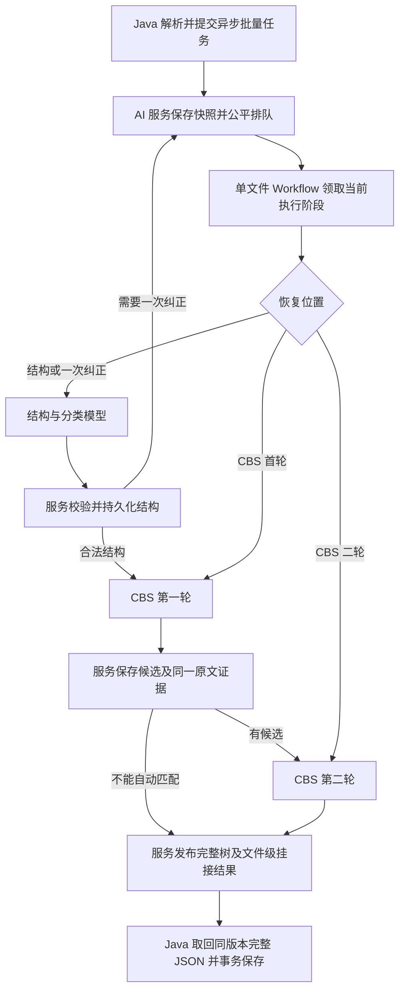

# Java 与 Dify 工程量结构树联调方案

本方案覆盖批量料表上传后的结构构建。Java 解析文件并提供 CBS 快照，Dify 中的大模型判断行关系、设备材料类型并完成两轮 CBS 语义匹配，AI 服务校验、组装树并通过结果接口把完整数据返回 Java。Java 校验、保存并向页面提供数据。定额匹配、价格匹配和金额计算沿用后续业务阶段。

文档状态为待实施方案，日期为 2026-10-27；本次为 22 节点精简修订。此前方案声称核对过作者本地资料；本次只依据上传材料修订方案文档，没有取得 Java/AI 服务实现、可运行的新应用 DSL，也没有连接 Dify 或运行真实模型。

实施边界已按用户要求固定：现有 Workflow 原样保留，另建独立的 Java 专用 Workflow，建议名称为“Java工程量结构树构建与CBS挂接”。新应用独立管理 App ID、API Key、草稿和发布版本。本文及配套文档中的节点调整只发生在新应用中，旧应用的节点、连线、提示词、环境变量及已发布版本均不改动。

接口字段与节点定义见[接口与节点契约](02-接口与节点契约.md)，实施顺序与验收方法见[搭建与验收](03-搭建与验收.md)。这些文档描述同一版方案，不是不同备选方案。

按画布实际操作时使用[新建 Java 专用 Workflow 的步骤](06-Workflow改造操作步骤.md)及[逐节点配置参考](07-Workflow逐节点配置参考.md)，其中列出现有节点在新应用中的复用方式、变量、HTTP 请求、失败连线和 Java 取回结果的方法。

## 需求依据和适用范围

本次用户要求优先于历史方案。用户已明确，Java 负责解析 DOC 和 PDF，Dify 负责模型理解，结果需要包含父子关系，并区分工程、分部、设备和主材。接口字段允许按实际实现调整。

本次更新按用户确认固定 CBS 顺序：先匹配最底层的单位工程名称，筛出候选后，再匹配这些候选的直接父节点名称。两轮均使用同一份料表的完整表头、专业和内部章节名称。匹配成功后整张料表挂到选中的单位工程，第二轮比较的父节点不作为最终挂接目标。

分类采用企业设备材料划分规则。用户已确认，图二仅是展示示例，不能因为截图中的蓄电池显示为主材，就把所有电池改成主材。现有代码的关键词分类也不是高于企业规则的依据。

原方案将业务数据、正式 UUID 和保存结果归于 Java，并以接口讨论稿为路由和字段起点；本版由 AI 服务按来源确定性组装并计算，Java 入库前校核。历史提示词和校验逻辑只是待核对的复用候选，不能覆盖新的业务要求。

本文只保证方案能够表达复杂料表。DOC 转换、扫描 PDF 的 OCR、表格列对齐和跨页续表均由 Java 解析链提供证据。模型不能恢复从未进入输入的文字。

## 保留现有语义判断链

此前方案描述的语义链包含逐行判断、程序校验组装、一次结构纠正和全量对账。本修订保留这些职责，批量调度与对账统一由 AI 服务承担；新 Workflow 一次仅处理一份文件。引用的旧实现不在本次附件中，其可复用性仍须实施时核对。

据原方案描述，本地 `semantic-output-lite-v2` 让模型返回 `role`、`parent`、`inherit` 和数量来源等十个字段。`semantic_v2.py` 根据这些判断回读原始行，生成节点、树和来源记录。`semantic-system-v3.4-scope.md` 进一步区分结构角色与采购范围。这比让模型直接写一整棵带数量、UUID 和长名称的树更容易校验。

本次拟在隔离的联调 Workflow 中复用经核对适用的上述逻辑，增加设备材料分类，并为 Java 输入建立适配层。旧 `v2` 输出契约保持原含义，新模型输出命名为 `semantic-java-quantity-v1`。不能只增加提示词，却继续使用不接收新增字段的旧 Schema 或归一化函数。

原方案称旧解析入口依赖 `parse_batch_id` 和解析服务目录，该实现未随附件提供。Java 已完成文件解析后，新的输入适配器直接建立语义输入包，不再上传同一份 DOC，不再重复转换文件，也不伪造旧解析目录。

## 职责和数据流



图中的纠正回到调度器表示本次运行先正常结束，再以同一 file job 的纠正阶段继续，不是画布中的循环。技术异常由 AI 服务回读已保存阶段，执行有界恢复；已有合法结构时，CBS 技术重试耗尽仍发布完整树。

Java 是业务状态的唯一写入方。AI 服务可以保存任务、输入快照和结果，用于执行、重试及排查，但不连接 smartCost 业务库。Dify 按 AI 服务给出的持久阶段动作串行执行模型，不生成业务数据库主键，也不直接更新 Java 的工程量记录。

AI 服务拟复用经核对适用的既有 Python 语义逻辑，新增 Java 输入适配和结果导出能力；可复用程度需取得实现后确认。Java 业务代码调用 `QuantityBuildClient` 一类的适配接口，实际类名由项目实现确定。Dify 应用地址、密钥及模型配置留在适配器配置中。

服务复用采用新增路由和独立契约：旧 `/v1/parse-test`、`/v1/semantic-lite` 路径及旧 Schema 保持兼容，新应用使用 `/internal/quantity` 路由和本方案的新 Schema。AI 服务调用 Dify 的配置单独使用 `QUANTITY_DIFY_API_BASE`、`QUANTITY_DIFY_API_KEY`，其中 Key 属于新应用。两套应用可位于同一 Dify 服务，但不通过修改旧应用的 Key、发布版本或输入格式完成切换。

## 行角色和业务类型是两种判断

行角色回答“这一行在原表里做什么”。业务类型回答“这个输出节点在工程量树里属于工程、分部、设备还是主材”。

业务类型增加 `PROJECT`，界面标识为“工程”。截图中的“西刘塬光伏场区（1.90216MWp）”就是工程范围节点；“安装部分”“光伏组件”等下级组织节点可以是分部。工程节点承载下级树，不作为一条设备或主材计量。名称中的装机容量保留原文，不能直接转成节点工程量。

例如，“电力电缆”是共同名称，下方两行分别写 240mm² 和 300mm²。这两行都挂在共同名称下面，但仍是两个独立材料对象。仅凭存在父节点，不能认定子节点不独立计量。

再如，光伏组件下面的工作电压是属性，配电柜下面明确列出的柜内接地导线是组成件。属性进入设备的属性信息，组成件保留为可展示的实物子节点。二者不能统一处理成“附属材料”。

本方案保留现有九种行角色，增加 `project`，共十种。`project` 表示有原文依据的工程范围节点，映射为 `PROJECT`。普通章节、共同名称和总分汇总节点仍映射为 `SUBSECTION`。独立对象、成套对象及组成件按企业规则映射为 `EQUIPMENT` 或 `MATERIAL`。属性和说明进入所属节点的附加内容及来源记录，不新增可计量的设备材料行。

模型根据标题含义、范围和下级组织关系区分 `project` 与 `section`，不能仅凭“位于第一行”“名称含工程”或“没有数量”确定为工程。工程标题只在表头时，Java 可将需要参与树构建的真实标题保留为有来源的原始标题行；仅作为匹配背景的表头不自动生成工程根。没有来源工程标题的文件仍可直接返回分部或实物根节点。

工程树节点的 `type=PROJECT` 与 CBS 挂接目标是不同字段。工程节点仍使用自己的 `resultKey` 和来源记录；`cbsMatch.projectCbsId` 继续指向两轮匹配选中的单位工程叶子。增加工程类型不改变整张料表只挂接一个 CBS 单位工程的规则。

无法确定结构时保留 `pending`。结构已确定但业务分类不明时保留原角色，业务 `type` 为空并记录分类待确认。缺数量不自动变成结构不明，采购范围不明也不自动变成数量不明。

## 模型如何判断父子关系

模型以单文件完整业务区为常规输入，读取文件表头、表格列定义、原始行序、名称、规格、数量、单位、备注及合并来源。短行号 `r` 只是模型引用键，不能替代原表的业务序号。

主项后的技术参数归为 `attribute`，父节点指向具体设备材料。模型必须说明参数归属，不能因为两行相邻就挂接。

共同名称下的多规格明细归为 `group → item`。规格行通过 `inherit` 引用提供共同名称的祖先，程序据此补齐名称。完整名称不再继承另一条完整规格名。

总项与明细归为 `summary → item`。父项数量只用于核对，子项数量分别保留。例如箱变总计 2 台，唯一规格明细也是 2 台，最终计量是 2 台。程序不能把两个数量相加，也不能把父总量复制给多个缺量规格。

明确的成套关系归为 `assembly → component`。组成件保持真实名称、类型、数量来源和所属成套对象。它是否参与后续单独取价，需要供货范围规则判断，不能由“主材”类型或父子缩进直接决定。

空序号不是属性的充分依据。有数量不是独立采购的充分依据。相同名称、相同数量也不是重复数据的充分依据。跨文件默认保留各自对象，不能把不同场区的同名电缆合并。

一行包含多个并列实物对象时，当前十字段模型不能凭空拆成多个 `r`。Java 解析器可以保留原始行，再建立有明确单元格来源的子行。如果仍无法可靠拆分，结果保留为待确认，并附原始内容，不把其中一个对象丢弃。

## 企业规则如何进入分类判断

AI 服务读取已审核的设备材料划分规则，固定规则版本，并向模型提供原文、适用条件和例外。联调时先使用完整的相关分类规则，不能只给规则编号，也不能仅靠关键词筛掉模型可能需要的条款。

模型针对 `item`、`assembly` 和 `component` 输出建议类型、规则编号、来源行和简短理由。程序校验编号是否属于本次规则版本、来源是否存在，以及是否与已确认结论冲突。规则编号存在只能证明引用有效，不能证明规则语义使用正确，分类质量仍需真实标注样本验证。

表类型作为上下文使用。设备表中的实物不一律判为设备，材料表中的实物也不一律判为主材。分类依赖当前对象的功能、供货边界和企业口径。没有适用依据时返回待确认，不能默认归为主材。工程和分部依据结构范围确定，设备和主材依据企业划分规则确定。

本轮没有取得经业务签认的分类规则发布包。因此，字段示例中的规则版本和规则编号是联调示例，不表示这些规则已上线。实施时把企业确认的版本接入同一契约。

## 向 Java 返回完整的嵌套树

模型仍只返回逐行判断。AI 服务先生成节点列表，校验重复键、悬空父节点、循环关系和来源覆盖，再由程序生成嵌套 `children`。文件结果接口直接返回 `data.tree` 根节点数组，每个节点包含名称、规格、数量、类型、来源以及 `children`，叶子的 `children=[]`。

节点仍保留 `resultKey`、`parentResultKey` 和 `sortNo`，与 `children` 由同一份已校验节点生成，禁止分别让模型生成两套关系。Java 遍历树，为全部节点分配 UUID，再把父节点键映射成正式 `parent_id`。后续页面可从 Java 保存结果生成自己的展示树。

同一响应还返回文件级 `data.cbsMatch`、原始行去向 `data.rowDispositions`、问题 `data.issues` 和版本信息。Dify 内部结束节点可以只传结果引用，但 AI 服务对 Java 的结果接口必须返回这些实际数据。仅返回任务 ID、结果地址或“处理完成”文字不算完成联调。

属性和说明保留在 `attributes`、`notes` 及行去向记录中。所有原始行都有去向，不要求每一行都变成树节点。业务类型未知的节点仍存在于构建结果与待确认视图，Java 不能将它强行保存为主材。正式表不允许空类型时，先写结果暂存，再由人工确认后提交正式节点。

## 固定分组与原始父子关系

需求文档要求 Java 为已挂接的 CBS 单位工程创建“设备”和“主材”两个固定分组。这两个分组的类型均为 `SUBSECTION`，由 Java 按项目 CBS 唯一创建。AI 返回的是来源料表的语义节点，不重复创建这两个固定分组。

页面使用一棵来源树和一个按 CBS 分类的展示结果。来源树保留模型确认的父子关系。Java 按最外层实物对象的类型，把整棵实物子树放入固定分组。配电柜属于设备时，柜内接地导线仍在柜下，并显示主材标识，不被搬走。

当纯分组下同时含有设备和主材时，Java 可以在两个固定分组下生成对应的展示分支。展示分支只引用来源节点，不复制实物业务记录。`summary` 的原总量不作为拆分后分支的小计。未知类型进入待确认区域，确认前不强行加入任一固定分组。

同一个工程量节点只能有一个业务记录，页面在不同视图中展示它不等于产生第二个计量对象。固定分组、来源分组和展示分支需要保留不同的节点来源标记。

来源树中存在 `PROJECT` 时，保留工程范围及其下级层级。工程节点不按实物类型归到“设备”或“主材”中，也不降格为 `SUBSECTION`。CBS 分类视图中的固定分组不改写来源树；界面已有的 CBS 单位工程展示根与来源工程节点分别记录身份，不能仅因名称相同就合并业务记录。

来源树可以包含以下层级。[工程节点样例](examples/project-node-case.json)给出相应的原始行、模型判断和返回树片段。

```text
西刘塬光伏场区（1.90216MWp）［工程，PROJECT］
	安装部分［分部，SUBSECTION］
		光伏组件［分部，SUBSECTION］
			光伏组件 620Wp［设备，EQUIPMENT；示例分类］
```

例如，成套配电柜按企业规则归为设备、柜内接地导线归为主材时，页面关系如下。这里的分类是示例条件，不代替企业规则。

```text
电气部分
	设备［分部，Java 固定分组］
		成套配电柜［设备］
			柜内接地导线［主材，柜内组成件］
	主材［分部，Java 固定分组］
		电力电缆［分部，来源共同名称］
			240mm² 电缆［主材］
			300mm² 电缆［主材］
```

## CBS 按两轮语义匹配确定

Java 提供三类来源：表头原文及解析字段（项目名称、场区名称、工程部分）、专业原文，以及内部“一、二、（一）、（二）”等章节名称与来源。Java 同时提供当前项目 CBS 节点的 ID、名称和父子关系，必须包含单位工程及其直接父节点名称。第一轮的“筛选数据”指筛选 CBS 候选，不删减料表行。

AI 服务据此固定一份 `match_context`。两轮传入的 `match_context` 内容和摘要必须相同；第二轮不改成只传场区，也不使用第一轮生成的摘要代替原文。两轮都进行语义判断，不能用名称包含或关键词命中代替。

| 轮次 | 料表证据 | 比较目标 | 输出 |
|---|---|---|---|
| 第一轮 | 完整表头、专业、全部内部章节名称 | 当前项目最底层单位工程名称 | 可能匹配的单位工程 ID 集合，保留同名但不同 ID 的候选 |
| 第二轮 | 与第一轮完全相同的料表证据 | 第一轮候选各自的直接父节点名称 | 唯一可确定的候选单位工程 ID，或未匹配 |

例如，表头含“西刘塬光伏场区”“电气部分”，专业为“电气”，内部章节为“一 光伏场区”。第一轮可以留下西刘塬与席兰村下两个名为“电气部分”的单位工程。第二轮仍读取以上全部信息，比较这两个候选的直接父节点名称，若能确定“西刘塬光伏场区”，最终返回它下面的“电气部分”单位工程 ID。这是匹配顺序示例，不是预置固定字符串规则。

第一轮没有候选时直接未挂接；有候选时必须经过第二轮，即使只剩一个候选。第二轮不能引入第一轮以外的节点。若多个单位工程属于同一匹配父节点，仍不能唯一确定单位工程，则保持未挂接，不能按数组顺序取第一项。

首轮在筛选前检查同名一致性：leaf_name 仅去除首尾空白后相同的候选必须有一致的 judgment。ID 不提供专业或场区证据。冲突时直接返回 CBS_OUTPUT_INCONSISTENT 未挂接结果，保留所有原始评价及完整来源树，不从冲突判断中任选一个进入第二轮。这不新增模型调用，也不改变 22 个核心节点。

每份文件只有一个 `cbsMatch`，结果作用于该文件的全部来源节点。内部章节既可参与原文树结构，也参与 CBS 匹配，但不据此把一份文件拆成多个挂接范围。章节表明多个互相冲突的工程范围时，返回 `SCOPE_CONFLICT` 并保留整棵树，交由人工处理。

多个候选无法区分、关键证据缺失或两轮证据冲突时，保留未挂接状态和原因。模型超时等技术错误另记执行失败，不能假称“语义不匹配”。只要来源树合法，CBS 未挂接或 CBS 执行失败均不丢弃树；结果仍返回 Java，页面归入“未挂接”，可使用现有“挂接”按钮。CBS 结果不单独把文件 semanticStatus 改为 REVIEW；结构、分类、数量及解析完整性决定该字段。Java 保存人工挂接，旧模型结果不能覆盖人工修正。

## 批量任务与恢复

Java 批量接口继续使用异步 job，按文件取回结果。一个新 dispatch 只绑定一份 file job 和一次实际 Dify 运行；多文件迭代、用户公平调度、幂等、运行追踪和对账均放在 AI 服务。

本修订采用 **22 个核心逻辑节点**，其中 3 个 LLM、6 个 HTTP、6 个响应读取 Code、5 个条件节点，以及 Start/End。三类模型分别承担结构与分类、CBS 单位工程名称、CBS 直接父节点名称判断。结构首轮与纠正使用同一个 LLM 节点、同一 System 和 Schema。

基准配置要求模型节点提供完整 `text`，直接用 HTTP raw body 发送给 AI 服务，由服务解析 JSON 并校验。若目标插件只提供结构化对象，则增加三个必要的序列化 Code 节点，总计 25 个；不得手拼 JSON 或取消校验来强行保持 22。

常规文件仍是一次 Dify 运行、三次模型调用；无 CBS 首轮候选时不调用第二轮。结构需要纠正时，服务先持久化非终态 REPAIR_REQUIRED，本次运行结束后派发 STRUCTURE_REPAIR，最多一次纠正，总模型调用通常为四次。技术重试单独计数，不能消耗或重置语义纠正预算。

恢复从 STRUCTURE_INITIAL、STRUCTURE_REPAIR、CBS_LEAF、CBS_PARENT 或 RETURN 中选择。输入与候选从服务快照回读；第二轮恢复不依赖本次运行曾经执行第一轮节点。已有成功阶段不再调用模型。End 只返回派发和文件任务身份，AI 服务对正常和异常结束均核对持久状态，不能把 End 或 workflow_finished 当作文件任务完成。

全服务最多 **4 个活跃单文件运行**作为未经压测的起点。取消原“每次 4 份、2 个活跃批次、批内并发 2”的三层配置，不叠加两套限制。共享凭据的旧 Workflow、技术重试和远端未确认结束的请求仍须计入供应方总额度；并发、RPM、TPM 和公平等待均需实测。

每个 file job 同时只有一个获准运行。启动握手绑定真实 workflow_run_id，不能把 dispatch_id 当作运行 ID。未知运行不得仅凭租约到期释放槽位。Java 通过持久后台任务发送、查询、取回并应用结果，页面关闭不影响闭环。

AI 服务还保存实际 task_id 和 dify_user，停止任务使用 task_id，运行查询使用 workflow_run_id。同一构建代次冻结 execution_config_id 及 workflow_id；纠正和恢复执行原发布版本。支持指定版本时调用对应版本接口，否则使用不可变的 Java 应用版本。现有 claim 和 reader 核对实际版本与冻结配置，不新增画布节点。完整契约见 02 §7.4。

每个构建代次只自动发布一次不可变文件结果。CBS 技术重试在发布前有界完成；发布后再次处理属于新构建意图和新 buildGeneration，可按版本一致性复用合法结构。Java 仍检查文件、CBS、规则、构建代次及人工修订，再按文件短事务保存。

超大结构输入尚未形成合法树时返回 FAILED/UNAVAILABLE 和 PACKET_TOO_LARGE；合法结构已存在而 CBS 容量超限时保留完整树并返回未挂接。跨包结构拼接仍是后续待实现能力。

## 本轮检查依据

此前方案引用了以下历史资料；本次未随附件提供，保留名称用于补齐依据，不能视作本次已经审查其实现。

- AI 服务接口讨论稿（历史引用，未随本包提供）。
- 系统开发需求文档（历史引用，未随本包提供）。
- 现有语义节点变量映射（历史引用，未随本包提供）。该文件是历史草稿回读，节点参数不代表当前部署。
- 语义提示词 v3.4（历史引用，未随本包提供）。
- 现有十字段 Schema（历史引用，未随本包提供）。
- 输入包和来源映射（历史引用，未随本包提供）。
- 语义校验与组装（历史引用，未随本包提供）。
- 现有对象分类代码（历史引用，未随本包提供）。原方案称其中存在关键词分类；本次未读取该实现，不将其当作已核实事实。

官方文档用于核实 Dify 的调用和节点能力。Workflow API 要求已发布工作流，支持阻塞响应和 SSE；本轮不发布应用。[Dify Workflow API](https://docs.dify.ai/en/api-reference/workflow-runs/run-workflow)

Iteration 支持数组迭代和并行处理，失败继续模式可能产生 `null`。LLM 支持结构化输出，但结构化格式不保证业务正确。[Iteration](https://docs.dify.ai/en/cloud/use-dify/nodes/iteration)、[LLM](https://docs.dify.ai/en/cloud/use-dify/nodes/llm)

当前官方文档可能新于项目部署版本。部署前以实际 Dify 版本和该应用的 API 文档核对可用字段，不能照搬新版本特有能力。
