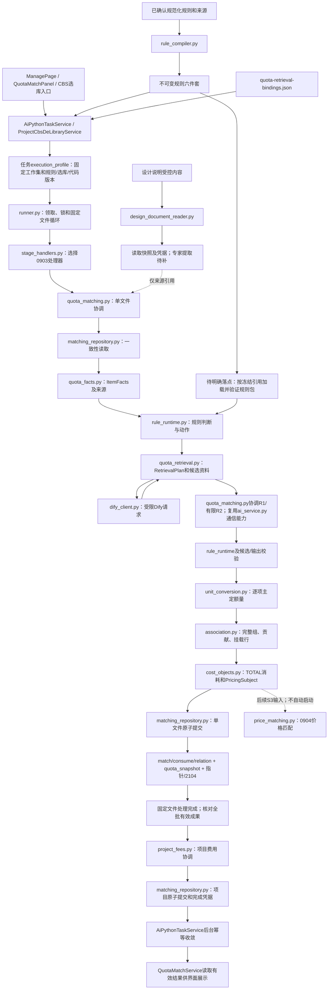

# 代码文件与调用链核对说明

> 历史核对说明：下文依据v1.11/v1.6，保留原审查时点；不是现行完整设计或实现完成证明。当前请读取[实施方案](实施方案.md)和[项目接入实施细则](项目接入实施细则.md)，跨语言交接见细则§8.6，审查取舍见[本次整合记录](../20261112-0903-independent-review-integration/report.md)。

核对日期：2026-11-12。依据：《实施方案.md》v1.11、《项目接入实施细则.md》v1.6。下文简称“主方案”“细则”。

这是对现有方案的从属阅读说明，不另立实施计划、不修改业务规则。原方案明确的内容标为“已有”；为连接分散章节所作的归纳标为“串读”；尚未明确的实现位置标为“待补/建议”。本文中的函数建议均不是已经存在的代码。此次只新增本说明，两份原方案及业务源码保持原样。

## 1. 核对结论

**方案已介绍拟新增文件，也有总体处理流程，但尚未为每个文件提供同等细度的实现说明。** 0903的业务算法、数据和事务合同已经相当具体；文件清单、函数职责、跨文件调用和界面入口分散在不同章节，需要合起来阅读。不能说“完全没有介绍”，也不能说“每个文件都已细化到可直接照着编码”。

| 用户关注点 | 核对结果 | 原方案位置 |
|---|---|---|
| 本次新增哪些Python文件 | 已有14个生产模块、4个提示词/Schema文件；已有文件的修改范围另列 | 细则§8.2，459—493行 |
| 每个Python文件怎么实现 | 编译器/运行器最详细；检索、关联、算量、事务细节在其他章节；阶段分发、加载器和模型调用函数边界还需补足 | 细则§4.4、§6、§8.1、§14、§25 |
| Java、前端新增文件 | 已有模型/DAO、DTO及条件新增组件清单；部分以组合名称或“对应API类型”描述，没有逐文件方法/字段映射 | 细则§8.3—§8.5，495—546行 |
| 数据库脚本和测试文件 | 已有4份拟定迁移及分层测试清单，迁移编号须实施时查重 | 细则§8.1.8、§24.2、§25.9 |
| 文件之间怎样连接 | 已有单向依赖、单文件伪代码、人工重算及项目费用时序；尚缺一张覆盖具体文件和交接数据的完整图 | 细则§8.2、§14.6—§14.9、§25.5—§25.7 |
| 价格匹配是否也达到同样细度 | 有业务流程、数量/金额合同及两个未来模块名，尚无完整的逐文件实现和持久化落点 | 主方案§10；细则§7、§10/S3、§17/E5 |

**范围需要特别分清：0903是定额匹配，0904是价格匹配。** 两份文档的总体目标覆盖二者，但最新版本明确“0904/0905算法不纳入此次0903代码实施范围”（主方案第8行、§17第7项）。因此，本次14个Python模块是0903清单；`price_catalog.py`和`price_matching.py`属于后续S3。此次核对不把它们自动纳入当前开发范围。

## 2. 先把完整链路串起来

下图按原方案串读。箭头表示调用或数据交接，不全部代表Python导入关系。Java向数据库原子发布任务，Python Runner从任务表领取；两者通过持久化合同衔接，原方案没有要求Java直接启动某个Python脚本或同步等待模型。



图中的两个补充条件不能省略：

1. **项目适用路线先于受影响文件选项判断。** 细则§14.8要求项目级A09互斥/覆盖条件提前确定；文件处理消费该项目上下文，不能等最后计算项目费用时才发现重复选择。项目费用金额协调则在文件成果齐备后执行，两者时点不同。
2. **规则包必须先验哈希再传给runtime。** 图中的加载器是原文已有职责，但尚未绑定具体生产文件；它不是已经列入清单的第15个新增模块。

## 3. 14个Python生产模块逐个对应输入、实现和上下游

本节文件全部位于`E:/smartCost/smart-cost-ai/`。以下处理步骤由原文串读，尚未给出的函数名不作既有实现陈述。

| 文件 | 接收什么 | 应在文件内完成的实现 | 输出交给谁 | 细节程度/依据 |
|---|---|---|---|---|
| `stage_handlers.py` | 已领取任务的阶段、启用配置和冻结运行引用 | 建立阶段到处理器的明确注册；0902转既有实现，0903转定额处理器；未实现/未配置阶段不可领取。把阶段分派接到Runner现有生命周期 | `quota_matching.py`处理文件；文件完成后进入项目协调 | 职责已有；处理器初始化、文件入口、阶段结束入口的签名待补。§8.2、§9 |
| `matching_contracts.py` | 跨模块、跨语言共同字段定义 | 定义FrozenRunRef、ExpectedRevision、ItemFacts、QuotaRef、GroupKey、Contribution、Ready/PendingAssociation、ManualRevision、FileResult/FileReceipt；约束联合身份、四态属性、精确数值和来源；与JSON Schema一致 | 所有0903模块；Java DTO/JSON按同合同交换 | 核心类型语义已有；CompiledRuleBundle、RuleResolution、RetrievalPlan等后续章节类型的统一定义位置需归齐。§14.9、§25 |
| `rule_compiler.py` | 五页规范化记录、源快照、答复证据、字典、真实库引用及测试例 | 来源片段映射→拆分已确认条件/动作→结构校验→条件AST→类型化动作/公式→库引用与pair_key→递归收集依赖→冲突/循环检查→生成规则卡和保守索引→校验后发布不可变版本；未核分支保留影响范围 | 六件套交任务冻结/运行加载；规则卡供模型上下文 | 已有10步、输入输出、错误边界和伪代码，最详细。§25.2—§25.3 |
| `rule_runtime.py` | 已验包、只读ItemFacts/GroupFacts/ProjectFacts、AllowedScope、EvaluationPhase | 完整筛选可能规则，按三值逻辑求条件；保留UNKNOWN/CONFLICT；检查优先/替代后的冲突；按FACT_NORMALIZE、BEFORE_RETRIEVAL、CANDIDATE_VALIDATE、AFTER_SELECTION、GROUP/PROJECT返回动作、缺参、依赖及证据 | 规范动作交`quota_facts`，检索动作交`quota_retrieval`，公式/分组/覆盖动作交计算模块 | 已有`resolve_rules(...) -> RuleResolution`及分阶段合同。纯计算，不做文件/网络/数据库I/O。§25.4—§25.8 |
| `design_document_reader.py` | Java冻结且实际上传成功的项目设计说明清单、受控内容引用/哈希 | 校验项目和内容；读取DOC/DOCX/PDF/允许的Excel，保留段落/表格/真实位置；保留原文件及读取结果的不可变引用；扫描PDF无可靠文本为NEEDS_OCR，读取与提取状态分开 | ReadingSnapshot及读取凭据交任务状态/文件快照；当前不输出自动业务事实 | 步骤已有；由哪个入口调用、何时复用同一项目读取结果、如何取得内容需落实。§4.4 |
| `quota_facts.py` | 有效0902快照、当前实物及其指纹、任务明确采用的人工事实修订 | 检查来源和版本；保留原量、成套、逻辑表、工程实例及原行顺序；规范电压/型号等属性且保留原文来源；应用runtime允许的A11动作并验证；未知不默认，冲突不择一 | ItemFacts和有来源上下文交runtime、检索及计算 | 字段和反例已有；加载数据库由repository承担，事实模块负责校验/组装。§4、§14.2、§21.1、§25.5 |
| `dify_client.py` | 已受控的dataset、元数据过滤、query、检索参数和预算 | 负责鉴权/HTTP协议、TopK前原生过滤、响应解析及服务/版本错误分类；仅使用已验证元数据字段；不在这里决定专业适用性 | 原始命中及请求/响应证据交`quota_retrieval.py` | 外部接口和边界已有；内部请求/响应类型与重试/预算调用边界待细化。§5.2、§19、§25.5 |
| `quota_retrieval.py` | ItemFacts、RuleResolution、冻结AllowedScope/映射 | 构造RetrievalPlan→同库精确目标补充→受限混合召回→按库/版本/子目ID合并片段→核对真实业务库映射→回取正文/章说明→生成QuotaFacts和比较资料；区分零召回、覆盖缺失、来源冲突、接口失败 | 完整候选包及证据交`quota_matching.py`，供runtime复核和R1选择 | 算法顺序已有；业务库读取/说明回取应由明确的repository或适配接口提供，函数交接待落实。§5、§14.4、§21.2、§25.5 |
| `quota_matching.py` | FrozenRunRef和file_id | 作为唯一单文件协调器串起读取、事实、规则、检索、R1/有限R2、校验、主量、整组关联、消耗/计价归属；验证完整FileResult后只调用一次提交；首版逐对象串行，首次单候选也走R1 | FileResult交`matching_repository.commit_file`，FileReceipt返回Runner/阶段处理器 | 已有`process_file(run,file_id) -> FileReceipt`和伪代码；SelectionPacket组装、模型调用/纠正的内部函数位置待补。§14.5—§14.6、§14.9 |
| `unit_conversion.py` | 原物理总量/单位、目标单位/倍率、审定A07等公式及有来源参数 | Decimal和量纲检查；执行有作用域的换算，分别保留实物量、主定额量、关联基准量及消耗量；已在0902展开的倍数不得再乘；缺参、单位不兼容、零除分别处理 | 数量/单位/公式/参数证据交主项、关联和消耗计算 | 算量原则及例子已有；统一Quantity/ConversionResult等具体函数合同待补。§6.2、§14、§25 |
| `association.py` | 全文件主项结果、全部潜在组成员及待补行、A06动作、来源顺序和绑定依据 | 按逻辑表/工程实例/规则组等组成业务组；先核成员完整性；换成共同基准单位后合计、应用系数/扣减/排除、防重；从合格参与成员原顺序选末行；保存全贡献。必要成员未决返回Pending | Ready/PendingAssociation和贡献交`cost_objects.py`及文件快照 | 分组、公式、挂载、人工反例已有；不能以显示relation代替全贡献。纯计算无SQL。§6.3、§14.7 |
| `cost_objects.py` | 主项/关联结果、真实基础单位消耗、实物/成套/供货范围和人工总消耗修订 | 基础单位消耗×合法主定额量形成TOTAL；MANUAL_TOTAL保留独立语义；识别是否已含购买费用；按物理对象/采购范围确定cost_owner，生成唯一PricingSubject及文件级费用依据 | consumes、pricing_subjects、file_fees交文件提交；PricingSubject留给未来0904 | 主要计算、防重和数量合同已有；不是价格检索器，也不计算风电三项项目费用。§6.4、§8.1.7、§18.3 |
| `project_fees.py` | 全批全部适用文件的有效receipt清单、项目事实/修订/规则、项目费用期望代次 | 校验完整清单和项目范围防重；风电三项各一次；有据金额/费率/基数才计算，缺依据保存NEEDS_INPUT/null；无适用费用也形成协调结果 | 项目费用集合及完成证明交`matching_repository.py`的项目提交入口 | 项目时序/幂等/恢复已有；阶段处理器怎样调用最终协调应补函数合同。§14.8 |
| `matching_repository.py` | 冻结运行、期望修订、完整FileResult或项目费用集合 | 输入一致性读取；短事务锁与复核task/request/attempt、输入/快照/人工/绑定/代次；原子替换当前match/consume/relation、追加快照、更新指针和2104；项目费用独立原子提交；receipt用于续跑和完成判断 | FileReceipt/项目完成证明返回协调层；有效成果供Java查询 | 表/字段/唯一键/事务步骤已有；还需按读写方法列具体SQL边界和同连接复用。不得反向驱动业务算法。§8.1、§14.9 |

上述14个模块均被原方案标为“拟新增”。本次对生产目录进行文件名盘点，未发现这14个对应文件；这只证明文件尚不存在，不替代对未来实现的验收。

**依赖方向应保持原方案规定：** `runner → stage_handlers → quota_matching / project_fees → 事实、规则、检索、计算及matching_repository`。`matching_repository`可调用既有`repository`公开的低层设施；`repository`不反向导入匹配协调器或匹配仓储。所有模块使用共同合同，不分别发明状态和数量口径。

## 4. 协议、配置和已有Python文件如何配合

四份拟新增提示词/Schema也是代码链路的一部分：

| 文件 | 在哪一步使用 | 必须承载的内容 |
|---|---|---|
| `prompts/quota-selection.txt` | `quota_matching.py`构建R1/有限纠正请求 | 本对象事实、适用/可能规则、候选正文和章说明；允许拒绝/待补；资料正文只作数据；不允许模型换库、造编号、改系数 |
| `prompts/quota-selection-output.schema.json` | 模型响应解析、进入正式计算之前 | packet_id、逐对象status、真实候选ID或null、规则/证据引用、关键排除、missing_fields；还要用程序检查每对象恰一结果及候选归属，Schema本身不能证明业务正确 |
| `schemas/rule-package.schema.json` | 编译校验与运行加载 | 包格式、审定AST/动作、来源、依赖和版本；与manifest哈希校验配套 |
| `schemas/matching-contract.schema.json` | Python类型、Java DTO、HTTP和快照之间 | 运行、事实、人工修订、结果、证据；十进制字符串、UNKNOWN/null、联合身份及版本；不得让不同语言自行舍入 |

六件套`rules.json`、`rule-cards.jsonl`、`source-map.json`、`unit-dictionary.json`、`test-cases.json`、`manifest.json`是编译产物，不是六个新增算法模块。`quota-retrieval-bindings.json`是受控检索配置，也不是新的规则正文。任务必须冻结实际内容/引用/哈希，不能运行时读取“目录里最新一份”替换原版本。

| 修改/复用的已有Python文件 | 如何接入新增文件 |
|---|---|
| `runner.py`、`config.py` | 增加阶段配置和分派，按固定工作集串行处理；0902保留既有入口；0903通过stage_handlers进入新处理器 |
| `repository.py` | 保留通用任务领取、锁和0902保存；低层事务/清理通过同一连接提供给matching_repository；0902重做的失效/清理覆盖新实体 |
| `execution_profile.py` | 为新0903协议补冻结/核验能力，纳入模块、提示词、Schema及规则哈希；0902既有冻结和历史摘要不改写 |
| `analysis_snapshot.py`及既有快照Schema | 接入真实来源边界并维护0902快照合同；quota_facts消费它的成果，不重新建立另一套0902结构算法 |
| `ai_service.py` | 必要时抽取现有HTTP与Schema校验能力供0903调用；原文尚未确定具体可复用方法及新调用入口 |
| 配置模板、README及既有测试 | 说明阶段启用、冻结、启动/停止和兼容性；不以改普通配置把尚未完成的0904注册为可运行 |

## 5. Java、前端和数据库文件串在什么位置

Java路径基准为`E:/smartCost/smart-cost-server/src/main/java/com/cq/design/smartcost/`；前端定额组件基准为`E:/smartCost/smart-cost-web/src/views/smartCost/project/manage/quota/`。

### 5.1 拟新增Java文件

| 文件 | 输入/处理/输出及调用关系 | 原文细度 |
|---|---|---|
| `modules/matching/model/FileQuotaSnapshot.java` | 映射sc_file_quota_snapshot十列；Python写入文件成果后，QuotaMatchService读取快照版本/业务状态/按对象证据；大正文按需加载 | 字段在§8.1.2已有；Java字段和JSON映射未逐项展开 |
| `modules/matching/model/MatchRevision.java` | 映射人工输入修订；QuotaMatchService接收补参/选项/改量，保存patch和基准版本；Python随后读任务指定修订 | 字段/幂等键在§8.1.3已有 |
| `modules/matching/model/ProjectCostObject.java` | 映射项目费用成果；Python项目协调写入；Java按批次/有效generation查询给费用界面 | 字段/唯一性在§8.1.4已有 |
| 三个对应DAO | 分别支撑上述模型的查询或追加修订；查询要核验归属/有效性。按现有命名惯例可展开为`FileQuotaSnapshotDao.java`、`MatchRevisionDao.java`、`ProjectCostObjectDao.java`，位于`modules/matching/dao/` | 原文只写“对应Dao.java”，本文展开的是命名建议；具体方法/SQL待补 |
| `modules/matching/dto/QuotaRevisionInput.java` | 前端人工命令→Controller/Service：基准快照、期望人工/批次修订、幂等键、受控动作、新值/单位/来源、理由；校验后追加revision并发重算任务 | §8.4提供请求合同；各人工操作如何共用/扩展此DTO待补 |
| `modules/matching/dto/MatchDecisionView.java` | 服务按snapshot/objectKey读取并裁取选库、事实/规则、候选差异、公式、组贡献/anchor、缺参和修订链→证据UI | 详情内容已有；JSON字段/嵌套类型待补 |
| `modules/matching/dto/ProjectCostObjectView.java` | 有效项目费用、依据、缺参状态→费用查询/现有费用面板 | 输出职责已有；逐字段映射待补 |
| `modules/project/dto/TableQuotaBindingInput.java` | CBS选库界面提交逻辑表/CBS/库与版本、期待修订及幂等键→ProjectCbsDeLibraryService校验并保存quota_bindings | 路由和业务字段已有 |
| `modules/project/dto/TableQuotaBindingView.java` | 服务返回当前表级绑定和修订→CBS界面；供用户确认后在任务中冻结 | 职责已有；具体展示字段待补 |
| `modules/raw/service/MaterialTableExcelParser.java` | 若既有解析器确实不覆盖XLSX，增加解析入口；输出与Word/PDF一致的MaterialTableModels及raw/header真实来源，后续供0902和quota_facts使用 | 条件新增；具体解析方法/单元格和续表合同需结合真实样本落实 |

DTO按原方案“能复用则复用”，不应为了凑清单重复建类。DAO不承担Python的A06算量，Java模型也不意味着Java另算一套定额结果。

### 5.2 拟新增前端文件和已有入口

| 文件/入口 | 如何接上后端和Python结果 |
|---|---|
| 条件新增`MatchDecisionDrawer.vue` | 从QuotaMatchPanel某对象打开，调用`GET /matching/decisions`读取MatchDecisionView；展示证据/缺参/贡献和版本，不调用模型。仅现有组件不能承载时新增 |
| 条件新增`QuotaFactsDialog.vue` | 接收对象及当前快照版本，提交有来源的补参到`POST /matching/quota/facts`；保存后显示待重算，收到新有效结果再刷新。0902输入级修改按后端错误引导重做0902 |
| “对应API类型” | 原文未命名具体TypeScript文件；需要明确请求/响应类型及HTTP封装位置，数值和ID保持字符串 |
| 已有`ManagePage.vue`、`CbsBuildPanel.vue` | 发起明确批次/阶段任务、配置每表执行库、展示任务和业务状态；仅轮询读取不推进阶段 |
| 已有`QuotaMatchPanel.vue`、`QuotaSelectDialog.vue` | 查询当前有效成果；人工选项/改量提交版本化命令；“提交成功”先表示修订已接受，不能立即显示派生结果已经完成 |
| 已有`ProjectDialog.vue`、FileService/FileStorage | 继续上传设计说明；服务端成功文件集合进入任务冻结；Python设计说明读取器取得受控内容 |
| 已有`FeeInfoPanel.vue` | 继续编辑原取费模板参数；展示新增项目费用及依据，不把模板参数当计算成果 |

Java已有服务的衔接顺序为：`AiPythonTaskController → AiPythonTaskService → 任务/文件/批次持久化 → Python处理 → QuotaMatchService/费用查询 → 前端`。人工入口则由`QuotaMatchController → QuotaMatchService`在同一事务记录修订并发布重算；表级绑定仍进入已有`ProjectCbsDeLibraryService`。细则§8.3还列出了RuleA06Service、来源解析器、QuantityStructureService及导出/汇总的修改责任。

### 5.3 四份迁移脚本为什么必须按顺序配合

| 拟定文件 | 先提供哪项能力 | 直接关联的代码 |
|---|---|---|
| `005__0903_source_context.sql` | raw/header真实来源及输入版本触发覆盖 | Word/PDF/条件新增Excel解析器、FileRaw/FileHeader、analysis_snapshot、quota_facts |
| `006__0903_task_and_manual_revision.sql` | batch.execution_context、file.stage_context、sc_match_revision和任务JSON幂等索引 | AiPythonTaskService、QuotaMatchService、MatchRevision/DAO、execution_profile、matching_repository |
| `007__0903_table_binding_and_a06_pair.sql` | file.quota_bindings、A06 pair_key | ProjectCbsDeLibraryService、表级绑定DTO、RuleA06Service、rule_compiler/runtime、quota_retrieval |
| `008__0903_quota_snapshot_and_project_cost.sql` | 定额快照/项目费用两表、match快照引用、consume数量口径 | FileQuotaSnapshot/ProjectCostObject及DAO、matching_repository、cost_objects、project_fees、有效性查询/UI |

这四份脚本合计支持三张0903新业务表、七张既有表上的八列。任务execution_profile和0902快照已存在，不重复新增。脚本所在目录、最终编号及真实库差异按原方案实施前核对，本文没有执行迁移。

## 6. 用一个例子检查自动、人工、查询能否闭合

沿细则§25.7的电缆算例：同一有效逻辑表/工程范围内，三条原量为1km、0.1km、0.12km。只有实际选中定额单位确为100m且关联条件成立，才使用以下数值；不据算例生成真实定额编号。

| 顺序 | 文件/服务实际承担的步骤 | 交给下一步的数据 |
|---|---|---|
| 1 | Java任务服务冻结三条来源所属文件、规则版本、每表执行库、0902快照及人工修订集合 | FrozenRunRef和固定工作集 |
| 2 | Runner分派到quota_matching；matching_repository读取一致输入，quota_facts保留三条事实和真实来源顺序 | 三个ItemFacts及ExpectedRevision |
| 3 | rule_runtime返回适用/可能规则；quota_retrieval通过dify_client在冻结库中检索，并补全真实ID和说明 | 每条完整候选包、规则和缺参 |
| 4 | quota_matching组织R1；收到结果后核对候选归属/规则/证据，unit_conversion按实际单位算量 | 三条主定额量10、1、1.2，原实物量仍保留 |
| 5 | association确认完整组及0.4规则，求`(10+1+1.2)×0.4=4.88`，选最后合格原行挂载 | 一条关联结果、三个成员贡献、唯一anchor |
| 6 | cost_objects装配真实TOTAL消耗和唯一PricingSubject；matching_repository一次提交整文件 | match/consume/relation、完整quota_snapshot、2104和FileReceipt |
| 7 | 全批适用成果齐备后project_fees协调项目费用，Java后台根据完成证明收敛 | 有效文件成果和独立项目费用；不自动跑0904 |
| 8 | QuotaMatchService按有效指针查询；列表给摘要，详情给该对象证据 | QuotaMatchPanel及证据抽屉展示 |

**用户把末行主定额量从1.2改成2时，调用链必须回到同一计算路径：**

```text
QuotaMatchPanel
  → POST /matching/quota/update-match
  → QuotaMatchService：校验基准快照/期望修订
  → 同一事务：追加MatchRevision + 使依赖结果待更新 + 发布REVISION任务
  → runner.py → stage_handlers.py → quota_matching.py
  → matching_repository读取完整文件及任务指定修订
  → 选择依赖没变：复核本对象原选择；仅改定额量无需重新问模型
  → unit_conversion/受控量覆盖 → association按完整组重算
  → (10 + 1 + 2) × 0.4 = 5.2
  → cost_objects重建消耗/计价归属
  → matching_repository整文件提交新快照与receipt
  → 项目费用按新的有效文件集合协调 → UI刷新
```

这里修改的是主定额量，不是把0902原始实物量也改成2。全组贡献在快照中，所以系统能重算5.2；relation只用于末行展示，不应只用末行得到0.8。待补组即使尚无match，也必须能从快照中的成员/依赖找到。

只查看证据则是`UI → QuotaMatchService → 有效快照/历史快照 → MatchDecisionView`，不发布任务、不重算、不调模型。文件失败续跑基于固定工作集和receipt处理未完成文件，不能再次重算已经成功的前几份文件。

## 7. 后续0904价格匹配如何接续，以及当前缺什么

现有方案已经给出下面的业务连接，但它属于后续S3：

```text
专家价格工作簿
  → price_catalog.py：固定来源快照、原始行/真实price_id映射、属性及检索索引
  → PriceRecord候选集合

0903 cost_objects.py形成且保存的有效PricingSubject
  → 用户明确发起0904，任务冻结价格来源快照及取价政策
  → price_matching.py：应用价格用途A11 → 限定价格来源检索
  → 模型核对材质/规格/性能/供货范围
  → 按已确认政策选价格记录，政策缺失则PRICE_POLICY_PENDING
  → 程序换算价格单位，校验金额守恒及计价责任唯一
  → 单文件保存价格及证据、更新2106
  → 价格查询/界面 → 后续0905输入
```

| 未来文件 | 原文已经明确 | 尚未落实到代码文件的细节 |
|---|---|---|
| `price_catalog.py` | 原文件只读、来源哈希、snapshot/sheet/row键、A:F原值、描述属性/跨度、空规格不等于不限、重复导入幂等、索引一次准备 | 具体导入/增量/检索接口；属性索引落地方式；PriceKnowledgeService与Python谁写哪部分；源快照/记录映射的物理存储 |
| `price_matching.py` | 输入PricingSubject；价格来源独立于CBS定额库；物料符合与取价政策分步；Decimal换算/金额守恒；缺价为null；逐文件事务和重跑 | Selection输入输出Schema/提示词、执行器入口、价格证据及人工决定存储、repository方法、Java接口/DTO和价格结果页面文件 |

`unit_conversion.py`和`rule_runtime.py`是未来可复用的能力，但只允许复用用途已确认的转换/规则；不能复用已除过定额倍率的工程量作为采购价格量。0904的仓储责任是否扩展`matching_repository.py`，当前文本没有明确，不能把它当成既定决定。

例如细则的合成用例：10块、620Wp/块、0.80元/Wp，应得到6200Wp、4960元，安装定额量仍按安装单位保留。PRICE-01未决时只能保留候选/差异，不能为了闭合代码链随意选最低、最高或平均价。价格证据表/快照仍是待细化设计，也不能把“0903只新增三表”擅自解释为0904持久化已经设计完成。

## 8. 要达到“逐文件能照着实施”，还应补齐的连接点

以下是核对建议，不是新增已批准模块或第二份实施计划。可直接归入细则已有§8、§14、§25；原S0—S5顺序继续作为唯一实施顺序。

| 缺口 | 为什么影响实施 | 建议在现有设计中补什么 |
|---|---|---|
| 规则包加载器未指定文件 | §25要求runtime纯计算，却又需要读取/验哈希；没有落点容易把I/O塞进runtime或各处重复加载 | 明确放在哪个已有/已列模块、`load_verified_bundle`一类入口的输入输出、由谁按任务冻结调用、失败如何终止；不一定新增文件 |
| R1/有限R2执行位置不够具体 | quota_matching负责协调，ai_service只写“必要时复用”；请求构造、Schema检查、业务校验、纠正预算可能重叠 | 列出quota_matching内部模型选择入口与ai_service通信入口；给出SelectionPacket/SelectionOutput和错误交接，不再只写“调用模型” |
| 阶段处理器生命周期缺签名 | 文件循环、项目规则预判、设计说明读取和最终项目协调分别有描述，入口顺序还需要开发者自行接线 | 明确prepare/process_file/finalize等职责的实际归属及合同；项目路线在选择前、项目金额协调在成果齐备后 |
| 部分共用类型未归齐 | §8.2列基础类型，§25又出现CompiledRuleBundle/RuleResolution/EvaluationPhase，§14出现RetrievalPlan和SelectionPacket | 在matching_contracts及Schema中列完整对应关系，标明哪些内部类型、哪些持久化/HTTP类型 |
| 设计说明内容传输和读取结果复用 | 已定义读取边界，但不能默认Java/Python同机，也不能每条料重新解析全文 | 明确使用已有授权内容流还是受控共享存储、调用入口、内容寻址引用、读取失败状态及按冻结清单复用的方法 |
| Java/前端清单部分仍为占位 | “三个对应DAO”“对应API类型”可理解用途，不能定位全部改动和方法 | 补准确相对路径、方法、请求/响应字段、JSONB映射和组件事件；条件新增文件继续注明条件 |
| 0904只列两个模块名 | 业务流程较全，但缺价格证据持久化、仓储、协议、Java/UI落点，无法逐文件审查 | 在进入S3时补独立的文件—输入—处理—输出—调用方映射，沿用主方案价格规则和未决边界，不自动扩大本次0903范围 |
| 用例与模块映射需收齐 | 已有测试清单，但rule_compiler/runtime/design_reader在§25.9另列，加载器/分派/协议往返覆盖需要明确归属 | 归并索引到§24已有清单；按行为分配测试，可放入已有拟定测试文件，不为每个模块机械新增一份测试 |

原方案已有的测试落点包括12个Python测试文件（§24.2的9个，加§25.9的编译器、运行器、设计说明3个），以及5个Java测试文件、1个前端E2E文件和0903 fixtures目录。它们目前是计划，不能将本次文档核对当作测试通过。

与本问题相邻的一处编辑问题：细则第1520行“Q41—Q60的存储/规则/设计说明读取边界”连续重复6次，可在后续原方案修订时合并成一次，不影响本说明的文件数量或链路判断。

## 9. 本次核对依据与验证范围

| 来源文件 | 读取版本 | SHA-256 |
|---|---|---|
| `实施方案.md` | v1.11，775行 | `6D5C60AA0077879CE1E8DCD3242F9FBA067BD5B5E8B2C914303FCE1343D77A12` |
| `项目接入实施细则.md` | v1.6，1699行 | `8340894124CD4CEA7F296030C6C3AEF430184B0ED10E6CE10280520DC42E712B` |

核对以两份方案的当前章节为依据；同时只读盘点了Python生产文件及相关Java/前端文件名，用于区分新增与复用入口。没有运行业务测试、数据库迁移、服务、Dify检索或模型；未把文档中的历史授权/Agent执行指令视为本次开发授权。此次产物是调用链阅读和缺口核对说明，方案中的开发与业务验收状态不变。
