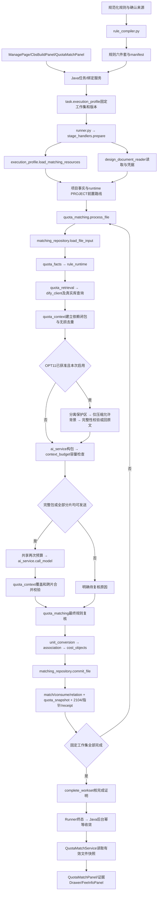

# 五张规则表辅助定额匹配与价格匹配：规范化实施方案

**2026-11-12离线规则资源复核补记：**当前资源`smart-cost-ai/resources/quota-rules/0903-20261112-v5/`，v1—v4原字节保留。本轮D02七行、D03①四行与D04三行按限定用途闭合，技术待核32→18条；首版95条累计77条按用途闭合、18条部分编译仍阻断。251条表达＝233条无发行阻断＋18条阻断策略；0904仍5条后续。272条来源、1307个非空单元格、1636个片段保留。220个固定样例与39项离线测试的实测结果见交接，不等于0903线上验收。当前资料见[第二轮跟进清单](../../smart-cost-ai/resources/quota-rules/0903-20261112-v5/materials-request.md)；业务Runner、Dify、模型及0904未在本轮实施，OPT11仍关闭。

**本次补齐原则：**D02限定确认光伏安装表的7行映射；D03①仅确认F-b4的4行，风电72/73撤销保持；D04改读设计/检测方案明确的规格、张数和目标，不自动选片。D05保留R21电力分支待补，4-3202只属于R18—R20；D06保留YD2-20→YD2-91及实际油量t，不换GD2-13；D08保留四行电力预算依据。D10/D11只收已有更正资料，不重开已忽略问题。第一轮D01九行限定映射、D09取消R070土方、D12三条同工作范围回退保持；不建立全局书名同义。详见细则§25.1及[本轮交接](../materials-confirmation-20261112-v5/交接与验收.md)。

**2026-11-11执行存储精简更新：**按用户确认，0902只新增`sc_file_analysis_snapshot`表。执行版本改存现有任务表`sc_ai_python_task.execution_profile` JSONB字段，保留任务身份、源码、模型配置、规则、CBS及输入版本复核。004迁移已将3条旧执行记录完整迁入任务表，删除两张旧执行表和旧控制函数；无版本依据的历史任务保留RETIRED原因，原任务状态和业务成果未变。新环境按001、002、004升级，已有003的环境只执行004，003保留历史。安装版本312项回归通过，含56项PostgreSQL临时表测试；当前Runner已重启，未执行真实模型或0903。当前实现、迁移顺序、测试和回退边界见[本次精简报告](../20261111-0902-task-execution-profile/report.md)。下文003、独立执行表及硬编码59个历史task_id的描述属于此前版本，不作为当前存储方案。

**当前权威版本：v1.20，2026-11-13。**继承v1.19的通用选档及其它有效合同；按用户要求撤除项目级费用拟建表和整条自动生成分支，匹配到该类费用也跳过。具体边界见A06-13、细则v1.15的§8.1.4/§14.8。0903仍待实施，本次未改业务源码、不可变发行包、数据库或服务。

当前验收登记为[acceptance-cases.v1.15.json](acceptance-cases.v1.15.json)，保留302个稳定ID（298当前适用、4历史），将项目级费用用例改为跳过行为并同步任务收尾合同。按最终Markdown原始字节派生，不继承PASS。当前变更与检查见[项目费用撤除记录](../20261113-project-cost-removal/report.md)；旧登记和历史整合报告保留。

**2026-11-10最新执行决定：撤除未通过收益/质量门槛的0902优化。**用户明确要求“如果优化没用，就把对应优化代码去掉，并将方案更新”。当前正常运行代码已删除OPT01本地缓存/结构索引、OPT02请求JSON压缩、OPT04紧凑编码、OPT05连接池，以及OPT09的CBS并发实现和实验开关，恢复完整15字段对象输出、每请求独立HTTPS、结构chunk/独立CBS范围/文件全部串行。保留完整原文/known/规则、原纠正与截断预算、分类/数量/CBS校验、17列工程量与快照/文件状态同事务、输入/请求/来源和执行版本提交复核。数值修复候选未夹带上线；0903/0904及OPT03不变。已完成300项程序回归（44项PG临时表）、0失败/跳过；旧20份成功任务的101个真实响应重放，两版完整请求/结构/306条工程量/快照相等。本轮没有新增真实模型调用或性能实验，不将重放当作新语义验收；旧失败任务与全部成果未重置。旧优化实现和试用状态以下均为历史。见[实际撤除与验证记录](../20261110-0902-optimization-removal/report.md)。

**2026-11-10 20:17正常服务已恢复：**已启动此前20份全部成功运行的原正常Runner，源码/规则/模型配置与该成功任务冻结一致，五项优化全关、CBS并发1，正常backend_queue恢复。恢复前后工程量、快照、文件、任务及冻结记录指纹全部不变；旧隔离Runner仍停止，新修复候选未部署，新实验20份没有自动重试。不能在旧实验task_id上切换协议。实际进程、启动方式与独立核验见[恢复记录](../20261110-0902-codec-repair/normal-restore.md)。下文暂停状态保留为历史。

**历史停用阶段（随后已恢复正常Runner）：**本次紧凑编码复验未通过后，已确认无活动0902并通过原STOP机制停止旧隔离Runner；前端5173/后端8080仍运行，该停用阶段本地0902队列暂停，20份文件和旧冻结不改。候选未部署；不得将配置中旧true值理解为当前有服务执行。详见最新复验报告的服务状态。

**2026-11-10用户20份试用失败后修复复验：**隔离候选已补全紧凑编码逐行逐字段纠正反馈，保持完整15字段、一次纠正及原业务/数值校验。最终361项程序测试通过（45项PG临时表，0失败/跳过）；用户另行授权南湾村10行输入的6份真实复验，实际11次HTTP，自动主断言1通过、3质量失败、2执行失败，独立完整语义确认0/6，故候选未部署、未启用。旧20份文件、失败任务和冻结记录未改，不能在旧task_id内切换协议或删除冻结。实际修复、限额、证据及仍未实施的新运行接续边界见[本次复验](../20261110-0902-codec-repair/report.md)。以下试用启用及旧验收记录保留为历史。

**2026-11-10业务问答状态确认：**用户最新确认“规则表的问题已经全部得到回答了”。当前将A-05、A-06、A-07、A-09、A-11五张规则表中已列出的业务问题按已有专家及用户答复执行，不再作为等待用户重复回答的前置条件；答复定位见《待答复问题清单.md》，源行与处置见《规则逐条拆解-20261110.md》。原书章节、定额库版本/编号对应和具体项目参数属于后续资料或实施核验，按受影响规则局部处理，不因此阻断无关规则或0902优化。随附对话中的PRICE-01仍明确等待专家选价答复，未提供具体选价政策，保持独立待答，不因本次五表问答状态确认而自行补齐。业务问题已有答复不等于规则已编译、原文已全部核验或系统验收通过；下方各轮代码、试用与验收状态保持各自证据边界。

**2026-11-10用户隔离试用补记：**用户随后明确要求启用最新数值修复和优化进行本地20份测试，已为独立项目 `OPT20-20261110` 启动单独Runner，五项优化开启、CBS并发1，正常源码/配置保留。此为用户指定范围的试用启用，不将下述4/6质量结果或真实codec未跑记录改为验收通过；其他项目0902新任务暂待正常Runner恢复。实际项目入口、源码指纹、开关、保护核验及回退说明见[试用启用记录](../20261110-0902-user-preview/report.md)。

**2026-11-10理由数值修复及编码复验更新：**对上轮隔离候选中“3200kVA原文、3000kVA理由”增加保守容量证据核对，仍使用完整15字段及原有一次纠正预算，不自动改写数字或分类。当前隔离候选344项程序测试通过（含44项PG临时表）、15项Terra独立反例通过；6对固定真实响应在对象/紧凑编码下程序等价。用户追加授权后实际完成6份新真实对象协议试验，容量理由专项6/6，但整文件金标4/6，另两份光伏分类未达标，故按预登记门槛停止后续12份真实编码对照，保留NOT_RUN。候选未部署/启用，正常运行源码及全关/并发1状态不变；不宣称真实编码、性能或全部语义验收通过。具体源码指纹、耗时费用、反例、事务证据限制和交接见[本轮修复记录](../20261110-0902-numeric-evidence/report.md)。以下历史记录继续保留。

**2026-11-10 0902优化实施与验收补记：**已按从属细则§20/§22实现OPT01两个独立缓存开关、OPT02无损JSON、OPT04完整15字段编码层、OPT05线程隔离HTTPS复用，以及OPT09的独立CBS范围调度器。所有优化默认关闭；共享限流F13/F14尚未实施，实际配置拒绝并发大于1。310项程序测试全部通过（含42项PostgreSQL临时表测试）；42次单因素真实模型试点中26次通过预登记金标主断言、16次失败（主断言不等于全部名称、具体CBS叶子和来源语义均合格），各优化均未取得对当前全关对照的冷/热p95改善。独立gpt-6.1-terra/xhigh完成本轮界面验收：4条工程量、快照及文件状态同事务保存，但光伏组件分类为主材，严格分类验收失败；箱变容量重复展示仍存在。故本轮**已实现不等于已通过启用门槛，所有优化继续关闭、并发1**。未修改0903/0904、结构窗口或历史成果；最小任务配置冻结/禁用代次不代表完整§18运行/STALE体系。实际版本、测试、费用未知项、回退与限制见[0902优化实施报告](../20261110-0902-optimization/report.md)及[独立验收记录](../20261110-0902-optimization/terra-acceptance.md)。以下较早状态保留为历史。

**2026-11-10原文核验补记：**《规则逐条拆解-20261110.md》及配套 JSON 是最新版五页来源目录，替代旧《规则来源处理目录.md》的源行状态；来源拆解不代表全部业务已复核或启用。核验事实与限制见《定额原文核验与未闭项-20261110.md》。用户确认 A-06 第4行编号范围修正为 4-3052～3063，非防爆泵电机恰好3kW套4-3046，按实际电机台数计，不另套调试项或4-3052；4-3052～3063组按用户口径从大于3kW开始。数据库4-3052名称仍写3kW，保留差异，正式原文由专家后续提供；PRICE-01按用户要求等待专家答复。较早历史表述如有冲突，以用户后续答复和本补记为准。

**2026-11-10单料表真实验收补记：**正常0902 Runner现已启动，指定gpt-6.1-terra/xhigh子Agent在独立项目TERRA-SNAPSHOT-20261110通过现有界面运行一份魏大湾设备表。4条工程量、1份快照和文件2102已同事务提交，来源/数量/版本检查通过，原有成果与0903未改。界面发现既有箱变规格重复显示，独立报告将严格展示准确性单列FAIL；不扩大为全部0902或0903业务验收通过。当前证据见[真实验收报告](../20261110-0902-snapshot-live/report.md)，下段“尚未完成真实模型/UI验收”为此前快照接入阶段的历史状态。

**2026-11-10技术实施进展：**用户已追加授权实施0902精简快照。当前已将`sc_file_analysis_snapshot.run_id`改为`task_id`，保留`input_revision`和`snapshot_schema_version`，并接入工程量、解析快照及文件完成状态的同事务保存。数据库维护真实输入修订号，提交前复核版本与内容；快照保留完整原文、结构证据、成套合并映射和计算口径，缺失逻辑表边界等信息保留UNKNOWN。具体实现、实施顺序、回退条件及未完成边界统一见从属《项目接入实施细则.md》§4.3；程序验收证据见[0902快照接入报告](../20261110-0902-snapshot-integration/report.md)。本轮不做0903，不新增模型调用，不自动重算历史料表；尚未完成真实模型/UI验收或完整运行失效体系。下文此前“只改文档”的阶段说明不代表这次快照实施仍未开始。

历史版本说明：v1.8（2026-11-08）曾并入0902/0903优化审查及验收定义，配套细则v1.4；后续业务答复、代码实施和优化撤除以各次有日期的更新为准。本文始终是唯一实施方案，细则从属展开，答复台账、审查及来源目录作为证据，不构成另一份实施计划。当前版本见文首。

**2026-11-10业务更新（v1.9历史轮次，业务口径继续有效）：**业务规则以用户最新指令、最新版规则表及专家答复为准，具体见下方“本轮来源更新”和《20261110-规则更新与专家答复证据.md》。本次资料更新替代下文相应旧源值、旧A11行号和旧答复状态；当时的`acceptance-cases.v1.4.json`未全面重编，保留为历史。2026-11-11已将当前Markdown用例重编到v1.5登记，但没有执行这些业务验收；资料冲突或项目缺参仍局部处理。

### 2026-11-10用户补充确认及验收

用户追加答复：A06第54行保留，管道市话电缆在同一料表内按单项工程分别汇总，挂该组最后符合条件的管道市话行；A06-03的4-3143与4-3141计算规则一样，不会重复，两者分别保留原表0.3和0.4系数；PRICE-01等待后续答复；桥架每节长度从资料取值，缺失待补；DI和DO合计后由系统除8；A09“预算指标”即本表2022版概算指标；恰好1000元的单价及计算后金额均保留两位（按用户对两项合并问题答复“保留两位”理解）。完整用户原答复及尚未确认事项记录在《待答复问题清单.md》“2026-11-10用户补充答复”。

热缩套校验示例：同管径、同防腐等级下主管线开料合计2km、合格对焊管件20个，定额量`2+20/10×0.23=2.46km`；另有10个法兰不计入管件数量。若还有不同管径或防腐等级的管线，另立一组及适用子目，不合计到前一组。缺关键资料时不假设符合条件或自行赋予材料数量。

上述是待实施验收口径，不代表代码、业务界面或历史验收登记已经更新并通过。

### A06-06：现场总线调试与过程I/O防重

2026-11-10用户明确第44—47行的“这种系统”是现场总线控制系统（FCS）。控制器或总线主站与现场智能仪表、远程I/O以现场总线构成数字、多点通信，调试范围包括网段划分、终端电阻、总线供电、地址、通信质量和诊断等网段自身工作。5-4020仅适用于其中高速H2级的部分。

**套用5-4020须同时具备三个条件：**①现场设备串接于同一总线网段，由主站统一寻址组态；②采用现场总线或工业以太网协议且属于高速H2级；③调试范围包括网段测试及通信诊断。仅有RS485或RJ45接口不能证明满足条件；它们是接口提示，不能凭接口、协议名称或设备名称直接推断系统拓扑、H2等级与工作范围。仅用于上位机监控、第三方数据交换或单台智能仪表组态，且不构成上述FCS系统的情况，按用户答复不另计5-4020，相关工作已包含在5-4008～4015内。

5-4020按实际总线主站或独立总线系统的套数计量，不按设备台数或I/O点数重复计取；第47行原系数1是源表示例，不代表所有项目固定1套。对于FF-H1、Profibus-PA这类现场总线，用户进一步明确套5-4019，不套高速H2的5-4020。项目数据库中`DE1000022001`的5-4019记录名称为“现场总线控制系统调试（中速H1）”、单位“套”；须保留数据库原名称，不把用户此前“低速H1”的表述当成该记录的原名。此为数据库导入记录核验，不等于已取得2022版指标纸本或官方原文，实际应用仍须核验CBS指定库、系统事实及工作内容，不跨库。

总线型仪表的总线虚拟点不再按5-4016～4018计取过程I/O组件调试，避免重复；仍需分别识别独立物理I/O及其工作范围，不能把整个项目的物理点一并删除。适用的物理DI、DO点先合计，系统按8点一组折算，不取整也不重复除8。应保留总线系统/主站身份、网段拓扑、协议及级别、调试范围、实际套数、物理/虚拟I/O分类和来源；任一必要条件未知时保留待补，不因未知条件默认满足。上述用户业务口径与H1子目核验状态分别记录，尚未实施或验证。

### A06-08：管沟土方扣除已计量

适用A06第57、59、63、65、67行。用户确认同一段管沟的土方只允许计取一次，累计管长只用于确定土方总量。对于适用的汇总组，按实际管沟参数计算：`Q带出(m³) = L累计(m) × B宽(m) × H深(m) − Q料表或其他项目已计(m³)`。结果大于0时带出该净量；结果小于或等于0时不生成该关联定额行，不生成负工程量。

继续遵循已确认的同一料表内各单项工程分组、不同材质/管径/主号段分别汇总及末行挂载口径；不同尺寸的沟段应分别使用其实际宽度和深度，不能用单个断面系数覆盖不相同的沟段。扣减的已计量须对应同一段管沟的同一土方工作，统一为m³，并记录已计项目、来源、覆盖范围和数量；不能因名称相近扣除无关工作，也不能将同一已计量重复分配给多个组。未找到相关记录不自动视为已确认零；沟段关系、已计范围/数量或必要尺寸不明时，受影响组待补。其余未受影响组继续按各自依据处理。

这项答复针对A06-08所列管道沟土方，不自动改写此前A06-15对接地扁钢与电缆共沟的单独答复；若实际工作范围同时触及两组规则且无法判定是否同一项土方，应保留冲突待核，不擅自合并或重复带出。

### A06-13：项目级费用自动生成已撤除

按2026-11-13用户最新要求，移除项目级费用自动生成功能。A06-R084、A06-R085、A06-R086的PROJECT_SUPPLEMENT动作不在本期0903执行范围：即使命中风电场景或费率、基数、报告金额齐全，也直接跳过，不执行费用公式、不生成费用成果、金额或NEEDS_INPUT待补，不增加对应人工补参入口，也不影响正常料表主项、A06文件内关联及A09项目路线。既有v5不可变规则包及其离线复现工具保留原义和原字节；它们是规则来源证据，不构成执行这些动作的授权。后续实现必须在规则动作路由、收集项目费用专用缺参及发起外部请求之前排除这三条动作；按规则ID和动作用途限定范围，不能一概跳过全部PROJECT规则。此范围决定随当前方案版本纳入执行冻结，本轮不新增运行配置开关或重新启用路径。

原来源表第84—86行及此前计取答复保留于不可变v5发行和历史记录，仅用于来源追溯；不再据此实现全项目唯一费用、费率/报告金额计算、缺金额待补或费用恢复。

### A07-04：大屏显示屏外形面积

用户确认第10行大屏显示屏工程量按整套屏的外形尺寸计算，**包含边框**，不使用有效显示区或可视面积代替。外形宽、高统一为米后相乘得到平方米，按实际整套屏数量计取；如果资料已经给出全部整套屏的总面积，不再重复乘数量。只提供有效显示区尺寸、缺少含边框外形尺寸或数量口径不明时，受影响条目待补，不推测边框尺寸。保留设备尺寸、计量口径和数量来源，定额5-6055及其单位仍以CBS指定库原文核验。

### A09-02：标准化模块优先、指标覆盖与补充计取

用户明确同一对象执行两级选择：有对应且适用的标准化造价指标模块时优先套用；未设置该对象模块时，套《石油建设安装工程概算指标（2022版）》对应章节。储罐优先套“标准化造价指标—储罐制作安装（机械、防腐）”；阴极保护适用该概算指标第九章第四节。道路专业直接套《投资估算指标》；建筑、总图、结构套标准化造价指标。保留既有的专业、阶段、图集号、储罐容量严格对应和CBS指定库约束；未配置或缺少适用指标时明确提示，不能自动换库或虚构适用章节。

钢结构及模块化、管线、储罐、井场等主专业指标已包含的防腐，不得重复计取；未覆盖工作可以补充计取，但必须有明确计价依据，例如相近子目换算或现行定额组价，与已覆盖内容不重复，并在编制说明中单列注明。保留指标原文、工作覆盖范围、补充依据及说明位置；覆盖范围或依据不足时，该补充项待核，不能猜测为已覆盖或未覆盖。

穿越仅在单出图时套标准化造价指标。针对A09管线指标原文列有“穿跨越”而此前专家答复“主管线指标都不包含穿跨越”的差异，用户进一步确认：**核对实际覆盖范围，已包含的部分不重复计取**。单出图是穿越单独套指标的必要条件，不等于可以忽略已覆盖范围；先依据具体主管线指标及穿越图纸核对重叠，未覆盖部分仍须有明确计价依据并在编制说明单列。缺少覆盖或图纸证据时不自动重复计取。本次不把“穿越”的新增说明无条件扩展为其他穿跨越对象的具体做法。

### A09-06：屋面光伏与产建分布式光伏

用户确认：同一项目同时符合屋面光伏和产建分布式光伏条件时，优先套用A09第40行“投资估算指标-屋面光伏”。第39行“投资估算指标-分布式光伏”只在“产建分布式光伏（非专项工程）”的限定条件下作为补充指标使用，不作为屋面场景的默认指标。同一项目只能计取这两项中的一项，不得重复取费；“补充”不表示可在已计屋面光伏指标之后再叠加另一项。

保留场景分类、项目范围、非专项工程条件及指标选用来源；屋面场景或限定条件不明确时待补。若首选指标在CBS指定范围内不可用，不自动换库或将第39行视为屋面默认后备，应提示缺少适用指标并核实。实际指标条目与工作范围按指定库原文核验，不扩大已确认的项目范围。

### A11-01：MPa与PN备注方向

用户确认最新版A11第4行`6.3 MPa ↔ PN63`的数值正确，原备注`MPa ≈ PN×10`方向写反，规范化时保留备注并修正为 **`PN ≈ MPa×10`**。例如压力数值为6.3 MPa时，PN数值约为63；反向表达为MPa数值约等于PN数值除以10。保留近似关系、适用语境及来源，原备注作为更正前证据留存，不改写源工作簿。A11“等同”仍只用于辅助表达和检索，不自动认定整个物料等价或跳过其他关键属性核验；具体对象的压力等级含义及适用标准按原文与项目依据核验，不将近似记号变成无条件的物料替代规则。

### PRICE-05：单价与金额的四舍五入

用户确认需要舍入的数值采用**四舍五入**。沿用已确认的先后顺序：单位换算后的单价按对应保留位数四舍五入，再乘数量计算金额；金额按已记录的两位小数口径四舍五入。既有单价位数口径为1000元以下保留两位、1000元以上不保留小数；恰好1000元按此前用户回复保留两位。计算使用十进制精度，保存换算前后单价、舍入后单价、数量及金额依据，避免二进制浮点误差或重复舍入导致差异。这些是计划验收口径，不表示现有系统已实现或已通过验证。

### 本轮来源更新（2026-11-10）

- **来源与范围：**读取用户指定的《智能组价_规则梳理总表-最新版.xlsx》A-05/A-06/A-07/A-09/A-11，以及《定额规则待专家确认问题_已回答.xlsx》。专家答复多数是问题C列内的红色富文本；全红问题按用户要求忽略，不当作待答复或普通答案。PRICE-01全红但另写“明天给答复”，用户已明确等待后续选价答复。A06-03虽然在专家表未见红字，用户随后在对话中补充了答复。完整逐项上下文、色段、源文件指纹和逐格变化见证据文件及`source-update-20261110.json`。
- **A06删除线和第39行：**第49、51、53、55行的4-3143关联按用户指令删除出有效规则，保留来源审计。双绞线、光缆、埋式市话分别按既有各自分组/挂末行口径，只保留各自第48、50、52行4-3141；不再生成已划掉的0.3或3。第54行管道市话4-3141新旧口径冲突已由用户裁定为保留第54行；该行原始单位km、关联单位100m、系数4，禁止再重复换算。第55行4-3143仍按删除线移除。第39行最新对象扩展为信号（屏蔽）电缆、控制电缆，原只带4-3141和分组条件仍适用，不附带4-3143。
- **A06专家答复：**探伤及热处理按具体说明要求，2061～2065不做超声波、射线、预后热和热处理；胶片自动选择条款未核；按第二轮D04选定的方案，读取项目设计/检测方案已明确的规格、张数和具体目标，检测比例不设默认。报警回路N点基础1、增量N−1，可燃/毒气与火焰设备同一系统可合并；挂载以实际设备表为依据，不推定固定行。DI与DO点数先合计，数字量无需取整，由系统按8点计量自动除8，避免重复除8；高速H2的FCS触发条件、按套计量及总线虚拟点防重已确认，详见上方A06-06专项；FF-H1、Profibus-PA套5-4019已由用户确认，项目数据库记录原名为“中速H1”；官方原文与实际适用工作仍待核。管沟按各单项工程汇总并挂末行，不同材质/管径/主号段分别汇总，按累计管长；同一管沟已计土方须扣除，净量不大于零不生成关联行，详见A06-08专项。黄土灰土、沙漠砂垫层为当前默认且按管长计补充项目，其他地质暂未覆盖。容量选不小于实际容量的对应档，1MWp选G-b37；大于4MWp先按4MWp档计取，剩余容量若仍超过4MWp则继续按4MWp档拆分，最后非零余量按对应容量档计取；9MWp按4＋4＋1MWp计取，余量为零不新增一项。拆分以设计确定的单个子方阵容量为输入，不据此推定物理上新增子方阵。吊装相关单价暂按企业固定参数、每台风机计取，50km是风机间估算距离而非设计实测。试桩8万、防腐1万为无明确规定的暂估示例，按每座基础；保留并列说明。风电场环保、水保、劳动安全与职业卫生三项的历史答复保留；当前按A06-13最新范围决定跳过其自动生成，不计算或形成费用待补。空冷器、阀门执行机构全带，调相机除YS7-163外其余全带；仍以CBS允许库、工作内容防重和实际参数为前提。K96的0.5是长度按50%计算、相关参数暂作默认；YD8-13/14按已问口径汇总挂载；接地扁钢和电缆土方分别计取。K70原公式、m/10m²单位冲突及旧1.26m³修正算例均保留历史；最新D09已取消第70行土方关联，不作面积到管长换算。管道安装行及同沟防重继续执行原答复。
- **A07：**第3—6行是示例，排除规则；桥架第7行料表单位改为“节”，定额单位10m，参照表4-7钢制桥架重量，源文要求先由节换m、并涉及主材t；每节长度从料表或设计资料取得，缺失时待补；重量按适用规格和表4-7等依据确定，不能把节数直接当m或t。第11行热缩套按同管径、同防腐等级分组，每组定额工程量`Σ主管线开料长度(km)+合格对焊管件数量÷10×0.23(km)`；0.23km对应10个管件。只计与主管线同管径、同防腐等级且需同规格热缩套补口的对焊管件，如弯头、三通、异径管、管帽；法兰、阀门、螺纹及承插连接件、随设备成套供货管件不计。同组多条管线可合并；不同管径或防腐等级分别统计并选择相应子目。该系数已综合约2道口/件及12m定尺管，不再按管件类型调整。必须保留主管线及管件关联、各组贡献行；缺管径、防腐等级、连接方式、开料长度、管件数量或供货范围等必要信息时受影响分组待补。专家答复光端机1套为整对、对应1对；大屏按整套屏含边框的外形尺寸计面积，不按有效显示区或可视面积；详见A07-04专项；热缩套按主管线长度、补口补伤为一个定额，避免同一范围重复。
- **A09：**最新版中原“概算指标”明确为`石油建设安装工程概算指标(2022版)`，按对象、专业及章节与A05对应，不把所有行强行当同一章节。第32行柱上变条件、第48—49行站外给排水管线优先顺序、第73行热工/防腐文字已变更；详见逐格证据。A09-04、05整题红色按用户要求忽略旧问题，使用新版行内容；不继承旧DN范围。专家答复可研优先估算指标、初设优先预算指标，新能源两个阶段采用估算指标；用户明确此处“预算指标”就是新版所写石油建设安装工程概算指标(2022版)；按阶段、专业适用条件选择，仍受CBS选库约束。无图集号不套标准化模块，有图集号按号区分；储罐容量按指标项严格对应，不做无依据插值。储罐按开量专业归属、站场无损检测套定额、模板问题忽略。已被主专业指标覆盖的防腐不重复计取；穿越单出图后仍须核对具体主管线指标的实际覆盖范围，已含部分不重复计取，详见A09-02专项。按料表工作量套相应指标，无料表工作量不计费用；不能从料表缺行推断设计一定不存在。A09-06中第39、40行光伏指标优先顺序及同项目防重已由用户补充确认，详见A09-06专项；原答复“问题忽略”的范围不扩大到其他问句。
- **A11：**最新版按对象重新对照：删除旧HART变送器、BXM-8K配电箱、仪表接头、交换机、金属软管人工判断示例；法兰编码及BXM(D)配电箱由原“人工判断”改为“等同”，不能误写成“精确匹配”。等同仍只辅助表达检索，价格侧关键属性冲突/缺失的处理维持既有政策。专家确认`100kW·台`删“台”、N为电机功率、WBX(T)-400为400A；6.3MPa对应PN63、PRWG1及止回阀DN25已在最新表体现。新版C4的`MPa≈PN×10`方向错误，用户确认备注保留并修正为`PN≈MPa×10`；原文留作更正证据，详见A11-01专项。A11-07整题全红按用户要求忽略，不能据此认定所有物料的未知关键属性均可放行。
- **价格匹配：**专家称只匹配提取出的设备、主材，以及石油建设安装工程概算指标(2022版)第六章防腐定额自带主材；具体消耗对象及来源需按定额核验。PRICE-03指定前21条及第23484行不参与匹配，按原工作簿/行/快照标识，不泛化为所有0价行。专家确认人民币不含税，含运输保险等，时间与地区越接近项目越好；特殊单位按答复暂忽略，不伪装成普通单位自动计价。单价1000元以下保留两位、1000元以上不保留小数，先舍入单价再计；用户补充“保留两位”，按恰好1000元的单价与计算后金额均保留两位理解；需要舍入时采用用户确认的四舍五入，详见PRICE-05专项。候选仍须满足物料属性及统一口径，不以接近时地取代PRICE-01选价政策。

## 1. 目标与权威边界

目标是让模型在选取定额时正确利用 A05、A06、A07、A09、A11 的业务规则。执行链路为：**CBS 为每张设备材料表指定定额库 → 准备该条目的适用规则 → 在指定定额库内混合检索 → 模型结合候选原文与规则选择定额 → 校验依据、单位和工程量 → 处理关联项目。**

价格匹配使用同一份原始物料与标准特征，执行独立流程：**确定待计价对象与价格来源范围 → 应用价格用途的A11特征规则 → 检索价格候选 → 模型核对规格与供货范围 → 按已确认取价政策选择价格记录 → 换算价格单位 → 写入可追溯的价格草案或结果。** 定额选择正确不代表价格物料等价；定额计量数量不等于价格计量数量。详细合同见第10—14节。

来源和约束顺序：

1. 用户本次指令及补充：只分析五张规则表；设备材料表之外的工作量文件不读；用户追加的项目设计说明按细则§4.4读取、提取规则待专家补充；CBS 每表选库是检索范围的硬约束；A11等同仅辅助表达和检索；A06第37—38行按同一料表内各单项工程分别汇总、换算100m后乘0.4/0.3、两条关联挂该组最后一条符合条件的源行，主系数是单位换算系数；价格来源为用户新增指定的专家价格工作簿；本次只交付方案。
2. 原始规则五页和设备材料表：提供业务条件、例外和实际输入样式。矛盾不能靠模型猜测消除。
3. CBS 实际指定的库及其具体定额子目、章说明：供实施阶段核验编号、适用范围、档位、计量口径和包含内容；本次不声称已经核验所有定额。
4. 现有项目规格和代码作为集成基线。既有`交付/A-05规范化`仍为待对照产物；通用数值选档的当前依据是2026-11-13用户明确确认，不冒充源Excel已写明。其他未确认假设不随本次选档确认自动生效。

当前权威入口为本目录《实施方案.md》v1.20和从属《项目接入实施细则.md》v1.15；2026-11-10业务答复继续有效，0903架构入口见本文§17及细则§8、§10、§14.6—§14.13、§22.5、§24—§25。`acceptance-cases.v1.15.json`是当前派生登记，必须与Markdown用例逐项一致；不得独立修改JSON预期形成另一套规则。v1.4及更早登记、旧Gemini资料包及副本文档均为历史快照，不自动刷新原报告的验收结论。

五表已列业务问题按已有专家及用户答复执行，最新逐条来源见《规则逐条拆解-20261110.md》；旧问题表的“待答”不能覆盖后续答复。来源拆解不等于规则包已编译、库引用已核验或每个项目参数齐全。实施仍需逐片段编译、核对来源冲突及实际子目，不能把目录覆盖或本轮验收登记更新当作规范化已完成。PRICE-01维持独立待答边界。

CBS选库违反本场景已确认的必选库限制时，返回“指定库与规则适用范围不一致”，让用户处理配置或业务例外。只是另一个库的可选对应关系时，提示当前库缺少专门规则覆盖，仍可在指定库内按原文判断。模型不得自行跨库，也不能强行选择不适用子目。

## 2. 本次实际读取范围和发现

用户原路径 `D:\长庆油田新能源数据\工作量文件夹` 不存在；对应资料实际位于 `D:\长庆油田新能源数据\工作量`。

已按设备表/设表/材料表/料表文件名建立白名单，排除 Office 临时锁文件，读取 61 份：42 DOC、18 PDF、1 XLSX。Word 读取保留表号、行号和单元格，PDF 共36页，Excel保留工作表、单元格及合并区域。未读取道路工程量、桩数、建筑PPT和结构图等其他文件内容。

规则来源：`D:\企业微信\WXWork\1688857208647011\Cache\File\2026-10\智能组价_规则梳理总表.xlsx`。实际页名为 A-05、A-06、A-07、A-09、A-11；未分析说明页、A-08、A-10和发现问题页。下列行数包含说明、表头和业务说明，不能当作可执行规则条数。

| 页 | 非空行 | 合并区域 | 需保留的特殊内容 |
|---|---:|---:|---|
| A-05 | 21 | 8 | 专业/场景分支、章号或编号范围、包含内容、不同库同号 |
| A-06 | 98 | 51 | 10个Excel公式、一对多关联、汇总一次、排除条件、金额与工程量混列 |
| A-07 | 12 | 1 | 特殊单位换算、查表/设计参数、已有单位换算截图 |
| A-09 | 81 | 16 | 初设阶段、指标/定额适用条件、范围包含关系、2张设备样例图 |
| A-11 | 75 | 1 | 特征表达映射、单位转换、显式“需人工判断”、原本用于价格匹配 |

五页未发现隐藏行列。已检查A07、A09的3张内嵌图片：A07展示旧软件已有单位维护，不能据此断言当前smartCost已具备相同能力；A09图片为柱上变、标准化井场的识别示例，不能当成当前项目新增工程量。

用户后续指定的价格来源为 `D:\企业微信\WXWork\1688857208647011\Cache\File\2026-08\长庆油气田设备材料标准化参考价格（一物一价汇编）可研初设第一版（GS1.2）.xlsx`。已只读检查唯一工作表Sheet1：104,317条数据，104,317个不同物料编码，未发现重复编码；表头为物料编码、物料描述、规格、单位、不含税单价、价格来源。规格列全部为空；21条缺单位，21条单价为0，经逐行核对二者均为第84—90、204—210、319—325行；第23484行缺价格来源。未发现公式、合并或隐藏行列，G:M无非空业务值。证据为`price-source-profile.json`，不代表已导入系统。

价格表内有878种非空原始来源文字（计入空值共879种取值），并有“最低价”“最高价”单独记录；例如Sheet1第9、10行是同类容器的最低/最高参考价，物料编码不同。因此“编码唯一”和“一物一价”文件名均不能替代选价政策。规格需要从描述中提取，所有提取属性保留原文位置；不得把“规格列空”理解为所有物料规格不限。源文件SHA256为`f024865618e5e354f0401caecb6b1ed77b133993e15e13a75c333b6ac9503881`。

实际输入要求：

- 光伏场区材料表同时包含低压电缆、35kV电缆、终端头、接地材料及支架，不能把文件或CBS节点电压赋给所有物料；电缆额定电压U0/U、系统电压和单芯/多芯应分别保留。
- 西刘塬设备表有620Wp组件3068块，但场区总组件数不能直接当作一个发电子方阵。调试定额还需要子方阵划分及每组容量。
- 线路表有“每串”构成明细；消防表有“以下为单台设备工作量，共N台”。即便上游已算好总量，也要保留原量、倍率、结果及计算依据，防止再乘一次。
- “含接线端子”“含基础”“包含以下内容”等不能作为普通备注丢弃。它们提示需要核对供货/组合关系及定额工作内容；是否不再另套，要由适用定额和确认规则决定，不能只凭“含”字一律删除。
- 设备表、材料表中未给出的重量、敷设方式、共沟关系、子方阵划分等应保留缺失状态。不得把图纸要求变成模型估算；本次不读取用户排除的图纸。

## 3. 规则表采用两种相互一致的表达

**人工维护：规范化Excel；程序和模型使用：从同一Excel编译生成的结构化规则及完整规则卡。** 规则卡不另行手工维护，避免两个版本不一致。规则库和定额库是不同用途的数据，可放在不同集合/数据类型中，查询时不能混为候选定额。

保留五张业务页，分别重构字段。不把所有内容塞进同一张宽表；辅助维护公共字典与复杂条件明细，名称建议为“定额库字典”“字段单位字典”“条件明细”“验收用例”。这些是后续计划产物，本次未生成工作簿。

五页共有字段：

| 字段 | 要求 |
|---|---|
| 规则ID、规则组ID、规则版本 | ID稳定；同一业务关系可拆为多条规则，共用组ID |
| 规则用途 | 特征规范、候选限制、优先建议、排除、数量转换、关联项目、重复计取检查 |
| 适用对象、专业、工程场景、建设阶段 | 使用字典值；明确“不限”与“未知”，空白不默认全部适用 |
| 适用库类型、ID及版本 | 定额规则引用定额库，与CBS指定库取交集；价格规则引用独立价格来源快照；库无关规则显式标记，不能用定额库ID替代价格来源 |
| 触发条件、排除条件、必需参数 | 简单条件用明确字段；复杂条件引用条件组 |
| 对模型的选取指引 | 写完整句子，含触发、处理、例外、缺参处理；不写“同上”“按实际”即结束 |
| 约束强度 | 必须满足／优先建议／仅检索扩展；未确认经验不能设成硬过滤 |
| 生效状态、审核依据 | 草稿、待业务确认、已生效、停用；只有已生效规则参与正式决策 |
| 原文件、原页、原单元格、原文 | 不可覆盖；合并继承值保留锚点，图片保留对象/位置 |
| 适用阶段、未决事项ID | 分开定额匹配、价格匹配和数量转换；未决项解决前不得标记已生效 |

所有业务数据区只保留一行列名，取消合并单元格，不用颜色、缩进、空白表达业务含义。数值、单位、运算符分列；编号按文本存储。说明行、示例行、缺失记录与正式规则需显式分类。

迁移时只有真实合并区域可以按锚点确定性展开。A06中有些主项目字段没有合并、只是下方留空，须结合已确认的规则组恢复；A09仅在一处填写的阶段也要明确其覆盖范围。不能对整页一律向下填充，否则会把上一组定额、数量或阶段错误地传给下一组。

复杂条件明细至少包含：规则ID、条件组ID、上级组、AND/OR/NOT、字段、比较符、值、单位、是否含边界、缺值行为。程序采用“满足／不满足／未知”三种结果。必要字段未知时不能当作不满足后套用默认分支。上下限分别存储，不能只放“1~2”文本让模型猜边界。

## 4. 五张业务页具体怎么改

### A05：主定额候选与选择规则

专用列：标准对象、原始名称/别名、场景条件、适用库、目标选择器类型、准确编号/起止编号/目录ID、排除编号、选档参数、取档方法、包含工作内容、选择说明。

- `exact`对应一个确切子目；`range`对应同一已确认编号序列；`chapter`对应章/节；`set`对应多个离散编号。章号`8-`不能冒充一个定额编号，离散区间要拆成选择器明细。
- 号段只能从指定库的实际目录解析出存在的编号，不按字符串或整数盲目生成。源表`4-3202`在不同库出现时，唯一键必须包含库ID和版本，不能只按编号合并。
- “钢制阀门”按专业拆分；站场光缆与站外光缆分别保留条件；柴油消防泵的橇装包含内容保留，影响后续重复计取检查。
- **通用数值选档（2026-11-13用户确认）：**检索引擎召回候选后，模型在本次实际候选集合内选择最终定额：有相等值优先相等；无等值时取大于物料特征值的最小档；没有更大档则取小于物料特征值的最大档。本规则通用于设备主材的可比数值特征，不限电缆，也不要求先查全目录证明全库没有更大档。实际120、候选95/150时模型选150；候选70/95时选95；候选119/200时仍选200，不按绝对差取119。库/对象及其他适用条件、单位与来源继续核对，强规则明确目标和A05借用仍按其独立合同处理。
- 模型依据通用规则作正式选择，程序只验证，不以本地算法替模型直通。比较范围、同档不同工法、缺参、多特征歧义、版本冻结、分片及完整审计见细则§14.5.1；首次含单候选仍走R1。选定档位不回写设备主材实物特征，不改变A06数量基数、A07换算或0904价格匹配。v5原件不变，新通用政策尚未接入业务源码。
- 最终模型仍须比较候选原文的材质、电压、芯数、截面、施工方式、适用范围；规则不是凭名称直接写死结果。

**A05-02已确认源缺陷：** A05第18—21行共同表达同一示例主材`ZC-YJHLY23-26/35-3×95mm²`在四个库中的对应关系；第18行石油概算22、第19行光伏指南22、第20行陆上风电指南23原表均列4-3202，第21行应独立给出《电力建设工程概算定额》2018版中的35kV档对应子目。用户明确第21行原`YD8-46`及“20kV以下”名称是对应关系错误，不能解释为另一低电压示例，不能通过改低主材电压来保住旧号。

规范化保留第21行和四库映射组，原编号/名称留在来源证据中，错误的35kV→YD8-46映射标为失效；这不等于全局禁用电力库的YD8-46。目标库与版本固定为该电力2018版，目标电压条件35kV，备注采用用户指定文字：**“电力定额按电压档另选，不沿用 4-3202”**。实施Agent须从该版电缆敷设章节核验实际存在的编号、规范名称、计量单位和适用属性；未经核验时`target_item_id/code/name=null`，单独记录`business_confirmation=CONFIRMED`与`target_binding_status=PENDING_LIBRARY_VERIFICATION`。这里的35kV是目标约束，不是伪造一个正式子目名称；后续规范化输出在核验后填写真实编号与名称。

业务问题已关闭，替代编号属于Agent技术核验任务，不再让用户推号。现阶段未取得该章节可核验的子目记录，不能宣称已经修正为某个正确编号；也不能从前三库复制4-3202或套用同号等价推断。未绑定的精确映射不直接用于最终套项，已确认主材特征和目标库仍可用于库内检索；前三库原映射各自保留库ID/版本，适用性检查照常执行。

**A05-01已确认的两类规则必须分开：**

1. **整条管线的章节归属。** A05第11行“1.管径>457”和“2.定额说明”为两个并列入口，顶层OR；第一入口为外径`outside_diameter_mm > 457`，不能比较DN。25km“以上”使用`>=25km`并同时保留对应条款中的管道类别、位置等条件。外径恰好457但另一入口成立，仍归第九章；两入口均不成立则按第八章适用性处理，含未知且无入口成立时待补。
2. **第八章缺子目时的子目级借用。** A-05!E10与A-09!D12位于第八章规则行，用户已确定其含义为：本项在第八章没有适用子目时，允许借用第九章对应子目，**不需要重新满足第九章整条管线入口，也不改变整条管线的章节归属**。它不是上述OR的第三个入口，也不是将整条管线改判为长输工程。

借用在CBS本表已指定的同一允许库/版本内执行；章节借用不授权跨库。先检查第八章相关目录与候选并记录缺项依据，再检索第九章相应工作；接口失败、索引缺失或单次TopK为空只能说明检索资料/执行不足，不能直接证明第八章缺子目。借用仍核对具体子目的对象、材质、尺寸、施工工作内容和计量单位，只有整章管线入口不再作为借用门槛。结果保留`selection_mode=BORROWED`、原待计价条目ID、原章节、借用章节、实际借用子目ID、借用规则ID和缺项依据；第八章候选ID仅按实际召回记录，不要求或编造不存在的原子目ID。同一管线其它已有第八章子目的条目照常使用第八章。

### A06：主项目与关联项目

专用列：主项目选择器、关联目标类型、关联定额选择器、关联库、触发条件、关联方式、主量基数、主量单位、关联量表达式、关联量单位、分组范围、分组键、互斥组、已含项目、所需设计参数。

- 每一条关联关系单独一行，但主项目字段不得依赖上一行空白继承。关联方式区分逐条、按比例、按参数、同组汇总一次、固定项目一次。
- A06第37—38行已由用户明确：先在指定库选择4-3174~3205中的具体主定额，再同时带出4-3141、4-3143；关联数量基于本组设备主材数量之和，分别乘0.4、0.3，每组每条关联只生成一次。不能先按各行重复生成，也不能以主定额调整后的数量替代设备主材基数。完整表达见4.1。
- 第37—38行汇总边界已确认：同一逻辑料表内的同一单项工程（例如“（一）西刘塬光伏场区”）。各行先换算为100m，汇总后产生两条关联，并挂在该组最后一条符合条件的原始行；“（二）”另起一组。主定额系数是单位换算系数。不得增设物理沟段ID、型号相同、具体主定额编号相同等新门槛；其他明确按实际沟段计量的规则仍需其真实沟段关系。
- 探伤、焊口热处理按对应源行保留衬里管等工艺约束；A06第13—16行仅移除`3-2061～2065除外`这一编号排除，不删除其工艺约束，且不将此修订扩大到第9—12行。原始备注保留为来源；“按定额含量和设计要求”展开成所需字段及来源。源规则表未给出胶片选择规则，原书自动选片条款仍未核。按2026-11-12 D04确认，本次只接受设计/检测方案明确的规格、张数和经核实具体目标，不自动选片；必须校验本目标与该工作范围一致、规格与壁厚适配，数量=本目标已核张数÷10。同一计划多种规格须分别核量，不重复套总张数；缺片数、厚度、尺寸或目标依据不生成正式数量。
- 光伏发电子方阵调试以设计划分的单个子方阵容量为输入；超过4MWp时可按已确认口径拆成多档计取，关联数量按各档计取次数统计，不能简单等同于实际子方阵个数。组件型号功率与组件块数是容量计算参数，不把全场容量无依据当成一个子方阵。
- `补`、`补充定额`、`补充项目`不能假装是知识库中存在的正式编号。履带吊费用等应拆为费用类型、费率/单价、计费基数和依据，不能把50963等金额装进工程量字段。
- 关联定额需要其他库时检查CBS允许范围；缺少对应库时输出待配置项。若后来支持递归关联，必须做循环检测和重复结果去重，不能递归无限加项。

#### 4.1 A06第37—38行的完整已确认业务口径

确认依据：用户文字、截图`codex-clipboard-369e9071-44c5-49ce-bd0a-997f60d4fe31.png`及随后关于“（一）”“（二）”、最后一条、100m和主系数的答复，对应A-06第37—38行。该次确认只覆盖这一组，不自动覆盖第39、48—55、72—73、96—98行；第39行及第48—55行的后续独立确认另见4.2，也不把第73行“三种及以上电缆型号”的条件搬到本组。

| 字段 | 规范化内容 |
|---|---|
| group_id | A06-CABLE-37-38（拟定稳定ID） |
| 主项目 | 已指定库内4-3174~3205中的实际适用子目；编号范围不是一个可直接套用的子目 |
| 关系 | 两条REQUIRED关联：4-3141、4-3143；须在允许库内核验真实子目ID和单位 |
| 基数 | 同一逻辑料表、同一单项工程下，实际选中指定库4-3174~3205范围主定额的电力电缆设备主材数量；型号和具体主定额编号可以不同。保留所有贡献行ID |
| 关联表达式 | Q_3141 = 0.4 × B；Q_3143 = 0.3 × B；B = Σconvert(material_quantity_i, material_unit_i, 100m) |
| 主定额工程量 | 每行分别按所选主定额单位做单位换算；本组“定额系数”就是单位换算系数，不含另一个未说明的定额调整系数 |
| 分组范围 | 同一逻辑料表内按“（一）”“（二）”等单项工程分别分组；不能跨单项工程或跨料表汇总。CBS、库及版本是执行边界，不能因编号相似跨库合并；也不能因CBS配置不同自动拆开已确认业务组。同组配置或关联归属不相容时报告冲突、暂缓关联，详见第15节从属细则 |
| 计量口径 | 两条关联单位均为100m；每行先换算成100m数量，再合计乘比例。100m+0.2km=3个100m，关联量1.2和0.9 |
| 挂载行 | 按原料表顺序，取本组最后一条符合条件的电力电缆源行；此前符合条件行只挂各自主定额，该行挂自己的主定额及两条关联。与页面排序或任务完成顺序无关 |
| 去重 | 业务唯一键包含逻辑料表ID、单项工程实例ID、CBS/库配置版本、规则组ID、关联定额ID；run_id仅追溯执行，不让同配置的重跑新增一份结果。保存贡献行及anchor_row_id |
| 结果状态 | 关系、系数、范围、挂载及单位含义均已确认。实际输入若缺单项工程标识、数量、单位或成员主定额未决，影响的组暂不形成正式汇总量；这属于运行缺参，不再是未答业务政策 |

实现时采用“逐行选主定额→按单项工程收齐本组成员→计算两条关联→挂最后源行”的两步处理，不要求先前行在匹配时猜哪行最后。逻辑料表可以跨页、跨Word物理表格；单项工程标题是有原文证据的分组，不等同Word表号、CBS名称或模型猜测。重复标题仍用独立实例ID区分。模型选定范围内主定额后，由程序按上述已确认公式计算关联量，模型不自由生成系数或挂载位置。

组内存在可能符合规则但主定额选择未决的条目时，可以保留其它行主定额草案，但关联汇总暂缓，防止只按部分成功条目漏算。最后源行无匹配结果时，不能把关联悄悄移到倒数第二条当作完成；应先解决成员归属。重跑、删行或改主定额改变成员后重建该组贡献和挂载关系，移除旧挂载，原子替换两条结果，禁止重复累计。

确认后的算术例子：同一单项工程的五条电缆依原文顺序数量为100、200、300、150、250m（合成测试数据），各自换算主量为1、2、3、1.5、2.5个100m，总基数B=10。前四条各自主定额，第五条主定额2.5并挂4-3141数量4、4-3143数量3；关联单位均100m。另一个单项工程独立计算。这个规则既不合并五条主定额，也不把两条关联各自重复挂五次。

#### 4.2 本轮补充确认：通信汇总、管沟算例与费用阶段

- **A06-01（第39行）：** 信号（屏蔽）电缆只带出4-3141，不带4-3143；最新版将控制电缆也列入第39行对象。同一逻辑料表内按各单项工程分别汇总，关联挂原文顺序最后一条符合条件的源行。源表记载石油建设安装工程概算指标（2022版）、主号段4-3026~3219、主项及关联单位100m、4-3141系数0.4；不因相近号段纳入不属于本规则的电缆，也不把第37—38行的4-3143带入本组。数量先换算为100m后求和，再乘0.4；目标编号、单位及工作内容仍需在CBS指定的允许库及版本中核验。组内单项工程、成员、数量或单位不明时暂缓正式汇总；保存贡献行及末行，重跑不重复生成。第72—73及96—98行各按独立来源与答复处理。
- **A06-03（第72—73行）：** 用户明确第72—73行与第37—38行没有联系，分别保留规则来源，不把第73行的“三种及以上电缆型号”条件添加到第37—38行。第73行是对4-3143的条件备注，源第72行主定额示例为4-3176。触发条件为同一单项工程内有至少三种不同型号或规格的电缆；多根型号和规格相同的电缆不能仅凭根数满足条件，不跨单项工程合计。用户确认两条关联计算规则相同、不会出现重复工作，分别采用原表系数：将符合条件的汇总长度换算为100m基数B后，4-3141量为`0.4×B`，满足第73行种类门槛时4-3143量为`0.3×B`；计量单位均为100m。两条关联各算一次、各留独立来源与系数，不能因为系数不同错误改为相同值，也不向无关规则扩展。适用对象、型号或规格如无法从资料判定则该组待补，不凭猜测组成三种或填长度。
- **A06-02有效关联（第48—53行）：** 双绞线、光缆、埋式市话电缆在同一逻辑料表内按各单项工程、各类别分别汇总并挂该类别最后符合源行。2026-11-10最新版将第49、51、53行4-3143关联划除；有效的4-3141按归一到100m后乘0.4，埋式市话1km源K=4是`10×0.4`的换算结果，归一后不得再次乘4。
- **A06-02管道市话（第54—55行）：** 第55行4-3143已划除。用户明确第54行4-3141改为保留，取代此前第54行禁用结论；源表单位km、K54=4、关联单位100m。同一料表内按单项工程分别汇总管道市话长度，每组关联只计一次并挂该组最后一条符合条件的管道市话源行；不跨单项工程或跨料表，不与埋式市话混组。源量km时`Q=总长度(km)×4`；如果先将总长度换算成100m，则`Q=总基数×0.4`，不得重复应用单位倍率。成员或最后行无法确认时该组待补；重跑不得累加。
- **A06-07（管沟）：** `12.6=10×0.7×1.8`、`11.2=10×0.7×1.6`是沟断面×管长算例，不是全项目通用默认常数。规范式为`Q_m3=L_m×width_m×depth_m`，几何参数绑定当前设计/已确认场景；原10m定额量须先还原管长，不能把一个10m单位当成1m。用户指出不锈钢算例沟深不同，对应1.6m算例；不能据此把原K65等1.8m场景全部改成1.6m。第70行曾确认每1m算例为1.26m³；2026-11-12 D09进一步明确该防腐保温行不挂土方，因此这条算例仅保留历史，不再形成公式或关联。保留原K70及m/10m²单位冲突；管沟由对应管道安装行承担，同沟只计一次，原工作簿不改。
- **A06-13（第84—86行）：** 当前0903跳过三项PROJECT_SUPPLEMENT动作；不建项目费用表、不计算金额、不形成专用待补或重试。来源及历史答复仍可追溯。

### A07：特殊工程量换算

专用列：物料对象、输入数量字段、输入单位、目标定额选择器、目标物理单位、定额单位倍率、换算方式、计算表达式、参数及单位、参数来源、精度/舍入规则、缺参处理。

换算方式为固定比例、属性计算、查表、引用其他对象数量、人工补量。物理量转换与定额计量基数分两步执行，保留两步结果，防止将“100m”当作“m”。

- 电缆0.1km → 100m → 1个100m定额计量单位；这是单位演示，不表示已经选定某个定额。
- **A07-02已确认：**20个=10处是指定库4-3341“接地跨接线安装”的专用换算，仅作用于该工作用途的线鼻子。40个→20处→定额数量2（单位10处）；其他用途线鼻子不能套4-3341，也不能复用该换算。先依据实际用途和候选工作内容确认对象，再计算，不能从“线鼻子”名称倒推接地跨接用途。用途未知是当前条目缺参，不是本规则尚未确认。
- 桥架t→10m必须使用适用规格的单位长度重量，不能全桥架共用一个常数。
- 光伏支架“个→t”需该类型支架重量，尺寸或坡度名称不能推导重量；没有数据时“可选候选、数量待补”，不能最终组价。
- 热收缩套按主管线长度计算，必须给出主管线关联ID，不可用“个数”直接乘通用系数。
- A07第3—6行已确认是示例，不纳入有效规则，也不从右侧截图猜测并启用。

### A09：计价方式及适用性规则

专用列：阶段、项目类别、专业、对象/模块、场景、条件、优先计价方式、指标/定额库、目录/模块选择器、后备条件、包含范围、互斥规则、缺失上下文处理。

- “指标优先”和“某编号必选”是不同规则。CBS指定库后，A09用于给模型解释计价路径、优先范围及包含关系，不能变成自动选库器。
- 标准化模块需模块/图集依据；无图集号不自动认定为标准化模块。已确认本场景必须用指标而CBS未配置对应库时，提示配置冲突；如果仅为指标优先建议，则提示指定库与建议不同，仍可在当前指定库依据原文继续判断，不自动添加指标库。
- 多个条件之间的AND/OR、阈值是否包含、何时进入后备分支必须明确。A09第13行入口按A05-01的OR及边界规则；第12行缺项借用是独立的子目级规则，不与第13行整条管线入口合并。
- 模块已经覆盖的安装、防腐或土建工作要参与重复计取检查；只覆盖部分时可按已确认范围补充，不能一概全加或全禁。
- **A09-08已确认：**B28:B29为“燃气-站场”同一合并组，第29行D列“阀门”限定一个对象分支；最新版C29明确为“石油建设安装工程概算指标(2022版)-第三章第二节”，第28行是同库第七章第四节的组内其他对象路径。阀门按分支选择，不把两条章节路径当作两项工作相加。规范化保留B28合并锚点；对象未知时待补。具体目标目录与子目仍按CBS指定库核验，该核验不重开已经确认的“分流而非附加”关系。
- 页内问题、标题和示例图不直接编译成生效规则。

### A11：特征规范与检索表达

专用列：适用对象类型、属性名、原表达、标准字段、标准值、单位、转换类型、转换公式/字典、适用标准/介质/语境、转换方向、是否可逆、信息损失、使用阶段、需人工确认项。

- 原表用途是价格库特征对齐。用户已确认“等同”仅辅助表达和检索，价格匹配仍核对材质、尺寸、性能、供货范围等关键属性。新增“使用阶段=检索表达/定额选择/价格匹配/数量换算”，逐条审核可复用范围；该确认没有批准存在矛盾的原映射，也没有把价格等同关系变成定额等价。
- `Q/H/N`展开为流量/扬程/功率。**A11-02已确认：**第5—8行是可纳入规则库的比例换算规则，不能因包含具体数值就整行标为示例或不执行；运行参数取当前设备规格，不是固定型号规则，具体合同见下表。
- DN、公称压力、外径、壁厚不能混成一个规格字符串；牌号和材料类别都保留，不能把所有牌号丢失成“碳钢/不锈钢”。
- **A11-05已确认并细化：**第34行为美制GPM，沿源表精度使用约`1 US gal/min=0.227m³/h`，英制约0.273不用于该规则。第35—36行约`1psi=0.703m`、`1bar=10.2m`的固定水柱系数仅用于4℃清水且密度1000kg/m³的约定条件。其他介质或不满足该条件的水，按`H_m=p_Pa/(rho_kg_per_m3×g_m_per_s2)`使用设计密度计算；压力先换成Pa，g采用程序单位字典规定并记录的标准重力常数，不能把钢管重量公式中的g/cm³数值直接当kg/m³使用。缺少可确认的压力、设计密度或其适用工况时待补，不能改用清水常数。全部近似值保留精度标记，不表述为无限精度的等式。
- “需人工判断”要编译成缺失字段清单，例如照明/动力、接口、信号制式，不能因相似度高就绕过。

| 来源 | 比例规则 | 当前条目必须提供的参数 | 原等式保留方式 |
|---|---|---|---|
| A11第5行 | 组件计量功率Wp=块数×每块额定Wp | 当前组件每块额定功率及单位 | 保存原1块=620Wp，不把620作缺参默认值 |
| A11第6行 | 风电机组计量功率kW=台数×每台额定kW | 当前机组每台额定功率及单位 | 保存原1台=6250kW，不绑定固定型号 |
| A11第7行 | 塔筒总质量t=台数×每台塔筒质量t | 当前塔筒每台质量，区分单台与总量 | 保存原1台=366t，不能将已给总吨位再乘台数 |
| A11第8行 | 锚板锚栓总质量t=套数×每套质量t | 当前锚板锚栓每套质量及供货范围 | 保存原1套=18t，缺每套质量时待补 |

四行规范化设置为`source_row_role=RULE`、动作`convert_quantity`、参数来源为当前设备属性，原等式作为来源证据；规则的业务语义已确认，可进入后续规则编译/入库流程，本轮仍只编写方案。混合规格按各行实际参数计算后再合计，不能用一行额定值乘全部数量。该转换输出独立计量量，保留原块/台/套数量，不覆盖单位仍为块/台/套的安装定额量。

## 5. 规则怎样进入混合检索与模型上下文

### 5.1 输入合同

每个待套条目至少带：项目ID、CBS节点ID、源文件/表ID、行ID、选库配置版本、允许库ID及版本、原始名称规格、标准特征、原数量及单位、已确认总量及口径、父子/成套关系、分组信息、原文位置、缺失字段。

第37—38行关联另要求`logical_table_id`、`subproject_instance_id`、单项工程原始标题及位置、稳定的`source_order`。这些字段应由上游提取保留；标题缺失时不按名称近似强行并组。若上游只保留扁平物料列表，先从授权来源补回标题和顺序，否则无法正确完成本组汇总与末行挂载。

CBS按每张表确定的配置必须随请求传递并冻结。本批执行期间即使用户改变选库，也应重新执行受影响记录，不能把两个配置版本的结果混在一起。现有系统是否已支持“每表配置”要实施时核查，不能仅凭单位工程挂库界面推定已经覆盖用户要求。

### 5.2 规则筛选

先按生效状态、物料对象、专业、场景和阶段查找相关规则，保留规则提出的库建议/限制，用于检查CBS配置冲突；再将可执行规则与CBS允许库求交。明确标记为“库无关”的通用特征规则可参与所有已确认场景。不能在第一步就丢弃所有异库规则，进而把“规则要求的库未选中”误判为“没有规则”。这一步只读取规则，不在未指定定额库中搜索候选。

异库规则须区分“另一个库中的可选对应关系”和“本场景必须使用某库的已确认限制”。前者提示当前库缺少专门规则覆盖，仍可在指定库内按原文判断；后者才形成指定库冲突，不能看到任意异库对应行就阻断所有其他库。若仅有异库相关规则，也应保留这一诊断。与业务条件冲突的规则排除；条件未知的相关规则返回必需参数。规则可由结构化查询准确选择，名称别名/表达差异可辅助语义检索。每条送入模型的规则卡必须完整包含条件、动作和例外，不能把例外切成另一个未召回片段。

如规则库中暂时没有该对象的规则，模型仍可在指定库内基于定额原文选择，结果显式标记“无专门规则覆盖”。无规则不等于无定额；无候选或关键条件无法判定则不能编造结果。

“没有专门规则”与“可能适用的强规则尚未确认”必须分开。未决条件若影响主项适用、选档或库限制，主项只能保留草案/待补，不能标成无规则后正式选择；若仅关联系数或成员关系未决，而主项全部依赖已确定，可保存主项并暂缓该关联组。状态与局部阻塞合同见现行细则§18.6；Dify已验证范围见其§19。

### 5.3 指定库内混合检索

检索输入由原名称规格、规范特征、施工动作、适用规则的目录/号段提示组成。按准确编号/型号/关键属性的词法召回与语义召回组合，随后重排。检索权重、候选数量、阈值通过本项目专家样本对比确定，不预设一个任意分数就声称能保证正确。

**库ID与版本必须是检索过滤条件，不能只写在query字符串里。** 2026-11-07已通过独立API读取元数据和混合检索配置，完成六组有限样本范围对照；浏览器页面读取受限不否定这些证据。当前采用已验证的`retrieval_model.metadata_filtering_conditions`，无需因该过滤需求重建库。实施仍须完成CBS业务库ID到Dify库代码/版本、真实子目和消耗的映射，以及全范围/章说明覆盖；未来有具体能力缺口才按细则局部调整。全库TopK后删异库仍不构成等价实现，实测边界见细则第19节。

建议候选元数据包含：`quota_library_id`、库版本、`quota_item_id`、编号、名称、计量单位及倍率、专业、目录路径、关键特征、工作内容、包含/排除内容、说明引用、来源版本。每条子目正文保留现有自然语言说明，引用的章说明须可回取且与该库版本一致。索引不完整时状态为检索资料不足。

输入规则的硬限制只在已审核且语义完整时过滤候选；“优先”“例如”“通常”只能指导检索或排序。每次检索后再次校验候选库ID/版本，防止同号跨库混用。

### 5.4 模型选择与输出

模型一次获得四部分：CBS允许范围；原条目与标准特征；完整适用规则卡；候选定额及说明证据。模型从候选ID中选择，不能自由生成编号。要求输出可审计的依据摘要，不要求暴露内部推理过程。

建议结果字段：条目ID、状态、候选ID/库ID/版本、定额编号名称、命中规则ID、满足条件的证据、排除其他候选的关键原因、缺参/冲突、源文与知识库片段引用、数量/单位/计算依据、关联项目及去重键。

章节借用结果另存：selection_mode=NATIVE/BORROWED、original_chapter、borrowed_chapter、borrow_rule_id、missing_item_evidence及对应候选检索证据。模型的解释需明确“第八章缺此子目，按已确认规则借用第九章某子目”；不能将借用写成“整条管线符合第九章”，也不能由借用结果反向修改原工程分类。

状态至少区分：已选且校验通过、候选待补参数、规则冲突、指定库冲突、未检索到适用定额、数量待补、需人工确认。模型说“高置信”不能替代这些校验。

选择完成后程序检查：候选是否真实召回且属于指定库；是否违反已生效规则；单位与计算维度是否一致；规则版本是否一致；数量是否缺失；是否重复计取。编号正确但缺数量的记录可以保留为草案，不能标记最终套定额完成。

### 5.5 规则卡示例（拟议表达）

> 规则ID：A07-LUG-001。来源：A-07!A8:G8。业务语义已确认。适用：指定库的4-3341“接地跨接线安装”，当前线鼻子用途明确为该接地跨接工作，输入单位为个。处理：处数=个数÷2，定额数量=处数÷10，即个数÷20。其他用途明确排除该定额及本换算；用途未知返回缺用途，不根据名称猜用途。缺数量或单位不符合时不计算。原材料价格数量仍保留个数，不被安装计量数量覆盖。

规则卡从结构化字段生成；人工先审核业务适用范围再启用。

### 5.6 0903上下文容量：语义分片为主、无损去重为辅

这是本版0903必需的正确性合同，尚未实现。程序读取并保存完整资料，不等于每次把全文交给模型。当前0902的chunking.py限制输出行数但仍携带完整输入；不得将它当作0903输入超限保护，亦不改其既有行为。

1. **冻结容量。**任务execution_profile.profile_data.context_policy固定实际供应商/模型版本的上下文窗口、最大输入/输出、输出预留、安全余量、计数器及分片策略版本。容量或计数依据不明时停止0903准备，不拿max_output_tokens当总窗口，不从模型名称猜大小，不自动换模型。
2. **先组织完整证据。**规则runtime仍以全量检查为基线；quota_context.py按对象事实、项目公共约束、完整规则卡、候选及必要章说明建立依赖闭包。规则条件/例外、表头/单位、借用说明和跨章节引用不得被切断。设计说明只提供ReadingSnapshot结构和来源；EXPERT_RULES_PENDING时不借分片自动提取业务事实。
3. **无损去重。**同一作用域、版本和依赖下完全相同的正文在单个请求shared中只放一次，保留全部来源及引用关系。另一片必须重新包含它需要的正文；文件hash或ID不能替代模型没有见到的内容。不做摘要替代规则、近似文本合并或数值删减，不恢复0902紧凑编码优化。
4. **检查真正发送的请求。**ai_service.py统一构建含system、JSON Schema、事实、规则、候选及纠正内容的请求；context_budget.py用冻结计数器核验“输入token＋预留输出token＋安全余量≤上下文窗口”，同时检查最大输入、最大输出及供应商特定计费/推理口径。输入计数必须含消息封装；TPM限流另行执行。检查后的正文hash、模型/计数版本随发送凭据绑定，发送前变更则重查。
5. **超限才拆。**完整包放得下时只发一次常规选择；超限时先无损去重，再按完整候选及其依赖闭包划片。所有片带相同的公共事实/规则/项目约束；不可独立的候选比较、缺失依赖或单个必要闭包仍超长时不强拆，记录待复核。先检查全部计划片容量与剩余请求额度，再发第一片。
6. **保留两次总调用上限。**同一对象最多两次模型HTTP，分片、纠正、歧义比较和传输重试共用；不按片重置，不增加摘要或合并模型调用。正常一次选择可留一次纠正；两片各一次时没有第三次合并/纠正额度。两片模式输出逐候选适用性证据，程序完整合并；只有全候选覆盖、仅一个候选成立、其他候选明确不适用且最终规则复核通过时才能MATCHED。多个可用项、任一相关UNKNOWN或仍需跨片语义排序时待复核，不能以局部胜出者、分数平均或多数票代替全局选择。细则§14.13是唯一算法合同。

上下文超限/无法安全比较记对象NEEDS_REVIEW及明确context_reason；真实缺参仍NEEDS_INPUT，真实规则冲突仍CONFLICT。计数器失效、实际服务拒绝已放行请求或非法片响应属于执行失败，不能伪装成无定额。所有对象收齐后才做完整A06组、消耗和文件事务；任何必要成员待复核都不能算正式部分组量。相关验收Q67—Q86见细则§24.5，仍为NOT_RUN。

### 5.7 后续可选：LLMLingua-2受控硬提示压缩（OPT11，默认关闭）

本项在S2串行0903闭环和§5.6上下文基线通过后，进入S4独立对照；不是首期必装组件。唯一开关为`context_policy.compression.enabled=false`，未配置等同关闭。OPT11通过验收也不自动开启，正式启用仍按细则§22的发布边界。LLMLingua-2属于有损文本筛选，不称作无损去重，不套用论文倍率承诺本项目收益。

| 分区 | 内容与处置 |
|---|---|
| 保护区PROTECTED | system/任务/Schema、完整规则条件与例外、数值边界/单位/公式、物料与设计事实及来源、候选原文及必要章说明/包含排除、公共范围/供货/成套/组事实、跨片依赖、人工修订与纠正依据。原文完整保留，物理上不传给压缩器；只保留数字/编码或force_tokens不构成保护证明 |
| 可压缩区COMPRESSIBLE_BACKGROUND | 已有请求中，经版本化白名单及依赖分析确认不承担套项判定的辅助背景/解释性叙述。保留原文引用、hash、分区理由和适用范围；模型输出不得把压缩背景作为正式证据。相似度低不能自动批准压缩，不为制造收益新增无关背景 |
| 未确认内容 | 默认归保护区；相关性/作用域/依赖不能证明时保留原文。EXPERT_RULES_PENDING设计说明不因接入压缩器就自动提取参数或进入套项事实 |

调用顺序为：`完整事实/规则/候选 → quota_context建立依赖闭包及无损去重 → 按开关确定分区 → prompt_compression仅处理允许背景 → 验证保护区与来源不变 → 按目标模型重计实际整包token → FIT直接选择，仍超限按原完整依赖语义分片 → 全局校验/整组计算/文件保存`。默认关闭时直接走原上下文基线，不导入LLMLingua依赖、不加载权重或联网下载。

压缩器每个selection_root_id最多一轮本地处理，不为追求目标长度反复调压缩率；本地时间/资源预算另冻，包含在任务总时限。后续纠正/补查不重新压缩已有内容；新资料按原文处理。所有模型HTTP仍共用每对象最多两次，分片、纠正和回退均不重置。压缩不够、保护闭包自身超长或全局比较无法完成，继续按§5.6分片/待复核，不能压缩保护区解围。

运行时辅助背景压缩失败、背景结果不可验证或实际目标模型token无净减少时，按照预先冻结的策略恢复原文一次，重新容量检查和必要分片；不存在“回退后免检查”。保护区原文/依赖被修改属于PROTECTED_MUTATION，必须阻止提交并走事故禁用合同，不能用普通回退掩盖。缺依赖/权重指纹不符等部署配置问题在启用准备时失败，不静默采用其他模型。已发模型请求后的证据问题只可在剩余额度允许时回原文纠正，否则按真实错误结束，不保存半份成果。

对应文件、类型及参数见细则§8.2.7/§14.14。原文与压缩派生内容分开存储，compressed text不是第二套业务事实；人工重算、恢复、快照、详情沿原链路保留压缩状态/来源/回退原因。对照A为当前“语义分片＋无损去重”，B只打开OPT11；同样本/同候选/同目标模型/同预算，验保护完整、规则例外、套项正确率、覆盖/待复核率和数量关联，再计压缩开销后的总token、实际费用及端到端耗时。启用合同见细则§22.6、验收Q87—Q98；没有完整证据保持关闭。

技术依据为[LLMLingua官方参数说明](https://github.com/microsoft/LLMLingua/blob/main/DOCUMENT.md)与[LLMLingua-2论文](https://aclanthology.org/2024.findings-acl.57/)；本项目上述保护、预算和验收边界属于方案设计，尚未验证中文定额场景收益。

## 6. 必须先处理的源表疑问

以下仅记录源表内部可见的不一致，不在本次擅自改正：

| 来源 | 发现 | 规范化时处理 |
|---|---|---|
| A05!A18:E21 | 用户已判定第21行35kV主材对应YD8-46“20kV以下”为填错，不是另一个示例 | 保留四库映射及第21行职责；使本错误关系失效，按电力2018电缆敷设章节另核35kV档真实编号/名称；备注“电力定额按电压档另选，不沿用 4-3202”，技术核验待办不重开业务问题 |
| A06!H4 | 原文`4-3052~4063`跨度异常 | 用户确认修正为`4-3052～3063`，本组自大于3kW起；非防爆泵电机恰好3kW套4-3046，源原文仍留痕，正式章节等待专家提供 |
| A06!K74:K77 | 历史相邻端点重叠 | 按已确认单个子方阵口径及T05—T07编译、核验实际库档位，不重新等待已回答的业务问题；无子方阵身份仍待补 |
| A06!F70:G70、K70 | 原主量1m、原公式`10*0.7*1.8`存在单位错位 | **最新D09修订：**第70行不挂土方；原公式、单位冲突及旧1.26m³答复仅留历史，不把防腐面积换成管长；土方由管道安装对应行承担 |
| A06!H54:L55 | 历史曾将两行同时停用 | 以2026-11-10答复为准：第54行4-3141保留，管道市话独立分组并末行挂载；第55行4-3143划除，见T35，不沿用旧的同时停用结论 |
| A06!K78:K83 | 部分“关联工作量”是金额/费率 | 分开费用与工程量，补计费基数及依据 |
| A07!F3:G6 | 只有输出单位和系数 | 用户及专家确认示例，排除有效规则，不自动编译执行 |
| A09!D23 | `Φ27~Φ273（含168）` | 明确上限和边界，不自行替换文字 |
| A11!A4:C4 | 历史值`6.3MPa → PN6.3`及新版备注`MPa≈PN×10`有误 | 最新`6.3 MPa ↔ PN63`数值正确；按用户答复将备注方向修正为`PN≈MPa×10`并保留原值证据，适用语境及标准按原文核验 |
| A11历史A75:C75 / 新版第70行 | 旧DN25与DN125错误对应已被新版纠正 | 最新两端均DN25；保留旧错误证据，真实DN125候选仍拒绝，见T13，不把旧行号当作当前源行 |

另外A06中公式引用、无表头M列备注、A09页内疑问、三张图片均须逐项归档，不能只读表头覆盖的矩形范围。原规则与原定额说明冲突时记录冲突，不让模型选一个看起来合理的解释。

## 7. 分阶段实施与交付

| 阶段 | 具体工作 | 可验收产物及结束条件 |
|---|---|---|
| 1 来源与缺口清单 | 对五页所有单元格、公式、合并、图片建立映射，核对61份提取输入；检查指定价格工作簿的表头、记录和问题行 | 每个源规则片段都有去向：正式规则/示例/待确认/不执行说明，无静默丢失；价格范围快照与数据质量报告齐全 |
| 2 规范化规则 | 按五种职责拆条件、动作、例外、数量及分组，建立字典；核对既有A05产物 | 规范化Excel、规则字段约定、疑问记录；语义经业务确认的规则才生效 |
| 3 编译与静态校验 | 从Excel生成结构化JSON和规则卡，校验ID/引用/单位/边界/冲突 | 一个权威规则版本及编译报告；不存在已生效但关键字段不完整的规则 |
| 4 检索接入 | 建立每表CBS选库快照与知识库过滤，检查子目及章说明引用；独立解析专家价格描述并建立来源快照/价格检索 | 选定库内的召回结果和证据；异库候选为0，不凭正文库名过滤；价格记录不进入定额候选，价格异常保留原值且不静默启用 |
| 5 模型选择试跑 | 用电缆、光伏组件/支架、通信设备、消防数量口径等样本分别评估定额选择、价格物料选择、取价与单位换算 | 每条结果可回放条目→配置→规则→候选→决策→数量或价格；暂无覆盖的不硬套 |
| 6 页面与业务验收 | 显示选择依据、缺参、冲突；检查关联汇总、重复运行、改库重跑 | 子Agent独立复核阶段产物、操作测试界面、记录预期与实际；业务确认后再考虑正式启用 |

本次不为这些阶段估算虚假的完成天数。主要依赖是规则疑问的业务确认、库映射及知识库元数据能力、上游数量/成套关系，以及必要的设计参数。

本表是业务交付拆分，不另立技术实施时间线。项目执行统一采用细则§10的S0—S5：本表1—3对应S0及贯穿实施的规则整理/编译，4—5对应S1底座后的S2定额/S3价格闭环，6对应S4联调与S5验收。0902/0903优化放入既有阶段，任务映射见细则§17，独立开关准入及回退见§22；不得先启用缓存或并发，再补正确性基线。

## 8. 验收用例与预期结果（后续实施时执行）

| 编号 | 输入或操作 | 预期结果 |
|---|---|---|
| T01 | 同编号分别存在于石油/光伏库，CBS仅选光伏库 | 只检索并选中光伏库版本；规则库名相似不能越界 |
| T02 | CBS未选库；或只有异库相关规则 | 未选库则先配置；异库规则若为已确认的必选库限制则提示冲突，若只是另一库的对应关系则提示当前库无专门规则覆盖；两者都不自动换库 |
| T03 | 西刘塬35kV、3×95mm²电缆0.1km | 正确保留35kV、铝芯/芯数/截面；候选是否适用由库原文核实；若计量单位100m，则数量为1；不接受20kV以下候选 |
| T04 | 同表同时有0.6/1kV与26/35kV电缆 | 各行按自身规格检索，不能都继承CBS节点110kV |
| T05 | 620Wp组件3000块，明确同一子方阵；指定光伏库有核实后的G-b38 | 容量1.86MWp，命中相应2MWp档且关联数量1；核验库说明及规则后才通过 |
| T06 | 620Wp组件3068块，但没有子方阵分组 | 总容量可计算为1.90216MWp；不能据此认定一个子方阵或直接生成1套调试量 |
| T07 | 设计单个子方阵容量分别为1、2、8、9MWp | 1MWp选G-b37一次；2MWp选对应2MWp档一次；8MWp按4＋4计取；9MWp按4＋4＋1计取，即G-b40两次、G-b37一次。余量为0时不额外生成0MWp条目；各项须在CBS指定库核验，不能将全场容量误认作同一子方阵 |
| T08 | 40个明确用于接地跨接的线鼻子；另有其他用途或用途未知的线鼻子 | 接地跨接组按4-3341为20处、定额数量2，不重复除10；其他用途不得套4-3341，用途未知待补，不按名称强选 |
| T09 | 光伏支架34个且重量未知 | 提示补该类支架重量；不假定吨数、不标最终完成 |
| T10 | 非A06第37—38行的其他规则，已确认要求按真实沟段汇总一次 | 同组只产生一份关联结果并列出贡献条目；不同沟段分开；缺沟段关系待确认。第37—38行按T21—T23单独验收 |
| T11 | 消防西刘塬单台2具，共2台及5台 | 上游确认后分别4具、10具，合计14具；已展开结果不再乘倍率 |
| T12 | 绝缘子串“每串”子项，或成套箱柜同时列父子量 | 保留计量口径和父子关系；不得将整套及已包含部件无条件重复计取 |
| T13 | DN25止回阀对新版DN25或旧版DN125候选 | 最新A11第70行两端均为DN25，旧DN125记录保留为已纠正历史；候选实际DN125仍为冲突，不应自动匹配 |
| T14 | A06 R010/R014/R069明确设计/检测方案选片；R010编号/衬里排除与R014移除旧编号排除；R069沿用本行含量依据 | 不自动选片；仅真实3-2202～2207中明确目标、胶片规格、壁厚和同工作范围张数及证据均有效才按张数÷10；20张为2个10张。缺项/冲突/错误库/重复工作/零负张数不生成正式关联；总说明第七条支持3-2207严格大于21mm，重叠上限不推互斥下限；保留R010/R014/R069各自工艺约束，不采用DN100/8mm示例阈值 |
| T15 | A06补充吊装费用或缺失工程量的空冷器关联 | 区分费用与定额子目；缺参数保留待补，不编造正式编号或数量 |
| T16 | 有候选但没有专门规则；没有候选；两个同等适用候选 | 第一种可按原文选择并标无专门规则；第二种返回无适用结果；第三种保留歧义/复核，不靠名称相似强选 |
| T17 | 相同输入重复运行，或运行后改变CBS选库/规则版本 | 同版本不重复加关联；版本改变使相关旧结果失效并可重跑；保留版本记录 |
| T18 | 新增或修改规则、含公式/图片/空白继承的源行 | 定位到原来源和差异；遗漏、未知单位、冲突不能假显示校验通过 |
| T19 | 使用A11价格专用规则，或未知GPM/压力语境 | 不自动用于定额硬判断；需要前提的换算返回缺参 |
| T20 | 模块已覆盖部分防腐/土方，且明细有同类项目 | 按确认覆盖范围校验重复，不能双计；范围不清楚待复核 |
| T21 | A06第37—38行主项已选，同一逻辑表同一单项工程的设备主材基数B=10 | 必须同时产生4-3141和4-3143，各一条，数量分别4和3；挂最后一条符合条件源行；只带一条、重复带出或引用非原主材基数均失败 |
| T22 | 第37—38行同组多条电缆；重跑；另一个单项工程或另一张料表有电缆 | 组内先汇总后各乘0.4/0.3；重跑不累加；单项工程和料表之间不串量，不能按全CBS或全项目合计 |
| T23 | 第37—38行同组源数量100m与0.2km，主项单位100m | 主定额数量分别1和2，B=3，关联量1.2与0.9，挂第二条符合条件源行；单位倍率只用一次，不能再除100 |
| T24 | 第37—39行、第72—73行和第96—98行分别具有电缆关联规则 | 按各行独立业务口径处理，不把第73行种类门槛添加到第37—39行；第73行满足本单项工程至少三种不同型号或规格后，按与第72行相同的汇总长度基数乘0.3，第72行乘0.4；第96—98行按本轮专家答复处理 |
| T25 | 报警回路0、1、多点，两个设备行共享一个回路或属不同回路 | 按已确认回路规则计算基础及增量，不能每行再套一次；0点不产生负增量；回路关系未知时待补 |
| T26 | 独立物理数字量DI和DO合计分别为7、8、9点，单位8点 | 系统按8点计量分别得到0.875、1、1.125，不取整、不重复除8；总线型仪表虚拟点不计入5-4016～4018 |
| T27 | A06第70行防腐保温主量m与防腐子目10m²冲突；K96长度按50% | 按最新D09，第70行不生成土方关联或面积转管长公式；原K70及旧1.26m³答复保留历史，管道安装行同沟土方仍只计一次；K96的0.5按长度50%解释，原暂定范围不变 |
| T28 | A09!A3未合并的初设阶段、消防标题下B62给排水标记 | 不把阶段机械传播全页，不静默修正专业；按源问题要求确认 |
| T29 | 外径458且第二入口不满足；外径400且满足相应第九章条款含25km；外径457且第二入口不满足/满足 | 前两种分别由第一/第二入口成立，顶层OR不误作AND；457且第二入口不满足不按整条管线入口归第九章，另一入口满足则归第九章。长度含25，缺类别/位置不假定第二入口成立；第八章缺子目借用另按T37执行 |
| T30 | A07光端机1套（个）明确是整对两端设备 | 按专家答复计1对；实际资料未明确整对时先核实，不套用通用1对=2个 |
| T31 | 吊装费用元/次、运输费元/km与试桩固定费用 | 费用与工程量分栏；次数/距离/分摊对象和适用版本缺失时待补，不将金额当数量 |
| T32 | 第37—38行同一单项工程五条不同型号电缆，分别100、200、300、150、250m，主定额编号不同但都在范围内 | 主定额仍各行保留，数量1、2、3、1.5、2.5；前四条无这两条关联，第五条挂4-3141量4、4-3143量3；不按型号或具体主号再分组 |
| T33 | （一）和（二）各有多条电缆；有重复表头、分页、Word表格分隔 | 按各单项工程实例分别累计和挂其最后符合行；分页/物理表格不能拆断同一逻辑组；同名但不同实例不误合并 |
| T34 | 并行任务完成顺序或界面排序变化；末行删除/改主定额；成员选择未决 | 完成顺序/显示排序不改变anchor；成员变化重算并移除旧挂载，只保留两条新结果；成员未决时暂缓关联汇总，不以部分成功量假完成 |
| T35 | 同一料表同一单项工程有埋式市话1km、管道市话0.3km和0.7km，另一个单项工程有管道市话 | 埋式与管道市话分别汇总，4-3141均各为4个100m；管道关联挂本组最后符合条件行，另一单项工程独立计算。第53、55行4-3143已划除，不能生成；重跑不累计 |
| T36 | 风电场包含多个单项工程及多份料表，命中A06第84—86行 | 跳过三项项目级费用动作；不生成项目费用表记录、料表费用挂项或专用待补，正常主项和文件内关联继续 |
| T37 | 归第八章的管线不满足第九章入口，但某工作在第八章无适用子目，第九章有相应子目；另有第八章已有子目的工作 | 缺项可按规则借用第九章子目，保持管线第八章分类；已有子目的工作留在第八章。结果记录借用模式和缺项证据、计量依据，候选仍限CBS允许库；接口错误/索引不足不冒充缺子目 |
| T38 | A09燃气站场组同时有阀门与非阀门对象，B28:B29合并 | 两行恢复同组上下文，阀门按第29行条件分流至其C列目标，不因第28行通用路径再附加一条；非阀门按其适用路径，未知对象不落默认分支 |
| T39 | A05四库映射中选择电力概算2018，输入同一35kV主材，正确目标号尚未核验 | 第21行保留、原错误映射失效；不降主材电压、不复制4-3202、不猜新号。业务状态已确认，目标绑定技术待核；核验后填真实编号/名称/单位及证据。此修正不全局排除其他物料使用YD8-46 |
| T40 | 同一料表两个单项工程各有信号（屏蔽）电缆，同组两行分别100m和0.2km，另有普通电力电缆；目标库和单位已核验 | 信号组按各单项工程独立汇总；示例组基数3个100m，末条信号行只挂一条4-3141、数量1.2个100m，不带4-3143；普通电力电缆不进入信号基数，适用时仍按其自身规则计算。重跑不重复；缺成员归属或数量时受影响组待补 |
| T41 | 第72—73行适用场景：单项工程甲有同型号同规格3根；乙有3种不同型号或规格，符合条件的汇总长度1km；丙、丁分别有2种和1种 | 甲不因3根而满足“三种”；乙以10个100m为基数，4-3141为4、4-3143为3个100m；丙、丁不得跨单项工程合并为3种，不满足门槛时不带第73行4-3143。第37—38行不受该门槛影响，各关联不重复计取 |
| T42 | A07同管径同防腐等级的多条主管线开料长度共2km；合格对焊管件20个，另有10个法兰 | 定额量为`2+20÷10×0.23=2.46km`；法兰不计，分组内长度与合格管件各计一次，保留贡献关系 |
| T43 | A07不同管径或不同防腐等级的管线与管件；另有供货范围或管径未知的管件 | 分别分组并按各组选择适用子目；排除随设备成套供货管件；不能确认参与条件时该组待补，不擅自并组 |
| T44 | A06独立物理数字量DI为3点、DO为6点 | 合计9点后系统按8点计量得到1.125，不取整、不重复除8；不把总线型仪表虚拟点纳入基数 |
| T45 | PRICE-05单价恰好1000元，及以已舍入单价计算出的金额 | 单价保留两位、金额保留两位；采用四舍五入，先舍入单价再乘数量 |
| T46 | 高速H2现场总线系统满足同网段主站统一寻址、协议级别及网段测试诊断，且明确两个独立主站 | 在指定库核验5-4020后按实际两套计；不以设备数或虚拟I/O点数计算套数 |
| T47 | 仅有RS485/RJ45接口，分别用于上位机监控、第三方系统交换或单台仪表组态，不构成符合条件FCS | 接口不作为5-4020的单独触发条件，不另计5-4020；按主项已有工作范围处理 |
| T48 | 系统声称H2，但统一寻址组态、H2协议级别、网段测试诊断三项中有一项不满足或未知 | 不满足时不套5-4020；未知时标待补，不以接口或模型推测补齐 |
| T49 | 明确识别FF-H1或Profibus-PA现场总线，指定库含已核对数据库记录的5-4019；另有不明协议或异库情况 | 按用户确认的适用口径考虑5-4019，不套高速H2的5-4020；保留数据库名称“中速H1”和单位“套”，核对指定库及实际工作内容；协议或库未知时待补、不跨库 |
| T50 | 同项目既有总线型仪表虚拟点，也有独立物理PI/DI/DO/AI/AO点 | 虚拟点不计入5-4016～4018；物理点按实际工作范围分别计，物理DI和DO合计后除8一次 |
| T51 | A06-08同一适用组累计管长10m、沟宽0.7m、沟深1.8m；同一管沟土方已计2.6m³ | 总量12.6m³，扣除已计量后仅带出10m³；记录已计来源、沟段与扣减关系，并挂本组最后符合条件行 |
| T52 | A06-08同一适用组总量12.6m³，分别已有12.6m³、13m³或已计范围未知；另有无关管沟土方 | 前两种净量不大于0，均不生成关联行；范围未知时待补，不能按0或全额处理；无关管沟不参与扣减，也不重复分配同一已计量 |
| T53 | A06-13三项项目级费用的费率、基数或报告依据缺失 | 不索取这三项费用专用参数，不产生NEEDS_INPUT费用对象，不阻塞文件处理或任务收尾；其他适用规则缺参仍按原合同处理 |
| T54 | A06-13三项项目级费用的费率、基数或报告金额齐全，并发生重做/恢复 | 仍跳过费用动作，不计算、不落库、不生成对应费用重试或人工入口；重复处理不新增费用，不能将跳过伪称为已计费 |
| T55 | 大屏整套外形宽4m、高2.5m（含边框），有效显示区为3.8m×2.3m，数量1套 | 按外形面积计10m²，不按有效显示区8.74m²；只提供有效区或缺外形尺寸时待补，不猜边框大小 |
| T56 | 两套尺寸相同的大屏分别给出单套外形尺寸，或资料已明确给出两套合计外形面积 | 前者按单套面积乘2；后者采用已给总面积，不再乘2；套数或面积口径不明时待补 |
| T57 | 同一对象有适用标准化模块；另有无对应模块对象及储罐 | 优先使用适用模块；未设模块的按2022版概算指标对应章节，储罐按对应储罐标准化模块。图集、容量、阶段或指定库条件不满足时提示并保留依据，不自动跨库 |
| T58 | 钢结构、模块化、管线、储罐或井场指标已覆盖防腐，同时料表另有防腐；另有可证明未覆盖且有计价依据的工作 | 已含防腐不重复计取；未覆盖工作可按相近子目换算或现行定额组价补充，在编制说明单列并留存依据；范围或依据不明则待核 |
| T59 | 穿越单独出图且主管线指标原文含穿跨越；另有未单独出图的穿越 | 单出图后仍核验具体覆盖范围，已含部分不重复计取；未覆盖部分有依据时方可补充并单列。未单出图不单独套穿越标准化指标；范围不明待核 |
| T60 | 道路、建筑/总图/结构、阴极保护分别需要指标 | 道路选投资估算指标，建筑/总图/结构选标准化造价指标，阴极保护选2022版概算指标第九章第四节；均保留CBS库范围与实际目录核验 |
| T61 | 同一项目同时符合屋面光伏、产建分布式光伏（非专项工程），两个指标均可用 | 优先选A09第40行屋面光伏指标，项目内不再计取第39行分布式光伏指标，保留场景及选择依据 |
| T62 | 非屋面项目满足产建分布式光伏（非专项工程）；另有条件未知项目 | 第39行可在满足限定条件时作为补充指标使用；限定条件未知时待补，不将第39行当成屋面默认或与第40行在同一项目叠加 |
| T63 | 屋面项目首选第40行指标，但CBS指定范围不可用或场景证据缺失 | 报适用指标不可用或缺项目场景，不擅自换库，不自动把第39行当屋面默认替代 |
| T64 | A11第4行输入6.3MPa、候选PN63；另有输入1MPa、候选PN10 | 按用户确认的`PN≈MPa×10`方向记录为对应表达；原备注不能解释为PN×10得到MPa，近似关系不替代其他属性校验 |
| T65 | A11压力表达缺单位或没有适用语境；另有压力表达对应但其他关键属性矛盾 | 缺单位或语境时待补；其他关键属性冲突不得因为压力表达对应而自动认定整项物料匹配 |
| T66 | PRICE-05换算后单价12.345元、数量2；另有单价1000.5元、数量1 | 单价分别四舍五入为12.35元和1001元；先舍入单价再乘数量，金额分别24.70元和1001.00元。使用十进制计算，不先按未舍入单价乘出24.69元 |

质量衡量分开统计：指定库候选召回率、模型选择正确率、缺参/冲突检出率、单位换算正确率、关联重复率、可追溯率。使用专家确认的案例做盲测，并保留“已知规则的边界案例”和“规则未覆盖的新对象”，避免只测试源表示例。正式启用前要求：源片段去向100%可追溯、跨库选取0、已确认硬约束违反0、验收用例全部通过；召回及模型选择的业务质量目标在样本标注后确定，不能用静态字段校验代替。

## 9. 交接信息

| 项目 | 本次真实状态 / 后续要求 |
|---|---|
| 代码版本 | 继承当前离线资源0903-20261112-v5及其确认；业务代码/SVN状态以接手时实读为准。本轮只改文档，当前文档与保护文件哈希见20261113-0903-generic-feature-tier/report.md及checks.json；旧发行归档仍见第二轮整合记录 |
| 修改文件 | 主方案v1.20、细则v1.15、派生acceptance-cases.v1.15.json及baseline-integration-checks-v1.15-20261113.json、完整0903实施提示词和核验资料；未改业务源码、发行包、SQL、数据库或服务 |
| 启动方式 | 前端：`E:\smartCost\启动前端.bat`；Java后端：`E:\smartCost\启动后端.bat`；Python：进入`E:\smartCost\smart-cost-ai`，先运行`.venv\Scripts\python.exe -B -X utf8 runner.py --check-config`，配置通过后去掉`--check-config`启动。上述为既有方式，本次未启动验证 |
| 测试地址 | 既有前端默认`http://localhost:5173`，Java默认端口8080；具体页面路由见第15节，服务健康待实施确认。当前新能源知识库管理定位为用户最新指定的`http://10.1.40.154:18080/datasets/86623929-c7a4-488b-9aba-893463272376/documents/7a435e0e-ad91-4d46-b836-29562e7372c4`；同数据集旧文档链接仅为历史截图证据。管理链接不是检索API或唯一候选文档范围 |
| 知识库核验 | 浏览器读取受工具限制；已通过独立API完成6次鉴权GET和6组混合检索/元数据筛选对照，均HTTP200。API根地址为http://10.1.40.154:18080/v1；统计9868份available文档，有限样本范围条件生效。不是全量内容、业务映射或内部执行顺序证明，详见接入细则第19节 |
| 测试用例及预期 | 当前v1.15登记从本文T01—T66/P01—P25/C01—C09、细则I/O/F/N及Q01—Q106派生，共302项定义。其中N09/N10/N15/N19为已撤除实现的4项历史专项，298项当前适用定义仍需按阶段实现并验收；不是298项已通过。当前登记不继承旧轮次的PASS，历史证据保留在旧登记和原报告 |
| 读取验证 | 61份正式文件完成只读解析；42份DOC无读取异常，18份PDF所有36页有文本；按本轮来源清单复核61份文件哈希一致。原文读取不等于所有工程量及套定额已业务验收 |
| 验收责任 | 按用户指定由gpt-6.1-terra、xhigh子Agent负责阶段产物复核、必要界面操作和独立验收。当前已有方案审查和Dify有限样本API证据审查；业务功能和真实UI验收待实施 |

支持证据位于同目录：`source-manifest.json`、`rules-inspection.json`、`equipment-doc-tables.json`、`equipment-pdf.json`、`equipment-xlsx.json`、`image-manifest.json`、`source-profile.json`、`read-verification.json`、`price-source-profile.json`、`规则来源处理目录.md`、`source-coverage-check.json`及`quota-ambiguity-review.md`。只读界面结果及独立审查见`review.md`，以其注明的验收版本为准。

## 10. 价格匹配必须补齐的设计

### 10.1 已知代码基线与未知业务口径

本轮只读核对了 `smart-cost-server/src/main/java/com/cq/design/smartcost/modules/price` 下Price、PriceInput、PriceKnowledgeService、PriceKnowledgeController及前端PriceLibrary.vue，并读取用户新增指定的价格工作簿；未访问数据库价格记录或改变服务。现有接口 `/price/knowledge` 支持价格维护与关键词查询，不能据此声称已有混合检索或价格匹配算法。

现有价格实体字段是：id、code、description、specification、unit、exclTaxUnitPrice、priceSource、sourceExcelName和录入信息。服务允许同一code对应多条记录。前端明确标签为“不含税单价”“录入时间”。因此：

- 价格记录的身份使用 `sc_price.id`，不能只按物料编码唯一化。
- 录入时间不能自动当作价格有效期，导入文件名不能单独当作价格库版本。
- 本次未在该实体中发现专用的价格库ID、地域、币种、价格有效期、运费/供货范围等字段。后续先确认这些是来源级固定政策还是需要逐条扩展，不能伪称现有数据已具备。
- `sc_price_basis` 是定额体系使用的计价依据，不能因为类名PriceBasis就拿来代替设备材料价格库。
- 定额匹配0903和价格匹配0904的算法仍未实现。当前源码能证明的维护能力与拟议匹配能力分开验收。

价格来源已确认是第2节指定的专家工作簿，不再待用户选择其他来源。待业务确认的是该表内同类物料出现多条适用记录时的优先顺序（尤其最低/最高价）、匹配对象是否仅设备和主材或还含其他消耗，以及时间/地域/币种/供货范围等是否统一。尚未确认时可以检索该表并展示候选和差异，不自动取最低价、均价、最近录入价；未授权的估价或替代不启用。

该表的规范化另生成价格记录快照，不改原文件：`price_source_scope_id`绑定文件SHA256；`source_record_key`绑定快照、Sheet1和行号；保留A:F原值，物料编码按文本保留；物料描述拆出对象、型号、材质、尺寸、性能、品牌等有证据的属性，每个属性带原文跨度。不能把整列空规格自动填成不限，也不能只依赖已有空的specification字段检索。编码唯一是当前源快照特征，不能代替数据库记录ID或保证未来版本永不重码。

单位原值与规范单位分开：米/m、吨/t/T等由已审核字典处理，百件显式倍率100，台/套/只/件不能无条件互换，价格表单位列出现“元/米”“截面周长（m)”等需核对真实计价维度。来源文字保留原文，可去首尾空白生成检索值，但878种非空原文字串不等于878个独立价格库。21条零价、21条缺单位、1条缺来源列入数据问题清单；零价不直接认定免费，缺单位不按同名邻行补齐。文件/数据版本、列完整性与记录问题分别验证。

### 10.2 五页对价格匹配的作用边界

| 规则页 | 对定额匹配的作用 | 对价格匹配的作用 |
|---|---|---|
| A05 | 选择/限制主定额候选 | 不直接决定价格；仅将已核实的包含内容传给计价对象检查 |
| A06 | 生成关联定额/费用，决定分组及数量 | 识别哪些材料/设备/费用需要独立计价、哪些存在重复计价风险；不把安装关联定额当设备采购物料 |
| A07 | 换算定额工程量 | 仅经用途确认的转换可复用于价格数量；不能直接重用已经除过定额倍率的数量 |
| A09 | 计价方式、模块/定额适用性与包含关系 | 核对指标或成套范围是否已含主材/设备费用；没有金额包含依据，不自动扣减或不计价 |
| A11 | 经确认可用于定额的特征规范 | 核心价格特征映射与单位换算；必须区分表达相同、类别相近、技术等价与可替代采购 |

**用户已确认A11“等同”仅辅助表达和检索。** 仍需拆成关系类型：`alias`仅同义表达；`unit_conversion`为有前提的数值换算；`category_projection`为具体牌号→大类，单向且有信息损失；`conditional_equivalence`只可表示确认前提下的特定属性对应，不授权物料整体等价；`manual_review`需人工补充。原C列“等同”只存为`raw_relation`；所有价格候选仍必须核对材质、尺寸、性能和供货范围等关键属性，不生成无条件、双向或传递的物料等价关系。

A11中的HART与4—20mA、IP4X与IP40、Class与PN、材质大类、外径与DN等，本次仅识别语义/适用前提不完整，不发布任何替代技术结论。定额选档能满足不代表供货性能、价格和采购条件一致。

### 10.3 待计价对象与三套数量

为每个计价对象分配稳定的 `pricing_subject_id`，明确对象类型是原设备、原主材、定额消耗材料、人工、机械或补充费用，并记录来源物料/消耗ID、父子/成套关系及 `cost_owner_id`。是否纳入0904由已确认配置确定，不能通过“名称看起来像材料”绕过类型缺失。

保留以下三套量，互不覆盖：

| 量 | 含义 | 例子 |
|---|---|---|
| `material_quantity` | 原物料及上游已确认总量 | 组件10块、线鼻子40个 |
| `quota_quantity` | 定额计量口径下工程量 | 组件安装10块、接地跨接线2个10处 |
| `price_quantity` | 实际单价口径下数量 | 组件6200Wp、线鼻子40个 |

安装工作内容“包含某项安装”与设备供货价“包含某个实物/附件”必须分别记录。不得因定额包含安装工作就把设备采购价删除，也不得按设备名称相同就让父项套价与子件套价同时进总价。成套价先确认范围再决定分项计价；甲供、另购、暂估等原文保留，结算处理不凭词语猜测。

同一设备在原始料表和定额消耗中都有引用时，用相同物理对象/计价范围的拥有者归并计价责任，保留所有引用关系；不同实物即使名称相同也不能去重。跨文件共享对象的计价责任由贡献关系确认，不只按名称和CBS节点合并。

### 10.4 价格候选检索、选择与取价

1. **确定范围。** 本项目默认范围已由用户指定为专家工作簿；将其绑定为独立价格来源配置和文件快照，不混入数据库历史导入记录或外部报价。请求传递来源配置ID、允许记录范围和快照版本。CBS每表选库仍只约束定额检索，不擅自推定价格库也由同一控件选择；未来更换来源须显式更新配置。
2. **规范输入。** 在保留原值的基础上生成标准特征，逐属性记录来源、转换规则与是否信息损失。只应用价格用途的已生效规则；待确认映射用于解释疑问，不用于放宽硬条件。
3. **检索。** 准确型号/编码、词法和语义召回结合，限定价格来源，补全规格和供货范围。价格混合检索是拟实施能力；不能用现有关键词分页接口冒充已完成检索集成。
4. **判定物料匹配。** 模型比较候选关键属性并输出匹配、冲突、未知。缺失不是相同；品牌和型号不得从候选倒填为原物料事实。对关键属性明确矛盾的候选拒绝，对未知的候选保留待补；是否允许同等技术替代由专项业务规则控制。
5. **选择价格记录。** 物料匹配后，按照已确认来源优先、有效期、地区、供货条件等取价政策确定一条记录。多个候选同等适用且政策未决时返回候选及差异，不随意取一个。检索相似度不是价格可信度。
6. **转换计量口径。** 核对价格单位、倍率、币种和税价口径；无法确认时不计算正式金额。现有字段是不含税单价，但币种、运费等不能靠字段名补出。未授权不计算税金、市场调价、损耗、运输保险或品牌差价。
7. **校验与保存。** 候选ID存在、来源范围有效、快照未变、关键属性无冲突、单位维度正确、计价责任唯一且必需参数齐全时，才可作为可采用结果；业务审核要求仍按项目已确认流程执行。

价格来源记录缺少有效期/地域等字段时，可由经确认的来源级政策声明“不按此维度区分”或提供统一值，并记录依据；这不是允许模型填造一个日期/地区。

### 10.5 单价换算与金额守恒

统一定义：`factor = 每1个目标物理单位对应的价格源物理单位数量`，`price_unit_scale = 每1个报价计量单位所含的价格源物理单位数量`。

`源计价数量 = 目标物理数量 × factor ÷ price_unit_scale`

`目标物理单位单价 = 原报价单价 × factor ÷ price_unit_scale`

`金额 = 源计价数量 × 原报价单价 = 目标物理数量 × 目标物理单位单价`

若目标单位本身为“100m”等复合单位，先还原目标物理数量后使用上述公式；不得再次除同一倍率。金额、单价使用十进制定点计算，保留未舍入中间值。最终精度/舍入层级按已确认财务口径，未知时提供草案不擅自确定最终报表值。

**纯测试示例，价格是假设值而非本项目报价：** 620Wp/块、10块，候选报价为0.80元/Wp、倍率1，则price_quantity=6200Wp，等效每块单价=496元，金额4960元。安装定额数量仍为10块。将单价除以620或把安装工程量换成6200块，都应被验收拒绝。

**A11-04已确认：裸管钢重、给定吨位优先、按材质取系数。** 这条规则只处理管体计价数量，不适用于所有带有钢材牌号的阀门/法兰等物料。

按以下顺序处理：

1. 设计/料表已有与当前裸管对象及范围对应的吨位时直接使用，记录重量来源和口径，优先于长度推算；不得被模型计算值覆盖。成套重量或包含附件的总量不能不经范围核对直接当成裸管重量。
2. 没有可用吨位、只有长度时，才按已确认材质、外径、壁厚计算理论重量。密度规范单位为g/cm³，外径D与壁厚S为mm：`C=π×ρ/1000`；`W_kg_per_m=C×S×(D−S)`；`M_t=W_kg_per_m×L_km`，**不再除1000**。长度为m时先转km，或在完整m输入公式中仅除一次1000。不得将kg/m³密度数值直接代入g/cm³版本公式。
3. 按本轮确认的规则系数计算，保留其精度与用户依据；密度公式用于解释/验证系数来源，不能静默改用更多位数导致同一规则版本计算口径改变。

| 材质范围（用户确认） | 密度g/cm³ | 本规则采用C | 处理 |
|---|---:|---:|---|
| 碳钢、低合金钢；用户列举A105、WCB、L245至L485 | 7.85 | 0.02466 | 限裸管管体及已确认材质语境 |
| 铬钼钢I、V类 | 7.85 | 0.02466 | 同上 |
| 奥氏体不锈钢304/316 | 7.93 | 0.02491 | 不得沿用碳钢系数 |
| 铜、铝、塑料 | 不在本规则内取值 | 不适用 | 即使源说明给出密度，也不把本钢管规则扩展到这些材料 |

**范围排除：**外防腐/涂层（3PE、环氧、镀锌）、内衬、法兰、管件、吊架、保温层均不进入本公式的裸管重量。这些内容按各自对象及计取规则处理，已有指标/项目包含时仍须防重，不因本公式排除就无条件新增子目。用户说明中的镀锌层约3%等描述不编译成统一加减比例，不对含涂层总吨位自动扣3%。

**两个硬约束：**壁厚缺失不得默认；先采用可用裸管吨位，否则仅可按指定标准的壁厚表取得可唯一映射的壁厚，并记录标准名称、版本、表/条目、系列/等级和选取依据，映射不能确定则待补。管径必须是外径；只有DN时须按适用尺寸标准取得有证据的外径，不能直接以DN数值代入。规范规则写“使用DN会造成尺寸及重量误差”，不把误差方向固定为偏大，避免把错误方向作为检查依据。

每次计算保存`weight_basis`（给定吨位/理论计算）、原量、范围、材质、密度单位、C、D、S、L及各自来源；标准查表值与料表直接给值分开标识。碳钢D219、S6、L1km结果31.51548t；304/316采用C=0.02491，结果31.83498t。若同范围已有设计吨位，则采用该吨位，不改成以上理论结果。

### 10.6 价格结果、写回与重跑

结果至少包括：pricing_subject_id、物料/消耗引用、候选price_record_id、price_source_scope_id、来源快照版本、匹配类型、关键属性比较、规则ID、原报价数值/单位/倍率、转换参数、源计价数量、等效目标单价、金额草案、税价/币种/供货口径、状态、缺参/冲突、来源证据和人工决定记录。

价格状态分开：`IDENTITY_MATCHED`（物料符合但尚未取价）、`PRICE_POLICY_PENDING`、`NEED_INPUT`、`RULE_CONFLICT`、`AMBIGUOUS`、`NO_CANDIDATE`、`READY`、`MANUAL_REVIEW`。`READY`表示通过预定校验，不表示用户已经审批。缺价为null并给状态，不得填0伪装成功；实际0价也需注明有效来源及适用原因。

现有消耗表有original_price、price和价格匹配状态/方式/得分/说明，匹配表有base_price、cl_fee、rg_fee、jx_fee、zc_fee、sb_fee。后续编写字段映射说明时必须明确数量是“每定额基量消耗”还是“项目总消耗”、费用字段是单位费还是总额，再决定公式。**本方案不把未确认的计价公式写入现有字段。** 完整追溯需单独结构化保存，不能把大JSON硬塞进500字符备注，也不能仅凭price_match_score重现结果。建议新建匹配证据/快照记录及关联外键，具体命名属于实施细节。

后续写回按已有ADR-0006已确认的重跑语义：明确重新执行允许替换本环节及下游人工成果；失败续跑保留已成功文件及其人工修改；不得重开已确认业务决定。自动生成的运行快照与人工修改仍需可追溯。价格阶段不默默改变已确认定额、原始量或定额工作量。共享成果的受影响范围按贡献关系重算，不跨越本批次；具体0903/0904实现仍待验证。

## 11. 另一Agent可以照着执行的数据合同

### 11.1 三种记录必须分开

| 记录 | 最小字段和约束 |
|---|---|
| SourceFragment 原始片段 | source_id、文件SHA256、sheet、cell_range/表行位置、raw_value、raw_formula、cached_value、merge_anchor、image_ref；只追加版本，不改原文 |
| NormalizedRule 规范化规则 | rule_id、revision、family、usage、object_scope、context、library_scope、conditions、required_inputs、effect、strength、review_status、source_refs、open_issue_ids |
| MatchDecision 匹配决策 | run_id、item_id/pricing_subject_id、输入快照、选库/价格范围快照、规则版本、召回候选快照、selected_candidate_id、decision_status、evidence、缺参/冲突、quantity_result或price_result |

`raw_value`允许字符串、数值、布尔或空，保留原始类型；`raw_formula`与缓存结果分开保存。计量和金额进入计算合同后用十进制字符串表示，单位使用字典编码。文件哈希用于版本，不作为不同场区同内容文件的业务去重依据。

### 11.2 规则字段的确定定义

| 字段 | 类型/允许值 | 完整性要求 |
|---|---|---|
| rule_id / revision | 稳定字符串 / 版本字符串 | 源行位置变化不改变同一规则身份；规则修订改变revision |
| family | A05/A06/A07/A09/A11 | 仅来自五页，不读被排除页补规则 |
| usage | QUOTA_MATCH / PRICE_MATCH / QUANTITY_CONVERT / COST_COVERAGE 数组 | 不同用途转换含义不同则拆成独立规则并关联组ID |
| object_scope | 对象字典ID及原始别名数组 | 模糊别名是召回提示，不是排除其他对象的唯一依据 |
| context | 专业、阶段、场景等带状态的属性对象 | KNOWN、UNKNOWN、NOT_APPLICABLE分开；ANY只用于经确认不限的规则范围 |
| library_scope | domain=QUOTA或PRICE或NONE；mode=ALLOWLIST或ANY；id/version数组 | QUOTA/PRICE来源不得混用；ANY必须有确认依据 |
| conditions | 带AND/OR/NOT的条件树，叶子含field/op/value/unit | op限EQ/NE/IN/RANGE/EXISTS等明确白名单；区间显式include_min/include_max；未知不能转false绕过 |
| required_inputs | field、type、unit、来源位置/来源类别数组 | 标注哪些缺失只影响数量，哪些阻止候选选择；禁止无依据默认值 |
| effect | 下述动作之一及有类型参数 | 同一行多个独立动作拆开；不执行任意脚本/自然语言公式 |
| strength | HARD / PREFERENCE / RETRIEVAL_ONLY | HARD须有确认的完整适用依据；相似度高不能覆盖HARD |
| relation_direction | FORWARD / BIDIRECTIONAL | 默认不创建逆映射；BIDIRECTIONAL须另有依据；也不默认关系传递 |
| information_loss | true/false及丢失属性列表 | 牌号到大类等保留原值，不作为已确认精准同物料依据 |
| review_status | DRAFT / NEEDS_CONFIRMATION / APPROVED / DISABLED | APPROVED要求必需字段齐、无未决阻断项且有review_evidence |
| source_refs / open_issue_ids | 原始片段ID数组 / 待确认事项ID数组 | 每条规则至少一个source_ref；每个未决项具备问题、负责人类别、所需证据与暂行处理 |

动作集合：`normalize_feature`、`expand_query`、`restrict_candidate`、`prefer_candidate`、`exclude_candidate`、`convert_quantity`、`associate_item`、`exclude_association`、`borrow_item_on_missing`、`check_coverage`、`select_pricing_method`。`exclude_association`绑定主选择器、具体关联目标及排除依据，本次用于管道市话的两个错误关联，不等于全局禁用这两个定额。`borrow_item_on_missing`绑定原章节、目标章节、已确认缺项依据和允许库；仅豁免该借用规则指明的整章入口，不放宽具体子目技术条件。特征规范不得凭空增加原始物料未知性能。取价政策来自单独的已确认price_policy配置，A11映射不自动决定“最低/最新/均价”。

公式采用有类型表达式：常量、变量、加减乘除、经明确授权的条件分支/取整/查表。变量绑定原物料、关联对象、指定库消耗或设计参数，均有来源；零除、负重量、不兼容单位、循环引用报错误。不得直接eval单元格文字或模型生成代码。跨对象公式必须有明确join_key，不能通过名称相似任意借量。

### 11.3 条件、冲突与继承

- 条件树返回TRUE/FALSE/UNKNOWN。AND中存在FALSE则FALSE，否则含UNKNOWN则UNKNOWN；OR中存在TRUE则TRUE，否则含UNKNOWN则UNKNOWN；NOT UNKNOWN仍UNKNOWN。
- 互斥组内多个HARD分支同时满足则冲突；明确关联的规则可以叠加。优先级仅用于事先定义的同类偏好，不允许数字优先级压掉相矛盾的硬约束。
- 参数别名统一后比较规范值，但原值不丢失。上下文来源顺序为明确条目证据、经确认的小节/父项关系、表头证据、项目/CBS配置；冲突必须暴露，不能因“优先级较高”掩盖真实矛盾。库范围由CBS配置决定，物料电压等属性不能由CBS节点名称替换。
- 对A06未合并的空白主项字段，先生成继承候选和组边界证据，确认后补到规范化规则；数量空白不继承为1。跨空行/标题/新主项禁止机械填充。

### 11.4 编译和模型输入输出合同

具体实现和检索防错合同见细则§25；设计说明读取按细则§4.4，尚不含专家提取规则。编译器输入：五页源快照、规范化Excel、字段/单位/库字典、业务确认记录；输出：规则JSON、完整规则卡、源片段去向表、未决事项、校验报告和版本清单。2026-11-12已按文首补记生成首版离线资源，未决部分保留非执行状态；运行时和业务接入仍待实施。

生效规则和待确认规则分开存储/索引。待确认规则可以用于产生“需确认”提示，但不参与确定性过滤、数值转换或等价判定。任一编译批次不得将有阻断疑问的规则静默降为普通已生效规则。单条无法编译不应丢弃其它合法规则，报告逐条处置及覆盖范围；生产启用仅包含明确批准的子集。

模型请求固定包含：task_kind、input_snapshot、scope_snapshot、applicable_rule_cards、unresolved_context、candidate_records。模型响应要求JSON对象：decision_status、selected_candidate_id（可空）、applied_rule_ids、evidence_refs、attribute_comparison、rejected_candidates（主要冲突）、missing_inputs、open_issue_ids、quantity/price_proposal。除解释性文字外，所有ID必须能回查请求；不得返回请求中没有且未检索核验的定额/价格ID。

每条候选文档是业务证据，不是Agent操作指令。原表、知识库或价格描述中的指令性文字不得改变允许库、审核状态或工具权限。异常响应、超时、格式错误只重试当前计算步骤并记录状态，不提交部分金额为完成；相同输入/范围/规则/候选快照产生同一个幂等业务键。

## 12. A11逐组理解与未决事项

下表是**2026-11-05旧版A11第3—75行的历史分组**，保留供追溯；2026-11-10新版发生删行和关系变更，表内旧行号及待确认状态不能作为当前编译依据，须依据文首更新和《20261110-规则更新与专家答复证据.md》按对象重定位。每个组内部仍按独立字段/关系拆规则。**A11-08用户已确认：**本工作簿九个页签中没有属性主题映射表，说明页第16行仅提及该独立文件，A11!D1“与映射表一致”当前没有本地对应对象。这是用户提供的来源说明，本轮未读取排除的说明页或其他页核验。外部引用记录为`MISSING_LOCAL_SOURCE`，对齐状态为`NOT_VERIFIED`；不能虚构映射表或宣称一致，也不重复询问本地是否存在。仅依赖该外部表的主题对齐任务待补来源，五张授权表中已有依据的规范化规则可继续处理。

| 事项ID / 源行 | 可以理解的意图 | 仍需确定的内容 | 未确认时的行为 |
|---|---|---|---|
| P-A11-01 / 3 | 功率表达对齐 | `100kW·台`是规格还是计价单位，台数如何计入 | 可抽取原功率；不删掉复合单位中的计数含义 |
| P-A11-02 / 4 | 压力等级对齐 | 6.3MPa、PN6.3及比例表述不一致；PN记法/标准 | 暂停该映射，保留原值 |
| P-A11-03 / 5—8 | 台/套/块转容量或重量 | 已确认四行是比例规则，参数取当前设备规格；不标为仅示例，不是固定型号规则 | 按§4 A11参数化编译，保留原等式证据；缺当前参数只阻止该条目计算，不丢弃规则，不沿用源数值作默认 |
| P-A11-04 / 9—15 | Class与PN对照 | 用户给出依据B16.5；实施核验所用版本、范围及具体条款，不冒称本次已查标准原文 | 用于已确认的表达检索用途，不当通用可替代或同价关系 |
| P-A11-05 / 16 | 外径壁厚到DN规格 | 对象和尺寸标准、外径与DN对照依据 | 保留外径219、壁厚6；DN需依据，不能推通用减法 |
| P-A11-06 / 17 | 裸管钢重 | 已确认给定吨位优先；无吨位才用材质系数、外径及有据壁厚理论计算；不含涂层内衬附件；km输入直接输出吨 | 按10.5完整口径执行；铜铝塑料不适用，缺壁厚不得默认，DN不得直接代外径；只将实际缺参转待补，不再将本组业务口径列为未答 |
| P-A11-07 / 18—32 | 英寸规格到DN字典 | 用户给出依据GB/T 1047；实施核验版本及适用对象 | 作为有限对象表达字典，不等同实测英寸转mm，不外推未列项 |
| P-A11-08 / 33 | Q/H/N拆为流量/扬程/功率 | N对应电机额定功率还是其他功率，当前对象语境 | 可建立抽取规则；功率含义未明时不替代候选关键参数 |
| P-A11-09 / 34—36 | 流量/压力与扬程换算 | 美制GPM约0.227；固定0.703/10.2仅4℃清水且ρ=1000kg/m³；其他介质按设计ρ及H=p/(ρg) | 保留约数和全部单位；缺设计ρ/适用工况时待补，密度齐全的其他介质允许公式换算，不再写为一律禁止 |
| P-A11-10 / 37—53 | 牌号、材料类别与别名对齐 | 用户确认本组映射技术正确，并提供材料代号依据JB/T 308；具体版本/引用由实施核验 | 保留原牌号，用于表达和类别扩展；用户确认不改变先前“等同仅辅助检索”的用途，不把同类材料视作同价 |
| P-A11-11 / 54 | 量程单位换算 | 两端量程及测量对象是否一致；其他属性是否满足 | 仅规范量程数值，不据此认定整个设备相同 |
| P-A11-12 / 55—56 | 原文明确人工判断 | HART/输出信号是否同时具备、价格侧信息是否完整；法兰编码解释 | 保留MANUAL_REVIEW并列缺失属性，不从价格候选反填设计 |
| P-A11-13 / 57—60 | 法兰、阀门、管件型号解析 | 编码标准、连接形式、压力、壁厚/等级、半径等是否全部一致 | 只做可证实的属性拆解；候选省略的关键属性记UNKNOWN |
| P-A11-14 / 61—62 | RE/RC异径形式字典 | 缩写在该标准下的意义和作用范围 | 需标准语境；不能将任意产品文本RE/RC全局替换 |
| P-A11-15 / 63—64 | 型号排版/字符与额定值规范 | `PRWGI`与`PRWG1`是否笔误；WBX(T)-400后缀是否表示400A | 待编制者/型号资料核实，不静默纠错 |
| P-A11-16 / 65—67 | 防爆配电箱用途及回路数表达 | 8K释义；照明/动力；防爆参数及供货范围是否足够 | 明确人工行维持人工；第67行“等同”也不能免除缺失用途检查 |
| P-A11-17 / 68—69 | 仪表接头/交换机属性核对 | 内外螺纹、接口规格；端口速率组合、PoE能力等缺失项 | 明列差异与缺参，不只按24口和POE判同 |
| P-A11-18 / 70—71 | 防护等级/型号名称对齐 | IP4X与IP40能否按本项目政策视为相同；品牌是否能由型号推断 | 两种IP原值均保留；价格候选的品牌不能变成设计事实 |
| P-A11-19 / 72 | 换热器多属性重排 | 温度参数在目标描述中缺失、压力记法与抗硫条件是否确实匹配 | 缺失温度或性能不能当相同；需补证据或业务豁免 |
| P-A11-20 / 73—74 | 阀门规格规范/软管人工补参 | 价格侧新增长度、材质、压力、连接形式来源；阀门密封等关键属性 | 只依据源物料事实匹配，新增属性不反向赋值 |
| P-A11-21 / 75 | 止回阀型号规范意图 | DN25与DN125明确冲突；可能哪一侧录错 | 不自动启用，不自行改成相同 |

需要原编制者/专业人员确认的来源问题，不由程序员猜。需要价格库负责人确认的取价与计价单位问题，不由模型决定。需要设计补充的重量、分组、接口等参数，记录为逐项目缺参；缺少图纸不意味着要求读取本次明确排除的资料。

全局业务决策及剩余事项（已确认部分不再重复询问）：

| ID | 要确认的决策 | 默认记录状态 |
|---|---|---|
| B01 | A11“等同”的用途 | **已确认**仅辅助表达检索，价格仍核关键属性；源映射中的错误与适用前提仍按第12节逐项处理 |
| B02 | A06关联、沟槽及费用范围 | 文件内关联和沟槽继续按已确认规则；A06第84—86行项目级费用按最新范围跳过，不计算、不建成果、不产生费用待补 |
| B03 | 价格来源、选价和匹配范围 | 来源已确认；设备、主材及指定第六章防腐自带主材的范围见文首；多记录选价问题全红但附“明天给答复”，待澄清，不能擅自取最低价 |
| B04 | 币种、时地、含运及舍入 | 按文首专家答复记录币种、时地、含运和保留位数；用户确认单价和金额采用四舍五入，先舍入单价再乘数量，详见PRICE-05专项 |
| B05 | 消耗量是单位含量还是总量、各费用字段覆盖范围和更新公式 | 需对接定额/价格业务与现有结果模型；映射前不写业务总价 |

剩余问题只需用户或对应业务负责人给出业务事实；不要求用户决定JSON结构、检索实现或数据库技术细节。用户后续回答按适用行/用途登记，不能把局部确认扩张成整表批准。

## 13. 新增验收用例及完整性门槛

以下金额均为合成测试数据，非实际市场报价。与第8节定额用例分开执行、分开报告。

| 用例 | 场景 | 预期结果 |
|---|---|---|
| P01 | 620Wp组件10块；适用价0.80元/Wp | 价格数量6200Wp、每块496元、金额4960元；定额安装量10块不变 |
| P02 | 线鼻子40个；定额量2个10处，价格5元/个 | 价格数量仍40个、金额200元；不能按2个计价 |
| P03 | 相同物料编码有两条不同来源价格 | 保留两个sc_price.id；按已确认政策选择；未确认不自动取最低/最新 |
| P04 | 型号近似但DN25与DN125不同 | 明确拒绝该价格候选；不被A11错误等同覆盖 |
| P05 | WCB和A105都映射到碳钢 | 可扩展类别召回，原牌号保留；不能只凭“碳钢”判同价 |
| P06 | 源要求HART，候选只写4—20mA | 记相应属性未知/需确认；不擅自假设候选支持或不支持全部功能 |
| P07 | 原料为金属软管DN25，候选含长度/316L/法兰等 | 列出源缺参；候选属性不能写回原料当事实 |
| P08 | 原IP4X，候选IP40 | 未确认等价前保持差异并待核实，不无条件合并 |
| P09 | 输入不同规格组件/风机/塔筒/锚栓，含650Wp组件10块；当前参数缺失或已给总吨位 | 四条比例规则保留并可执行，650Wp×10=6500Wp，不用源620/6250/366/18作固定值；缺参仅该条目待补，已给总吨位不再乘台/套数；原安装块/台/套量保留 |
| P10 | 碳钢裸管无给定吨位，D219、S6、L1km | 按C=0.02466得31.51548t；输入1000m应得相同结果，不再多除1000；缺必要参数且无有据补值时待补 |
| P11 | 两条价格录入时间新旧不同但有效期未知 | 不把录入时间当有效期；等待已确认选价政策 |
| P12 | 无价格、有效0价、异常负价、单位空白 | 分别报告缺价、0价依据、无效数据、缺单位；不能统一填0 |
| P13 | 成套设备与其已含附件同时命中报价 | 根据已确认供货范围划分计价责任，避免双计；不因安装定额包含安装就去掉设备价 |
| P14 | 价格阶段运行或失败续跑 | 不修改上游定额与原量；遵守ADR重跑规则，保留已成功文件及人工修改；明确重跑才按授权替换 |
| P15 | 来源报价元/100m，材料0.1km，报价200元/100m | 1个报价单位、金额200元、等效2元/m；倍率只除一次 |
| P16 | 两条报价税价/币种/供货范围不同或未知 | 不直接比较价格大小并取最低；缺口径待确认，不擅自税汇换算 |
| P17 | 外部价格记录更新但批次已生成旧快照结果 | 检出快照差异，按策略重新匹配受影响项；旧结果可追溯 |
| P18 | 一个物理材料同时作为原料项和消耗引用，或两个同名不同实物 | 前者按已确认cost_owner防双计并保留引用，后者不错误去重 |
| P19 | 指定价格表104,317条规格列空，描述中有型号/尺寸 | 记录全部保留，按描述提取有证据的属性并可回查行号；空规格不变成匹配任意规格 |
| P20 | 价格表Sheet1第9、10行最低/最高价同类物料，编码不同 | 保留两条独立候选及区间角色；取价政策未知时不自动取最低、最高或平均，不误报重复编码 |
| P21 | 本次价格表缺单位、零价、缺来源；单位含百件或元/米 | 问题行可定位并分状态；需确认项不自动READY；已确认百件倍率只换算一次，混合计价单位须明确物理单位与价格口径 |
| P22 | A11美制GPM；4℃清水ρ1000；其他介质p=100000Pa、设计ρ800kg/m³、测试g=9.80665m/s²；缺密度 | 美制近似0.227；只有约定清水条件使用0.703/10.2。其他介质按H=p/(ρg)得约12.74645m，不能套10.2m/bar；缺设计密度/工况待补，保留近似精度和参数单位 |
| P23 | 裸管D219、S6、L1km，分别为304/316、碳/低合金、I/V；另有铜铝塑料 | 304/316按0.02491得31.83498t，其他已确认钢类按0.02466得31.51548t；铜铝塑料不应用此规则；不能仅凭宽泛“金属”分类选系数 |
| P24 | 同一裸管对象既有长度/尺寸又有设计给定吨位；另有涂层、内衬及附件 | 采用范围明确的给定吨位，不被理论量覆盖；理论公式只算裸管管体，不加入附件或涂层比例；含附件的成套总重不能直接冒充裸管重量，也不自动扣3% |
| P25 | 无吨位且缺壁厚；只有DN；指定标准查表结果唯一或有歧义 | 无依据不填默认壁厚，不直接代DN；可唯一查得时保存标准/版本/表项/等级及参数来源；有歧义则待补。有可用裸管吨位时不因缺壁厚强迫重新估算重量 |

| 用例 | 合同/来源检查 | 预期结果 |
|---|---|---|
| C01 | 对五页全部非空单元格、公式、图形建立去向 | 每个源片段映射规则/示例/元数据/待确认/不执行说明之一，覆盖100%；原行数不等于规则数 |
| C02 | APPROVED规则缺来源/单位/条件，或有未决阻断项 | 校验拒绝生效；不得用空值或“其它”绕过 |
| C03 | 合并锚点、非合并空白、数量空白、跨组继承 | 只在可证范围内恢复；未知量不填1；继承可追溯 |
| C04 | UNKNOWN条件进入AND/OR/NOT、兜底分支 | 遵守三值逻辑；缺参不会假命中默认定额/价格 |
| C05 | 规则A→B与B→C、具体牌号→大类 | 无授权不推导逆向和传递等价，不丢原属性 |
| C06 | 规则JSON与自然语言规则卡不一致，或例外被分段 | 发布拒绝；生成同源且整条可召回的卡片 |
| C07 | 模型返回不存在的候选ID、外库ID或无来源值 | 拒绝提交并记录错误，不假成功 |
| C08 | 仅处理批准子集，或执行被暂停规则 | 覆盖报告明确哪些未覆盖；暂停规则不得参与正式选择/换算 |
| C09 | A11!D1引用的属性主题映射表没有本地对象 | 标记MISSING_LOCAL_SOURCE/NOT_VERIFIED，不能凭D1宣称已对齐、生成假映射或读取排除页；只暂停依赖该表的对齐，不阻断已确认的独立比例/属性规则 |

业务效果须分别报告定额选择、价格物料识别、价格记录选择、数量和金额换算，不能合并一个“准确率”。源行覆盖、合同检查、合成算术用例通过不等于专业语义全部确认。业务歧义未解决的分支可以验收为“正确转待确认”，不能验收为“自动匹配正确”。

## 14. Agent接手顺序及停止条件

1. 阅读本文及第9节交接信息；核对仅五页及61文件白名单，以及用户新增指定的专家价格工作簿，不重新打开被排除的A08/A10/发现问题页或工作量其它文件。检查来源文件当前哈希；如果变了，重读变化的授权片段并记录版本差异，不沿用旧行号结论。
2. 阅读最新`规则逐条拆解-20261110.md`、`20261110-规则更新与专家答复证据.md`及《待答复问题清单.md》的后续答复，再核对本文第12节。旧`规则来源处理目录.md`和`quota-ambiguity-review.md`只作历史来源；不能据其旧状态重开已确认问题。
3. 当用户授权规范化实施后，先制作规范化Excel及字段字典草案；原文件只读，新产物按版本命名。每个原片段必须关联规则或处置记录。先完成无需业务补充的格式整理、来源映射和参数占位，不等待所有疑问才开始。
4. 对疑问登记确认者、确认内容、证据、时间和影响规则。只有相应问题解决才启用相应规则；某类规则待确认不阻断无关规则的规范化，但禁止将未确认分支自动发布。
5. 再编译规则和规则卡，执行C类静态/合同检查；接入指定库检索与独立价格来源检索，按T/P用例试跑。运行日志记录模型标识、提示词版本、范围/规则/候选快照，不记录密钥。
6. 按用户指定，由gpt-6.1-terra、xhigh子Agent独立读取阶段产物、检查界面和验收。主Agent先提供代码修订与未提交差异、修改文件、启动方式、实际测试地址、用例与预期；子Agent报告实际结果、失败证据和未测事项。界面无法访问时按事实记录，不把截图/源码静态检查当作界面通过。
7. 价格功能写回前必须完成B03—B05所需范围和字段映射，核实数据模型和实际候选；匹配成功、业务审核通过、写入完成是不同状态。未被授权的发布、导入或正式项目写入不包含在本轮方案任务内。

阶段停止条件是局部且明确的：无法解释某规则→该规则待确认；缺某物料参数→该条目待补；知识库未覆盖→候选不足；价格政策未确认→不自动取价；运行/接口失败→任务失败并保留已完成范围。其它已具备依据的工作继续，禁止为追求“全部成功”填入猜测。

## 15. 整合到现有智能组价项目的接入细则

2026-11-06，用户要求在“后续规则疑点全部得到答复”的前提下说明项目集成，并提供`E:/smartCost/smart-cost-ai/20261105-工程量AI服务业务与实现详解.md`作为当前业务与实现说明。依此补充[项目接入实施细则](项目接入实施细则.md)，它是本文的从属实施展开，不改写已确认业务口径，也不把假设前提记为问题全部已答。

接入直接复用用户已搭建的[新能源定额知识库](http://10.1.40.154:18080/datasets/86623929-c7a4-488b-9aba-893463272376/documents/7a435e0e-ad91-4d46-b836-29562e7372c4)，数据集ID为86623929-c7a4-488b-9aba-893463272376。管理文档链接不是检索API或全部候选范围；CBS每表指定库仍为检索硬边界。2026-11-07已验证API鉴权读取及六组混合检索/元数据筛选，实际base_url为http://10.1.40.154:18080/v1；不再把接口完全列为未知。索引/章说明完整性、正式库映射、项目适配器及全范围验收仍待完成。

细则明确：复用0902并补持久上下文与逻辑表边界；规范化规则编译及版本管理；CBS每表库配置；在既有知识库内检索；0903主项、关联与消耗；0904专家价格来源快照与匹配；数据库增量、接口与界面改造；失败续跑、明确重做与阶段退回；S0—S5实施顺序及接入验收。历史接入代码快照及审查分别见`integration-code-baseline.json`、`integration-review.md`；2026-11-07代码读查见`review-code-evidence-20261107.json`。历史审查均只覆盖其指定版本，当前版本入口与新增优化取舍见本文§1、§16及细则§20—§23。

同日依用户“写下具体实现思路，并提高套定额准确率、尽可能加快速度”的追加要求，细则升级v1.1，新增第13—17节：方案比较、模型选择分层、规则AST/依赖与冲突、候选检索/属性比较、输入输出合同和处理伪代码、严格等价模型决策复用、缓存隔离/失效、文件内有限并发、请求预算、金标与冷/热性能对照、O01—O20专项用例。首次正式选择仍由模型结合规则完成；缓存仅复用满足严格合同的有效模型选择，数量/关联/价格继续逐对象计算。99%自动选择准确率与99.5%候选召回仅为建议评测目标，尚无实测保证。v1.1审查见`optimization-review.md`，文档一致性检查见`optimization-plan-checks.json`；此前integration-review.md只覆盖其固定指纹对应版本。

2026-11-07核验用户转交的Gemini评审后，细则曾升级v1.2：第18节明确S1/S2准入条件，区分正常耗尽与异常空工作集，按run/generation保护续跑和结果有效性，补充消耗两端对账、规则未决的局部阻塞、关键/非关键UNKNOWN、PostgreSQL共享配额机制及价格原文角色标签；回归定义从S0准备、各阶段随改动执行。该轮处理记录为`评审意见处理记录-20261107.md`，源码读查证据为`review-code-evidence-20261107.json`，历史规划审查为`review-acceptance-20261107.md`。这些报告仅绑定当时指纹。

2026-11-07在Dify鉴权和检索核验后，业务方案曾同步为v1.7、接入细则为v1.3，新增细则第19节并修订旧的“接口未核验”现状。G3拆分为已验证的G3a接口/有限样本行为，以及待实施验收的G3b库映射/范围和G3c内容覆盖/生产适配。该版本处理记录为`评审意见处理记录-v1.3-20261107.md`，规划审查为`review-acceptance-v1.3-20261107.md`，API独立审查为`dify-auth-acceptance-20261107.md`。该版131项业务定义未执行；6次GET和6组API检索对照单列实际结果，不能相加后宣称全套测试通过。

上述v1.7/v1.3轮次同步了Dify证据与Gemini资料包，后续v1.8/v1.4轮次只整合审查和验收定义。各旧包保持原内容。当前v1.20/v1.15交接沿本文§9/§17及细则§12/§22/§24；本轮只完善0903文件级方案，不改业务代码、不运行服务/接口、不改原表或Dify，0903仍待实施验收。

## 16. 0902与0903优化范围及0902撤除决定（2026-11-10更新）

**当前范围优先：**OPT01/02/04/05和OPT09中的CBS并发不再作为本次待实施/待启用任务；其代码已撤除。S1/E1不再以本地优化为先决任务，S4不再要求重开已撤除的协议或连接池。以下0903优化及OPT03原窗口约束仍按原阶段和门槛，不借撤除扩展实施范围。历史假设/试点见原记录，当前运行合同以接入细则§20/§22更新为准。

本节承接[0902/0903独立审查](../0902-0903-optimization-audit-20261107/审查报告.md)，只纳入经改造后不改变已确认业务语义的优化。被驳回的原稿和审查中的实现草案均不是另一个权威方案。业务规则以本文及有效答复为准；技术合同由细则§4、§13—§23展开；ADR-0006的已确认重做/续跑边界不变。

| 范围 | 纳入的优化 | 不得越过的边界 | 细则与验收来源 |
|---|---|---|---|
| 0902本地准备 | OPT01/02实现已撤除；逐请求完整对象准备；OPT03本轮不改窗口 | 不用序号/正数量/标准单位确认独立计量；不由A11替换企业分类；结构纠正必须使结构缓存失效 | §20.1—§20.2；N01—N08、N19—N20 |
| 0902模型传输与CBS | OPT04/05和CBS并发实现已撤除；完整字段对象输出、独立HTTPS连接、CBS范围串行 | 结构chunk继续保留完整原文和前序known、串行执行；证据/理由不删除；CBS两轮判断、同名展开及完整父路径不变 | §20.3—§20.5；N09—N18 |
| 0903事实与候选 | 有来源和状态的ItemFacts/QuotaFacts；精确引用补充、受限混合召回、说明回取；经证明的不兼容裁剪 | 当前Dify七项元数据不含规格区间；UNKNOWN不默认；模型按召回C内通用规则选档，不冒称全库最优；A05-01借用仍需独立证据 | §14、§19、§21.1—§21.2；O01—O06、O18、O21—O28 |
| 0903重复请求与输出 | 运行内缓存/single-flight；R0先shadow后验收；包内共享正文、完整最小决策；有界并发及小批量 | 首次含单候选走R1；完整依赖入键且首版不跨项目；NEEDS_INPUT和证据不可省；数量/关联/价格不复制 | §13.2、§15、§21.3—§21.4；O07—O15、O29—O34、F10 |
| 执行、回退及证据 | 开关配置冻结、逐项对照、停止错误路径、保留审计及有效历史成果 | 文件间串行；单文件原子提交；不通过回退恢复STALE旧结果、不自动重做成功文件或连跑下阶段 | §9、§18、§22；F03—F08、F13—F14、F17—F22 |

实施采用同一S0—S5：先冻结来源、金标和现有0902行为，再补G1/G2/G4/G5底座及G3/G6的0903串行闭环；0902已撤除优化不再进入后续启用任务；0903的选择复用、并发和小批量仍各自按细则§22门槛且本轮未实施。0904沿原范围实施，不能因本次优化绕过价格来源或取价政策待答事项。

明确不纳入：启发式直接生成item/direct、锚点全chunk并发或删除跨段上下文、自动补造分类证据、CBS相似度直接定归属、单候选首次跳过模型、六字段跨项目缓存、本地名称索引替代未知对象混合召回、仅choice/rule_id的模型结果。结构独立域并发尚无闭合证明，本版不排入可启用任务。

任一优化出现越库、错量、重复计量、证据缺失、跨对象串位或原子性错误，关闭受影响优化并阻止未提交旧配置结果写入；无法证明安全回到既有路径时，按真实原因失败或待补。仅出现耗时、成本或覆盖劣化时按已冻结的对照门槛撤回该开关。具体检测、缓存失效、在途请求、结果有效性、恢复和复验责任统一在细则§22，不另制第二份回退计划。

旧v1.4登记171项及原131项是各自历史范围；当前登记见§9及细则§18.9/§24，已按现行Markdown更新业务预期和撤除状态，不能再声称所有旧预期不变。2026-11-07审查的215项既有0902离线测试和合成反例只证明其对应代码/样本行为，不代表新0903验收通过。结构/计量反例仍说明末端校验不能替代语义上下文。

本版不承诺8—15秒、65%—75%降本或≥99.2%准确率。保留细则§16的独立金标、覆盖率、候选召回、数量/关联、冷/热p50/p95/p99和实际费用口径；先证明正确性不退化，再用实测决定启用。当前文档整合检查为`baseline-integration-checks-v1.15-20261113.json`，历史v1.4检查仅绑定原版本；这些检查均不证明业务验收通过。

## 17. 0903架构与实施边界（2026-11-12更新）

本版依据本地当前代码核验外部审查。现有0902程序尚无自动0903入口是实施缺口，不能误作既有方案遗漏，也不能要求先实现全部功能才能开始开发。按细则§8.6明确交接，按§10.1分别检查开发与启用条件；仍沿S0—S5唯一顺序，本次0903不等待后续S3/0904、设计说明自动提取或OPT11。规则技术待核仅限制相关动作，发布准入仍要求完整安全合同和真实验收。

采用“既有Runner＋按阶段分发＋单文件协调器＋唯一Python计算”。本版按用户要求收敛物理设计：只建设已确认业务所需的保存、恢复、人工调整和检索规则，不新增通用工作流、规则管理平台或分布式调度。

1. **自动套项：**Java明确本次批次、每表执行库、输入和文件集合；Python消费有效0902快照，经A11事实规范、A05/A09约束、指定库检索/说明回取、R1选择与校验、Decimal主量、完整A06组和真实TOTAL消耗，一次提交整份物理文件。首次唯一候选也不绕过R1。
2. **存储：**0903仅新增sc_file_quota_snapshot（文件成果与证据/全组贡献/待补）、sc_match_revision（人工输入）两表。0902已有sc_file_analysis_snapshot不动。其余职责复用现有任务/文件/批次；删除项目费用专用字段、模型、接口及事务分支，不把该费用功能转存其它表。
3. **规则与检索配置：**规则六件套及Dify映射采用受控不可变版本文件，任务已有execution_profile冻结实际采用内容/引用/哈希；不新增发布表、检索映射表或定额库配置列。每表差异通过已有CBS关系及file.quota_bindings表达，多库不能任取一个。配置文件不是源规则第二套正文。
4. **离线整理与在线执行两项职责：**原rule_compiler.py职责已由tools/quota_rules离线工具落实，按源表、最新答复和目录证据构建带来源的AST/规则卡/依赖、复核清单和校验包。rule_runtime.py在线进行完整规则筛选、三值判断、缺参/冲突和类型化动作，当前尚未实施；后续必须支持v2发行级阻断和检索用途限制。详细合同见细则§25，不能用正则硬裁剪或规则向量TopK代替。
5. **设计说明：**复用新建项目上传的设计说明文件，明确项目归属、实际上传成功集合、原文读取、哈希及历史依据。先实现读取，不先制定关键信息提取规则；用户待下周专家梳理后再补。读取成功不等于已提取可用参数，不让模型从全文自行猜事实/工法/系数。见细则§4.4。
6. **人工与关联：**人工选项、改量和补参先保存revision，再由同一Python路径重算受影响文件/完整组。末行只负责挂载，全部成员负责算量；条件成立时10、1、1.2乘0.4得4.88，末行改2后为5.2。人工A→X、B→Y不扩散为全连接，不自动发布通用规则。
7. **费用及计价：**项目级三项费用按A06-13跳过，既有取费模板参数继续保持原功能。已证定额含主材费用时仍抑制重复计价并保留实物/来源；不删除0902原料表，不实施0904/0905算法。
8. **事务及完成：**文件成果、0903快照、2104及有效指针同事务；第6文件失败不撤销前5文件，续跑保留成功和合法人工结果。明确重做按ADR失效下游并回到目标阶段。GET查询不推进阶段；只有CBS至概算全流程完成并提交后才结束批次，0903结束不自动进入0904或新批次。

唯一定义位置：细则§8.1给出表/字段，§8.2给出Python逐文件/函数/输入输出及资源加载/阶段生命周期，§8.3—§8.5给出Java/前端文件及接口，§14.6—§14.12给出自动/人工/保存/展示时序；§4.4为设计说明读取边界，§25为编译器/运行器算法；§10为唯一实施顺序；§22.5为回退；§14.13定义上下文与分片合并，§14.14/§22.6定义默认关闭的LLMLingua-2与对照启用；§14.5.1定义通用选档，§24、§25.9和§25.11为Q01—Q106验收来源。本节说明整体业务连接，不另立第二套接口或计划。模型容量检查是必需守卫，不能作为性能开关关闭。首版串行、R0/选择缓存/候选硬裁剪优化关闭，新增表字段和模块仍待实施。

### 17.1 本次新增代码文件怎样分工

本版把原核对说明发现的缺口整合进正式方案。原《代码文件与调用链核对-20261112.md》仅保留为修订前的核对记录，后续开发直接读取本节及细则，不需要再从核对说明拼接实现要求。本次只完善0903文档；0904继续保留S3，不创建业务代码或执行数据库迁移。

Python路径相对`E:/smartCost/smart-cost-ai/`。14个S1/S2在线基线模块、1项S0离线整理职责和1个S4可选模块的整体分工如下；OPT11不成为首个闭环的依赖，具体方法/错误边界以细则§8.2.1/§8.2.7为准：

| 新增文件 | 输入 → 实现 → 输出/下游 |
|---|---|
| stage_handlers.py | 任务/配置 → prepare准备资源和A09项目路线、process_file委托单文件、finalize核固定工作集完成证明 → Runner取得文件及任务完成凭据 |
| matching_contracts.py | 领域/序列化定义 → 统一身份、版本、UNKNOWN、精确数值及来源 → 各模块和Java/前端共同合同 |
| 离线规则整理工具（原rule_compiler.py职责） | tools/quota_rules/authoring.py、authoring_revision.py规范化 → review_pending.py逐项复核 → build.py装配、verify.py校验 → 版本化六件套及复核附件；不进入业务Runner |
| rule_runtime.py | 已验规则包＋事实＋允许范围＋求值阶段 → 三值适用判断及审定公式求值 → 规则动作、缺参、冲突、依赖/依据 |
| design_document_reader.py | 已冻结说明文件引用 → 取内容验hash、解析原文/表格/位置、保存读取副本 → ReadingReceipt；提取仍待专家规则 |
| quota_facts.py | 仓储提供的0902完整快照/实物/人工事实修订 → 来源核对、保留未知及A11规范动作 → ItemFacts/ProjectFacts/完整成员上下文 |
| dify_client.py | 已受控检索/片段请求 → Dify协议、TopK前原生过滤、响应/错误分类 → 命中/正文及请求证据 |
| quota_retrieval.py | 事实/规则/冻结选库 → 检索计划、精确补充、混合召回、业务ID核验、章说明回取 → 完整候选包及关联目标资料 |
| prompt_compression.py（S4可选） | 已批准背景块/冻结压缩策略与本地权重 → LLMLingua-2一轮压缩、保护/来源校验和诊断 → CompressionResult，仅供quota_matching构造辅助呈现；默认不加载 |
| context_budget.py | 已冻结容量/计数器与实际ModelRequest → 计数、输入/输出/窗口三项检查、hash绑定 → TokenReport及可发送凭据或拒绝原因；不发网络请求 |
| quota_context.py | 当前事实/完整规则/候选/范围 → 语义块、依赖闭包、无损去重、确定性分片与全局合并验证 → ContextPlan/片输入/GlobalReview；无I/O |
| quota_matching.py | 固定run/file及资源 → 事实/检索→上下文规划/计数→预算内直接选择或分片审查→全局校验→主量/完整组/消耗 → FileResult并调用唯一提交 |
| unit_conversion.py | 原量/单位、目标单位及有来源公式参数 → Decimal和量纲/倍率换算 → QuantityResult，保留原量和计算轨迹 |
| association.py | 全部成员/主项、A06动作、已验关联目标 → 完整组换算/合计/扣减/防重/原序末行 → Ready或Pending组及全部贡献 |
| cost_objects.py | 主项/关联量、真实单位消耗、供货范围和人工覆盖 → TOTAL/MANUAL_TOTAL、采购归属防重 → 消耗、PricingSubject和文件费用依据 |

| matching_repository.py | 冻结任务/期望修订及查询或完整结果 → 一致读取、目录/消耗只读查询、短事务复核与原子保存 → FileReceipt/TaskCompletionReceipt及有效成果 |

配套新增`prompts/quota-selection.txt`、`prompts/quota-selection-output.schema.json`、`schemas/rule-package.schema.json`、`schemas/matching-contract.schema.json`四份协议文件；S4另拟新增requirements-compression.txt锁定可选依赖，关闭OPT11不安装该依赖集；规则六件套和`quota-retrieval-bindings.json`是版本化数据产物/配置，不算新增算法模块。

Java拟新增10个文件：FileQuotaSnapshot/MatchRevision两个model及各自Dao，QuotaRevisionInput/QuotaRevisionReceipt/MatchDecisionView/TableQuotaBindingInput/TableQuotaBindingView五个DTO，以及MaterialTableExcelParser。细则§8.5给出路径、字段和消费者；前端新增MatchDecisionDrawer.vue和QuotaFactsDialog.vue，扩展既有matching/quota、ai/task、project/cbs API；不增加项目费用模型、DAO、DTO、接口或费用展示调用。

已有文件的两个关键落点现已确定：**execution_profile.py加载和校验规则包/提示词/Schema/检索映射；quota_matching.py组织模型输入、解析/校验和有限纠正，复用现有ai_service.call_model的一次HTTP调用。** 这两个责任不塞入纯计算runtime，也不再新增空的加载器或模型客户端模块。

### 17.2 从任务发布到结果展示的文件调用链

Java通过数据库原子发布任务，Python从已有任务表领取；箭头中跨语言部分是任务/快照交接，不是Java同步执行Python脚本。当前首次自动选项含单候选也必须R1；合法人工选择和本对象旧选择复核沿细则§14.7执行相同硬校验。

设计说明READ_OK目前只提供原文/读取依据，EXPERT_RULES_PENDING时不自动生成参数。A09项目互斥/覆盖路线在文件选择前确定；任务收尾只核固定工作集和全批当前依赖的完成证明，不执行项目级费用生成。每个物理文件独立原子提交，文件执行完成与全部对象业务MATCHED分开。

### 17.3 人工修改怎样回到同一条计算链

以条件成立的电缆组为例：原量1km、0.1km、0.12km，实际定额单位100m，则主量10、1、1.2；关联规则0.4得4.88。界面最后一行只负责展示挂载，三条贡献全部保存在文件快照。

1. QuotaMatchPanel/QuotaSelectDialog/QuotaFactsDialog通过现有API文件提交基准快照、期待修订、幂等键、明确动作及来源。Java统一转为QuotaRevisionInput；模型输入、主定额量覆盖、总消耗覆盖彼此区分。
2. QuotaMatchService在一个事务里追加MatchRevision、使受影响成果待更新并发布REVISION任务，返回QuotaRevisionReceipt。页面先显示“修改已提交，待更新”；不会把接受回执当作新数量已计算完成。
3. Runner通过同一stage_handlers/quota_matching加载整份文件和任务指定修订。仅把末行主定额量改为2且选择依赖没变时，复核本对象原选择即可，模型调用0；association按完整成员重算为`(10+1+2)×0.4=5.2`。原实物量保留，不能只算末行得到0.8。
4. cost_objects重建消耗/计价归属，matching_repository一次提交新match/consume/relation、完整快照和指针/receipt；按全批有效依赖核验任务完成证明，不执行项目费用协调。失败保留修订证据及其他文件成果，旧受影响结果不能恢复成有效。
5. 前端按返回taskId读取任务/完成凭据后，重新查询有效成果。无match的待补组也按objectKey列出；证据抽屉读取指定snapshot/objectKey，展示全组贡献和修订链。GET查询不计算、不调用模型、不推进阶段；刷新/重入从服务端恢复状态。

事务锁顺序、幂等和SQL边界见细则§14.10；列表/详情/历史/导出统一有效性及具体UI状态见§14.11；完整往返算例见§14.12。首次自动、合法人工和失败续跑共享同一计算/保存路径，不能维护一套Java关联公式和另一套Python公式。

### 17.4 本轮实施边界和后续0904接口

本版仍只规划两张0903新表、七张既有表上的八列，复用已有任务execution_profile和0902快照；四份迁移按细则D1—D4进入同一S1。设计说明内容采用受控共享内容寻址存储，Java发布前固定副本，Python按同一相对ContentRef验hash读取，详细路径/归属/读取复用见细则§8.2.3。业务代码、SQL脚本和新增组件均尚未实施。

0903只生成并保存有效PricingSubject及供货/计价归属。未来S3的price_catalog.py准备专家价格快照/索引，price_matching.py消费PricingSubject并执行属性比较、已确认取价政策、单位/金额换算；PRICE-01未决仍按原边界处理。本次不增加0904处理器、价格证据表或价格结果页面，不自动发起0904/0905，也不恢复已撤除0902优化。

### 17.5 上下文机制接回自动、人工、保存和展示

新增模块准确路径为`E:/smartCost/smart-cost-ai/context_budget.py`和`E:/smartCost/smart-cost-ai/quota_context.py`；接口在细则§8.2.6，类型在matching_contracts.py及原matching-contract.schema.json扩展。既有config.py校验策略，execution_profile.py加载冻结容量/计数器，ai_service.py复用同一请求构建器并验证发送凭据，quota_matching.py统一调度，不另建模型客户端。新增两份测试计划test_context_budget.py/test_quota_context.py，其余事务/Java/UI用例扩充既有计划文件；没有新增业务表、迁移或Vue组件。

| 业务环节 | 本次补充的输入、调用与产物 |
|---|---|
| 自动套项 | stage_handlers.prepare核容量能力；quota_matching取得完整CandidateBundle→quota_context.plan_context→ai_service.build_model_request→context_budget.check_request；溢出才生成最多两个候选片。所有计划片可发且额度足够后，经仓储登记selection_root_id下的尝试再调用模型；直接输出或片输出校验→quota_context.merge_reviews→runtime AFTER_SELECTION→唯一SelectionDecision |
| 人工重算 | Java仍只提交合法修订并发布REVISION。纯改量、已合法人工选择或本对象旧选择重验且选择依据未变时，沿原合同模型调用0；需要新自动选择时重建事实/依赖hash、完整包/分片计划和容量报告。人工选项仍校验完整规则/来源，不能用“人工”绕过硬条件；旧片结果不混入新修订 |
| 文件保存 | matching_repository在task.run_state中保存小型尝试账本，分片正文/响应及覆盖清单用已有内容寻址存储保存。成功或完整待复核决定、context_manifest_ref、容量报告、全局候选覆盖和各片引用进入FileResult/定额快照；所有主项与整组计算完成后仍一次commit_file。片成功不是文件成功，无局部match/consume提交 |
| 查询展示 | QuotaMatchService及MatchDecisionView透传context_reason和摘要；QuotaMatchPanel把NEEDS_REVIEW显示为“需人工复核”，明确资料过长/无法安全比较的原因，不显示成“未找到定额”。MatchDecisionDrawer按有权限的快照展示容量、分片、规则/候选覆盖和原文证据；GET和详情翻页不发模型请求。大正文不进入列表 |
| 续跑及失效 | RESUME、进程重启、纠正和检索扩展共用原selection_root_id的已消耗额度；已验片只有身份/输入/规则/策略/正文hash全相同才可在原运行恢复，UNCERTAIN不重放。规则、事实、章说明、模型容量或计数器变更需要新的明确执行边界；不把旧证据或旧有效结果嫁接到新任务 |

实施顺序仍为S0合同/计数器验证→S1冻结及审计字段→S2容量守卫/分片/合并并接业务闭环→S5金标与故障验收。正常调用次数与拆分后待复核率、实际token、端到端耗时分别度量；不得靠删候选/漏强规则提高成功率。0904继续保留后续S3，设计说明提取业务规则仍待专家提供。

### 17.6 OPT11新增文件与业务调用的接点

S4拟新增`E:/smartCost/smart-cost-ai/prompt_compression.py`、可选依赖文件`E:/smartCost/smart-cost-ai/requirements-compression.txt`及测试`E:/smartCost/smart-cost-ai/tests/test_prompt_compression.py`，本轮不创建。其余能力扩展已计划的quota_context.py、quota_matching.py、matching_contracts.py及既有config.py/execution_profile.py/ai_service.py，不建立第二个模型客户端或重排服务。

quota_context.classify_compression_zones从完整依赖图和已审定zone_policy产生ZonePlan；quota_matching在开关通过且确有可压缩块时调用prompt_compression.load_compressor/compress_background/validate_result，形成仅用于辅助背景的render_overrides，交回原plan_context与context_budget。保护区和候选manifest保持原文，原prompt/schema只在OPT11实际应用时附加辅助背景用途边界；压缩文本不进入事实/公式/定额ID。

matching_repository把压缩一轮的状态、版本、原/派生内容引用及恢复记录放已有run_state.context_requests和snapshot_data.context_audit.compression；人工仅改量/合法旧选择复核仍可模型0调用且不启动压缩。需要重选时依当前修订重建保护分区，不能复用旧依赖的压缩结果。Java的MatchDecisionView及已有Drawer技术详情透传审计，普通列表仍以业务结果/待复核原因呈现；查询、分页、展示不触发压缩或模型。0904、KV Cache/软提示模型部署与自动compaction不纳入OPT11。

### 17.7 第二轮审查采纳的五项实施补强

本节补强当前方案，S0→S1（D1—D4）→S2自动及人工/UI闭环→S4的0903覆盖→S5顺序不变，S3/0904继续后续。已确认规则不重新征询；当前发行及待核范围以文首和细则§25.1为准。

| 补强项 | 实现位置与放行边界 | 验收及回退 |
|---|---|---|
| 在线规则包严格校验 | execution_profile唯一加载入口与matching_contracts：类型/未知键、跨文件引用与语义、实际能力逐层校验；APPROVED/approved_scope不等于可执行，合法阻断策略只阻断相关动作 | 细则§8.2.3.1；Q47/Q49/Q61，非法资源首次外部调用前拒绝，RB04 |
| 可核对的候选覆盖依据 | 复用CandidateBundle/coverage_basis；原Dify命中、精确补充、强目标/邻项、章说明、目录范围、排除与未证明范围分别留证；普通语义项不要求穷举整库 | 细则§14.4.1；Q07/Q52/Q54及容量用例，缺事实/覆盖不足/执行错误分别处理，RB04 |
| 普通A06文件归属 | GroupKey携带project/batch/file归属和稳定逻辑表/范围锚点；同物理文件有据续页可连续，不因同名/同CBS把不同文件合组 | 细则§4.2/§6.3/§14.9；Q03/Q33，未知归属待补、误合组拒绝，RB01/RB02 |
| 共享限流的实施阶段 | D1—D4仍为两张0903业务表；两张拟议限流表只在后续多Runner/提高并发专项迁移。S2单Runner仍持久保存两次调用预算、预留和UNCERTAIN | 细则§8.1.8/§10/§18.7；Q41/F13/F14，多Runner门槛未过保持串行；冻结配置不可热改 |
| 不可变发行档案 | 固定工具/输入/依赖/命令/日志/产物哈希，旧发行用归档副本重建；当前文档升级不重写旧manifest，离线工具演进不等于线上冻结变更 | 细则§25.10；Q46/Q55/Q61，缺失证据按对应发行限制并记录，不全局阻止S0/S1 |

“恰一个ELIGIBLE、其余均INELIGIBLE”仅是PARTITIONED的程序合并条件；完整DIRECT请求仍按模型的有据比较和§14.5复核，不新增错误的唯一适用门槛。首版功能、可选性能优化与实际启用分开；无实测不承诺耗时、成本或准确率。

2026-11-12轮次更新了14项既有验收定义和派生材料，当时保留294个稳定ID；本日新增见§17.8。最新完整开发指令见[Codex-0903完整实施提示词](../20261112-0903-second-review-integration/Codex-0903完整实施提示词.md)，它随当前权威版本更新，是派生交接材料，不构成第二套方案。上轮文档核验和发行归档结果见[整合记录](../20261112-0903-second-review-integration/report.md)，该报告只证明原版本。

### 17.8 2026-11-13通用选档补充

本次用户确认取代旧普通选档的全目录门槛；范围为模型收到的候选集合。S0固定政策与反例，S1补既有选择合同和冻结指纹，S2接入R1提示词及后验校验，S4/S5按层验收。Q99—Q106及O26/O27/Q07/Q52覆盖相等、先上后下、候选范围、单位、缺参、同档、模型职责和版本/分片边界。失败拒收及合法版本回退沿细则§14.5.1与RB04，不能静默改选或热改旧任务。唯一实施合同仍为本文和细则；新政策、旧v5规则包和既有人工修订/事务合同的版本分别记录。
