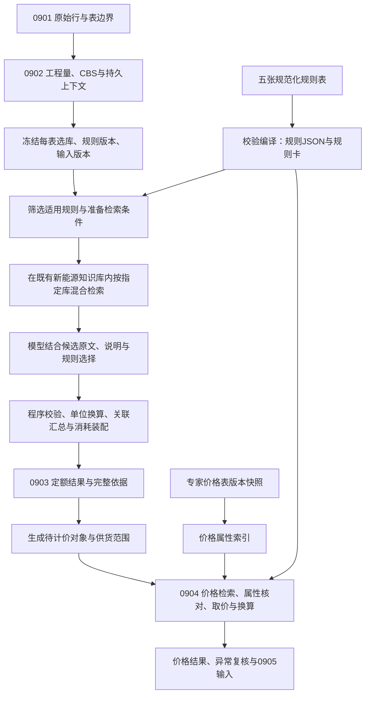
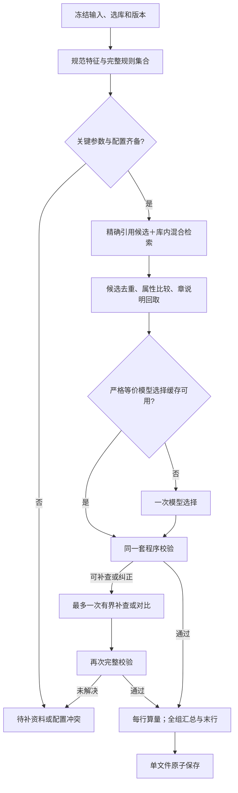
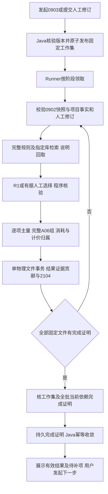
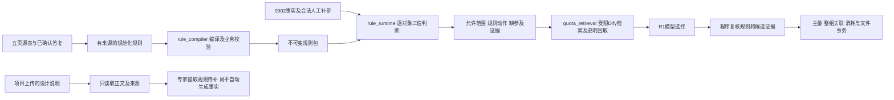

# 智能组价项目接入实施细则

**2026-11-12离线资源实际落地及复核：**当前资源resources/quota-rules/0903-20261112-v5，v1—v4保留。本轮D02七行、D03①四行与D04三行按限定用途闭合，技术待核32→18条；首版95条累计77条按用途闭合、18条部分编译仍阻断。251条表达＝233条无发行阻断＋18条阻断策略；0904仍5条后续。[第二轮跟进清单](../../smart-cost-ai/resources/quota-rules/0903-20261112-v5/materials-request.md)保留12组状态，6组仍需资料、21处关联。220个固定样例与39项离线测试结果单独记录，业务接入与在线验收未实施。

**2026-11-11执行存储精简更新：**按用户确认，0902只新增`sc_file_analysis_snapshot`表。执行版本改存现有任务表`sc_ai_python_task.execution_profile` JSONB字段，保留任务身份、源码、模型配置、规则、CBS及输入版本复核。004迁移已将3条旧执行记录完整迁入任务表，删除两张旧执行表和旧控制函数；无版本依据的历史任务保留RETIRED原因，原任务状态和业务成果未变。新环境按001、002、004升级，已有003的环境只执行004，003保留历史。安装版本312项回归通过，含56项PostgreSQL临时表测试；当前Runner已重启，未执行真实模型或0903。当前实现、迁移顺序、测试和回退边界见[本次精简报告](../20261111-0902-task-execution-profile/report.md)。下文003、独立执行表及硬编码59个历史task_id的描述属于此前版本，不作为当前存储方案。


**当前版本：v1.15，2026-11-13；从属《实施方案.md》v1.20。**继承v1.14有效合同；撤除项目级费用拟建表及生成、补参、查询、恢复分支。命中A06-R084/R085/R086也直接跳过；具体范围见§8.1.4，不影响正常A09和文件内关联。当前业务源码未实现这些分支，本轮仅删除开发要求，不改离线v5原件，不做0904。

唯一实施顺序仍为§10的S0—S5；§17作任务映射，§22作准入/回退，§24作验收定义。当前[acceptance-cases.v1.15.json](acceptance-cases.v1.15.json)保留302个稳定ID（298当前适用、4历史），业务状态仍为NOT_RUN。本次说明及检查见[项目费用撤除记录](../20261113-project-cost-removal/report.md)。

**2026-11-10最新执行决定：撤除未通过收益/质量门槛的0902优化。**用户明确要求“如果优化没用，就把对应优化代码去掉，并将方案更新”。当前正常运行代码已删除OPT01本地缓存/结构索引、OPT02请求JSON压缩、OPT04紧凑编码、OPT05连接池，以及OPT09的CBS并发实现和实验开关，恢复完整15字段对象输出、每请求独立HTTPS、结构chunk/独立CBS范围/文件全部串行。保留完整原文/known/规则、原纠正与截断预算、分类/数量/CBS校验、17列工程量与快照/文件状态同事务、输入/请求/来源和执行版本提交复核。数值修复候选未夹带上线；0903/0904及OPT03不变。已完成300项程序回归（44项PG临时表）、0失败/跳过；旧20份成功任务的101个真实响应重放，两版完整请求/结构/306条工程量/快照相等。本轮没有新增真实模型调用或性能实验，不将重放当作新语义验收；旧失败任务与全部成果未重置。旧优化实现和试用状态以下均为历史。见[实际撤除与验证记录](../20261110-0902-optimization-removal/report.md)。

**2026-11-10 20:17正常服务已恢复：**已启动此前20份全部成功运行的原正常Runner，源码/规则/模型配置与该成功任务冻结一致，五项优化全关、CBS并发1，正常backend_queue恢复。恢复前后工程量、快照、文件、任务及冻结记录指纹全部不变；旧隔离Runner仍停止，新修复候选未部署，新实验20份没有自动重试。不能在旧实验task_id上切换协议。实际进程、启动方式与独立核验见[恢复记录](../20261110-0902-codec-repair/normal-restore.md)。下文暂停状态保留为历史。

**历史停用阶段（随后已恢复正常Runner）：**本次紧凑编码复验未通过后，已确认无活动0902并通过原STOP机制停止旧隔离Runner；前端5173/后端8080仍运行，该停用阶段本地0902队列暂停，20份文件和旧冻结不改。候选未部署；不得将配置中旧true值理解为当前有服务执行。详见最新复验报告的服务状态。

**2026-11-10 §20.3/§22紧凑编码失败修复实际状态：**已在隔离候选补全字段级聚合错误和引用类型说明，361项程序回归通过（含45项PG临时表），保留15字段、原Schema/业务与数值守卫、原纠正预算及无半份保存。真实6份验证仅1份过自动主断言、独立完整语义0/6，因此候选不部署/不启用；旧用户20份仍0成果，当前旧隔离源码和冻结未替换。新任务边界接续及关闭紧凑后的真实对照未实施/未跑，不能把常规失败重试视为新运行。详见[修复与真实复验记录](../20261110-0902-codec-repair/report.md)，未跑的共享限流/并发及其他验收项保持原状态。

**2026-11-10业务问答状态衔接：**按用户最新确认及主方案文首，五张规则表中已列业务问题已有答复，不再把旧台账中的“待答”文字作为重复征询或阻断0902优化的理由。实现时读取主方案、最新逐条目录和答复台账中的有效结论；原文/库映射核验、项目缺参、规则编译及测试分别记录，仅限制依赖这些资料的分支。附件仍列待答的PRICE-01保持独立状态，不推导缺失选价政策。本次状态确认不改变§20业务不变量、§22启用门槛及已有真实验收结论，不自动启用功能或执行0903/0904。

**2026-11-10用户明确要求的隔离试用启用：**用户在获知最新候选未启用后要求“测最新修复后的版本，启用优化，数值修复也启用”，并选择新建独立项目。现仅项目 `OPT20-20261110`（2120108821166653442）采用冻结候选、五项可用优化true和CBS并发1，旧20份任务完成后才切换本地空闲Runner。新任务按明确project/batch及启动基线登记，文件集合限1～20；正常源码/配置、历史成果和0903保留。此次是用户授权试用，不构成§22语义/性能验收通过；下段真实4/6、后续12份codec NOT_RUN及所有历史结果不变。实际状态、运行边界、8项准入测试、组合重放和恢复方法见[试用启用记录](../20261110-0902-user-preview/report.md)。

**2026-11-10本轮数值证据候选验收：**依据下述既有身份候选继续修复理由容量与原文不一致，新增当前原行的明确容量核对及反例，完整15字段codec不变。冻结候选344/344程序测试通过（44 PG、0跳过），Terra独立反例15/15，固定真实响应编码重放6对等价。另行获准的本轮真实试验实际执行6份/20HTTP：容量理由专项6/6、整文件4/6，03光伏分类review、05光伏误归材料；未达到预登记6/6门槛，后续12份真实codec对照及其冷/热统计NOT_RUN，未补样本或改阈值。该业务正确性候选没有部署或启用，不代表常规Runner已采用新校验；全部优化仍关闭、CBS并发1，0903/0904及历史成果不变。对应§4.3、§16、§20.1/20.3、§22、§23.2/23.4的实测与边界见[数值修复报告](../20261110-0902-numeric-evidence/report.md)、[独立审查](../20261110-0902-numeric-evidence/terra-review.md)和[交接](../20261110-0902-numeric-evidence/handoff.md)。旧验收目录只追加本次相关条目的新证据，不改变未跑条目和历史业务定义。

**2026-11-10后续问题修复候选：**用户追问共同物名继承纠正失效后，已准备隔离候选，针对“原行仅容量、空inherit、删除分类引用后仍漏物名”的明确子集增加保守检查，并加强首轮/纠正指令。候选318项程序测试通过（含43项PG临时表）；用户另行授权的12份真实对象协议对照已完成，基线主断言2/6、候选6/6，但独立补充审查发现候选1份分类理由将3200kVA写成3000kVA，不能认定全部语义通过。候选未替换运行源码，不证明任意继承祖先语义正确，也不能作为紧凑编码真实验收。该检查属于业务完整性校验变更，不能按纯性能优化自动发布。候选、数据和未覆盖边界见[问题修复候选记录](../20261110-0902-identity-repair/report.md)。下面上一轮310项测试、42次试点和全关状态仍按其实际版本保留。

**2026-11-10 0902优化实施更新：**本次用户已授权实际实现§20的OPT01/02/04/05和OPT09中独立CBS范围调度的最小部分；当前状态见本节、§20、§22及[本轮报告](../20261110-0902-optimization/report.md)，不再沿用下文历史“只改规划”的范围描述。310项程序测试通过、0失败、0跳过；42次真实模型试点26次通过预登记金标主断言、16次失败（主断言不等于全部名称、具体CBS叶子和来源语义均合格），未满足真实质量与p95启用门槛。独立gpt-6.1-terra/xhigh界面验收完成真实新任务，同事务和历史保护通过，但光伏组件分类及既有容量重复展示未通过。所有优化仍关闭、并发1；003增量迁移仅增加0902配置冻结及禁用代次，完整共享限流、统一新run/STALE和0903/0904没有实施。旧验收登记只追加本次涉及条目的证据，不将历史业务用例整体追认为通过。

**2026-11-10快照接入更新：**按用户后续实施授权，已完成§4.3限定的0902快照表调整及同事务写入，`run_id`改为既有任务`task_id`，保留输入版本和格式版本；数据库增量迁移已应用，离线与临时表PostgreSQL测试通过。本文其他阶段仍按规划执行，不据此宣称0903或完整§18运行/失效合同已实现。此前“只改文档”的范围说明保留为历史状态，本次实现范围以§4.3及其验收记录为准。

**2026-11-10来源更新（历史轮次，业务答复继续有效）：**当时从属主方案v1.9，以最新版规则表及专家答复替代旧行号/通信关联/价格状态。来源证据见《20261110-规则更新与专家答复证据.md》。旧v1.4登记作为历史；当前已按文首v1.15入口重编，仍不代表业务功能已实现。

历史版本说明：v1.4（2026-11-08）从属主方案v1.8，曾纳入优化审查、验收和回退；当时的问答前提已被2026-11-10用户“五表已列问题全部得到答复”及后续具体答复更新。业务疑点不重复询问，PRICE-01、资料核验和项目缺参分别处理。v1.1算法、v1.2数据/事务及v1.3 Dify有限样本证据继续作为相应历史依据，不等于业务闭环已通过。当前版本见文首。

当前业务权威入口为主方案v1.20和本细则v1.15；`acceptance-cases.v1.15.json`按最终Markdown原始字节重编，保持稳定ID和历史状态。JSON和[完整实施提示词](../20261112-0903-second-review-integration/Codex-0903完整实施提示词.md)是派生材料，旧登记和旧资料包仅用于历史追溯。

现状输入：用户提供的 `E:/smartCost/smart-cost-ai/20261105-工程量AI服务业务与实现详解.md`、实际源码、`E:/smartCost/docs/adr/0006-file-stage-reexecution-and-resume.md` 及既有规范化方案。业务意图以用户确认和ADR已确认事项为准；“已经实现”的判断以本次读取的源码为准。说明文档中的泛化介绍、效果表述不作为功能验收证明。

## 1. 接入结论与边界

保留“Vue界面 → Java创建任务 → Python常驻Runner → PostgreSQL成果”的现有架构。0902继续编制工程量并挂CBS；本次方案完善同一AI工程中的0903定额匹配处理器，0904价格处理器留后续S3、不在首版注册。原有设备/主材分类规则继续服务0902，A05/A06/A07/A09/A11形成独立、可版本化的匹配规则包，不直接塞进现有 `classification-rules.json`。

**模型负责理解特征、结合规则判断候选；程序负责检索边界、条件校验、单位换算、数量计算、关联汇总、防重和事务写入。** 不把全部业务决策写死为关键词规则，也不让模型凭记忆生成定额编号、价格或计算结果。

用户已建好的新能源定额知识库直接作为0903检索来源：

- 管理定位：[用户指定的新能源定额知识库文档](http://10.1.40.154:18080/datasets/86623929-c7a4-488b-9aba-893463272376/documents/7a435e0e-ad91-4d46-b836-29562e7372c4)。
- 数据集ID：`86623929-c7a4-488b-9aba-893463272376`；该链接中的文档ID：`7a435e0e-ad91-4d46-b836-29562e7372c4`。
- 这是用户指定的现有数据源，不要求重建知识库。管理页面地址不是程序检索API；单篇文档ID也不等于整个新能源库的检索范围。接入登记实际API地址、鉴权、数据集与库版本映射，检索该数据集中与CBS选库相符的全部有效子目及说明。
- 原先另一个文档链接与新链接属于同一数据集。保留原证据引用，运行配置采用核验后的数据集映射；不把两个文档误当作两个定额库。
- 2026-11-07已通过API读取指定数据集、文档与元数据，并完成6组混合检索/范围筛选对照。API根地址为`http://10.1.40.154:18080/v1`，知识库报告9868份文档available；接口与有限样本筛选已验证，不再笼统列为“接口待确认”。浏览器页面读取仍受工具限制，但不影响独立API证据。完整库映射、章说明覆盖、正式业务接入和准确率仍待实施验收；证据与边界见第19节。



## 2. 现状核对：复用什么、补什么

以下路径相对 `E:/smartCost/`，均为本次源码检查结论，不是运行验收结论。

| 能力 | 当前源码 | 接入处理 |
|---|---|---|
| 0902结构识别、计量、分类、CBS | `smart-cost-ai/ai_service.py`、`quantity.py`、`cbs_matching.py`、`classification.py`、`analysis_snapshot.py` | 已有同事务快照；复用算法，继续补有来源的逻辑表/工程范围和有效性消费，不由0903重新猜结构或倍数 |
| 任务领取与保存 | `smart-cost-ai/runner.py`、`repository.py`、`config.py` | 现在只执行0902，配置硬校验2101/2102；增加阶段分发，不能只把task_type改成0903 |
| Java阶段任务 | `modules/ai/service/AiPythonTaskService.java` | 已有0902/0903/0904对应2101/2103/2105；补原子发布、准确批次归属、分阶段续跑和重做退回 |
| CBS库配置 | `modules/project/service/ProjectCbsDeLibraryService.java` | 现为单位工程节点上的多库关系；补每张逻辑料表的执行库绑定及版本，不能把节点多库直接交模型任选 |
| 定额基础资料 | `modules/quota/service/QuotaKnowledgeService.java` | 复用按库查询目录、子目、消耗；与现有知识库建立ID映射和内容一致性校验 |
| 匹配结果存储与维护 | `modules/matching/model/FileItemMatch*.java`、`QuotaMatchService.java` | 复用match/consume/relation；补决策证据、关联贡献、末行挂载、失效标记与统一重算 |
| 价格维护 | `modules/price/service/PriceKnowledgeService.java` | 现有A:F导入和关键词LIKE查询；补指定来源快照、幂等导入、属性索引与自动匹配 |
| 前端阶段页 | `smart-cost-web/src/views/smartCost/project/manage/ManagePage.vue`及`quota/QuotaMatchPanel.vue`、`QuotaSelectDialog.vue` | 已有0903结果与人工操作，扩展版本、缺参/冲突、待更新和证据；不重复新建QuotaMatchPanel，0904现状另按实际源码核对 |
| 规则管理 | `smart-cost-web/src/views/smartCost/knowledge/KnowledgePage.vue`及`components/RuleA06Panel.vue` | 已有A06维护界面；修正人工配对隔离，新增正式规则包校验/发布，现有维护记录不自动成为已批准可执行版本 |
| 上传解析 | `modules/raw/service/RawMaterialFileService.java`、`MaterialFilePanel.vue` | 当前PDF/Word，一个物理上传文件形成一个ParsedTable和连续行流；未见Excel上传或显式逻辑表边界。61份资料中XLSX需补解析支持后才能进入同一端到端流程 |

特别注意：现有 `FileItem` 的17列不含原始行映射、逻辑表ID、单项工程实例、计量来源或完整结构角色；`sort_no`是实物同级顺序。不能直接以它确定全表最后一条源行，也不能从CBS名称反推出料表中的“（一）”“（二）”。

## 3. 先把业务答案固化为可执行规则版本

### 3.1 答复关闭后的整理步骤

1. 将逐项答复写入原问题ID对应记录，保留原表文字、修正值、适用范围和确认来源；已确认纠错不覆盖原证据。
2. 完成逐业务片段拆解。已有287非空源行的119个分组去向仅是覆盖索引，不能代替每条条件、公式、排除和例外的映射。
3. 产出规范化Excel、字段/单位字典、库与子目引用、规则验收用例。只处理A-05、A-06、A-07、A-09、A-11；不增加对其他页的读取。
4. 编译为同一版本的 `rules.json`、`rule-cards.jsonl`、`source-map.json`、`unit-dictionary.json`、`test-cases.json`、`manifest.json`。规则卡由结构化规则生成，不另行维护第二份规则正文。
5. 通过覆盖、类型、公式量纲、条件边界、冲突、引用和业务金标检查后登记为可执行版本。版本不可原地修改，修订产生新版本。

### 3.2 五页在程序中的明确职责

| 规则来源 | 编译类型 | 执行位置 |
|---|---|---|
| A05 | 适用范围、主项选择器、选档指引、例外借用 | 检索前限定与扩展候选；模型选择时提供指引；选择后校验 |
| A06 | 关联关系、数量表达式、汇总范围、排除、防重、费用处理 | 主项选择完成后的关联计算；金额类交费用对象，不伪装成定额工程量 |
| A07 | 单位字典、专用换算及所需参数 | 定额量计算；专用换算不得扩散到其他用途 |
| A09 | 场景、阶段、计价分流、包含/排除 | 识别指标/定额适用路线；选择和防止重复计取 |
| A11 | 有作用域的表达映射、属性解析、单位或参数化比例 | 定额检索特征准备、价格检索与核对；“等同”不直接授权同价 |

规则解释器只允许声明的比较、AND/OR/NOT、单位转换、查字典、分组求和和审定公式运算；不用 `eval` 执行Excel或模型输出。条件结果为满足、不满足、未知；缺参不能自动走“不满足”的默认分支。

所有适用的强制规则先按专业、阶段、对象、库和条件字段完整筛选，不能只靠规则向量TopK召回，否则可能漏掉排除条款。模糊对象的规则可作为候选指导模型识别对象，但未确定对象前不能执行其专用公式。强制规则必须完整进入校验；示例、软偏好和检索别名按其标记使用。

A05第21行保留四库对应职责，35kV→YD8-46错误映射失效，保留原值和用户备注“电力定额按电压档另选，不沿用4-3202”。从2018版实际章节绑定正确子目ID、编号、名称和单位。业务答复齐全并不替代实际库引用核验，实施Agent负责完成核验，不猜号。

## 4. 0902与下游的数据合同

### 4.1 保存计算结果，也保存形成结果的依据

在 `build_file_result()` 形成实物结果及全行映射后同步构建 `FileAnalysisSnapshot`；与 `sc_file_item` 在同一单文件事务提交。既有`build_item_records()`保留为返回实物列表的兼容入口，正式Runner只构建一次。保留现有17列成果及页面兼容性，新增附属快照，不将下游业务字段全塞进remark。

每个实物及相关来源片段至少提供：

| 字段 | 用途 |
|---|---|
| project_id、batch_id、file_id、file_item_id、input_revision | 归属、并发检查、旧结果失效 |
| logical_table_id、table_boundary_refs | 识别逻辑设备/材料表；同一文件多表不能混算 |
| source_raw_ids、primary_raw_id、source_order、source_position | 保留完整来源行集合及主物料行；确定挂载末行，不能按UUID、插入时间、异步完成顺序或界面排序决定 |
| subproject_instance_id、scope_title、scope_source_refs | 区分料表各单项工程实例；同名也不能自动合并。v1.0/v1.1的single_engineering_scope_id为同义旧名，迁移统一映射，禁止作为第二种分组口径 |
| project_cbs_id、cbs_path_snapshot | 0902已确认的挂接结果；与料表单项范围分开存 |
| original_role、original_parent、assembly_owner、merged_into、supply_scope | 识别成套/组成件及已经合并的来源，支持防重复计价 |
| raw_quantity、raw_unit、quantity_basis、basis_refs、multipliers、physical_quantity | 保留原量与已算总量，后续不再乘一遍每台/每处基数 |
| attributes及每项source_refs、missing_fields | 电压、外径、壁厚、材质、敷设方式等可核对特征；区分有证据的值与未知 |

快照还保存全部结构行、pending行及其处置，不只保存已出表实物。这样可以检查一个电缆汇总组是否存在尚未确定的成员，避免把缺失行当作不存在。

现有 `partition_scopes()` 为CBS匹配按最近project/section划范围，不能直接当作A06的单项工程分组。新上下文从已校验完整祖先链区分单项工程与专业章节，并记录对应源行；证据不足的范围留待补，不能仅凭同一CBS合并。

### 4.2 逻辑表与历史成果

- 0901需新增保存物理表、页、原行边界，0902根据连续表头和章节等证据识别逻辑表；跨页续表属于同一逻辑表，多张独立表即使同文件也分开。当前FileRaw只有连续orderno等业务字段，不能声称这些位置已经齐备。边界不能可靠提取时记UNKNOWN并要求补充该范围依据；旧原始行无位置不伪造坐标。经验证一文件一表时可采用与file_id对应的稳定逻辑表键。
- 单项工程键基于逻辑表和范围锚点生成，不使用标题字符串单独去重；重做产生新输入版本并保持来源映射。
- 范围依据可来自原文工程标题、表头或明确的工程范围说明；缺少内部“（一）”标题不必然没有范围。须保留真实来源及适用行，不能从CBS名称反推、从相似项目补范围或默认整文件属于一个单项工程。实施门槛见第18.1节。
- 历史0902成果无附属快照时，仅在已有完整、对应版本的结构证据足够时可受控回填；不能从remark猜测后宣称数据齐全。需要重新编制的历史批次进入明确重做流程，先显示影响范围，再依ADR-0006替换；实施升级本身不自动重做用户成果。
- 0902未挂CBS、数量未知、类型待确认必须在界面可见。文档提及的待确认项被查询过滤问题要在接入时核验修正。未解决对象不能悄悄从“全文件完成”统计中消失。

普通A06的范围身份同时携带所属project_id、batch_id、file_id；logical_table_id在该文件命名空间内由稳定表边界/来源锚点标识。跨页续表仅指同一物理文件内有据延续，不把两份上传文件的相同局部表号、同名标题或相同CBS当成同一组。该身份在读取、人工修订、组装、保存及查询时逐层复核。

### 4.3 已实施的精简快照合同（2026-11-10）

本节是用户确认的本次0902实施范围，归入§10的S1数据底座，不另立实施计划。未覆盖的§4.1/§4.2及§18要求仍为后续接入门槛。

- **表结构：**`sc_file_analysis_snapshot`保留10列：id、file_id、task_id、input_revision、result_revision、snapshot_schema_version、snapshot_data、create_user_id、create_org_id、create_date。task_id引用现有任务身份；request_id保存在正文并用于本次请求复核，不新增逻辑run。`file_id + result_revision`唯一，历史快照追加、不覆盖。
- **真实输入版本：**`sc_file.input_revision`由表头及原始行增删改触发器维护。现有输入从迁移基线1开始；计数可跳号或一次重解析递增多次，不编造历史版本。短事务持文件共享锁读取一致输入，模型调用时不持锁；提交持文件更新锁，同时核对任务请求、文件归属、版本及原文指纹。输入变化拒绝旧结果提交。
- **构建与保存：**原结构、分类证据、数量和CBS校验保持不变；先完成成套归并，再由同一次构建的真实item ID生成映射。保存全部原始业务行、完整结构及证据、pending、合并去向、计量来源和实物量。Decimal按精确字符串存JSON；实物量与数据库numeric(18,6)实际值一致，同时保留计算原值，不再乘倍率。新增过程不调用模型。
- **原子性：**现有清理旧工程量及关联下游成果、插入17列工程量、追加快照、更新2102共用同一个文件事务。快照失败时整份文件回滚，不能降级为只写工程量。此前成功文件保留；失败续跑和明确重做沿用ADR-0006。结果版本在文件锁内分配；MAX只用于下一编号，不用于认定当前有效成果。
- **如实保留缺口：**目前只有连续原行顺序，没有可靠逻辑表边界，所以logical_table为UNKNOWN；不新增虚构表/页坐标。显式project祖先以file_id及源行锚点区分，同名不合并；此键仅标识可追溯的工程标题实例，不能充当已确认的A06完整分组。缺工程范围、供货范围等信息保留UNKNOWN，不按CBS猜测，不提前选末行。
- **消费边界：**本轮不做0903、规则匹配、完整run/STALE及人工修订后的自动失效处理。人工编辑不会更新旧快照；将来消费必须检查输入版本、当前工程量与items_fingerprint及范围完整性，不能直接读取最大版本后套定额。没有快照的历史成果不自动回填或重算。

实施顺序为：核对现库及空快照表 → 应用001/002增量迁移 → 部署Python模块和Schema → 配置检查/正常启动Runner → 后续授权0902任务自动保存。当前测试库已完成迁移和代码接入，尚未发起真实模型料表重算或界面验收。快照写入失败、版本核验异常或映射不一致时停止受影响文件；保留已提交版本，修复后按续跑/重做语义处理。应用回退不得删历史、重置版本或恢复只写工程量的旧写入器；整体撤回时先停止任务处理。

2026-11-10后续真实验收：已启动正常Runner，由用户指定gpt-6.1-terra/xhigh子Agent通过现有界面创建独立一文件测试项目，真实执行魏大湾设备表0902。8条原行生成4条设备及1份快照，工程量/快照/文件2102的xmin均为70254，输入版本10、结果版本1、格式1.0；22项只读检查通过，旧成果和0903不变。上述“尚未发起”为接入阶段历史状态。界面刷新读取通过，但箱变规格重复显示单列非阻断FAIL；只证明本样例保存主路径，不替代完整§18或其他业务验收。完整版本、启动方式、用例及证据见[真实验收交接与报告](../20261110-0902-snapshot-live/report.md)。

已执行验收：244项离线测试及33项PostgreSQL临时表测试通过，覆盖完整角色与pending、同名不同工程、绝缘子串归并、持久化精度、快照故障回滚、源数据修改拒绝、请求替换拒绝、重做追加历史、失败后仅续跑剩余文件，以及正常Runner回放无新增模型请求。证据见[本次接入报告](../20261110-0902-snapshot-integration/report.md)。这些是程序合同测试，不替代旧业务验收登记重编、真实模型准确率或§18全部门槛。

### 4.4 项目设计说明：先接入读取，关键信息提取待专家规则

**2026-11-12用户明确边界：**设计说明必须进入接入方案；客户正在梳理其中关键信息的提取规则，用户计划下周取得后再补入方案。本版只定义文件读取、版本、原文及来源，不制定业务字段清单、自动提取判定、默认参数或冲突优先规则，不声称设计说明已能直接驱动自动选定额。

当前真实入口是`ProjectDialog.vue`的新建/编辑项目：项目保存后，通过现有上传接口登记多个设计说明，`sc_file.master_type=1001`（项目）、master_id=项目ID、type=1103（普通附件）。它们不是按批次保存的设备/材料表。现有`FileService`提供登记、列表、内容流和删除，尚不能据此宣布0903已读取设计说明。当前1103语义是普通附件；首版必须核对文件确实来自设计说明上传入口/经用户确认，不能把未来所有项目附件都当设计说明。

| 读取步骤 | 拟实现逻辑 | 产物/异常处理 |
|---|---|---|
| 选定本次文件 | Java按项目权限列出实际已上传成功的设计说明，任务发布固定文件集合；不是扫描工作量目录或读取A08规则页 | task.execution_profile.profile_data.design_documents保存file_id、归属、原名、格式、内容SHA-256及读取器版本。上传界面“保存成功”不证明每个文件上传成功，需核对服务器列表 |
| 取得内容 | 按§8.2.3首版通路：Java经既有FileStorage发布受控共享内容副本，Python按ContentRef取字节；核对大小/哈希，原附件删除后副本仍可追溯 | 不默认Python与Java同机；不按客户端任意路径读取。缺文件/哈希变化明确报来源问题，不转空正文 |
| 读取正文 | 新design_document_reader.py适配DOC/DOCX、PDF和实际允许的Excel格式；复用能验证的现有解析组件，只提取段落/表格/页或sheet锚点 | ReadingSnapshot含文档ID/哈希、解析器版本、原文段落/表格及位置、读取状态。DOC转格式如需使用工具须保留原文件及转换指纹；扫描PDF无可靠文本标NEEDS_OCR，不伪造正文 |
| 保存读取结果 | 原文件/完整读取结果放受控内容寻址文件，任务保存引用、哈希和读取凭据；小型证据引用进入0903快照 | 不为设计说明再新增数据库表/列，不把大段全文写进每条match或每次模型请求。历史任务引用内容保留，不因现有附件删除接口删物理文件而丢失证据 |
| 留出业务接入 | 提取状态固定EXPERT_RULES_PENDING，明确与读取状态READ_OK分开 | 规则未提供前，不自动填ItemFacts，不根据正文生成硬过滤、系数或供货范围。已由料表/合法人工证据确定的独立链路可继续；确实缺设计参数的对象NEEDS_INPUT |

设计说明一项目可多份，原文之间的矛盾先保留，不能自动用最后上传的覆盖。改换/增删说明后，原任务仍指向原版本，相关新业务执行需新的明确输入边界；正式依赖说明的结果应失效并重算，保守范围由任务记录的文档依赖判定。未启用提取前，不因此把所有无关料表一律重算。

后续专家规则到位时，用户再补充“提取字段、适用章节/对象、来源及作用域、单位、缺参/冲突处理、模型输入片段和验收例”。届时采用单独版本的design_extraction_rules，与五页规则来源区分；不先建A08规则库，不用大模型猜出一套代替专家。现阶段完整设计说明可供人工/Gemini阅读理解，但它的文字是资料，不是执行指令；正式自动选定额只有经过审定接入的相关事实和证据才可进入SelectionPacket。

## 5. CBS每表选库与现有知识库接入

### 5.1 选库配置

保留现有“单位工程关联库”作为可选库集合，在CBS节点下增加“关联料表 → 执行定额库”配置：

- 最小绑定键：`batch_id + logical_table_id + project_cbs_id`。同一逻辑表涉及多个CBS时分别列出对应部分；每个部分有明确执行库及版本。同一张表整体选同库时可以批量填充这些绑定。
- 配置保存库ID、版本、来源节点、配置修订号、适用范围。节点唯一库可在界面预填并明确展示；多个库时不能任意取第一项，也不能默认全部参与检索。
- 若经业务确认的场景确实允许多库，则绑定必须同时包含明确优先/回退条件，并分别检索；模型不能用相似度自行扩大允许库集合。
- 任务创建时固定绑定快照。规则只能在此边界内辅助选择；跨章借用不等于跨库。规则与指定库存在强制冲突时显示配置冲突。
- 运行期间变更配置使相应结果失效，正在执行的旧版本不能作为新配置的有效结果提交；续跑使用原运行快照，需改配置则走明确重新执行。

### 5.2 检索适配器

建议内部接口（不是对现有知识库API形状的假定）：

```text
retrieve_quota_candidates(
  query, allowed_libraries, library_revisions,
  chapter_or_item_selectors, retrieval_profile_revision
) -> candidates + retrieval_evidence
```

接入登记 `业务定额库ID/版本 → dataset_id + 可执行过滤条件 + 索引版本`，首版存§8.1.6的版本化配置文件，不增加定额库表字段。关键词检索处理准确名称、编号、型号，语义检索处理表达差异；在允许范围内融合并按需重排。TopK、融合权重、阈值用独立金标集调试并随检索配置版本保存，不在方案中假定某个数值天然正确。

**库ID和版本必须在取TopK前限定。** 只把库名拼进query，或全库召回后剔除异库结果，均不满足本任务要求。当前已验证路径采用`POST /v1/datasets/{dataset_id}/retrieve`及`retrieval_model.metadata_filtering_conditions`，默认复用现有元数据筛选，不需要为了本次过滤需求另建索引。第19节记录有限样本的正反例；未来换库/版本或扩展范围时若发现能力缺口，再按第18.2节局部处理，不能把本次成功外推为全部范围均已验收。

候选至少带：库ID/版本、真实子目ID或可唯一解析的联合键、编号、规范名称、目录、单位及倍率、工作内容、适用/包含/排除、章说明引用、document/segment定位、检索分数及索引版本。同号跨库不能去重；同一子目多个片段应组合为同一候选并保留各引用。

模型选中后从业务库 `sc_de_item/sc_de_consume/sc_de_rcj` 核对并装配数据。知识库与数据库的编号、单位或版本有冲突时停止该对象写入并报告“基础资料不一致”。知识库有子目但业务库无对应基础记录/消耗时先完成导入映射与验证，不能凭正文编造消耗。当前只读子目和消耗接口可复用；章节说明完整性需另核验。

### 5.3 接入验收必须先做的检查

1. 连通、鉴权、指定数据集读取及混合检索已完成本次实测，复用第19节证据；部署环境、权限或接口变化后再运行相应回归，不重复询问用户是否已建库。
2. 本次6组覆盖指定库/版本组合、Top1变化、空范围和冲突范围；同号不同库、同名不同版本及全部正式使用范围的反例仍须扩展，保存请求范围与结果元数据。不得把6组样本通过等同G3整体完成。
3. 对实际新能源样本核对目录、子目、单位和章说明的召回与回取；包括精确编号查询、范围查询及跨章借用证据查询。
4. 区分真实无适用子目、TopK未召回、索引缺失、接口失败。后三者不能证明“第八章缺项”。
5. 固定被测知识库映射版本与索引覆盖清单，再进入真实自动套项。

## 6. 0903：先主项，再关联，再消耗

### 6.1 单个文件的处理顺序

1. 读取0902成果及上下文，验证CBS、选库、数据版本、规则版本和必需参数。
2. 使用A11等规则准备标准特征，同时保留原始名称、型号和属性；使用A05/A09形成场景、章节、选择器、排除及必需参数。
3. 在指定库混合检索，回取适用章说明。具体关联编号也必须在指定库中存在，不能仅因A06写了编号就直接造记录。
4. 普通路径中模型输入“本对象事实 + 必要成套/范围上下文 + 适用完整规则卡 + 候选原文 + 说明”，输出候选ID、规则引用、事实依据、差异和缺参；只允许选择提供的候选ID或返回待补/未匹配。第13节另定义经专项验收才可启用的严格等价模型选择复用路径，仍执行同样的候选和规则校验；唯一明确规则可以缩小候选，但首次正式选择仍由模型确认。
5. 程序核验库、版本、条件、关键属性和候选存在性；用Decimal及单位字典计算主定额量。模型可以提出选项和计算所需参数，不直接决定最终浮点计算值。
6. 全文件主项判断完成后执行A06组级计算，生成关联项目、贡献列表和挂载行。即使模型分批调用，也不能按每个模型批次分别汇总。
7. 从真实定额基础消耗装配工料机，对设备/主材确定包含、追加消耗、独立计价或待确认处理，形成0904的唯一待计价对象集合。
8. 在事务外完成模型与检索；进入单文件短事务后复核任务和输入版本，替换该范围旧成果、写入match/consume/relation与证据、更新2104，全部成功才提交。

### 6.2 主量、关联量、价格量分开

`physical_quantity`是0902已经计算的实物总量。`quota_quantity`由目标定额单位及专用规则得到；`price_quantity`按最终价格记录计价单位得到。三者各有单位、公式、参数来源，不能覆盖成同一个quantity。

示例：本单项工程电力电缆100m和0.2km，主项分别为1和2个100m。按已确认A06规则，关联基数为3个100m，4-3141为1.2、4-3143为0.9个100m。原始材料合计仍300m；若价格按元/m，价格量为300m，不能使用3、1.2或0.9计材料价。

### 6.3 关联汇总与末行挂载

普通A06业务分组键为：`project_id + batch_id + file_id + logical_table_id + subproject_instance_id + rule_group + 类别/已确认附加分组条件`。前三项是所有权/文件命名空间，其余分组条件继续沿用已确认规则；不增加按CBS拆组。每个成员及anchor须属于该project/batch/file，逻辑表和范围锚点须有稳定来源；跨物理文件的普通A06合组明确拒绝。同类别不同型号、不同主项编号只要满足已确认范围就可同组；不同单项工程、不同逻辑表不混算。CBS/选库配置用于执行边界校验和版本追溯，**不能据此自动拆开用户已确认的汇总组**。同组成员出现不同CBS/绑定时，检查是否具有一致且明确允许的目标库/版本、相容单位及已明确的关联归属；若满足，仍按原业务组计算；不满足则报该组配置冲突并暂缓正式关联，不擅自拆组、选交集中的某个库或跨库汇总。

- 所有成员先换成关联基准单位，再求和、乘规则系数；已换到100m的市话长度不再乘10。
- 每组先检查成员完整性；缺归属/数量/适用性时保留独立主项草案，关联为待补，不把未识别行排除后形成偏小的正式总量。
- 每条关联结果只生成一次。挂载 `max(source_order)` 的合格物料源行：必须是实际参与该组且已匹配适用主项的物料行，不是它后面的note/attribute或已合并的非独立组成件。保存 `anchor_raw_id → anchor_file_item_id` 唯一映射；无法唯一对应保留实物时暂缓挂载，不退到上一项假成功。前面各行保留主定额，不重复展开同组关联。
- 建议关联match的 `file_item_id` 指向该末行，`is_main=0`；relation表示该末行主项与关联项的显示关系。**全体贡献成员及贡献量另存**，不能为每个贡献主项都建立会被界面展开的同一关联关系，造成重复展示和合计。
- 唯一业务键包含分组键、规则修订、目标关联子目；run_id仅追溯。新版本结果替换旧有效集合，旧版本在审计记录中保留但不参与当前总价。
- 上游修改数量、型号、CBS或主定额后重算受影响整组；末行变化时移动挂载并清理旧关联。失败续跑不能重算已成功文件，明确重新执行按ADR替换。

A06各类别采用各自规则包，不能泛化为“电缆都带两项”：电力电缆第37—38行两项；信号（屏蔽）及控制电缆第39行只带4-3141；通信第49/51/53/55行的4-3143已划除。管道市话第54行4-3141由用户明确保留，并按同一料表内各单项工程分别汇总、挂各组最后符合条件的管道市话源行；第55行4-3143仍划除。第72—73行独立于第37—38行，4-3143按同一单项工程至少三种不同型号或规格触发，两条关联各以汇总量计算并分别采用0.4和0.3，不重复计取。

A06-08管沟土方按对应分组的累计管长及实际宽深计算总量，扣除同一沟段、同一土方工作在料表或其他项目中已计量；净量不大于零时不生成关联行。组成员、已计范围、单位和扣减分配须有证据，可追溯且不重复扣减；无法判断时相关组待补。规则合同与示例以主方案“A06-08：管沟土方扣除已计量”和T51—T52为准。

A06-13第84—86行项目级费用自动生成按用户最新要求撤除；无论参数缺失或齐全均跳过，不形成专用待补，也不阻塞正常文件处理。完整边界见§8.1.4及主方案A06-13、T36、T53—T54。

A09-02同一对象优先标准化模块，未设模块时选择2022版石油建设安装工程概算指标对应章节；道路、建筑/总图/结构和阴极保护按用户明确的专业口径处理。已覆盖防腐及穿越内容不得重复计取；穿越单出图后仍核对主管线指标实际覆盖范围，未覆盖工作有明确计价依据时可补充并在编制说明单列。完整条件见主方案A09-02专项及T57—T60。

A09-06同一项目同时符合屋面光伏和产建分布式光伏条件时，优先第40行屋面光伏估算指标；第39行仅作为产建分布式光伏（非专项工程）的补充指标，不作为屋面默认，项目内两项只能计一项。指定库不可用或场景条件不明时按主方案A09-06专项及T61—T63处理。

§9的历史共享关联/跨文件引用只用于核查真实清理和失效依赖，不授予新普通A06跨文件汇总能力。发现确证的新跨文件业务时另按原始资料及用户确认修订；当前不为假设新增跨文件协调器。项目级唯一费用仍按原项目范围处理，不受普通A06文件组合同误限。

### 6.4 消耗与费用合同

把基础定额“单位消耗含量”与“本次定额工程量乘出的总消耗量”显式分开。适配器按源库合同标记quantity_basis；写入现有consume.quantity前固定一种口径并同步Java汇总函数和界面，避免双方各乘一次定额量。基础单价、单位基价和总费用也逐字段定义；原始快照独立保存，不能为适配旧字段而丢失。

2026-11-07源码复核：当前`QuotaMatchService.items()`主要返回已有quantity/price；`updateMatch/updateConsume()`写入数量等字段；`manualMatch()`复制基础基价。所读匹配服务及相关引用中未见实际执行总消耗汇总或“两次乘定额量”的路径。因此双乘是需防止的集成风险，不是已证实的现有计算缺陷；新增统一计算合同与两端对账是S2准入条件，见第18.3节。

`material_handling`复用现有含义：包含于定额、追加设备/主材消耗、待人工确认。原实物、成套母项、组成件、定额基础消耗之间建立待计价归属关系，同一采购范围只形成一个有效价格对象；不能因0902保留了母子实物就一律给母子同时计价。

A06中吊装、运输、费率、据实等形成带基数/次数/距离/阶段和来源的费用决策。金额不写进定额数量字段；在匹配页展示依据，并通过独立费用合同供0905使用。本轮不借机重写0905取费和报表，但必须把这些规则的去向实现，不能声称“规则全接入”却丢掉金额类。

## 7. 0904：专家价格表作为独立、受控的价格来源（后续S3）

本节保留后续阶段的业务合同。本轮只完善0903；price_catalog.py/price_matching.py、价格写回/证据存储及价格结果界面不进入本次新增实现清单。

### 7.1 一次准备与增量更新

使用用户指定GS1.2价格工作簿，不向定额知识库混入价格记录，不扩展外部报价来源。原文件只读。以文件SHA256建立 `price_source_snapshot_id`，每行建立来源键 `snapshot_id + sheet + row`，关联真实 `sc_price.id`。

现有104,317行可批量解析和建立索引：保留A:F原值、从物料描述提取标准属性及原文跨度、规范单位并保留原单位。规格列为空不能解释为规格不限。已发现零价/缺单位/缺来源记录按最终确认政策标记状态，不默认为免费或用相邻行补值。

同快照重复导入应复用同一来源行，不再产生新价格记录；新文件版本创建新快照。现有导入每次新UUID、单价舍入6位，需要补来源幂等与原值快照，内部计算精度及最终金额舍入按最终业务口径执行，不能让导入舍入隐式成为业务政策。

### 7.2 运行流程

1. 从0903产物生成 `PricingSubject`：设备/主材独立项、追加消耗及最终确认范围内的其他消耗。每个对象包含归属、规格、供货范围、物理量及单位。
2. 冻结指定价格来源快照和取价政策。CBS选库只限制定额，不能误用其de_library_id过滤专家物料价格。
3. 标准对象/型号/编码关键词与描述语义混合召回，前置限定来源快照。索引记录必须映射到可核验的price_id及来源行，不能混用历史任意导入记录。
4. 用A11标准特征辅助检索，再逐项核对材质、尺寸、性能、用途、供货范围和其他必需属性。候选提供的属性不能反写成原设计事实。
5. 多条均适用时执行最终确认的取价政策；模型不得自选最低价/最高价/最新录入。无法满足政策或关键属性缺失时保留待确认，并展示原因。
6. 程序计算价格单位转换、等效单价与金额，用三套数量合同验证金额守恒。价格表是不含税单价来源；税率、运杂等仅按已确认计价口径处理，不能模型估算。
7. 单文件短事务更新对应match/consume价格及汇总，并保存price_id、来源行、属性比较、规则、公式、单位和政策版本；更新2106。独立实物价格与定额基价通过明确字段角色区分。

例如10块620Wp组件，合成测试价0.80元/Wp：价格量6200Wp，金额4960元，每块等效496元；安装定额量仍依据安装子目计算。钢管只有长度时按已确认裸管规则转换；设计已给可用吨位则直接用，不能重复套理论重量。

## 8. 持久化与接口改造清单

### 8.1 数据库增量：两张业务表及最少必要字段（2026-11-13）

#### 8.1.1 取舍与统一名称

当前0903只拟新增两张表：`sc_file_quota_snapshot`、`sc_match_revision`；0902已有`sc_file_analysis_snapshot`不动。项目级费用自动生成已经撤除，其职责不转移到其它表，不建设对应费用模块、查询接口或后台协调。其余事务、恢复和人工修订合同继续执行。

本文中的run就是现有`sc_ai_python_task.id`所标识的一次逻辑执行，`run_id/runId`只作旧文档兼容称谓，不再另生成身份。head是`sc_file.stage_context`中的阶段对象；0903已提交file_state是`sc_file_quota_snapshot`记录，未提交状态由任务固定工作集与提交记录之差得出。decision/contribution是快照内的结构化业务记录，不再对应独立表。不得按这些旧逻辑名另建七张表或其DAO。

| 业务需要 | 落点 | 不保存会导致的问题 |
|---|---|---|
| 本次用了哪些规则、库、来源和模型；哪些文件要处理 | 已有任务表的`execution_profile` | 失败后无法判断是否可以续跑，容易混用新旧条件 |
| 每份料表套项依据、待补事项、关联组成员及完成凭据 | 新`sc_file_quota_snapshot` | 当前成果被替换后依据丢失；无成功match的待补组无法恢复 |
| 用户补参、选定额和改量 | 新`sc_match_revision` | 人工输入与计算结果混在一起，重算时无法正确保留或撤销 |
| 风电环保、水保、劳动安全等项目级费用 | 本期忽略，不建成果表 | 不计算、不生成费用记录或专用待补，不转挂料表或取费模板表 |
| 当前有效结果、文件对应哪个库 | 既有文件/批次表的小型结构字段 | 旧结果仍被汇总，或多库时错误选第一库 |

公共列沿用项目惯例：`id varchar(36)`；`create_user_id/create_org_id varchar(36)`可空但服务必须记录可获得的发起人；`create_date varchar(19)`记录创建时间，不借本次改造全库时间类型。新增表id及下列业务必填列NOT NULL；既有表新增列初期允许NULL，历史NULL表示“尚无该合同”，不自动认定有效。数量用Decimal，JSON用精确十进制字符串。实际pg_catalog、权限、索引、引用和删除顺序在D1—D4核实；本次没有执行DDL或宣称新表已经存在。

#### 8.1.2 新表一：sc_file_quota_snapshot（文件定额结果快照）

用途：记录一份物理料表一次0903的完整业务结果与依据。Python在文件事务中与match/consume/relation、文件2104和当前指针一起追加；Java按需读取。已提交快照不改写。采用与0902快照相近的十列，避免把同一份任务配置重复拆成大量列。

| 字段 | 类型/空值 | 业务用途 |
|---|---|---|
| id | varchar(36)，必填 | 本份0903成果及证据的稳定引用 |
| file_id | varchar(36)，必填 | 对应物理料表；逻辑表分组保存在正文 |
| task_id | varchar(36)，必填 | 对应已有任务，追溯本次规则、选库和执行身份 |
| input_revision | bigint，必填、非负 | 本次采用的原始输入修订，提交时与现有sc_file核对 |
| result_revision | bigint，必填、正数 | 本文件0903成果顺序号；仅用于编号，不能以MAX判断有效性 |
| snapshot_schema_version | varchar(32)，必填 | 按明确格式读取正文，初版`0903.1` |
| snapshot_data | jsonb，必填 | 下表所列业务数据、依赖、上下文审计及同事务完成凭据；本版同步扩展尚未实现的0903.1 Schema，旧0902 Schema不变 |
| create_user_id | varchar(36)，可空 | 发起人 |
| create_org_id | varchar(36)，可空 | 所属机构，查询仍须校验任务/文件/批次归属 |
| create_date | varchar(19)，必填 | 创建时间 |

唯一键：`(file_id,result_revision)`及`(task_id,file_id)`。同task续跑遇到已有提交，核对哈希后直接复用，不追加第二份；不同结果哈希属于冲突。按file_id/task_id查询，正文只在详情/计算时加载。待补对象允许有快照，没有完整文件提交则不存在该任务的成功快照。

| snapshot_data固定成员 | 具体内容及约束 |
|---|---|
| schema_version、context | project_id、batch_id、task_id、提交request_id/attempt_no、0902 analysis_snapshot_id/result_revision、items_fingerprint、期望generation/mutation_revision、manual_revision_hash、冻结任务profile_fingerprint、设计说明读取凭据引用 |
| decisions[] | object_key、record_kind(ITEM/GROUP/PRICING_SUBJECT/FILE_FEE)、result_id可空、rule_resolution、decision_status、blocked_scopes、missing_fields、选择来源、事实及证据引用、规则和候选比较、完整计算依据。无成功match的GROUP也必须存在 |
| groups[] / contributions[] | GroupKey、所有真实成员member_key、primary_raw_id/source_raw_ids/source_order、原量与单位、转换量与单位、公式/参数/来源、待补成员、anchor、依赖。不能仅保存末行或已匹配成员；不按同名去重 |
| source_values / dependency_index | 重放需要的原始值与引用；以稳定来源身份定位受影响decision/group。重建后旧item/match UUID可失效，原值和0902快照仍可追溯。依赖索引由成员集合生成并验证一致，不另维护一份可变业务真相 |
| context_audit | 按object_key保留容量/策略/计数版本、selection_root_id、计划及请求/响应引用、完整候选/规则覆盖、合并检查与context_reason，见§14.13.7；compression子成员按§14.14.6保留可选压缩/回退审计；大正文仍用受控ContentRef，无新列 |
| receipt | 文件提交状态COMMITTED、业务状态计数、结果集合哈希、提交request/attempt及时间。执行已提交与业务MATCHED/NEEDS_INPUT分开，不能把待补量填0 |

receipt中的结果哈希计算对象为约定的业务结果/依据成员，排除receipt自身的哈希、提交时间及尝试日志，避免自引用；采用独立Schema和固定序列化向量核对，不能随手hash整份含自身哈希的JSON。

同一快照内`(record_kind,object_key)`和`(group_key,member_key)`必须唯一；每个READY组恰有一个合格anchor。提交前Schema及业务校验，重复或遗漏则整文件回滚。初版按文件读取完整关联组，在文件内重算，不为精确增量调度另建贡献表；无关文件不重算。数值计算保留未舍入字符串，落既有成果列按numeric(18,6)校验，溢出拒收。大段原文可以使用受控不可变文件引用及哈希，但保存重放所需内容，不能只存一句模型理由或临时日志路径。

#### 8.1.3 新表二：sc_match_revision（人工输入修订）

用途：把用户确定的输入与Python生成的结果分开。Java接受合法操作后追加修订，同时发布受影响文件的重算任务；Python采用该任务明确选用的修订，不自行猜“最后一条”。运行中冲突编辑由后端拒绝；运行后改量、失败恢复、撤销仍需要此表。前端editSnapshots内存Map不能替代它。

| 字段 | 类型/空值 | 业务用途 |
|---|---|---|
| id | varchar(36)，必填 | 修订身份 |
| batch_id | varchar(36)，必填 | 当前业务批次；项目由批次核验，不重复存一套项目归属 |
| file_id | varchar(36)，可空 | 文件修订必填；项目补参为空，不伪造料表 |
| scope_kind | varchar(16)，必填 | ITEM/GROUP/FILE/PROJECT，限制影响范围 |
| object_key | varchar(128)，必填 | 同一0902输入版本内的稳定来源对象/组/项目事实键，不能只用会被重建的match UUID |
| revision_no | bigint，必填、正数 | 同一范围对象的修订顺序 |
| base_result_ref | jsonb，必填 | 文件操作引用base_quota_snapshot_id/base_analysis_snapshot_id；项目操作引用base_project_generation；附采用版本，不冒充当前结果 |
| revision_type | varchar(32)，必填 | FACT_PATCH、MANUAL_SELECTION、MAIN_QUANTITY、MANUAL_TOTAL、PRICING_OWNER、EXPLICIT_PAIR、REVOKE等受控操作 |
| patch | jsonb，必填 | schema_version、旧/新值、单位和状态、source_refs、明确配对、supersedes_id，以及request中的idempotency_key/command_hash。只能写允许字段，不接收可执行代码 |
| reason | text，必填 | 用户修改理由/依据，不用来存模型全文 |
| task_id | varchar(36)，必填 | 本次修订触发的任务；与修订在同一Java事务发布 |
| create_user_id / create_org_id | varchar(36)，可空 | 操作人及机构；正常人工操作必须能追溯登录身份 |
| create_date | varchar(19)，必填 | 创建时间 |

唯一约束`(batch_id,scope_kind,object_key,revision_no)`；对`patch.request.idempotency_key`建立批次范围唯一表达式索引，缺键拒绝写入。同键同命令返回原修订/任务，同键不同内容拒绝。撤销追加REVOKE，不删除历史。`manual_revision_hash`按本次采用的完整修订ID/内容/作用域规范排序生成，不能取某个revision_no最大值替代。

#### 8.1.4 项目级费用范围已撤除

按2026-11-13用户最新要求，移除项目级费用自动生成功能。A06-R084、A06-R085、A06-R086的PROJECT_SUPPLEMENT动作不在本期0903执行范围：即使命中风电场景或费率、基数、报告金额齐全，也直接跳过，不执行费用公式、不生成费用成果、金额或NEEDS_INPUT待补，不增加对应人工补参入口，也不影响正常料表主项、A06文件内关联及A09项目路线。既有v5不可变规则包及其离线复现工具保留原义和原字节；它们是规则来源证据，不构成执行这些动作的授权。后续实现必须在规则动作路由、收集项目费用专用缺参及发起外部请求之前排除这三条动作；按规则ID和动作用途限定范围，不能一概跳过全部PROJECT规则。此范围决定随当前方案版本纳入执行冻结，本轮不新增运行配置开关或重新启用路径。

不执行该拟建表的DDL，不增加对应项目费用代次、ProjectCostObject模型/DAO/DTO、project-costs接口及费用生成器。已有取费模板/参数功能保留。加载器仍完整解析和验证三条原规则；在线能力检查只要求当前执行范围的处理器，不能因为没有已撤除的费用执行器而拒绝整个合法规则包。规则包完整性校验仍须通过；跳过动作不等于允许忽略坏Schema、哈希不匹配或其它资源损坏。

#### 8.1.5 现有表新增字段：逐项用途及Java影响

首版新增8列，分布于下列7张既有表；不因“可能将来有用”再加列。原任务表`execution_profile`和`sc_file.input_revision`已经存在，不重复计入新增。精度/默认值在迁移核对后落定，NULL不代表合同已满足。

| 现有表.拟新增字段 | 类型/默认 | 为哪个业务动作服务 | Java需要怎样调整 |
|---|---|---|---|
| sc_batch.execution_context | jsonb，历史NULL | 保存batch_revision、active_task_id；区分当前批次和旧任务，重做时使下游失效 | Batch模型/DAO及任务发布、批次完成方法支持结构化读写和锁内比较；不改current_stage原字段含义 |
| sc_file.stage_context | jsonb，历史NULL | 按文件阶段保存expected_generation、mutation_revision、active_task_id、current_result_ref；0902引用已有解析快照，0903引用新定额快照，后续阶段只定义失效接口 | 文件模型/DAO、查询和任务服务读取有效性；更新某阶段时保留其它阶段，不把整列写成旧页面值 |
| sc_file.quota_bindings | jsonb，历史NULL | 每个逻辑表＋CBS部分明确执行库；覆盖同一CBS下不同料表选不同库的已定业务 | 在现有CBS选库服务/接口增加表级读取保存和校验；唯一库可据现有关系预填确认，多库不能取第一条 |
| sc_file_raw.source_context | jsonb，历史NULL | 原始行的真实表边界、源行/页/单元格锚点，支持跨页续表和来源追溯 | 原始解析器、实体、保存/查询DTO补来源；无法取得的位置记UNKNOWN，不猜页码；输入变化继续纳入既有input_revision触发 |
| sc_file_header.source_context | jsonb，历史NULL | 表头适用范围及来源，避免多个逻辑表共用错误表头 | 表头解析/保存映射同步；与raw使用同一来源合同，不重复存模型结果 |
| sc_file_item_match.quota_snapshot_id | varchar(36)，历史NULL | 当前展示成果对应哪次0903依据；查询/导出不误用旧结果 | 匹配实体、查询/详情/导出按有效快照过滤；旧NULL结果可只读展示但不得冒充新合同有效成果 |
| sc_file_item_match_consume.quantity_basis | varchar(16)，历史NULL | 区分TOTAL和MANUAL_TOTAL，避免总消耗再乘主量 | Java计算/页面展示同步总量口径，模型/DTO补字段；历史未核记录不得默认TOTAL |
| sc_rule_a06_de_item.pair_key | varchar(64)，历史NULL | 多个主定额与关联定额保持明确配对，避免A→X、B→Y变成全连接 | A06实体、保存/查询和DTO保存真实配对；无法核实的旧配对待核，不猜、不自动发布 |

`quota_bindings`固定结构为`schema_version/current_revision/revisions[]`，每次保存追加一个带revision、entries、确认人/时间的版本；entry含logical_table_id、project_cbs_id、scope_refs、允许库真实ID/版次/内容修订及有据多库政策。Java持文件行锁校验expectedBindingRevision，验证每版键唯一及库属于现有节点可选集合。任务只冻结所用版本的完整entries和哈希。单库且现有关系足够时可以不产生人工覆盖，但仍需明确确认，并冻结实际解析出的绑定及来源关系哈希。不存在逻辑表依据时不伪造绑定。

`stage_context`只是文件当前指针，不保存模型正文；历史依据在两种快照。`execution_context`只存批次控制摘要，不再引入专门head/run控制表。0904/0905算法不在本轮实施，但所有已有查询/导出及后续入口必须尊重失效，不能借阶段未实现继续用旧结果。

对旧Java的兼容结论：添加可空列一般不会破坏原字段INSERT/UPDATE，仍须搜索全列INSERT、SELECT *、全实体覆盖更新、序列化和删除链路。涉及配置/查询/人工操作的字段必须同步实体、DTO、DAO及服务，不得宣称“加列后Java零改动”。新增DDL先兼容旧数据；启用新0903写入必须等待Java/Python/前端合同一起就绪。旧写入口不得在新合同下继续直接覆盖match/consume绕过修订。


Java实际接入还需两项明确工作：当前AiPythonTask实体尚未映射execution_profile，需增加读取/受控更新能力；JSONB采用经过PostgreSQL往返测试的显式类型映射或参数化SQL，不能直接把任意Java字符串当JSONB写入。0903冻结内容的跨语言哈希使用固定UTF-8、键排序和十进制字符串合同及相同测试向量；run_state不进入冻结正文哈希。旧0902摘要算法和既有记录不改写。

当前代码特别核对点：`QuotaMatchService.updateMatch/updateConsume/manualMatch`直接写成果；`AiPythonTaskService.latestTask`仍有阶段推进副作用；`QuotaMatchPanel.editSnapshots`只在浏览器内存；`FeeConfigService`按project_id/de_library_id读取费快照，而仓库初始化SQL仍声明project_cbs_de_library_id。D1须核对现库和真实增量历史，不能照初始化SQL改坏已运行取费配置。该差异是迁移核对项，本次没有连接现库证明运行错误。

#### 8.1.6 不新增表/字段的三项配置及任务正文

| 配置 | 首版具体存储 | 需要的Java工作 |
|---|---|---|
| 规则发布版本 | 编译器六件套存受控不可变版本目录；任务已有execution_profile记录release_version、manifest_hash和引用 | 任务发布核验版本和读取权限；首版用受控编译/部署流程，不建设独立规则发布管理平台 |
| Dify映射 | 受控版本化`quota-retrieval-bindings.json`，含真实库ID/版次→dataset/七项元数据条件/映射与覆盖证据 | 任务发布读取并验证选库都有映射；无需给sc_de_library新增列。本期不做页面编辑映射，未来确需页面维护再评审持久方式 |
| 每表选库 | 复用CBS可选库关系；需要每表差异时存§8.1.5的quota_bindings字段 | 配置保存、范围检查、版本冻结；不新增sc_table_quota_binding |

规则目录及检索配置按内容哈希保存，引用不含密钥。先写完整临时产物并校验，再原子发布为不可变目录/文件，最后任务数据库事务引用已存在产物；失败产生的未引用文件不是可执行发布。不得让同一版本内容原地变化。Java/Python按§8.2.3分别配置指向同一受控内容存储的根路径，以ContentRef相对键读取；不使用Java机器绝对路径作为跨进程合同。

已有`sc_ai_python_task.execution_profile`的0902外壳`schema_version=1.0`、FROZEN/RETIRED、profile_data/profile_fingerprint及既有历史内容保留。新0903任务沿用外壳，在profile_data中使用明确`protocol=0903-rule-v1`及内部Schema；现有004的外壳CHECK可复用，但新增0903必须增加应用层严格校验。不能直接调用0902专用freeze_execution来解释0903，也不重写旧0902哈希。

| execution_profile位置 | 内容、写入者和不变性 |
|---|---|
| profile_data.command | operation=NEXT/REDO/REVISION、idempotency_key、command_hash、期望batch_revision；Java发布时冻结。RESUME沿原task，不改变命令 |
| profile_data.workset | file_id、input_revision、analysis_snapshot_id、items_fingerprint、上游结果版本、期望代次/变更号、采用的manual revision IDs/hash；每个文件唯一，初始非空 |
| profile_data.rules/retrieval/bindings/model/code | 完整规则包引用/哈希、实际逐表绑定、检索映射/索引及正文清单证明、模型/提示词/Schema/代码指纹与预算；Java按部署清单固定，Python领取时核对实际加载版本 |
| profile_data.design_documents | 本次采用的项目设计说明文件ID/内容哈希/归属和读取器版本；详细读取合同见§4.4。尚未具备专家提取规则明确记录DEFERRED，不伪造已知属性 |
| profile_data.context_policy | §14.13.1模型能力、计数器及分片/去重/依赖版本、输入/输出/窗口限制与安全余量，并含默认关闭的compression子合同（§14.14.2）；Java按受控部署配置发布冻结，Python核实际适配及请求，不能由界面随意放大容量 |
| run_state | 同外壳下独立于profile_data的可变执行摘要：attempt_no、attempt_history、逐文件receipt引用/修订后继凭据、设计说明读取凭据、context_requests上下文尝试账本、任务完成证明及协调状态。更新须锁任务并核对request_id，不改变profile_fingerprint覆盖的正文；账本按selection_root_id保留累计次数，不随RESUME追加attempt_no而重置 |

运行请求仍以已有task.request_id防旧写；每次合法续跑追加attempt历史，前一请求的receipt保留。Java和Python只更新各自允许的JSON路径，禁止用读到的旧整列覆盖别人写入。对0903命令的project/batch/task_type/idempotency_key建唯一表达式索引，未配置的新0903任务不可领取；旧0902空值不强填。任务完成仍用原0/1及error_message，业务待补另从receipt统计。

#### 8.1.7 文件事务、人工重算及有效性

1. Java锁准确batch和受影响file，校验用户动作及期待修订，拒绝同批次冲突活动操作；保存人工修订（如有）、冻结任务、递增目标和下游期望代次，设置相应待处理状态并一起提交。batch_revision只在输入/用户动作边界变化，不能每个文件输出提交都增加。
2. Python在事务外读取设计说明、检索、调用模型和计算；文件提交前复核task/request/attempt、批次/输入/0902快照及items、全部冻结条件、人工修订及文件期望代次。任何失配整文件拒收。
3. 一份物理文件事务内清理当前展示成果，写match/consume/relation，追加quota_snapshot，更新当前指针及2104。失败整份回滚；已成功的其它文件保留。JSON中的decision/contribution不是另一次提交。
4. 所有列表/详情/导出/汇总/下阶段使用同一有效性判据：当前指针指向已提交快照，代次和输入/上游/绑定/人工依赖相符。快照存在、2104、任务status=1或最大结果版本均不能单独证明有效。
5. 历史快照保存重放所需原值；对会被重建的item/match ID不建阻止合法替换的历史FK。当前match.quota_snapshot_id可建立已核实引用，清理顺序、项目/文件删除与历史保留在隔离库验证；禁止级联误删其它批次。
6. 续跑只处理固定工作集里未提交的文件；成功文件后续合法人工修订，可用明确后继receipt证明保留，不能偷偷把新库/规则/输入混入原任务。明确REDO可按ADR替换目标和下游人工成果，必须记录哪些修订不再采用；原修订不物理删除。REVISION重算受影响文件及完整关联组，不另做一套Java关联算法。
7. 全部固定文件形成持久receipt后，在短事务中核任务、批次、当前依赖和工作集完成证明，再保存任务completion_receipt。收尾失败只补完成证明，不重跑已提交文件。GET轮询只读，Java后台幂等收敛，不执行项目费用事务。

`base_price/cl_fee/rg_fee/jx_fee/zc_fee/sb_fee`继续保存定额单位基价/分项基价，不覆盖成总价。TOTAL消耗只乘合法单价一次。0903不实现0904取价，缺价保持未匹配；定额已包含主材费用时抑制重复计价，保留0902实物和来源，不物理删除原料表行。

#### 8.1.8 增量迁移与回退

只规划增量，不创建或执行SQL。现有001/002/004底座及已退役003的历史不改写；实施时再核对最新编号。D1—D4是同一S1阶段的依赖顺序，不是四套独立系统：

| 顺序 / 拟定迁移 | 内容 | 验收重点 |
|---|---|---|
| D1 `005__0903_source_context.sql` | raw/header两列来源及既有输入版本触发覆盖 | 实际列/精度及取费结构核对；原0902、DOC/PDF/XLSX和跨页来源兼容 |
| D2 `006__0903_task_and_manual_revision.sql` | batch.execution_context、file.stage_context、sc_match_revision及任务JSON幂等索引 | 旧任务冻结不变；失败续跑、旧请求、人工修订、批次阶段正确 |
| D3 `007__0903_table_binding_and_a06_pair.sql` | file.quota_bindings及A06 pair_key | 旧配对不猜，唯一/多库及每表差异明确；规则和Dify映射采用文件，不建发布/映射专表 |
| D4 `008__0903_quota_snapshot.sql` | sc_file_quota_snapshot、match.quota_snapshot_id、consume.quantity_basis | 文件同事务、待补组、全贡献、TOTAL及历史有效性；不创建项目费用表 |

各SQL文件的输入是上一步已核验的实际数据库结构，输出是下一步Java/Python可消费的结构合同。D1先比对pg_catalog再加raw/header来源列，扩展既有输入版本触发覆盖，旧行保持NULL；D2增加批次/文件控制JSON及人工修订表、任务/修订幂等索引，旧0902任务正文保持原样；D3增加表级绑定与pair_key，历史歧义保留NULL，不能从同库记录反推配对；D4按§8.1.2/§8.1.4建快照/费用表及唯一键，再增加match引用和consume口径列，核验当前引用的FK及清理顺序，不给历史消耗默认TOTAL。每份迁移在受控事务中执行并做结构后置断言；重入先比对列/约束定义，已存在但类型或约束不同则停止，不以IF NOT EXISTS掩盖漂移。迁移不触发真实套项、不回填猜测来源、不重算历史成果。脚本完整目录及日期前缀见§8.5.5。

实际SQL文件日期按实施日确定，不能覆盖已应用序号。先备份/盘点、停止冲突写方，再部署兼容DDL及Java/Python/前端；新功能开关在验收后开启。退回只读或关闭0903入口，保留快照/人工修订/费用依据，不DROP新表、不删旧冻结，也不恢复不识别有效性或按末行乘系数的旧写方。规则包/检索配置回退只影响明确新任务，不能热替换正在执行任务的冻结条件。

**首版迁移边界：**D1—D4仅包含上述两张0903业务表及必要字段。§18.7的`sc_external_quota_scope/sc_external_request_reservation`属于S4后续多Runner或提高并发专项，启动专项时才核实际编号另编增量迁移、停用/恢复步骤及F13/F14；不得混进005—008或恢复已删除的0902独立执行表。S2单Runner仍必须在现有任务run_state持久化§14.13.3对象调用预算、request/attempt预留及UNCERTAIN，Q41同时核对这两个阶段。

### 8.2 Python文件清单与依赖方向

以下相对`E:/smartCost/smart-cost-ai/`；14个S1/S2在线基线生产模块及1项独立离线整理职责、1个S4可选生产模块及4份协议文件是本次明确的0903计划清单；在线模块及在线协议尚未创建，离线工具及随版Schema已按§25.1落地；requirements-compression.txt另属S4可选依赖文件。§8.2.1—§8.2.7将每个文件落实到入口、输入输出、计算步骤和调用者；其中函数名是本版确定的拟实现接口，不代表已有代码。已有能力继续复用，测试文件见§24.2及§24.4—§24.6。

| 新增文件 | 唯一责任及输出 |
|---|---|
| `stage_handlers.py` | 注册已启用阶段；0903以prepare/process_file/finalize三个入口衔接资源准备、单文件协调和任务收尾；0902转既有实现，未配置/未实现阶段不领取任务 |
| `matching_contracts.py` | 定义FrozenRunRef、ExpectedRevision、ItemFacts、QuotaRef、GroupKey、Contribution、Ready/PendingAssociation、ManualRevision、FileResult/FileReceipt；枚举和版本合同共用 |
| `tools/quota_rules/`（已生成首版离线资源） | 原rule_compiler职责，规则整理/修订时预先构建六件套，不由Runner调用；当前实现及边界见§25.1 |
| `rule_runtime.py` | 按§25.4—§25.8纯计算三值判断、作用域、缺参/冲突和类型化动作；不访问DB/Dify、不执行eval |
| `design_document_reader.py` | 按§4.4取得并读取项目设计说明原文/表格和来源；只保存读取快照，不实现专家未提供的关键信息提取 |
| `quota_facts.py` | 消费仓储已读取并验证版本的快照/当前实物及有效人工事实修订，生成带来源和UNKNOWN状态的事实；本模块无SQL，不重建0902结构树 |
| `dify_client.py` | Dify协议、鉴权、前置原生过滤、响应及错误分类；不决定业务适用、不猜不存在的元数据 |
| `quota_retrieval.py` | 允许库内精确补充/混合召回、真实ID映射、正文与章说明回取、覆盖及QuotaFacts验证；返回候选与证据 |
| `prompt_compression.py`（S4可选） | 仅加载冻结LLMLingua-2本地制品、压缩允许背景、返回可验证派生内容和诊断；默认关闭不导入/加载，不处理保护区 |
| `context_budget.py` | 冻结模型容量、可靠token计数、实际请求预算检查与发送凭据校验；不调用模型、不切模型 |
| `quota_context.py` | 语义块/依赖闭包、无损去重、超限分片、完整覆盖及跨片合并；不作摘要、不代替runtime、不访问DB/网络 |
| `quota_matching.py` | 唯一单文件业务协调器：事实/规则→检索→R1/有限R2→程序校验→逐条主量→整组关联→消耗/计价归属→一次提交 |
| `unit_conversion.py` | Decimal、量纲、A07及单位倍率；分别保留实物量/定额量/关联量/消耗量，不能复用0902倍率再次展开 |
| `association.py` | 唯一A06普通组算法：完整成员、转换/合计、防重、扣减及原顺序末行；返回Ready或Pending及全部依赖，无数据库写入 |
| `cost_objects.py` | 真实单位消耗装配TOTAL消耗，生成唯一PricingSubject及文件级费用依据；不读取专家价格或执行0904选价 |

| `matching_repository.py` | 0903输入一致性读取、修订/代次复核、成果/证据/贡献/指针原子保存及任务完成证明；算法模块不散落SQL |
| `prompts/quota-selection.txt` | 完整最小选择提示词，含§14.5.1通用数值选档、单候选可拒绝/待补、来源正文仅作数据的边界 |
| `prompts/quota-selection-output.schema.json` | §14.5完整SelectionOutput，不缩成choice/rule_id |
| `schemas/rule-package.schema.json` | 规则包、审定AST、来源和编译版本合同 |
| `schemas/matching-contract.schema.json` | 运行/事实/修订/结果/证据的跨语言序列化合同；金额/数量用十进制字符串，未知为null并附状态 |

| 修改既有文件 | 改动边界 |
|---|---|
| `runner.py`、`config.py` | Config新增经validate_capacity校验的context_policy/计数器配置（不设置凭空猜测的窗口默认值）及阶段配置：0902兼容原2101/2102，0903显式启用才使用2103/2104并要求资源/内容存储/预算齐备；0904不启用。run_runner先从stage_handlers.enabled_stage_types取得可领取集合，传给通用仓储；process_task调用prepare/process_file/finalize。0903只遍历prepare返回的固定pending_file_ids，不复用原按单一状态动态找文件逻辑；串行/缓存关闭、任务0/1不变 |
| `repository.py` | find_waiting_task接收Runner传入允许阶段，SQL在领取前过滤；保持共同project/batch排他锁、请求guard和通用任务终态入口，保留0902保存。原find_next_file只服务0902，0903由matching_repository核固定workset。0902重做清理/失效覆盖新附属实体；通过同一连接公开低层清理，不反向导入匹配层 |
| `execution_profile.py` | 分清既有0902冻结与新增运行冻结；新增load_matching_resources/read_verified_content作为唯一运行资源加载入口，验规则六件套/提示词/Schema/检索映射、context_policy/计数器与代码指纹；不得删除旧冻结或改旧task_id配置规避指纹保护 |
| `analysis_snapshot.py`及已有快照Schema | 消费S1新增真实来源边界，保持完整结构/成套/计量映射；必要时显式升级Schema，不覆盖旧快照 |
| `ai_service.py` | 提取唯一build_model_request(system,user,schema,config)->ModelRequest；既有call_model增加仅0903必需的checked_request关键字参数，核对请求/容量凭据再发同一份请求并仍返回str。0902兼容原参数和内容行为；不调用analyze_material_file重做0902、不切模型，详见§8.2.6 |
| 配置模板、`README.md`、既有测试 | 记录阶段开关、冻结、启动/停止及新运行接续；不写密钥，不直接改正常服务本地配置 |

依赖单向为`runner → stage_handlers → quota_matching → 事实/规则/检索/计算及matching_repository`；纯计算模块只依赖合同、字典和传入数据。`matching_repository`可调用`repository`公开的低层事务/清理工具，`repository`不得再导入`quota_matching`或`matching_repository`。人工Java接口不另写一套A06计算。`price_catalog.py/price_matching.py`留S3，`matching_cache.py/matching_scheduler.py`留串行基线通过后的E4；不在本轮预建空模块，不重新创建`item_context.py`。

#### 8.2.1 每个新增生产文件的实现入口

下表中的集合均保留来源身份和版本；返回业务待补不等于抛执行异常。网络/协议/版本失配走明确异常，不能伪装成空集合。所有数据库读取和写入均经matching_repository，传入纯算法的对象是只读数据。

| 文件及拟实现入口 | 输入 | 文件内部实现顺序 | 输出、调用者和边界 |
|---|---|---|---|
| `stage_handlers.py`：enabled_stage_types/get_stage_handler；QuotaStageHandler.prepare/process_file/finalize | 领取前的Config、领取后的task、通用Repository和Trace | enabled_stage_types仅返回已实现且显式启用阶段供领取SQL过滤；prepare验证冻结、加载并校验容量/计数器及资源、读取设计说明、构建项目上下文和剩余工作集；process_file委托QuotaMatching；finalize核工作集并保存任务完成证明。阶段实例不跨任务保留可变业务数据 | prepare返回PreparedQuotaStage，文件入口返回FileReceipt，收尾返回TaskCompletionReceipt；runner调用三个入口，具体顺序见§8.2.4。未实现0904不注册 |
| `matching_contracts.py`：类型/枚举、to_wire/from_wire、validate_contract | 明确Schema版本、结构化字段及Decimal字符串 | 统一身份/状态/单位；领域值校验和序列化；拒绝非法字段/枚举、NaN/Infinity及缺少来源；内部不可变类型与持久化对象分开，定义见§8.2.2 | 所有模块共用；不读Schema文件、不加载规则、不访问DB/网络；Schema由已验证资源传入 |
| `tools/quota_rules/build.py`（离线）：build_artifacts；publish | 已固定的五页快照、最新答复、数据库目录快照、显式规范化记录及固定样例 | authoring.normalize构造条件/动作与待核项→来源/引用/依赖/Schema/样例校验→装配六件套；publish校验完整暂存目录后改名，已有不同内容拒绝覆盖 | build_artifacts返回产物字节映射和离线报告；publish返回状态和报告；manifest记录供后续读取的版本/哈希，不进入Runner或业务数据库 |
| `rule_runtime.py`：resolve_rules；evaluate_formula | CompiledRuleBundle、Item/Group/ProjectFacts、AllowedScope、EvaluationPhase；公式入口另收已编译FormulaAst和有单位参数 | 全量规则扫描作为基线；三值条件、已确认优先关系、冲突/缺参；输出类型化动作；evaluate_formula只解释审定AST白名单，以Decimal执行并保留读依赖，不解析任意字符串 | RuleResolution或FormulaResult交事实/检索/算量/关联/项目模块。runtime不反向调用这些模块，无I/O；完整算法见§25 |
| `design_document_reader.py`：read_documents；read_document；save_reading_snapshot | FrozenRunRef.design_documents、内容存储配置、冻结reader/parser版本 | 逐文件read_verified_content验来源副本→按格式读取真实段落/表格/锚点→保存内容寻址ReadingSnapshot→生成读取凭据；复用同content_hash+parser_version的已验读取结果，仍逐任务校验归属和引用 | ReadingReceipt列表交stage_handlers，由matching_repository写run_state；READ_OK与EXPERT_RULES_PENDING分开。原件/读取副本传输落点见§8.2.3；无可靠文本不生成事实 |
| `quota_facts.py`：prepare_project_facts；prepare_file_facts；apply_normalization | ProjectInput或FileInput、任务明确采用的ManualRevision、runtime的规范动作 | 从0902全行映射和实物生成稳定object_key；保留原量、来源顺序、成套/范围和未知成员；只覆盖合法人工事实字段；检查A11提议的方向、用途及来源后形成新事实版本，不就地覆盖原事实 | ProjectFacts或FactsBundle交协调器；FACT_PATCH不能改0902结构/实物总量，MAIN_QUANTITY另作定额量覆盖。设计说明未经专家提取不参与自动补值 |
| `dify_client.py`：retrieve；read_segments | RetrievalRequest或受控document/segment引用、冻结连接/鉴权配置、共享检索预算 | 校验请求只含已验证元数据键；发送指定dataset的原生前置过滤检索；解析命中/分数/元数据；按实际已核接口回取片段；保留请求证据并分类错误；无内部隐式重试 | RetrievalResponse/SegmentResponse交quota_retrieval；不按字符串判断专业适用，不自行扩大库，不把HTTP失败当零召回 |
| `quota_retrieval.py`：build_retrieval_plan；retrieve_candidates；hydrate_rule_targets | ItemFacts、RuleResolution、AllowedScope、冻结映射、DifyClient及matching_repository只读目录接口 | 精确引用补充与受限混合召回→按真实联合身份合并→核对业务库子目/单位→回取完整工作内容/章说明→生成QuotaFacts/属性比较/覆盖证据；A06明确目标通过hydrate_rule_targets核对同样身份/单位；一次扩展受统一预算控制 | CandidateBundle及检索证据交quota_matching；关联目标资料交association/cost_objects。业务库读取见§8.2.5；TopK不能证明完整档位，首版不启用候选硬裁剪优化 |
| `prompt_compression.py`（S4可选）：load_compressor/compress_background/validate_result | CompressionPolicy、已验本地制品、ZonePlan的允许背景、原文hash/来源及本地预算 | 仅开启且获准时加载→核每块可压缩证明→本地分段/一轮压缩→校验正文归属/保护摘要及保留约束→交回派生背景或显式回退原因 | CompressionResult交quota_matching；不改ItemFacts/规则/候选、不发目标模型HTTP，详细实现见§8.2.7/§14.14 |
| `context_budget.py`：validate_capacity；check_request；validate_permit | ModelCapacity、ContextPolicy、冻结TokenCounter及实际ModelRequest | 校验能力/计数口径→计算完整输入→检查输入/输出/总窗口→绑定request_hash和容量/计数版本；发送前再次核对 | TokenReport、BudgetPermit或ContextRefusal交quota_matching/ai_service；详细参数见§8.2.6 |
| `quota_context.py`：build_blocks；close_dependencies；deduplicate_blocks；plan_context；validate_fragment；merge_reviews | ItemFacts、RuleResolution、CandidateBundle、ProjectContext、已冻结策略及剩余预算 | 来源/作用域核对→构造不可拆语义单元及闭包→同义不合并、相同正文有条件去重→直接包或确定性候选分片→完整片覆盖/跨片不变量核验 | ContextPlan、SelectionPacket或FragmentReviewPacket、GlobalReview/ReviewPending交quota_matching；不直接返回可落库match，仍经AFTER_SELECTION |
| `quota_matching.py`：QuotaMatching.process_file；build_selection_packet；select_item；validate_selection_output/validate_selection_decision；build_file_result | FrozenRunRef/file_id；构造器注入VerifiedMatchingResources、ProjectContext、MatchingRepository、DifyClient和Trace | 一致输入→事实规范/规则→检索与候选复核→逐对象自动R1或合法人工/本对象旧选择复核→主量→完整组→消耗/计价归属→FileResult完整性检查→唯一commit_file；负责调用顺序，不内嵌SQL | FileReceipt返stage_handlers；模型步骤见§8.2.5—§8.2.6及§14.13，自动与人工均进入本入口；业务待补也必须形成完整可保存结果 |
| `unit_conversion.py`：convert_quantity；calculate_main_quantity | QuantityValue、目标单位/倍率、审定转换动作/FormulaAst、参数及来源；可带MAIN_QUANTITY修订 | 先核量纲和用途→普通倍率换算或调用runtime.evaluate_formula→验证有限值、范围、精度→保留未舍入值/落库值及公式轨迹；人工量显式覆盖目标定额量，不修改physical_quantity | QuantityResult交主项、association或cost_objects；转换失败返回明确缺参/冲突或非法数据，不填0，不重复展开0902倍率 |
| `association.py`：build_groups；calculate_groups | FactsBundle的全部成员/待补行、主项结果、GROUP RuleResolution、已验证关联目标、单位字典及组级修订 | 建GroupKey并完整纳入可能成员→核范围/库/单位一致性→逐成员unit_conversion换算→合计→runtime.evaluate_formula执行批准系数/扣减→唯一性和净量检查→按真实source_order选合格anchor | ReadyAssociation/PendingAssociation列表及完整Contribution交cost_objects/快照；任何必需成员未决不得输出正式部分总量；不写relation/数据库 |
| `cost_objects.py`：build_cost_objects；validate_pricing_ownership | 主项和关联结果、仓储提供的单位消耗/基价、实物及供货事实、MANUAL_TOTAL/PRICING_OWNER修订 | 基础单位含量×各自quota_quantity→TOTAL；人工总量保持独立且核依赖→按含购买费用证据确定采购归属→合并同一实物/采购范围引用→生成PricingSubject与文件级费用依据→防重核对 | CostObjectBundle(consumes,pricing_subjects,file_fees)交协调器；保留单位基价，不执行选价，不在此生成风电项目三费用 |

| `matching_repository.py`：load_stage_input/load_file_input/load_project_inputs；load_quota_records/load_unit_consumes；check_execution；record_reading_receipts；reserve_context_attempt/record_context_attempt/load_context_attempts；commit_file/complete_workset | 当前任务身份及冻结引用；查询传scope/真实ID；guard和提交传ExpectedRevision，提交另传完整结果 | 一致性读取、范围与联合身份核验；check_execution检查0903请求/冻结和可选文件期望修订；不持锁调用网络；record_reading_receipts只更新允许run_state路径；commit入口统一锁定/比较版本、清理当前集合、写结果/快照/指针/receipt，见§14.10 | 只读输入、真实基础资料、FileReceipt/TaskCompletionReceipt；不选择定额、不执行公式；复用repository低层设施时显式传同一连接 |

`rule_runtime.evaluate_formula`是唯一审定AST求值器；unit_conversion负责单位/倍率及转换轨迹，association负责成员/合计/挂载，cost_objects负责基础消耗和采购归属。这些模块可以调用runtime和unit_conversion，不反向互相调用；避免每个模块各写一份公式解释器。

#### 8.2.2 跨文件输入输出合同与Schema落点

下列类型统一定义在matching_contracts.py。字段列为本版最小必需项；source_refs均指向冻结来源，不是自由描述字符串。JSON的ID、版本计数及十进制数量按Schema指定字符串表示；内部计数可为整数，禁止前端Number导致长ID/修订丢精度。

| 类型 | 必需字段/语义 | 谁生成 → 谁消费 |
|---|---|---|
| FrozenRunRef / ExpectedRevision | 前者含project/batch/task/request/attempt/stage/operation、固定workset及各冻结引用/哈希；后者含batch_revision、file/input/analysis_snapshot/items_fingerprint、generation/mutation/manual/binding修订及profile_fingerprint | execution_profile/仓储 → 全流程；提交使用计算前捕获的ExpectedRevision，不能提交前刷新为新值 |
| ContentRef / ReadingReceipt | ref含受控namespace、相对对象键、SHA-256、size、mime/schema版本；receipt含file_id、内容hash、parser版本、读取结果ref、READ_OK/NEEDS_OCR/UNSUPPORTED_FORMAT/READ_FAILED及EXPERT_RULES_PENDING/缺口 | 发布/reader → stage/run_state/快照；不带任意机器绝对路径或凭据 |
| CompiledRuleBundle / VerifiedMatchingResources | bundle含approved/pending规则、AST、卡片、依赖/索引、字典、source_map和manifest_hash；resources再含已验提示词/输出及持久化Schema、检索映射、模型参数、代码指纹和预算策略 | execution_profile加载 → runtime/协调器；内存只读，不序列化连接/密钥，不存入每条match |
| PreparedQuotaStage / ProjectContext | 前者含run、resources、project_context、reading_receipts、pending_file_ids及matcher；后者含ProjectFacts、项目A09路线/排除/缺参、适用文件manifest和期待批次修订 | stage_handlers.prepare → 文件处理及finalize；仅进程内对象，不能写整个matcher到JSON |
| ProjectInput / FileInput | 当前实物与0902全行快照、稳定来源/逻辑表/工程范围、任务指定修订、旧有效决策和依赖、ExpectedRevision；项目输入另含全批适用文件清单和项目事实 | matching_repository一致读取 → quota_facts/协调器 |
| ItemFacts / GroupFacts / ProjectFacts / FactsBundle | 属性统一raw_value/normalized_value/unit/status/source_refs/derivation_rule_ids；bundle保留全部item和pending来源、source_order、范围键、供货和计量依据，不仅成功行 | quota_facts及组构建 → runtime/检索/算量 |
| AllowedScope / EvaluationPhase / RuleResolution | scope是冻结库ID/版次/范围；phase使用§25.5枚举；resolution含matched/possible/rejected、conflicts/missing_fields/blocked_scopes、typed_actions、dependency_reads/evidence_refs | 冻结及runtime → 检索/模型校验/计算；动作带rule_id、用途、对象范围和审定FormulaAst |
| RetrievalPlan / RetrievalRequest / RetrievalResponse | plan含允许库映射、原词/别名、精确目标、说明需求、预算、来源；request只含该计划可发送字段；response含实际filter、命中联合身份、segment及版本/请求证据 | quota_retrieval → dify_client → quota_retrieval；原始分数不当概率 |
| QuotaRef / QuotaFacts / CandidateBundle | ref为库/版本/item/document/segment及内容hash；facts含有验证状态的单位/条件/包含内容；bundle含本对象candidate_ids、完整正文/说明/比较、覆盖状态和retrieval_evidence/coverage_basis，按§14.4.1统一结构 | 检索与目录核验 → 模型输入、runtime复核和消耗读取 |
| SelectionPacket / SelectionOutput / SelectionDecision | 原字段不删；packet/output增加purpose=DIRECT_SELECTION及selection_root_id/context_plan_id/common_hash；decision增加context_manifest_ref、context_reason和merge_origin。新增业务状态NEEDS_REVIEW仅用于明确待复核，不改任务0/1 | quota_matching构造/模型输出/程序校验 → 主量；直接合同见§14.5，分片变体见§14.13.4 |
| CompressionPolicy / ZonePlan / CompressionResult | 唯一enabled开关及依赖/模型/权重/分区/参数/预算/准入指纹；逐块PROTECTED或COMPRESSIBLE_BACKGROUND及批准依据；原文/派生hash与来源、状态/原因、本地用量、render_overrides及保护核验 | config/execution_profile及quota_context → prompt_compression → quota_matching/context_budget；具体合同见§14.14.2，不新增协议文件 |
| ModelCapacity / ContextPolicy / TokenReport / BudgetPermit | 实际模型能力与计数版本；策略/安全余量/输出预留；输入计数及三项上限判定；许可绑定request_hash/model/capacity/counter/policy_hash。Permit不含密钥，不是可复用网络授权 | config/execution_profile → context_budget → quota_matching/ai_service；详细字段见§14.13.1 |
| EvidenceBlock / ContextPlan / FragmentReviewPacket / FragmentReviewOutput / GlobalReview | block的原文/hash/来源/范围/依赖；全候选manifest和分片分配；片身份/公共约束及逐候选审查；合并后的全覆盖/唯一可用性或未决原因 | quota_context ↔ quota_matching；Schema在原matching-contract和quota-selection-output文件扩展，不新增协议文件 |
| QuantityValue / FormulaResult / QuantityResult | 原值/单位及KNOWN等状态；公式结果含值、维度、依赖和诊断；转换结果含input/output、系数/公式/参数来源、unrounded_value及persisted_value | runtime/unit_conversion → 主项/关联/消耗；未知与真实0分开 |
| GroupKey / Contribution / ReadyAssociation / PendingAssociation | 按§14.9保留完整成员/量/单位/来源及唯一anchor；pending列出未决成员、原因和目标资料，不伪造match/总量 | association → cost_objects/FileResult |
| CostObjectBundle / PricingSubject | consumes标TOTAL/MANUAL_TOTAL及真实来源；subject含稳定ID、object_kind、cost_owner、来源引用、实物量/单位、供货范围、状态及依赖；file_fees有依据和金额/缺参 | cost_objects → 文件快照和未来0904；本期不含选中价格记录 |
| ManualRevision / FileResult / FileReceipt | 修订按§8.1.3；result含主项/关联/全部decision/group/contribution、consumes/subjects/file_fees及依赖；receipt含快照/哈希/身份/版本/COMMITTED和业务计数 | Java/协调器/仓储 → 重算、恢复和查询 |
| TaskCompletionReceipt | task/request/batch及修订、固定workset、全批当前依赖manifest_hash、逐文件有效receipt引用、完成证明hash及业务未决计数；不包含项目费用结果或费用代次 | stage_handlers.finalize/matching_repository → Runner终态及Java阶段收敛 |

四份新增协议文件各有固定消费者：

| 文件 | 实现内容 | 加载/校验/消费 |
|---|---|---|
| prompts/quota-selection.txt | OPT11实际应用时将辅助背景声明为非权威证据，保护区仍为完整原文；关闭时不添加该可选段。按purpose分派直接选择或FRAGMENT_REVIEW，禁止片内结论自称全局选择；固定选择/有限纠正指令；逐对象事实、规则和候选仅作为数据；首次单候选可拒绝/待补；不允许造编号、扩大库或计算最终金额 | execution_profile验文件hash；quota_matching构建system和user；ai_service.call_model发送 |
| prompts/quota-selection-output.schema.json | 用oneOf和purpose常量区分完整SelectionOutput与逐候选FragmentReviewOutput，未知purpose拒绝；严格约束结构/枚举/必填/未知键；候选/证据归属另由程序校验，不能以Schema通过代替适用性 | execution_profile加载；quota_matching.parse_selection_output使用既有jsonschema能力校验 |
| schemas/rule-package.schema.json | 六件套记录结构、AST操作白名单、版本、来源、依赖和pending范围；用$defs区分文件类型，manifest逐个声明schema引用 | compiler发布前与execution_profile加载时双检；runtime仅接收已验类型 |
| schemas/matching-contract.schema.json | $defs统一FrozenRunRef、ContentRef、ReadingReceipt、人工命令/接收回执、事实、上下文块/计划/容量报告/压缩分区与审计/待复核原因/片审查、FileResult/Receipt、任务完成证明、快照以及HTTP视图；明确snake_case领域名与camelCase字段映射、Decimal字符串/null和状态 | Python to_wire/from_wire、Java DTO/JSON、前端API类型共用固定往返向量；连接/PreparedQuotaStage等进程对象不进入Schema |

#### 8.2.3 规则加载器与设计说明内容读取的固定落点

**运行资源加载器仍放入已有execution_profile.py，不另设加载器模块；14个在线基线生产模块包含容量与上下文模块，离线整理工具单独管理，另1个prompt_compression.py只在S4可选实现。** 新增`load_matching_resources(run, artifact_root) -> VerifiedMatchingResources`与`read_verified_content(ref, artifact_root) -> bytes`；0902原execution_profile/digest/历史冻结保持原协议，新0903用独立版本入口。

1. stage_handlers.prepare先检查任务是FROZEN、protocol=0903-rule-v1且归属/请求正确，再调用load_matching_resources。按任务引用读取manifest，核对manifest_hash；只加载manifest白名单中的六件套及已冻结提示词/Schema/检索配置，核对每项size/hash/schema和整体依赖/范围。禁止读取目录“最新版本”或从缺失规则降级为无规则。
2. 将规则AST/卡片/字典转换成matching_contracts中的只读CompiledRuleBundle。Schema损坏、规则卡/AST来源不一致、缺文件或版本变化均在第一条检索/模型请求前失败。相同任务的本地只读对象可共享；不因此启用跨对象选择缓存或跨任务新版本替换。
3. 新0903代码和协议指纹按实际阶段的部署清单核验14个在线基线模块及协议；离线工具版本记录在规则manifest中，不要求在线导入；S1/S2不要求尚未实施的S4可选文件。启用OPT11时必须额外纳入其模块/依赖/制品/策略指纹，关闭也不能绕过实际正在运行代码的版本检查；加载时核对进程启动清单，调用前和提交前继续既有版本guard。新模块改变旧0902指纹的兼容处理沿§22.5，不删除旧冻结。

**首版内容通路采用受控共享内容存储，固定相对对象键。** Java和Python分别配置`matching_artifact_root`指向同一受控存储，可为不同机器上的挂载路径；应用逻辑只交换ContentRef，不假设两进程同机。S1启动前验证双方对相同测试对象读取同一hash，未配置/不可达时拒绝启用0903，不退到客户端任意路径。此为业务文件保管目录，不新建存储服务或配置平台。

- Java已有FileService增加`prepareDesignDocumentRefs(projectId, confirmedFileIds)`：通过既有FileStorage.open读取经权限确认、实际上传成功的设计说明，写临时副本并计算hash，原子发布到`objects/sha256/<前两位>/<完整hash>`；任务事务只引用已经存在的不可变对象。发布前再次核对项目归属/采用文件清单。原附件删除不删除此副本；未被任务引用的临时文件不算已发布输入。
- Python的read_verified_content对namespace/相对键/实际解析路径做受控根校验，再核对hash/size；读取规则与原说明共用该读取原语。design_document_reader使用明确格式分派，不执行文档里的指令。DOC转换保留原件hash、工具版本及转换结果hash；DOCX按段落/表格锚点，PDF按可取得的页/位置，Excel按sheet/行/单元格记录；无法证明的位置为UNKNOWN，不造页码。
- reader的`save_reading_snapshot`按规范JSON产生独立内容hash并原子保存读取结果；缓存键是原内容hash＋冻结解析器/格式版本。每个任务prepare按清单调用一次read_documents，文件循环只带小型ReadingReceipt引用。没有已确认设计说明时返回空清单及明确原因，不伪造READ_OK文档。
- 缺源对象、hash变化或存储I/O错误属于输入/执行失败；扫描无文本、未支持格式、可定位解析失败分别保留NEEDS_OCR/UNSUPPORTED_FORMAT/READ_FAILED，提取仍EXPERT_RULES_PENDING。未启用专家提取时独立有据料表可继续，真正依赖缺失参数的对象待补；不得将失败文档当空正文成功。
- `matching_repository.record_reading_receipts(run, receipts)`锁任务并校验request/attempt，只更新run_state.design_readings；不改profile_data及其hash。规则编译产物先发布后引用也采用同一不可变内容纪律。原文件存储删除接口仅删除原附件，不回收被任务/历史快照引用的受控对象。

#### 8.2.3.1 在线规则资源的严格结构、语义和能力校验

实现仍落在`execution_profile.load_matching_resources`与`matching_contracts.py`；不新增加载器服务，不让Runner导入离线`tools/quota_rules/verify.py`，也不在每个任务内重编Excel或运行全部离线测试。离线与在线可共享受控反例数据，生产校验必须有独立、可测试的调用入口。

加载顺序为：冻结引用和受控内容身份 → manifest全部声明文件及哈希 → 严格字段解析 → 跨文件语义一致性 → 运行器能力核对 → 只读VerifiedMatchingResources。任何一步失败均在首次Dify/模型调用前停止本次资源准备，输出`RULE_PACKAGE_INVALID`或已有对应资源错误，带发行号、规则ID、字段路径和原因；不得吞掉TypeError后按“无特殊规则”继续。

| 校验层 | 必须检查 | 失败时行为 |
|---|---|---|
| 字段与动作类型 | 按当前动作/AST种类限定必填字段、类型、枚举和允许键；拒绝未知字段及数字/字符串冒充列表。合法可选字段按版本合同处理，不给保护字段补空值 | 拒绝该资源加载；包内旧Schema通过不免除在线严格解析 |
| 引用与语义 | `release_blocked_by`是合法待核ID列表，引用须存在且与pending的受影响规则/分支一致；规则卡与规则AST、来源处置、范围索引、依赖/字典、守卫及真实目标引用相互对应 | 删除阻断、造引用、卡片漏例外、索引漏可能规则均拒绝；不把source_binding当quota_id |
| 能力 | 明确支持该发行实际使用的AST操作、动作、字段、分库范围、覆盖回退、目录/设计方案守卫；仅识别`0903-rule-package-v2`字符串不足以证明支持 | 未支持能力或保护字段在检索前拒绝，不静默忽略 |
| 可执行性 | `approved_scope`仅是包内成员范围，`APPROVED`也不等于动作许可；按用途、允许库、已知分支、发行阻断、条件和execution_guards依次判断 | 合法包可包含合法阻断策略；只阻断可能相关动作，无关且已证明FALSE的分支不阻断其它对象 |

“资源非法”和“资源合法但动作尚不可执行”必须分开。合法待核策略允许保留未核实目标，不能仅因此拒绝整个包；只有要形成正式动作时才要求真实库/版次/目录/子目联合身份和技术条件闭合。库未知时保留可能分支；项目传入“已核实=true”不能消除发行阻断。新答复只通过新发行改变对应分支；历史任务继续按其冻结发行解释，不把当前v5规则倒灌到v4。

当前发行原件不在本轮改写。后续若改资源Schema、动作合同或保护字段，须发布新版本，并保留旧发行的受支持读取或明确拒绝路径；不能偷偷放宽解析来兼容坏数据。对应Q47/Q49/Q61；规则结构/语义错误按RB04阻止启用或提交。

#### 8.2.4 阶段处理器的生命周期和项目前置判断

`runner.process_task`负责领取后的共同排他锁、异常捕获、任务状态和锁释放；`stage_handlers.get_stage_handler(task_type)`只返回已启用处理器。0902适配器继续调用既有分析与保存，不借本轮替换其算法。0903处理器持有已注入的仓储、Dify客户端和Trace，按以下合同调用：

| 入口 | 步骤和返回 | 失败/恢复 |
|---|---|---|
| QuotaStageHandler.prepare(task) | 构建FrozenRunRef→load_matching_resources及context_budget.validate_capacity→load_stage_input→读取/登记设计说明→quota_facts.prepare_project_facts→runtime按PROJECT求项目适用路线/互斥/缺参→形成ProjectContext→从固定workset减去已验证receipt/合法后继receipt，返回PreparedQuotaStage | 初始workset为空按NO_ELIGIBLE_FILES拒绝；剩余为空但原集合有完成证据可正常进入finalize。项目缺参只阻断依赖范围，不让各文件自行选冲突路线 |
| process_file(prepared,file_id) | 核file_id在剩余固定集合；调用预先构造的QuotaMatching.process_file(prepared.run,file_id)，返回FileReceipt | 每次只处理一个物理文件；网络/程序/提交失败停止本次任务，已成功文件保留；不得在异常后提交半个FileResult |
| finalize(prepared) | matching_repository.complete_workset复核任务固定workset、当前批次修订及全批当前依赖的有效文件receipt，保存TaskCompletionReceipt；不调用项目费用模块 | 已有同一有效完成证明则核验复用；仅收尾失败时RESUME跳过已提交文件；无证明的空查询不能当成功 |

Runner在finalize返回持久TaskCompletionReceipt后，调用通用仓储的受guard任务结束入口记录status=1；有执行异常则status=1并写error_message。业务NEEDS_INPUT/CONFLICT由receipt独立统计。Java后台仅在任务终态及完成证明均匹配时收敛准确批次；两次写入间崩溃允许恢复补终态，不重跑成功文件。

同一ProjectContext供该任务全部文件消费；A09项目覆盖/互斥在主项检索选择前生效。REVISION工作集可小于全批，但收尾仍核当前全批依赖与既有有效文件receipt；不执行任何已撤除的项目级费用生成或补参。

#### 8.2.5 模型、基础资料和计算之间的具体交接

`quota_matching.py`承接0903模型选择全部上层逻辑；**复用ai_service.call_model的一次HTTP通信，新增0903请求容量凭据守卫，后者仍返回原始业务正文字符串，不负责0903结果校验。** 不另建model_client或自动套项服务文件。

现有call_model会调用`trace.execution_check()`，因此0903文件Trace必须在load_file_input取得ExpectedRevision后，绑定到`matching_repository.check_execution(run, expected)`；不沿用原0902的repository.check_execution/freeze_execution解释新协议。阶段准备可用check_execution(run)只核任务和资源；模型调用前的文件guard另核输入/采用修订，读取校验完成即结束短事务，网络期间不持事务。提交仍在commit_file锁内重新复核，前置guard不能代替提交guard。

| quota_matching内部入口 | 输入 → 输出 | 实现要求 |
|---|---|---|
| build_selection_packet | facts、RuleResolution、CandidateBundle、ProjectContext、run → SelectionPacket | 委托quota_context生成完整依赖闭包及去重包，容量检查在实际请求构建后；只装该对象允许候选、完整必要规则/说明和来源，首版items长度为1；片审查变体也只属于该对象，身份按§14.13固定 |
| parse_selection_output | response_text、已验Schema → SelectionOutput | json解析→Schema验证→错误定位；不猜补status/evidence/missing_fields，不从自由文字抓一个编号当结果 |
| validate_selection_output | DIRECT packet、output、facts、bundle → SelectionDecision或结构化校验错误 | 校验直接模型结果每对象恰一条及候选/引用，构成decision后调用validate_selection_decision；不接收分片输出冒充全局SelectionOutput |
| validate_selection_decision | 已解析直接决定、合法人工/旧决定或GlobalReview生成的decision，完整facts/bundle/ProjectContext → 已验SelectionDecision | 统一复核候选联合身份/版本、全部证据及runtime AFTER_SELECTION强条件/项目路线/缺参，保留接受/排除原因；分片路径不伪造DIRECT模型响应 |
| select_item | 对象事实、候选、人工/旧决策及共享预算 → SelectionDecision | 上下文与分片具体调用按§14.13；先分人工显式选择、本对象旧选择重验、自动新选；前两者也走相同硬校验。自动调用R1，必要时用下面一次R2，不把单候选当免模型条件 |
| make_correction_packet | 原packet、可纠正错误或补查结果 → 新packet | 只补明确错误/新增有据候选，保留原资料和引用；候选集变化生成新packet_id并保存两次关系；缺真实设计参数不构造模型猜测任务 |

每对象共享`SelectionBudget`由协调器持有并由run_state账本跨恢复保留，计入阶段总截止时间；语义分片也共用此预算，详见§14.13.3。首版正常R1一次、最多两次模型HTTP尝试，格式纠正、歧义比较和显式允许的传输重试共用上限。quota_retrieval最多一次有据范围内扩展；dify_client/ai_service无隐式重试。超过预算不再发请求。已知缺参/硬冲突直接R3；两次合法回答仍歧义可待复核，网络/非法响应/协议失败则执行失败，不能降成“无适用定额”。截断不得放宽Schema或接收半个结果。

业务库资料由`matching_repository.load_quota_records(scope, refs)`读取`sc_de_item`及目录映射，返回真实ID、库/版次、名称、单位、基价及内容修订；`load_unit_consumes(scoped_refs)`逐个以object/group、AllowedScope、QuotaRef三元组核范围后读取`sc_de_consume/sc_de_rcj`，保留单位含量、单位基价、材料/人工/机械类别和来源。不能把整批允许库的并集当每个对象的许可范围。两者只读，不调用Java写接口，不由算法模块拼SQL。Dify正文/章说明经dify_client回取，quota_retrieval统一核对映射和hash；缺必要说明/基础消耗时相关对象不得正式提交。

完整计算连接为：SelectionDecision→unit_conversion.calculate_main_quantity→association.build_groups/calculate_groups→cost_objects.build_cost_objects。A06关联目标先由hydrate_rule_targets验证身份、适用条件和单位，不能让association凭规则文本造子目；明确规则驱动关联计算不另行冒充一次R1主项选择。cost_objects按每个主项/关联项自己的量装配消耗。所有输出汇入build_file_result，再按§14.10一次提交。

#### 8.2.6 两个上下文模块与已有文件的准确接口

以下是本版确定的拟实现接口，尚未创建。context_budget.py只做容量计算；quota_context.py只做证据组织/校验；quota_matching.py持有流程与对象预算。算法不读取“最新”文件，不在内部发模型请求。

| 文件/方法 | 输入 → 输出 | 实现细节与调用关系 |
|---|---|---|
| context_budget.validate_capacity | ModelCapacity、ContextPolicy、TokenCounter说明 → VerifiedCapacity或配置异常 | config校验值域，execution_profile核能力来源/模型版本/计数器指纹，stage.prepare调用；模型窗口/输入/输出未知、计数口径不可靠时在检索和模型请求前失败 |
| context_budget.check_request | 实际ModelRequest、VerifiedCapacity、冻结TokenCounter → TokenReport＋BudgetPermit或ContextRefusal | 计算所有消息/Schema/封装的token，按§14.13.1三项不等式判定；保留来源/方法/版本和各项计数，不按字符数猜通过。无I/O、无自动删字或降低输出预算 |
| context_budget.validate_permit | 即将发送的ModelRequest、Permit、当前冻结能力指纹 → 通过或异常 | ai_service发送前调用；正文、模型、输出上限或策略变化必须重新计数；旧凭据不能放行另一片/纠正包，trace guard与提交guard仍独立 |
| quota_context.build_blocks / close_dependencies | facts、rules、candidates、project_context、source_map → EvidenceBlock集合及闭包诊断 | 保留原文/来源/单位/范围；将例外、表头、跨章引用及公共约束作为强依赖，规则来自runtime全量筛选结果，不从TopK补造规则；未知依赖不能证明可拆 |
| quota_context.deduplicate_blocks | 完整块及依赖图 → BlockDictionary＋occurrence/source映射 | 仅在正文hash、角色、库/规则/来源版本、作用域及依赖集合一致时共享正文；来源集合取并集、各occurrence仍保留对象/片关联。不得合并相似句、跨scope同名规则或不同单位 |
| quota_context.plan_context | 闭包、完整候选manifest、固定顺序、策略、remaining_attempts及纯render_and_check回调 → DIRECT/PARTITIONED计划或ReviewPending | 先尝试完整包；超限再按完整候选闭包做确定性顺序装箱，每次加入候选都重渲染/计数；公共依赖每片必带。校验所有片可发、候选恰好覆盖及请求数不超剩余额度。回调只组合ai_service.build_model_request/context_budget.check_request，无网络 |
| quota_context.validate_fragment | ContextPlan、原片请求、已过Schema的FragmentReviewOutput → ValidatedFragment或协议错误 | 检查root/plan/fragment/item/common_hash和目标候选集合，证据必须在该片真实正文中；每个目标候选恰一条，未见片外原文不能被引用；调用方再用runtime复核事实/规则 |
| quota_context.merge_reviews | 原完整manifest、全部ValidatedFragment及共同冻结身份 → GlobalReview或ReviewPending | 检查全量/唯一覆盖、公共约束一致、无冲突/未知及全局选择条件；首版仅支持唯一可用候选的确定性合并，多个可用项不按分数选。返回候选和全部排除依据或未决，不计算数量、不写库 |
| ai_service.build_model_request / call_model | 原system/user/schema/config → ModelRequest；原参数＋checked_request → str | 唯一构建器包含当前实际system追加Schema逻辑及供应商封装；0903的checked_request含不可变请求、TokenReport、Permit，call_model重构hash核一致后发送这份对象。缺凭据拒绝0903调用；0902旧调用保持原行为，不引入分片/压缩。HTTP完成reason=length仍失败，不接半份输出 |
| quota_matching.plan_and_select / prepare_optional_compression（S4） / parse_fragment_output / finalize_context_decision | 事实/候选/来源/共享预算 → 唯一SelectionDecision | 分派DIRECT原Schema或FRAGMENT_REVIEW变体；调上述纯模块，所有请求先容量检查再登记尝试，按计划串行执行；DIRECT经validate_selection_output，PARTITIONED经validate_fragment/merge_reviews；两者均由validate_selection_decision执行runtime AFTER_SELECTION与最终业务校验。任何模型引入的事实/规则改写均不接受 |
| matching_repository.reserve_context_attempt / record_context_attempt / load_context_attempts | run/ExpectedRevision、selection_root_id、request_hash/片身份、预算和状态 → 持久预留/响应引用/已耗预算 | 只更新已有execution_profile.run_state.context_requests对应子路径，先锁task并复核guard；预留与调用在不同事务，网络不持锁。RESERVED/SENT/VALIDATED/FAILED/UNCERTAIN、响应ContentRef及hash可回查；不删除已耗尝试。共同锁顺序沿§14.10，无新表 |

Config/模板仅声明策略字段；实际值须有供应商能力及计数验证证据后冻结，不在本次文档虚构生产窗口。模块依赖为`quota_matching → quota_context/context_budget/ai_service/matching_repository`；quota_context通过注入的纯回调取得容量判断，context_budget依赖合同与计数器，ai_service仅校验容量凭据，不导入quota_matching。所有新增类型归matching_contracts.py，避免循环引用。CheckedModelRequest为仅进程内的request/token_report/permit组合，不含连接或认证头；render_and_check返回此类型，call_model使用其中同一不可变request发送。ContextPlan在内存中提供packets及is_partitioned/is_review_pending访问器，持久化只保留§14.13.4的manifest与ContentRef。load_context_attempts在首次无账本时按冻结身份返回确定的root及零已耗次数，第一次预留才持久化；不能随机新建root规避预算。

#### 8.2.7 LLMLingua-2可选模块及准确调用合同（S4 / OPT11）

Python路径相对`E:/smartCost/smart-cost-ai/`。本节在S2容量/分片基线验收后实施；没有OPT11依赖、权重或准入凭据仍可正常使用默认关闭的基线。可选依赖与生产业务文件本轮均未创建。

| 文件/入口 | 输入 → 输出 | 实现细节、调用者与边界 |
|---|---|---|
| 新prompt_compression.py：load_compressor | VerifiedCompressionArtifacts、CompressionPolicy → 本地CompressorHandle | 由quota_matching在首个获准背景实际需要时懒加载，stage.prepare只核制品/策略；固定LLMLingua包/推理依赖、checkpoint/权重/tokenizer hash、设备/精度，使用本地已核制品。关闭时不import llmlingua/torch/transformers、不加载权重/联网下载；开启但制品缺失/hash错误属于准备失败，不换检查点 |
| 同文件：compress_background | ZonePlan中的允许背景、已核原文/来源、Handle、本地预算 → RawCompressionResult | 每root一轮，按已验证压缩器输入上限将背景分成完整句段并保序处理，覆盖全部输入块；不得由库静默truncation。只调用LLMLingua-2文本压缩，不做候选筛选/重排/事实提取，不调用目标模型或在线压缩API |
| 同文件：validate_result | RawCompressionResult、ZonePlan、原文hash及Policy → CompressionResult/BASELINE_FALLBACK原因，或PROTECTED_MUTATION执行异常 | 验输入/输出块一一对应、来源/范围、派生内容类型/长度、保留标记及所有保护区hash。保留原文及派生hash，不将压缩文本写回原EvidenceBlock。背景空输出、未知块、错序串块、背景保留约束破坏或无法验证时拒绝整轮压缩，恢复原文；保护区发生变更则报PROTECTED_MUTATION并执行事故停止/禁用合同，不能作为普通回退掩盖 |
| 新requirements-compression.txt | S4经验证依赖版本/制品记录 → 可复现可选安装清单 | 锁定llmlingua及实际torch/transformers/tokenizer传递依赖；与原基础requirements分离，关闭分支无安装要求。具体版本由隔离试验冻结，不写latest或假定任意最新组合可用；不通过本次文档执行安装 |
| quota_context.py：classify_compression_zones / attach_background_rendering | 完整闭包、审定zone_policy、事实/范围 → ZonePlan；ZonePlan＋已验CompressionResult → PreparedContext的render_overrides | 默认所有块PROTECTED，只有明确批准且不被业务依赖读到的辅助区可压缩；混合业务/背景单元整块保护。attach只生成独立auxiliary_background及来源映射，保护rules/candidates/chapters仍原文；plan_context继续掌握完整manifest |
| quota_matching.py：prepare_optional_compression | 完整去重上下文、run/root/资源/剩余时间 → 原上下文或带派生背景的PreparedContext | 关闭/无允许背景则直接返回基线；开启时调用上述模块、持久登记本地一轮状态、按目标模型重计整包，净token不减少即回原文。DIRECT/分片/纠正随后仍走同一plan_and_select与两次HTTP预算，顺序见§14.14.4 |
| config.py / execution_profile.py / stage_handlers.py | 冻结开关及可选制品/准入manifest → 验证策略与可选Handle | config对enabled=false只要求合法关闭合同；true时校验完整参数、模型支持/依赖/时限和S4/S5准入，execution_profile核hash并绑定运行指纹，stage.prepare先验后用。正常分支不偷偷改变目标模型/窗口或恢复0902优化 |
| context_budget.py / ai_service.py | 最终原文或压缩后实际ModelRequest → TokenReport/Permit → 一次HTTP | 不采用压缩器自报token数作为目标模型计数；背景标签、来源映射和指令也计入。检查后正文不变，任何回原文、补查或纠正都重新构建/核容量 |
| matching_repository.py / 已计划Java DTO与Drawer | root级本地执行记录、CompressionResult审计及完整FileResult → 既有账本/快照/只读视图 | 扩展run_state.context_requests[root].compression_pass及snapshot_data.context_audit[object_key].compression；不增表列/路由/组件。失败中间产物不构成文件receipt，GET/人工纯改量不触发压缩 |
| 新tests/test_prompt_compression.py | 合成/重放及可选本地模型fixture → 确定性保护、默认关闭和失败回退断言 | Q87—Q96；真实模型A/B与启用演练另按Q97—Q98，测试通过不能替代业务金标 |

依赖方向为`quota_matching → quota_context（纯分区/组包）＋prompt_compression（可选本地推理）→ quota_matching → context_budget/ai_service`；prompt_compression不导入协调器/仓储，运行记录由协调器写仓储。关闭路径不依赖本地压缩模型或可选模块存在，prompt_compression本身也仅在获准开启的分支按需导入。将来选择缓存或严格复用指纹须包含实际压缩模型/分区/策略及派生正文hash，但本次不启用R0或新增跨对象压缩缓存。

### 8.3 Java与前端：围绕已有业务入口修改

不新建通用阶段运行平台。任务发布、恢复及完成协调集中修改现有`AiPythonTaskService/Controller`；定额查询和人工操作集中修改现有`QuotaMatchService/Controller`；表级库在现有CBS选库入口扩展。Python是规则/算量/整组关联的唯一计算实现，Java不另写一套关联公式。

| 现有入口/文件 | 需要修改的业务行为 | 兼容和验收要求 |
|---|---|---|
| AiPythonTaskService/Controller及任务DTO/DAO | 指定准确batch；冻结规则/库/设计说明文件集合/文件工作集；NEXT/REDO/RESUME；追加尝试及持久完成证明 | hasError不能决定重置全批；GET latest只读；在原服务后台方法中校验凭据并幂等收敛到任务真实批次，无需新run表 |
| ProjectService、Batch、ProjectCbsDeLibraryService及相关接口 | 未完成流程沿当前批次；保存每表执行库、输入变更后失效 | 多库不能任选；仅全流程概算成功提交才允许新批次；不改变CBS可选库原职责 |
| QuotaMatchService/Controller、输入及结果DTO、match/consume DAO | 有效快照查询，人工改量/选定额/消耗改为提交revision并触发同一Python路径 | 不再直接按末行主量更新关联，不因人工选择自动发布通用A06规则；合法量使用BigDecimal/十进制字符串 |
| RuleA06Service、模型/DAO和配对DTO | 明确pair_key保存/读取，维护草稿来源 | 规则编译发布走受控文件流程；不额外建设发布管理页面，也不将项目人工修订自动沉淀为通用规则 |
| FileService/FileInfo、ProjectDialog、现有FileStorage | 为设计说明读取提供经授权文件列表/内容，核对上传成功与删除/替换依赖 | 继续原项目附件入口；任务存不可变内容引用；不在此阶段实现专家尚未给出的关键信息提取 |
| RawMaterialFileService、MaterialTableModels、Word/PDF解析器、FileRaw/FileHeader | 保存真实逻辑表/源行依据，补Excel实际支持 | 当前无法可靠解析的格式/位置明确标未知；保持原0902角色、数量、CBS及快照校验 |
| QuantityStructureService、列表/导出/汇总及下一阶段入口 | 共用结果有效性检查 | 旧结果不能仅凭物理存在/状态码用于计价；历史只读可显示失效原因 |
| ManagePage、CbsBuildPanel、QuotaMatchPanel/QuotaSelectDialog及API类型 | 每表选库、待补和证据、人工提交后等待重算 | 保留界面遮罩，但后端也拒绝冲突操作；前端editSnapshots只做编辑体验，不当持久人工记录 |
| FeeInfoPanel及费用查询 | 保持既有取费模板/参数功能，不增加项目级费用结果查询或展示 | 不重写0905算法，不把模板参数表改成成果表 |

原有库/目录/子目/基础消耗只读接口继续复用。缺参、未匹配、任务执行失败和旧结果失效分别展示；证据按对象加载，不把整份快照和设计说明全文随列表返回。Java序列化JSON要保留UNKNOWN及精确数值，不用null自动补业务默认值。

### 8.4 HTTP接口与调用方合同

下表为拟实施接口，不代表当前可调用。保留项目`ApiResponse`外壳，新增稳定业务错误码；请求/响应JSON统一由Schema与Java DTO映射，领域名与实际HTTP camelCase一一对应。数量/金额在HTTP中使用十进制字符串；Java使用BigDecimal、Python使用Decimal，前端不先用Number舍入。所有ID均在服务端核验组织权限、项目/批次/文件归属，不能仅凭客户端传入库ID或matchId通过。

| 操作 / 路由 | 必需请求 | 响应与行为 |
|---|---|---|
| 扩展`POST /ai/task/create` | projectId、batchId、taskType、operation(NEXT/REDO/RESUME)、expectedBatchRevision、idempotencyKey；RESUME另带taskId（旧runId如保留仅为同值别名） | 返回taskId/requestId、batchId、attemptNo、目标stage、worksetCount。服务端判定操作合法性；hasError仅兼容提示，不能单凭它重置文件。缺少可唯一解析的旧调用上下文时拒绝，不能默认取项目最新批次 |
| 新增`GET /ai/task/{taskId}`；收紧`GET /ai/task/latest` | 查询须绑定projectId/batchId，按指定task/run或该批次当前任务读取 | status仍0/1，另返回executionError、pending/blocked/staleCount、businessReady、nextStageReady及原因、目标阶段和完成协调状态；GET只读，不推进阶段 |
| 新增`GET/PUT /smartCost/project/cbs/table-quota-bindings` | GET带projectId/batchId/fileId；PUT带逻辑表/CBS、库/版本/政策、expectedBindingRevision/expectedBatchRevision、idempotencyKey | 校验来源范围及节点可选库，追加绑定修订并失效依赖；活动执行中冲突修改拒绝。多库不可隐式任选 |
| 扩展`GET /matching/quota/items` | 现有batchId/cbsId并核验项目归属；可带只读historicalSnapshotId | 当前列表显示有效状态和证据入口、pending/stale数量；旧结果不能作为有效价格输入；不返回整份snapshot_data或全部模型原文 |
| 新增`GET /matching/quota/decisions` | projectId/batchId、quotaSnapshotId、objectKey | 返回选库/规则/事实来源、候选关键差异、公式、贡献/anchor、缺参、修订链及有效性；读取不调模型 |
| 改造`POST /matching/quota/update-match`、`update-consume`、`manual-match`、`upgrade/{matchId}` | 保留原业务输入，补baseQuotaSnapshotId、expectedManualRevision、expectedBatchRevision、idempotencyKey、理由/来源；人工选项带真实库/子目联合身份 | 返回QuotaRevisionReceipt（revisionId/taskId/requestId、期待代次、recalculationStatus=PENDING）；原入口不直接覆盖正式派生数量/消耗。单次提交原子保存修订、失效及重算发布，失败全部回滚；公式文本不当eval输入 |
| 新增`POST /matching/quota/facts` | 对象/范围、字段值及单位、sourceRefs、baseQuotaSnapshotId（项目事实范围核expectedBatchRevision/expectedManualRevision）与期待修订/幂等键 | 生成有来源事实修订，可保留UNKNOWN/冲突；不得从候选反填设计。数量/成套/来源树修改若实际属于0902输入，返回应重做0902，不覆盖旧快照 |


数值输入在前端和Java均校验：非空非法文本、NaN/Infinity、超精度/范围值返回明确INVALID_DECIMAL，不发有效修改且不把原值清成null。只有用户明确清空、字段允许为空并通过修订校验时才采用null；真实0保持字符串"0"。HTTP往返用固定长精度小数/长ID/空值反例验证，不把“Java用了BigDecimal”当成前端无损的证明。

兼容策略：旧调用参数适配为同一command后进入同一服务；无法安全补足batch/run/修订时返回明确版本冲突，不静默走旧直写路径。文件对象带baseQuotaSnapshotId；项目事实修订核expectedBatchRevision和expectedManualRevision，分别校验归属及修订。不接受已撤除三费用的专用补参。前端人工保存后的成功含义改为“修订已接受”，必须等待对应receipt才显示新成果可用。错误至少区分`REVISION_CONFLICT`、`RUN_IN_PROGRESS`、`SCOPE_UNKNOWN`、`BINDING_CONFLICT`、`SOURCE_INCONSISTENT`、`NO_ELIGIBLE_FILES`、`UNSUPPORTED_STAGE`、`REQUIRES_0902_REDO`；业务NEEDS_INPUT不是HTTP异常或任务执行失败。

新任务JSON输入使用AiPythonTaskController内嵌静态CreateTaskCommand（字段即上表create请求），不另建顶层DTO文件；旧RequestParam调用适配成同一command，缺准确batch/版本时拒绝。响应扩展已有AiPythonTaskView；所有人工写接口改为`ApiResponse<QuotaRevisionReceipt>`。

Python提交完整文件及任务完成证明后登记任务终态；Java在现有`AiPythonTaskService`增加后台幂等协调方法，读取任务run_state完成证明，以batch/task/request及代次CAS收敛阶段。不新增通用阶段服务/运行表。后台触发与事务落点见§8.5.5，协调可重入，进程重启补做；GET轮询不再承担修改批次职责。证明未齐不收敛，也不假定用户必须一直开页面。下一步创建前同样核验实际依赖，不能仅检查stage字符串。

### 8.5 Java、前端及配套文件的逐文件实现合同

Java路径相对`E:/smartCost/smart-cost-server/src/main/java/com/cq/design/smartcost/`。本节将原“对应DAO/API类型”落实到实际文件；Java沿用现有Service/Controller，Python保留唯一规则/算量实现。下列10个Java文件为首版拟新增落点（2模型、2DAO、5DTO、1Excel解析器），不是已经创建；实施前若发现等效文件已由其他改动补齐，则在原文件实现同合同并登记实际路径，不再重复建类。

#### 8.5.1 两张表的模型和DAO

| 新增文件 | 输入与内部实现 | 输出、调用关系和禁止事项 |
|---|---|---|
| modules/matching/model/FileQuotaSnapshot.java | 映射§8.1.2十列；id/fileId/taskId等为String，inputRevision/resultRevision为Long，snapshotData按JSONB文本承载；数量在正文仍为Decimal字符串。实体只表达已提交快照，不以最大版本表示当前 | FileQuotaSnapshotDao返回给QuotaMatchService；列表查摘要，详情才解析指定对象；Java不修改已提交snapshotData |
| modules/matching/dao/FileQuotaSnapshotDao.java | selectCurrentSummaries(batchId,fileIds)、selectSnapshot(snapshotId)、selectDecision(snapshotId,objectKey)；显式SQL连接file/batch/任务范围及当前stage_context；历史查询按指定快照只读；从JSON取业务计数/单个decision，避免列表返回全文 | 供QuotaMatchService的items/decision及有效性检查；Python是成果写入方。NULL旧指针/失配代次不能返回为CURRENT |
| modules/matching/model/MatchRevision.java | 逐列映射§8.1.3：scopeKind/objectKey/revisionNo/baseResultRef/revisionType/patch/reason/taskId及审计；fileId对PROJECT可空，明确人工输入语义 | QuotaMatchService组装，MatchRevisionDao追加，Python按任务所列IDs/hash读取；不把旧match字段直接当修订正文 |
| modules/matching/dao/MatchRevisionDao.java | findByIdempotency(batchId,key)、selectAdoptedRevisions(ids)、insertRevision、selectScopeHistory；baseResultRef/patch用参数化CAST为jsonb。revisionNo在已锁batch/受影响file范围内分配；同键核commandHash | 被QuotaMatchService在“修订+失效+任务”同一事务调用；撤销追加REVOKE。禁止自动删除历史、全表取最后一条或事务外先插入修订 |


首版JSONB落地统一采用**显式DAO SQL＋既有JSON库解析**：查询`列::text`映射模型String，写入使用参数化`CAST(#{...} AS jsonb)`，更新任务/文件/批次只操作锁内校验通过的JSON路径。不得字符串拼接SQL或BaseMapper全实体覆盖新JSON。现有MyBatis-Plus模型习惯保留，但新JSON写操作不依赖未验证的自动String映射，也不为此新增通用TypeHandler文件。Java/Python固定向量覆盖null、UNKNOWN、中文、十进制字符串和版本计数。

#### 8.5.2 五个DTO的字段与接口消费者

| 新增文件 | 最小输入/输出字段 | 实现与调用者 |
|---|---|---|
| modules/matching/dto/QuotaRevisionInput.java | projectId/batchId/fileId或project范围、scopeKind/objectKey、baseQuotaSnapshotId（文件范围）；项目范围沿用expectedBatchRevision、expectedManualRevision/expectedBatchRevision、idempotencyKey、revisionType、patch、reason/sourceRefs；patch内嵌受控FactPatch/ManualSelection/QuantityOverride/ExplicitPair结构，数值为十进制字符串 | update-match/update-consume/manual-match/upgrade/facts统一转换为此command；旧QuotaCellUpdateInput/QuotaManualMatchInput补版本字段后适配，不保留绕过修订的直写；模型类型/字段/库/单位由服务端再验 |
| modules/matching/dto/QuotaRevisionReceipt.java | revisionId、taskId/requestId、batchId、operation=REVISION、acceptedBatchRevision、targetFileGenerations、recalculationStatus=PENDING | QuotaMatchService事务成功后返回；一条命令对应一条修订，可在同一范围patch中携带多个字段；同幂等键返回同一修订/任务，可附当前计算状态，与§8.1.3唯一键一致 |
| modules/matching/dto/MatchDecisionView.java | quotaSnapshotId/objectKey/recordKind、validity/businessStatus、actual revisions、facts/sourceRefs、allowedScope、rules/rejections、candidateComparisons、selectionOrigin、formulas/contributions/anchor、missingFields、revisionChain、readingRefs；追加contextReason/contextSummary/contextAudit，NEEDS_REVIEW枚举按Schema映射 | QuotaMatchService.getDecision按单对象生成；内嵌视图类型定义在本文件。原文引用经权限过滤，大正文按需，既不泄露内部路径/凭据也不重新调模型 |

| modules/project/dto/TableQuotaBindingInput.java | projectId/batchId/fileId、expectedBindingRevision/expectedBatchRevision、idempotencyKey、entries[]；entry含logicalTableId/projectCbsId/scopeRefs、真实库/版次/内容修订及明确多库policyRef | ProjectCbsController→ProjectCbsDeLibraryService.saveTableBindings；核逻辑范围、CBS允许库、键唯一和期待版本，追加quota_bindings修订并失效依赖；不允许客户端扩大库 |
| modules/project/dto/TableQuotaBindingView.java | projectId/batchId/fileId、currentRevision、batchRevision、entries及候选库摘要、confirmation/sourceRefs、conflicts/missingScope | ProjectCbsDeLibraryService.getTableBindings→CbsBuildPanel；唯一库预填也明确确认；任务冻结采用确认后的实际entries/hash |

Java内部版本计数使用Long，HTTP按matching-contract Schema输出字符串；JSON内数量/金额以BigDecimal精确转换为字符串。人工改quantity不接受前端Number；formula自由文本仅说明，能执行的换算必须提供已审定formula/rule ID和参数。事实PATCH不允许修改原始数量/结构/CBS来源，属于0902输入时返回REQUIRES_0902_REDO。

#### 8.5.3 Excel来源解析文件

`modules/raw/service/MaterialTableExcelParser.java`首版拟新增`parse(byte[] content) -> MaterialTableModels.ParsedTable`，由已有RawMaterialFileService按实际文件格式分派，复用现有POI依赖。实现顺序：打开工作簿→遍历授权材料表sheet/物理表区域→按已有列语义识别表头→保存原始单元格文本/数字/公式与缓存显示值→记录sheet、行列、合并锚点及连续source_order→输出ParsedTable。

同步扩展已有MaterialTableModels：header/row增加source_context，ParsedTable保留sourceTables来源列表及各表头适用区间，旧header/rows入口保持兼容。一个物理文件仍只提交一次；跨页/跨sheet是否同一逻辑表由有证据的0902边界判定，解析器不把同名sheet或相邻行机械合并。合并空白与非合并空白分开，未知量不补1，不执行工作簿宏/外链公式，也不自行构造工程范围。FileRaw/FileHeader保存来源后由既有input_revision触发器维护版本，analysis_snapshot和quota_facts才能消费。

#### 8.5.4 两个新增Vue组件与既有API文件

前端路径相对`E:/smartCost/smart-cost-web/src/`。本版明确在现有QuotaMatchPanel内接入两个专项组件，不新增定额主页面；API类型直接补到已存在文件，不再保留“对应API类型”占位。

| 文件 | 输入/输出 | 实现步骤及调用关系 |
|---|---|---|
| 新增views/smartCost/project/manage/quota/MatchDecisionDrawer.vue | props：projectId/batchId/quotaSnapshotId/objectKey/open；emit：update:open | 打开时getMatchDecision；按所请求快照/对象显示事实→规则→候选→公式/贡献→缺参/修订及上下文覆盖/合并证据；技术详情按需展开；切换对象取消或丢弃旧响应；历史标只读，失败可重试读取；不发重算任务 |
| 新增views/smartCost/project/manage/quota/QuotaFactsDialog.vue | props：对象/范围、当前快照或项目代次、期望修订、missingFields；emit：accepted(QuotaRevisionReceipt)、update:open | 只呈现该对象有类型/单位定义的缺参字段；收集值和来源/理由→十进制字符串校验→submitQuotaFacts；接受后通知父组件待更新，冲突时保留草稿并重新读取版本，不自动覆盖新事实 |
| 修改api/matching/quota.ts | QuotaRevisionInput/Receipt、MatchDecisionView以及扩展QuotaMatchRow/ConsumeRow；新增getMatchDecision/submitQuotaFacts，改现有人工方法返回Receipt | HTTP路由统一§8.4；existing quantity:number改为string；upgrade携带修订body；列表增加objectKey、snapshotId、rowKind、validity、businessStatus/missingFields、contextReason/contextSummary及版本字段；详情MatchDecisionView增加contextAudit，NEEDS_REVIEW枚举同步 |
| 修改api/ai/task.ts | 扩展CreateAiTaskInput/AiTaskView，新增getAiTask(taskId,projectId,batchId) | createAiTask明确batch/operation/expected revision/幂等键；人工任务轮询使用返回的taskId，续跑更新request/attempt；status=1仍结合error及completion/business字段判断，不能当全部业务成功 |
| 修改api/project/cbs.ts | TableQuotaBindingInput/View；getTableQuotaBindings/saveTableQuotaBindings | 经现有httpClient调用ProjectCbsController表级路由；字符串ID/版本原样传递，保存后刷新绑定修订与受影响结果状态 |

既有QuotaMatchPanel.vue以`objectKey + quotaSnapshotId`识别当前显示对象，matchId仅为当前成果ID。新增rowKind区分MAIN/ASSOCIATION/PENDING_ITEM/PENDING_GROUP；没有match的待补项id可空，仍有objectKey、快照/源行、状态和证据入口。不要沿旧“只有match才显示”的查询漏掉待补组。旧matchStatus字典保留映射，新businessStatus/validity不挤进旧编码。

已有QuotaSelectDialog.vue只产生明确联合身份的人工选择，父组件提交版本化命令；已有ManagePage.vue和aiProcessing状态消费准确task/receipt，不因“HTTP接受”“文件2104”“任务1”就跳下一环节。FeeInfoPanel.vue保持原取费模板/参数功能；CbsBuildPanel.vue调用表级绑定；ProjectDialog.vue继续原上传入口并以服务器成功清单为准。交互完整顺序见§14.7/§14.11。

#### 8.5.5 已有Java服务的新增方法与实际路由

| 修改的既有文件 | 方法/调用边界 |
|---|---|
| modules/ai/controller/AiPythonTaskController.java；service/AiPythonTaskService.java；SmartCostServerApplication.java | createTask补明确batch/operation/修订参数，getTask/latestTask只读；当前代码未见0903调度，拟在现有Application启用调度，AiPythonTaskService新增reconcileCompletedTasks启动补扫及可配置固定延迟扫描（首版默认5s）。逐task调用reconcileCompletedTask并用TransactionTemplate开启短事务，避免同类自调用使事务注解失效；无需页面轮询触发。发布/人工入口使用同一DataSource的REQUIRED事务，保持修订和任务一起提交 |
| modules/matching/controller/QuotaMatchController.java；service/QuotaMatchService.java | submitRevision统一接受五个人工入口；getDecision只读；items按有效指针及快照待补记录组装QuotaMatchView。调用AiPythonTaskService的同事务发布方法，不在事务提交后再单独发任务 |
| modules/project/controller/ProjectCbsController.java；service/ProjectCbsDeLibraryService.java | getTableBindings/saveTableBindings扩展现有CBS控制器，使用其真实前缀/smartCost/project/cbs；按batch→file锁顺序校验后追加绑定及失效，不新建配置中心Controller |
| modules/file/service/FileService.java；common/file/FileStorage及现有实现 | prepareDesignDocumentRefs从经权限核验的实际文件读取并发布不可变副本；共享存储相对键见§8.2.3；原附件删除与历史副本保留分离，未验证上传失败文件不进入清单 |
| modules/ai/model/AiPythonTask.java及DAO；Batch/FileInfo/FileRaw/FileHeader/FileItemMatch/FileItemMatchConsume/RuleA06DeItem及其DAO | 精确映射已有execution_profile及八个新列；受guard局部JSON更新、数量TOTAL读法、来源保存和pair_key查询；全部列表/详情/导出/汇总共用服务层有效性判据 |

§8.4的拟定路由据本版现有Controller前缀定为`GET /matching/quota/decisions`和`GET/PUT /smartCost/project/cbs/table-quota-bindings`。旧版`/matching/decisions`、`/project/table-quota-bindings`只是未实现草案，本版不为其增设别名Controller。任务/文件/批次及规则模型映射仍须覆盖§8.1.5八列，不引入新的业务表。

迁移文件统一放`E:/smartCost/smart-cost-server/src/main/resources/db/migrations/`，按实施日期前缀加§8.1.8的005—008顺序，实施前核对最新序号；D1来源→D2运行/修订→D3绑定/配对→D4成果，不能只创建Java类而未具备对应数据库合同。设计说明仅读取，0904留S3。部署/源文件清单、实际测试及回退按§12交接，空类/空脚本不算完成。

### 8.6 跨语言交接与旧入口退出检查（v1.10）

本节是§8.1—§8.5、§14的交接核对表，不增加模块、表、协议文件或第二套实施顺序。2026-11-12源码仍只有0902执行链；Java旧人工接口、GET推进及前端Number转换尚未改造。以下均为待实现、待验收合同，文件清单存在不代表已经接通。详细类型/函数仍以§8.2.1—§8.2.4和§8.5为唯一落点。

| 边界与责任人 | 交付及消费合同 | 原子性、异常和恢复判据 | 验收映射 |
|---|---|---|---|
| Java发布 → 通用Runner/stage_handlers | 准确project/batch、operation、非空workset及profile_data；领取SQL只含已实现且显式启用的阶段 | 原子发布任务/失效代次；同project/batch共用排他协议；0903不得进入0902处理器。旧客户端hasError不决定重置范围，未支持协议拒领 | Q01、Q20、Q26、Q35、Q42 |
| execution_profile → rule_runtime/检索 | 任务指定manifest及全部声明产物、包Schema、提示词/输出Schema、逐表绑定、检索配置和代码指纹；返回VerifiedMatchingResources | 加载损坏或不支持的包在首个Dify/模型请求前失败；只读规则对象不运行离线编译工具。profile_data不可变；request/attempt及凭据在受guard的run_state更新 | Q05、Q49、Q55、Q61 |
| quota_retrieval → 模型选择 | 库/库版次/索引发布与正文身份分别核验；Dify segment只作来源，真实quota_id必须回查同一联合身份 | TopK前受限混合检索→真实目录回查→必要正文/章说明补齐→程序验证候选；映射错误与网络失败不伪装无候选，首次单候选仍R1 | Q06—Q09、Q52—Q55、Q63 |
| Vue人工输入 → Java submitRevision → Python | Decimal字符串、明确基准快照/修订/批次及幂等键；返回QuotaRevisionReceipt，Python读完整采用修订链 | 追加修订、失效和发布同事务；旧update/consume/manual/upgrade不得绕过此入口，不自动沉淀通用A06。接受请求不等于新结果可用 | Q11—Q19、Q31—Q32、Q45、Q65—Q66 |
| quota_matching → matching_repository.commit_file | 完整FileResult和计算前捕获的ExpectedRevision；返回持久FileReceipt | 全文件结果/快照/贡献/有效指针/2104及receipt同事务；确认丢失先读凭据，不盲重算；不允许算法模块各自写结果 | Q21—Q23、Q34 |
| stage_handlers.finalize → 完成证明事务 → Java完成协调 | 固定workset、全批当前依赖manifest和TaskCompletionReceipt；业务待补计数与执行状态分离 | 收尾失败保留文件receipt，恢复只补完成证明和阶段收敛；不生成项目费用或自动进入0904 | Q27—Q28、Q37、Q62 |
| Java只读查询 → 页面/导出/下阶段 | 同一有效性判据及准确task/snapshot/objectKey；历史显式STALE/只读 | GET不推进阶段、不调模型；新结果未就绪时旧结果只供历史核对，不参与有效汇总。后台协调必须按实际batch/task/request/generation幂等收敛 | Q24、Q26、Q32、Q34、Q65 |

规则包release_version、业务定额库ID/版次、Dify索引发布及内容身份是三个独立版本维度。`FROZEN_CATALOG_SNAPSHOT`是取证快照哈希，不是Dify发布号；仅保存dataset_id或一个自填release字符串不能证明索引不可变。无冻结内容或可复核版本证明时，按§19.3/§25.8拒绝相应正式选择或提交，不切换到当前最新数据。

任务身份也不合并成一个“版本号”：task_id标识冻结命令/工作集；request_id和attempt_no标识一次执行尝试，允许合法续跑更新但不能改变profile_data或重置对象调用预算；文件input/result/manual/binding修订逐文件记录。不能把所有文件的修订压成一个input_revision，也不能将可变attempt混入冻结正文后反复重算其哈希。

## 9. 任务、事务、重做和并发

1. 沿用任务0/1协议：0等待/处理中，1结束；error_message表示执行失败。匹配对象状态另设MATCHED、NEEDS_INPUT、NO_APPLICABLE_CANDIDATE、CONFLICT等语义，不擅自扩展任务状态码。
2. Java在一个事务中校验批次和阶段前置条件、冻结应处理文件集合/版本、初始化本阶段待处理状态、登记结果失效代次、创建或续跑任务及运行快照。0902/0903/0904分别使用2101/2103/2105，失败续跑不重置已完成文件。原子提交后Runner才可见；单纯调换两个无事务语句的顺序仍不合格。空集是否代表成功按第18.4节的持久完成证据判断，不能一律成功或一律失败。
3. 默认单进程顺序处理文件；第15节可在一个文件内对独立、无副作用的检索和模型请求设置有限并发，保持文件间提交顺序及单文件事务不变。扩展多阶段后，各处理器对同一project/batch使用共同排他锁并复核任务身份，避免0902与0903并行覆盖；升级时停止旧Runner再切换公共锁协议，不能让旧quantity锁与新锁并存而误认为互斥。
4. 检索与模型调用在事务外。提交前再次校验task/request、batch、file状态、输入修订、绑定和规则快照、已有人工结果修订；旧请求不覆盖新修改。
5. 事务单位仍是单份物理料表文件的单个阶段，其内多个逻辑表和分组一次保存；0903替换match/consume/relation及附属证据，0904更新价格及其证据。第6份失败保留前5份成功成果。
6. 失败续跑只处理尚未完成文件，复用本次冻结版本，保留已完成文件及人工改动。改变规则/选库/输入后不能混在旧续跑内，改走明确重新执行。
7. 明确重做发布时先使受影响当前/下游旧结果失效，保留历史只读；Java不提前批量物理删除。Python仍按单文件事务替换。整批重做0902成功后才回到0902，0903成功后才回到0903，0904重新取价；失败保留已提交文件、展示目标阶段重做失败并禁止消费旧下游。用户依次发起后续，不自动连跑；阶段收敛使用实际batch/run/request/generation，见第18.5节。
8. 对共享关联建立受影响闭包，只清理当前批次合法范围。A06本轮已确认汇总不跨逻辑表/单项工程；如现库存在其他合法跨文件共享结果，使用确定归属的组协调/重建步骤，待所有贡献文件可用再重建，不能留悬空引用、重复计取或删除其他批次。
9. 规则/价格新版本只对新运行或显式重做生效，不自动改写历史估算。索引版本变更需可识别；不能在一个冻结运行中悄悄切到新索引。中断后根据任务锁与已提交文件恢复，不因服务重启自动重试status=1的失败任务。

## 10. 实施顺序、交付与Agent分工

先完成纵向闭环，再扩展覆盖。本表为唯一阶段顺序；§17的E任务和§22的优化开关均归入本表，不另开一套优化计划。所有开关均为拟实施配置，未经对应验收默认关闭或并发/批量为1。

| 阶段 | 实施内容 | 完成条件与交付 |
|---|---|---|
| S0 规则与来源冻结 | 按最新答复固化规则来源，建立合同类型/Schema、编译校验和Q10—Q15反例fixture；冻结源码、实测Dify边界、实际库映射缺口、独立金标和回退目标 | 按v1.15当前定义逐阶段落fixture/断言，并冻结容量来源/计数器及Q67—Q86上下文反例，历史已撤除专项单列；来源覆盖和真实未核事项可追踪，不把旧171定义/历史215程序测试当本轮通过 |
| S1 数据及任务底座 | 按D1→D2→D3→D4迁移顺序补真实表范围/XLSX、每表库、任务JSON/文件指针、人工修订、定额快照/项目对象，并接入设计说明读取（不含待专家规则的提取）、context_policy冻结和run_state上下文尝试账本；接通原子发布、统一锁、有效性读过滤和Java完成协调 | G1/G2/G4/G5、Q01—Q06/Q19—Q26/Q33—Q38相关层通过；0902原行为/快照/冻结兼容；缺G1只允许有据草案，不启正式组汇总；新旧写协议不并跑 |
| S2 检索与0903闭环 | 依次完成受限检索/说明/ID核验→语义块/依赖闭包→实际请求容量检查/必要分片→预算内模型审查与全局合并复核→Decimal主量→完整A06组→真实TOTAL消耗/PricingSubject→单文件提交→项目协调；随后接入现有人工入口、补参与证据UI，均走同一计算路径 | G3/G6及T/I/O/F/Q对应例通过，Q67—Q86各适用层必须通过；Q10—Q15三类人工反例、失败恢复和项目唯一费用必须在正式启用前通过；首版串行、R0/缓存/批量/并发关闭，OPT06不得阻断无裁剪正确性基线 |
| S3 0904闭环 | 价格快照/原文角色标签、待计价对象、A11属性、取价政策、换算、汇总与价格页 | 价格范围政策就绪；单位/金额对账、供货范围防重、价格快照和重做立即回归，不等S4 |
| S4 五页全面覆盖与联调 | 扩展全规则/异常/人工链路及61份授权资料适用回放；串行闭环后依次验证OPT06/07、R0 shadow及OPT09/10中仅0903的有限并发/小批量；OPT03如另行实施独立对照；S2上下文基线通过后可单独实现/试验默认关闭OPT11，见§14.14/§22.6 | 不恢复已撤除OPT01/02/04/05或CBS并发；共享限流通过后才提高独立请求并发，文件并发仍1；F/Q回退与跨系统对账通过，不以关优化逃避规则覆盖 |
| S5 独立验收与交接 | 冻结实际启用的代码/配置/数据版本、用例和回退目标；隔离项目真实模型/API/UI核对 | 按既定验收责任提交实测、未测项和开关清单；§16质量/覆盖/性能门槛及§22回退演练均满足后，仍按用户另行授权发布 |

业务实现由主Agent统一编排，模块可由独立执行Agent负责；共享runner/repository和迁移由一个明确负责人维护，避免冲突。用户指定的 **gpt-6.1-terra、xhigh子Agent** 在各阶段读取产物、核对来源和合同，联调时操作真实界面并独立验收。验收Agent不以实现者的“已完成”代替检查，也不把静态源码检查当作浏览器通过。

首个闭环建议选择同一逻辑料表内两个单项工程的电缆：既能验证库边界、主项、单位、关联与末行，也能接价格链路。它通过后再扩展阀门场景、专用换算、管道重量、设备容量和费用类规则。该顺序不放弃五页完整覆盖，S4逐片段去向仍是必需门槛。

阶段内交付依赖明确为：**类型与反例 → D1真实来源 → D2运行/修订 → D3规则/绑定 → D4结果/证据 → S2自动串行闭环 → S2人工/UI闭环 → S4覆盖与可选优化 → S5独立验收**。数据库能力和Java修订入口可在开发环境先准备，但生产入口必须等Python消费者及完整有效性读取一起具备后再打开。每步交付代码版本/未提交差异、文件清单、迁移记录、启动方式、测试地址、用例/预期/实际及回退目标；本次文档交付不执行上述开发或启用。

本版五项补强的实施落点：S0先定义严格资源/覆盖/文件归属合同与反例；S1完成加载校验及D1—D4；S2把覆盖证明、文件组和持久选择预算接到自动/人工链路；S4多Runner专项才实施共享限流两表；发行归档贯穿各次资源发布。未找齐全部历史发行环境不阻止独立S0/S1开发，未通过当前资源/相关分支门槛则不启用相应写入。

### 10.1 开发准入、启用准入与后续覆盖

独立审查指出“在线0903尚未实现”是准确的当前状态，不构成“必须先实现整个0903才能开始开发”的循环前提。沿§10原S0—S5推进，不采纳把S3改称数量关联、S4改称事务UI的另一套阶段编号。S3仍为后续0904；本次0903不以0904、设计说明自动提取或OPT11为交付前提。

| 时点 | 必须提供的可检查产物 | 缺口处理 |
|---|---|---|
| 开始S0/S1开发 | 当前两文档与有效派生登记；§8.6各边界责任及Schema/往返向量计划；固定规则包状态、库映射缺口和首个隔离样例 | 可编写合同、反例和适配器；尚未实现的处理器/SQL列为开发任务，不要求先宣称其已完成。不得启用真实自动写入 |
| 开始隔离S2闭环 | S1实际DDL后置断言、旧0902回归、准确任务/尝试/工作集、资源加载及共享内容验证；所选样例的目录/说明身份有据 | 没有有效来源/选库/规则动作依据的分支保留待补；其余独立有据分支可实施。技术待核清零不是全部开发的前提 |
| 开启真实0903自动及人工写入口 | 新Java/Python/UI共同通过§8.6交接、完整组计算、文件/项目事务、幂等/崩溃恢复、GET只读、旧写方退出及独立真实验收 | 任一必要合同未通过则保持入口关闭/只读；停止旧Runner还不够，必须停止或升级旧Java直写入口。按RB01—RB05处理，不以模型演示替代 |
| 后续全量覆盖与可选优化 | S4逐规则/来源覆盖、S5独立验收；各优化单独满足§16/§22门槛 | 无收益/质量证明不启用；保留正确串行基线。未启用OPT11及尚未实施0904不冒充0903缺陷 |

首版格式范围沿§8.5.3包含XLSX来源接入：S1必须为DOC/PDF/XLSX分别记录实际读取/边界验收，未通过的格式在进入0903前明确拒绝或待补，不能宣传支持。开发中的纵向样例可先复用已有有效0902文件；这不免除正式宣称支持XLSX前的来源、合并单元格、公式原值/缓存值及跨sheet边界测试。既有业务答复不重复询问，当前发行包待核按相关规则局部阻断。

## 11. 测试用例、预期和通过门槛

复用主方案T/P/C用例，新增接入用例I01—I20。以下均为待实施执行；本次没有运行这些业务测试。

| ID | 用例 | 预期结果 |
|---|---|---|
| I01 | 旧0902配置运行原有重放/回归集 | 计量、分类、CBS及17列成果语义不变；附属快照与原行一一可追溯 |
| I02 | 一个上传文件包含两张逻辑表，每张都有同名“（一）” | 两个逻辑表、两个范围实例，关联不混算；续页同表不误拆 |
| I03 | 同号定额存在于多个库/版本，CBS表绑定其中一个 | 检索前限定；返回和写入均为允许库版本；人工匹配异库也拒绝 |
| I04 | 任务运行中更改表绑定或实物数量 | 旧计算不得覆盖新配置/新输入；明确提示需重做，保存已有成功文件 |
| I05 | 同组100m+0.2km，另一个单项也有电缆，界面排序反转 | 主项为1/2个100m；关联为1.2/0.9挂原末行；另一单项独立；排序不改变挂载 |
| I06 | 信号电缆、埋式市话、管道市话混列 | 各规则单独分组；信号只4-3141，管道市话不带错误两关联；通信单位换算不重复乘10 |
| I07 | 第八章对象缺具体子目，但管线不满足第九章入口 | 有有效缺项证据时允许子目级借用；接口超时/TopK空不作为缺项证据，不改变整条管线归类 |
| I08 | A05第21行35kV四库映射 | 2018电力库使用真实核验35kV子目；不沿用YD8-46或其他库4-3202，无绑定时不造号 |
| I09 | 第6文件模型/API失败后续跑 | 前5文件及其人工结果保留，仅继续未完成；任务0/1与错误展示正确 |
| I10 | 0904时明确重做0902 | 当前批次下游失效并清理/替换，成功回到0902；不自动0903/0904，不动其他批次 |
| I11 | 同价格文件重复导入、新版本导入 | 同快照源行不重复生成；新版本独立；运行只检索选定快照 |
| I12 | 10块620Wp组件，测试价0.80元/Wp | 6200Wp、4960元、每块496元；安装量不被改成6200 |
| I13 | 接地跨接线鼻子40个，测试价5元/个 | 定额按专用口径为2个10处，价格仍40个、200元；其他用途不套该定额 |
| I14 | 钢管D219/S6/L1km及设计已给吨位/缺壁厚分支 | 碳钢理论31.51548t；已有适用吨位优先；缺壁厚无依据不算；不含附件重量 |
| I15 | DN25对DN125、WCB对A105或HART缺参候选 | 明确冲突拒绝；类别表达相近不能证明同价；未知属性列出，不从候选反填设计 |
| I16 | 人工更换主定额或调整数量、末行被移除 | 消耗、关联组、末行及价格同步失效/重算，无旧关联残留或重复汇总 |
| I17 | 任务发布和多Runner竞态、写入中失败 | 未提交发布任务不可见；同批次跨阶段互斥；单文件结果/证据/状态共同提交或回滚 |
| I18 | 金额类规则及同采购范围母子/消耗 | 金额不当数量；费用依据可追溯；成套/组成件/消耗不重复计价，0905仅消费有效结果 |
| I19 | 同一已确认业务组成员分属两个CBS或不同选库配置 | 不自动按CBS拆组；库版本与关联归属一致可确定时按原业务组计算，否则报配置冲突，不拆组凑数或跨库 |
| I20 | 最后合格物料后还有说明/属性、已合并子件，同名物料位于不同源行 | 挂最后合格物料源行并保留raw→item映射；附注/合并子件不抢占末行，同名不去重；映射不唯一时待补 |

验收分层：编译静态检查 → 离线模型输出重放 → 真实数据库隔离事务测试 → 现有知识库只读API → 真实模型 → Java接口与Vue真实界面 → 61份授权资料的适用规则回放。不得用Mock证明实际知识库过滤，也不得用页面展示证明数据库数量与金额正确。

通过门槛：活动规则及来源片段覆盖100%；已定义确定性/边界/失败用例全部通过；跨库、跨单项误汇总、重复计取和金额不守恒为零容忍；专家金标分别报告候选召回率、主项选择准确率、错误自动匹配率、未匹配率和数量/金额准确率。上线使用的自动匹配阈值须先在独立验收集上冻结；数据不足可正确转待补，不能为了自动匹配率强行选项。全规则答案齐全不等于每个项目的设计参数都齐全。

## 12. 本次与后续实施交接

| 要求 | 本次事实 / 后续交付 |
|---|---|
| 代码版本 | 继承当前离线资源0903-20261112-v5及其确认；业务代码/SVN状态以接手时实读为准。本轮只改文档，精确文件哈希与发行归档见第二轮整合report.md及checks.json |
| 修改文件 | 主方案v1.20、细则v1.15、派生acceptance-cases.v1.15.json及baseline-integration-checks-v1.15-20261113.json、完整0903实施提示词和核验资料；未改业务源码、发行包、SQL、数据库或服务 |
| 启动方式 | 现有前端 `E:/smartCost/启动前端.bat`；Java `E:/smartCost/启动后端.bat`；Python在AI目录先 `.venv/Scripts/python.exe -B -X utf8 runner.py --config config.application.local.json --check-config`，再去掉check-config运行。当前Runner只执行0902；后续0903/0904需完成代码及显式阶段配置后才能启动，不能把现命令描述成已具备三阶段 |
| 测试地址 | 项目前端默认 `http://localhost:5173/smartCost/project/manage?projectId=<隔离测试项目ID>`；Java默认 `http://localhost:8080`，本轮未启动或验收这些页面/服务。Dify已实测API根地址 `http://10.1.40.154:18080/v1`，检索路径 `/datasets/86623929-c7a4-488b-9aba-893463272376/retrieve`；管理页面与API不是同一访问方式 |
| 测试用例及预期 | 当前`acceptance-cases.v1.15.json`共302项定义：T66/P25/C9/I20/O34/F22/N20/Q106。其中4项已撤除专项标历史，298项当前适用；当前版未实现fixture/未执行验收，既有测试证据单列不继承PASS。最新业务T42—T66及架构Q01—Q106均入登记 |
| 验收交接 | 继续提供代码版本、修改文件、启动方式、实际地址、用例和预期，增加配置修订、启用门槛、回退目标和证据。本版文档检查见`baseline-integration-checks-v1.15-20261113.json`；历史审查只绑定原指纹。UI/数据库/真实模型和性能本轮未执行 |

实施交接还应固定规则版本、定额库与索引映射版本、价格来源快照、输入资料清单、模型/提示词版本以及增量迁移记录，使下一位Agent能够复现同一次匹配，而不是依赖当前对话记忆。

## 13. 更优的实现方案：受约束的分层匹配

### 13.1 方案比较与选择

本节比较对象仍为0903/0904业务处理，不重新设计0902算法。0902已撤除优化以文首及§20/§22为准，不恢复旧编码/连接池/CBS并发。准确率提升和耗时下降尚未实测，下表是工程取舍；当前0903模块及事务架构以§8/§14.7—§14.9为准。

| 实现方式 | 优点 | 代价与风险 | 本项目选择 |
|---|---|---|---|
| A．每一行独立检索、独立模型选择 | 容易建立可测基线 | 重复规格重复请求，普通项与难例花费相同；若每行携带全表，成本和延迟较高 | 作为首个正确性基线及对照组 |
| B．规则编译＋有作用域的候选检索＋分层选择＋确定性计算 | 严格等价请求可复用先前模型选择，明确规则缩小候选，普通项一次选择，难例受控加深；可逐项解释失败 | 需建立完整合同、严格复用键和评测门槛 | **推荐正式方案，在A通过后逐项启用优化** |
| C．通用自主Agent反复搜索、推理与多模型投票 | 处理开放问题较灵活 | 调用次数和延迟难控制，重复判断不等于正确；可能不断扩大检索范围 | 不作为逐行自动套定额主流程 |
| D．立即训练行业模型、重建向量库或知识图谱 | 有足量标注数据时可能改善特定错误 | 首期投入高；不能解决源数据缺失、错库、单位和组级重复问题 | 暂缓；根据B实测剩余错误再论证 |

主要优化顺序：**先保证正确候选可见和规则完整，再减少重复调用，最后增加有限并发。** 扩大模型规模、增加评审次数或减小TopK都不是默认优化动作。

### 13.2 四种执行路径

| 路径 | 进入条件 | 执行 |
|---|---|---|
| R0 受控复用模型选择 | 命中§15严格同上下文缓存，来源为已完整校验的有效模型决策；影响选择、硬规则适用、候选说明和供货范围的必要事实无未决UNKNOWN/CONFLICT；已证明与选择无关的UNKNOWN可保留且进入指纹 | 回取或核验候选及有效版本，重做硬校验并重新绑定来源，记录CACHE_REVALIDATED及原模型决策ID；不重复请求模型；依赖不明时按相关处理关闭复用 |
| R1 模型选择/单候选确认 | 事实足够、库内候选及相关章说明已准备，未命中R0；明确唯一规则也走此路径 | 规则缩小候选；一次模型结构化选择或确认＋程序逐项校验 |
| R2 有界补查/对比 | 可通过库内补查解决候选覆盖不足，或事实足够但少量候选存在可解释歧义 | 最多一次补查；确有需要时增加一次同模型对比/定向纠正，共享调用预算，不无限循环 |
| R3 待补/复核 | 缺关键设计参数、硬规则冲突、配置不相容、资料不一致，或R2后仍无法确定 | 返回清楚的原因与所需字段，保留候选；不自动给出最终套项 |

R0不是“Top1分数高”“检索只返回一条”或规则自行代替模型选项，必须由已验收的完全等价复用合同和原模型有效决策支持。R0先以shadow方式计算并与重新模型判断及人工金标比对，通过专项验收后才开正式省调用开关。唯一规则的程序推导可供候选高亮和shadow比对，**本方案的首次正式主项选择仍由模型完成**，符合用户“规则辅助模型选择”的要求。未专门批准为可复用模板的人工选项只属于原对象，不自动变成通用规则。

普通路径继续由模型利用五张表辅助选择。关联计算、单位换算和取价政策始终由程序执行。R2不会擅自切换线上模型；第二模型/更强模型只有在单独配置、授权且离线对照有效后才作为可选策略，本轮不更换现有供应商。



## 14. 可以直接转成代码任务的算法与接口

以下为设计合同和伪代码，不是已运行实现。金额使用Decimal，序列化为十进制字符串；状态和单位显式编码，不以空字符串表示已知为零。

### 14.1 一次准备、运行时复用的内容

规则发布时编译条件AST、字段依赖集、对象/阶段索引、库绑定、公式量纲和完整规则卡。`condition_fields`包含条件、例外、数量选档、价格适用条件等所有读取字段。规则修改只重编译新版本，运行中不重新解析Excel。

对既有定额知识库做只读覆盖审计，并准备可追溯的辅助索引：

- `QuotaRef(library_id, edition, quota_item_id, code, document_id, segment_ids, content_hash)`：链接现有知识片段和业务子目；编号永远带库及版本。
- `QuotaFacts`：规范单位、定额对象、工作类型、适用电压/尺寸/材质/敷设等可证属性、包含/排除、章说明引用。自动抽取的字段带来源和验证状态；未经核实的抽取值只参与排序/比较提示，不作丢弃候选的硬过滤。
- 子目片段保留完整编号、名称、单位、工作内容和必要适用说明。章说明按引用回取；条件、例外和公式不能在上下文截断时丢失。
- 一条子目若有多个片段，按库/版本/item_id合并；允许库内的不同子目即使同名也保持独立。发现章说明或子目缺失，仅补对应索引/映射，不无故重建整个新能源知识库。

价格表的描述特征在导入快照时批量抽取、校验和索引，不能等每次匹配时重新让模型读104,317行。能用审定词典和格式解析的字段确定性提取；确有必要的模糊记录再离线调用模型并留证，未核实关键属性保持UNKNOWN。原始价格行及模型属性不能互相覆盖。

### 14.2 每条物料的标准化合同

`ItemFacts`至少包含第4节上下文，再增加：

```text
attributes[field] = {
  raw_value, normalized_value, unit,
  status: KNOWN | UNKNOWN | CONFLICT | NOT_APPLICABLE,
  source_refs, derivation_rule_ids
}
selection_dependencies = 所有可能影响本对象选项的字段与上下文
calculation_dependencies = 数量、系数、单位及成套/组级依赖
```

先用原表显式字段和已确认规则规范；模型仅对无法确定性解析的语义补充提议，提议必须指向原片段。保持0.6/1kV与26/35kV、DN与外径、原牌号与材料大类、设备额定参数与场区总量等区别。电压匹配有完整数字/单位边界；不把110kV/11kV/66kV按子串降档，不默认铜，不把任意AL子串当铝。电缆U0/U、系统电压和芯数组合截面分字段保留；别名映射需审定作用域，§21.1及O21—O23补充验收。

关键属性未知时不直接按名称匹配。不同候选可能需要不同字段：先形成候选比较后确定缺哪些必要属性，避免要求所有对象填写无关参数。若未知字段可能触发强制排除或改变分支，则该分支不能自动通过。

### 14.3 规则解析与冲突处理

```text
resolve_rules(facts, context, release):
  scope_rules = 按阶段、对象/可能对象、库、工程语境取规则超集
  applicable, possible, excluded = 三值求值(scope_rules)
  conflict = 检查显式优先级/替代关系后的剩余硬冲突
  return 完整适用规则 + 可能影响结果的未知规则 + 排除及冲突证据
```

只有在字典和条件已证明不可能适用时才从规则超集中排除。别名不全、对象分类不唯一时扩大到相邻可能类别或做全量规则检查；本次规则规模有限，正确性优先于省去少量本地运算。索引执行结果必须与全量规则扫描逐例一致。

优先级由规则包明确声明，例如用户确认的例外覆盖一般规则。没有声明时，不按Excel行号、字符串长度或“越具体越优先”自行裁决矛盾。规则返回两条互斥目标且无法消解时为CONFLICT。

### 14.4 查询、候选召回与重排

`RetrievalPlan`由程序从事实及规则生成，包括强范围、精确目标/范围、检索词、允许别名、候选预算及需回取说明：

1. **先限定范围**：授权项目/机构范围、dataset、CBS允许库及版本；只有已确认硬条件才能继续限定章/节/类型。场景不明时保留允许库内多个合理目录，不能过早裁掉正确章节。
2. **精确引用通道**：已确认的具体子目ID/编号在该库中精确查验并加入候选；号段解析自真实目录，作为候选约束，不生成不存在编号。精确引用仍需要适用性校验。
3. **混合检索通道**：保留对象、数字、单位、芯数、型号和施工方式的原始特征，增加有据规范别名。禁止查询改写把35kV改成20kV、把DN改成外径或省略排除条件。普通项不额外调用模型专门改写查询。
4. **去重和属性检查**：按库/版本/item_id合并片段；已证实不兼容的候选排除，缺属性候选保留为UNKNOWN而不是假定兼容或不兼容。强规则指定的有效确切目标单独保留，不能被TopK挤掉。
5. **一次融合/重排**：优先使用现有知识库提供的混合检索与重排结果；应用侧不再重复做相同重排。如果接口只返回分路排名，才配置可复现的融合策略，例如RRF，并在验收集调参。不同来源原始分数不能直接相加或当作概率。
6. **回取与比较**：最终模型候选包包括适用章说明、单位、工作内容、包含/排除及关键属性比较。只有名称/相似度不能作为正式套项依据。

可配置的初始压测网格：候选召回上限20/40/80，模型候选5/8/12。它们是实验值，不是固定生产参数；采用达到召回/准确率门槛的最小耗时组合。条目数不能代替token检查。规则确切目标或必要档位边界邻项不能因预算被省略；必要候选装不下时必须进入§14.13的依赖闭包/容量/分片及全局合并合同，无法安全执行则待复核，不截掉关键说明、不按片选择后直接拼结果。

属性硬排除需要已验证的物料事实、候选条件、章说明及例外共同证明；不能扫描名称/工作内容的裸子串替代适用条件。TopK不代表完整规格目录，但§14.5.1已明确允许模型在本次候选内按相等优先、最近上档、无上档最近下档选择；不得再为此通用规则增设查全目录前提。同档不同工法仍为不同候选，未解析属性不能因另有可解析候选而被删除。精确规则目标如有已证冲突，记录冲突而非强行通过。实施顺序与反例见§21.2、O24—O28。

零候选/低覆盖时只允许在同一许可库内按一次扩展计划补查（扩同义表达、放宽软筛选、回取相关目录），硬限制不放松。涉及第八章缺项借用时仍须独立缺项证据，不能以这次召回为空替代目录查证。

**公共资料核验边界：**Dify官方文档介绍了知识库层与节点层检索设置、重排、TopK、阈值及文档元数据筛选；这些支持本方案采用有作用域的检索，但不能证明内网部署版本的API参数和过滤已经生效。[Dify官方检索节点说明](https://docs.dify.ai/en/cloud/use-dify/nodes/knowledge-retrieval)。实施应核对当前部署提供的API合同，并用同号异库反例实测，不能照抄其他版本示例后就宣布通过。

#### 14.4.1 候选覆盖依据的统一结构与判定

复用CandidateBundle的`retrieval_evidence/coverage_basis`以及ContextPlan的候选manifest；统一类型在`matching_contracts.py`、持久结构在既有matching合同和文件快照Schema中定义，不另建覆盖证明表或检索平台。检索适配器生成事实性记录，runtime和上下文规划器读取同一份结构，不能分别制造互不一致的“已覆盖”。

| coverage_basis字段组 | 最少内容和来源 |
|---|---|
| identity / requirement | 对象与输入修订、允许库/版次/绑定修订、规则包/检索配置/索引内容身份；本次规则需要核对的目录/工作范围、规则ID及证明种类 |
| retrieved / supplemented | 原始受限混合检索的请求引用、真实filter及全部返回联合身份；精确回查/一次扩展的候选及来源；融合后candidate_manifest_hash。原始结果与补充结果分别保留，不用精确命中替代Dify证据 |
| required_candidates | 强规则目标、必要档位边界邻项及其真实目录依据；每个目标已纳入、已证不适用、冲突或尚未查实的状态，不能因TopK/分片预算省略 |
| dependencies | 每个候选的正文、章说明、例外及跨候选比较依赖和hash；缺失项、已回取证据及依赖闭合状态 |
| directory_scope / exclusions | 经核验目录范围、版本、查询/扫描范围和完整性依据；每项排除对应已证事实、规则及原文；尚未证明范围、缺参数及原因，不以模型自述或空召回代替 |
| proofs | 分别记录候选清单分配覆盖、依赖闭合、本次规则所需目录范围覆盖；每项为SATISFIED/INSUFFICIENT/NOT_REQUIRED并带reason和证据引用。NOT_REQUIRED须由适用规则与证明种类确定，不能由模型为绕过门槛填写 |

三个证明不能互相替代：候选manifest被两片完整审查，不代表章说明齐备；章说明齐备，不代表已经穷尽某章的所有档位。普通受限语义匹配及§14.5.1通用数值选档按本次实际候选集合执行，**不要求穷举规格目录**；通用选档的全目录证明标NOT_REQUIRED并引用本条用户确认，候选清单和必要依赖证明仍需满足。A05缺项借用等确需全目录/工作范围证明的专项动作继续单独核验。已知精确目标仍需完成其适用性和受限混合检索合同。

缺事实使用NEEDS_INPUT；比较或覆盖不足按现有覆盖原因及NEEDS_REVIEW等业务合同处理；真实冲突仍为CONFLICT。网络失败、版本失配、非法身份及计数错误属于执行/资源错误，不能全部包装成待复核成功。保留未证明范围，不能把TopK为空改写为“该章没有子目”。验收对应Q07/Q52/Q54及§14.13的Q67—Q86；失败按RB04且不生成伪match。

### 14.5 模型输入、输出与程序验收

直接选择的输入拆成共享部分和逐对象部分；实际请求必须先过§14.13容量检查。分片审查采用§14.13.4的独立purpose变体，不能把局部SelectionOutput当全局结果：

```text
SelectionPacket:
  purpose=DIRECT_SELECTION, selection_root_id, context_plan_id, common_hash
  packet_id, run_revision, allowed_library_and_edition
  selection_policy_ref: policy_id, version, content_hash
  shared: rules_by_id, candidates_by_id, referenced_chapter_texts
  items[]:
    item_id, facts_with_refs, necessary_scope_and_supply_context
    applicable_rule_ids, possible_rule_ids, candidate_ids
    attribute_comparison, missing_fields

SelectionOutput:
  purpose=DIRECT_SELECTION, selection_root_id, context_plan_id, common_hash
  packet_id
  decisions[]:
    item_id, status, selected_candidate_id_or_null
    applicable_rule_ids, evidence_refs, key_rejections, missing_fields
    tier_selection_or_null: policy_id, feature_key, candidate_manifest_hash, branch, selected_value, unit, evidence_refs
```

程序校验覆盖：通用数值选档按§14.5.1核对同一候选集合、政策和比较分支，不覆盖模型决定；请求中每个item恰好一个结果；candidate_id属于该item候选集合；库/版本一致；引用真实存在；关键属性与条件满足；必需说明齐全；未知强条件未被跳过；选择状态与缺参状态不冲突。模型短理由用于说明，不能用其自报“99%置信度”代替上述判断或当成准确率。

一次选择通常只返回候选ID及必要依据，不重复生成定额全文，不输出自由长篇推理和自己计算的金额。候选名称/单位/消耗由程序按真实ID装配。只有格式、引用、明确违反已给约束，或事实齐全的有限歧义，才值得一次定向纠正/对比；缺设计参数不靠多问模型解决。

上述SelectionOutput为最小合同，不能缩成`choice/rule_id`两字段。若采用索引编码，须绑定不可变packet/item候选表，校验索引类型/范围并映射真实联合身份；缓存包含呈现顺序，审计保留映射。status、证据、关键排除及missing_fields不得靠程序伪造；单候选仍可NEEDS_INPUT或不适用，不能强制选择。

提示词中的事实、检索正文和规则来源是数据。正文内出现“忽略规则/换库/改系数”等字符串不成为程序指令。执行公式仅引用已审核规则AST。

#### 14.5.1 召回候选内的通用数值选档规则（2026-11-13用户确认）

本规则是模型正式选择阶段的通用业务规则，不限于电缆或某张A05规则表，也不是仅供shadow的建议。用户确认的执行位置是：检索引擎召回若干候选后，模型在本次候选中选择最终一条定额。它取代此前“普通选档必须查全目录”“不能在95/150召回中为120对象选150”的限制；不据此声称本次召回等于全库目录。

**比较范围：**C为本对象本次实际送入模型的冻结候选集合，包含既有受限混合召回及按原合同必要的精确补充；保留原始命中与补充来源，按candidate_manifest_hash绑定。先核对对象、允许库/版次、其他适用条件及可比较的特征，比较的是同一特征且单位归一后的数值。数值不相等本身不构成该比较特征的硬不适用；不得改写设备主材原值，也不因选到下档就把实际规格降低。跨材质、不同对象或明确不满足工作条件的候选不能凭数值近放行。

| 分支 | 模型必须采用的选择顺序 | 条件示例（其他条件成立） |
|---|---|---|
| EQUAL | 候选有等于设备主材特征值x的档位，优先取相等档位 | x=120，C为95/120/150，取120 |
| UPPER_NEAREST | 没有相等档位且有大于x的档位，取其中数值最小的档位 | x=120，C为95/150/185，取150；C为119/200仍取200，不能按绝对差取119 |
| LOWER_NEAREST | 没有相等或较大档位，取小于x的最大档位 | x=120，C为70/95，取95；不要求先证明全库没有更大档位 |

“没有更大”只指本次C内经过适用性核对的可比候选；审计理由写“本次候选中无更大值”，不能写成“全库无更大定额”。通用选档本身不要求穷举规格目录，也不因不知道目录是否另有120而拒绝在95/150中选150。已有强规则指定目标仍按原检索合同补齐；A05跨章借用仍须独立缺项证据，不把下档回退变成跨库/跨章借用许可。必要正文/单位/说明和其他条件校验继续执行，不能把“无需全目录”扩大为无需候选依据。

**同档与缺参：**同一档位可能有不同工法或工作内容的多条候选，模型继续根据完整事实和适用条件选择一条，不按返回顺序或检索分数强行取第一条；仍无法区分则NEEDS_REVIEW。无候选沿原空召回合同处理，不能编造定额。物料比较值、候选值或单位缺失且会影响选档时，不静默丢弃未知候选，按NEEDS_INPUT/NEEDS_REVIEW及真实缺项说明处理。多个数值特征的排序互相冲突、尚无比较维度/优先次序时，不自行合成距离或用数值大小比较材质文字，保留待复核。

**模型与程序职责：**在现有prompts/quota-selection.txt的受控选择指令中明确本通用规则，将完整候选、可比特征及来源交给R1，最终selected_candidate_id由模型输出；单候选也不改为程序直通。quota_matching在AFTER_SELECTION按同一冻结C复核数值分支和选项，程序计算比较结果仅用于校验，不能覆盖模型答案、删成单候选后跳过R1或伪造理由。违反规则的输出沿原最多两次HTTP预算定向纠正，仍不合法则拒收，不静默换成程序选项。

**最小审计合同：**SelectionPacket增加受控selection_policy_ref（政策ID、版本、正文hash）；attribute_comparison保留feature_key、物料原值/归一值/单位、各候选原值/归一值/来源、适用性及未决项。SelectionOutput在有数值选档时增加tier_selection，记录policy_id、feature_key、candidate_manifest_hash、branch（上述三值）、selected_value、unit、evidence_refs；缺参或非数值选择允许为null，并使用原status/missing_fields。程序核对模型引用，不替模型补造证据。JSON/Schema/Python/Java一致性、快照审计和Decimal比较一起纳入S1/S2，未实现字段不得谎称已经落库。

**版本与分片：**本条拟用政策标识GENERIC_NUMERIC_TIER_V1，与A05/A06源表规则ID区分。实现时把政策正文/版本/hash纳入现有execution_profile、共同模型约束、请求/选择指纹和缓存依赖；v5发行原件保持不变，不能宣称v5已编译本次新规则。后续若纳入规则发行则发布新版本。旧任务/旧响应/旧缓存不能仅因v5版本相同而套用新政策，仍按原冻结或明确新运行处理。

需要横向比较的同一候选组作为不可拆比较依赖，优先完整DIRECT让模型看全C。不能让分片模型各自选最近后由程序拼出最终赢家；PARTITIONED仍只允许原合同的唯一ELIGIBLE合并，数值不是最近不等于技术INELIGIBLE。需要全局比较而容量无法容纳时按§14.13待复核，不增加第三次模型调用。

**实施与回退：**S0固定用户确认及Q99—Q106等反例；S1补既有选择合同/Schema/指纹；S2接入现有选择提示词、模型输出及后验校验；S4/S5分别完成程序、真实模型和业务样例验证。出现错取较小值、候选范围被换、缺参被猜、程序越过模型或旧版本复用时，按RB04拒收受影响结果并保留证据；关闭新增入口或以明确新运行回退，不能删除冻结或把旧政策热切入本次任务。本轮仅更新文档及计划验收，未改源码、数据库或在线规则资源，不做0904。

### 14.6 单文件处理伪代码

```python
# 拟实现的0903首版路径，模块名表示调用归属；未实现、未运行。
# resources/project_context在stage_handlers.prepare中注入QuotaMatching。
def process_file(self, run: FrozenRunRef, file_id: str) -> FileReceipt:
    source = self.repo.load_file_input(run, file_id)
    expected = source.expected_revision       # 此后不刷新为新的数据库版本
    facts = quota_facts.prepare_file_facts(source, self.resources.bundle)
    facts = self.normalize_facts(facts)        # runtime FACT_NORMALIZE + 来源复核
    rule_sets = self.resolve_item_rules(facts, self.project_context)

    decisions, main_results = [], []
    for item in facts.items_in_source_order:
        # select_item先判人工/本对象旧选择重验/自动；自动分支检索后进入plan_and_select。
        # plan_and_select先核完整包容量，必要时安全分片；全局校验后才返回decision。
        # 已知缺参直接返回待补；所有分支保留本对象来源，不做R0跨对象复用。
        decision = self.select_item(item, rule_sets[item.key], source)
        decisions.append(decision)
        main_results.append(self.calculate_or_mark_pending(item, decision, source))

    groups = association.build_groups(facts, main_results, rule_sets)
    group_rules = self.resolve_group_rules(groups)  # runtime GROUP完整判断
    targets = quota_retrieval.hydrate_rule_targets(group_rules, self.catalog_context)
    associations = association.calculate_groups(groups, group_rules, targets)
    base_consumes = self.repo.load_unit_consumes(
        self.ready_refs(main_results, associations))  # 每个引用带其对象/组的AllowedScope
    costs = cost_objects.build_cost_objects(main_results, associations,
                                            base_consumes, facts, source.manual_revisions)
    result = self.build_file_result(source, facts, decisions, main_results,
                                    associations, costs)
    self.validate_complete_file(result)        # 含所有pending来源、组和计价归属
    return self.repo.commit_file(expected, result)
```

执行异常与业务未决分开：网络/协议/事务错误使文件本次执行失败并保留先前已提交文件；业务NEEDS_INPUT/CONFLICT可作为完整处理结果保存并标示，不成为已经正确套定额的条目。是否允许进入下一环节取决于第8节前置检查，不能仅看文件2104。

上述是接口职责伪代码，self.normalize_facts/resolve_item_rules/resolve_group_rules/calculate_or_mark_pending/ready_refs/validate_complete_file均为quota_matching.py私有组合方法，分别调用§8.2已定模块，不新增另一套算法文件。prepare_file_facts只按现有值和合法修订建立初始事实，normalize_facts统一完成A11动作。select_item的自动分支调用quota_retrieval和§8.2.5—§8.2.6/§14.13模型步骤；人工/本对象复核分支只在必要时回取资料，不能跳过硬校验。首版R0/请求批量/并发均关闭，自动新选择逐对象R1且保留总预算。文件费用不含风电三项；项目协调按§14.8执行。0904将来输入PricingSubject、候选为指定快照PriceRecord，本次不实施该阶段。

### 14.7 人工选择、改量、补参的统一路径

调用方有三种用法：发起本批次0903；提交某对象人工修订并等待更新；查看某个已保存决策。前两者分别发布NEXT/REDO或REVISION，第三者纯读取。人工修订不是失败续跑，也不默认重跑全批已成功文件；以受影响物理文件和合法共享依赖为工作集，保留无关文件。

1. Java读取当前有效state及权限，检查expectedManualRevision/baseQuotaSnapshotId和幂等键，校验新值类型/单位/允许库。允许提交“按实际资料补字段”“显式选此真实候选”“主定额数量改为2”“总消耗人工指定”等清楚动作；自由公式文本仅作说明。可执行换算必须用审定rule/formula ID及参数，不能运行用户或模型文本。
2. 同一短事务追加`sc_match_revision`，递增相关文件head及批次修订，登记需要更新的对象/组/下游并发布REVISION任务。没有新结果前旧受影响成果STALE，页面显示“修改已提交，待更新”；提交失败不留下仅修订或仅任务。活动执行中冲突修改返回RUN_IN_PROGRESS，外部旁路变化仍由提交guard拒收。
3. Python加载该文件的完整有效0902快照和人工修订链。人工定额量覆盖与0902实物量分开；修改原始实物数量/结构/CBS来源若会改变0902成果，须明确重做0902，不将旧快照偷偷改写为新输入。普通补参只覆盖所声明事实，保留来源和原值。
4. 根据selection/calculation/group/price/project依赖决定重算范围。仅数量改变且所有选择依赖仍相同，可核验本对象原有效选择并重算数量，不调模型，记录`selection_origin=REVALIDATED_PRIOR_OBJECT`和原decision ID；这不是R0跨对象复用。选项或关键事实改变时，人工指定走相同硬校验，自动新选择走R1。规则/库/模型冻结有变化不能混入旧失败续跑。
5. 通过contribution反查组，同时扫描当前文件的范围/未决成员，确保此前PENDING且没有match的组也能找到。`association.py`重算完整成员，`cost_objects.py`重建消耗与计价归属；删除/移出原末行则重新确定唯一合格anchor，清理旧展示关系。修改文件仍按整份文件原子提交；未受影响对象可从基准快照中曾有效且依赖逐项相同的决策重验后复制到新file_state，重绑定新结果身份并保留原decision引用，不重复调用模型、不覆盖其有效人工选择。STALE标记不允许直接消费旧结果，但可按上述核验用作重算证据。
6. 原`updateMatch → propagateQuantityToAssociated`按末行主量乘系数的写法不再用于新0903结果；原`manualMatch → RuleA06Service.deposit`自动写同库通用规则的路径移除。人工A→X、B→Y只作用各自对象/明确范围；正式规则发布走独立校验流程。A06规则维护的pair_key及源条件必须保留，不得将不同配对按同库展开。
7. `MANUAL_TOTAL`记录保存人工总消耗及依据，不能反推单位含量。仅展示改动不触发重算；上游依赖变化影响人工总量有效性时，保留修订并标需复核，不静默乘算或覆盖。`upgrade`独立计价同样验证供货归属，不能绕过禁止重复计价规则。
8. Python提交结果后，UI按run/receipt刷新，分别展示计算成功、业务待补和执行失败。旧主价/消耗价格只有在其依赖完整相同时才能保留有效性；否则0904待重做，不在0903自动重新取价。因版本/来源失配失败时保留修订证据，不能恢复旧价为有效。

关联算例以同一组主量10、1、1.2为前提：`(10+1+1.2)×0.4=4.88`。末行主量改2，应为5.2而非0.8；首行改20，应为8.88而非仍4.88。若一条必要成员数量未知，不能先生成其余成员的正式小计。此为确定性TEST验收，不冒充已运行真实0903。

人工重算失败时，已接受修订和旧快照都保留。旧受影响结果只能按历史/STALE读取；不得恢复为当前有效金额、正式导出或下阶段输入。修订发布事务本身失败则整体回滚，原有效结果不受一次未接受命令影响。必须区分这两个失败时点，不能以“旧结果仍可读”推导“旧结果仍有效”。

### 14.8 项目范围规则与文件事务的衔接

项目级条件先于受影响文件正式选择：冻结有来源的项目场景、阶段、范围与全部适用文件清单，求值项目级A09互斥/覆盖要求。例如屋面光伏与产建分布式条件同时满足时固定已确认优先路线，不能让不同文件各自选一项再相加；必要项目条件未知时只阻断依赖对象，不能靠最后求和阶段掩盖已经重复计取的主项。

A06-R084/R085/R086的项目级费用动作按§8.1.4跳过；既不逐文件生成，也不在任务收尾补生成。其它正常项目条件和文件内关联继续执行。

任务收尾短事务按batch→task→适用文件顺序锁定，重核批次修订、固定workset、input_manifest及全批当前依赖的文件head/receipt，再保存run_state.completion_receipt。该证明只记录文件完成和依赖有效性，不要求费用结果或NOT_APPLICABLE费用凭据。事务失败保留已成功文件，恢复只补收尾。

任一依赖文件或适用项目事实变更，旧任务完成证明按批次修订及依赖校验失效。历史跨文件共享记录仍按已确认归属和依赖闭包处理；普通A06不扩展为跨表汇总，无法证明归属时报告数据冲突，不删其它批次。

### 14.9 类型、函数边界与总体时序

| 合同类型 | 必需语义 |
|---|---|
| `FrozenRunRef` | project/batch/task/request/run/attempt、stage/operation、工作集与规则/绑定/检索/模型/代码冻结；不是仅一个task_id |
| `ExpectedRevision` | 输入版本、0902快照/实物指纹、人工修订、head代次及当前run；提交比较对象不可在计算中被悄悄刷新 |
| `ItemFacts` / `QuotaRef` | 四态属性及来源；真实库ID/版次/内容修订/子目ID、正文/说明哈希。编号本身不构成全局身份 |
| `GroupKey` / `Contribution` | project/batch/file所有权＋文件内稳定逻辑表＋工程实例＋规则组＋已确认类别；每个真实成员/anchor/来源/转换量/依赖同归属。普通A06不跨物理文件，CBS是验证约束，不替代分组键 |
| `ReadyAssociation` / `PendingAssociation` | 前者具备完整量/单位/目标/anchor/贡献；后者列出未决成员和缺参，不允许伪造正式部分总量或空贡献集合 |
| `ManualRevision` | 原有效版本、变更字段/类型、来源、操作者与作用域；不是直接改旧模型输出 |
| `FileResult` / `FileReceipt` | 完整文件结果集合与业务状态；receipt证明同一事务提交及版本，不能把NEEDS_INPUT改称业务全成功 |

```python
# 设计签名；本次不创建代码，也不以空实现声称完成。
class QuotaMatching:
    def process_file(self, run: FrozenRunRef, file_id: str) -> FileReceipt:
        raise NotImplementedError

class MatchingRepository:
    def commit_file(self, expected: ExpectedRevision, result: FileResult) -> FileReceipt:
        raise NotImplementedError
```

协调器只调用一个完整文件提交入口；不提供允许业务调用方独立提交“主项/关联/状态”的多个写入口。项目协调提供独立原子入口，并遵循§14.8；失败续跑不靠多次局部提交弥补半份成果。



图中异常按§9/§18处理，不能将网络失败转成NEEDS_INPUT或空结果。进入下一步必须满足其实际依赖，概算完成前不新建业务批次；查看历史任务始终不驱动新批次状态。

### 14.10 保存链路：谁开事务、写什么、如何给出完成证明

所有数据库写入使用既有PostgreSQL连接和事务设施；模型、Dify、文件读取/复制及规则编译不放进数据库长事务。新写方统一锁顺序为batch→已存在task→受影响file按ID排序→对应修订/成果；仅锁task更新run_state的方法不再向前申请batch锁。Java发布新task时先锁batch/file再插入尚不存在任务，不与已存在task抢反向锁。

| 保存入口/责任文件 | 事务内步骤 | 一次成功必须同时得到 |
|---|---|---|
| Java AiPythonTaskService发布NEXT/REDO | 权限和准确batch→锁定/核expectedBatchRevision及冲突任务→检查上游有效快照/绑定/规则/已存在内容引用→冻结workset/profile→登记目标/下游期望代次和待处理状态→插入任务及幂等身份 | 任务、固定输入及失效边界同时可见；未提交任务Runner不可领。不是先发任务再重置文件 |
| Java QuotaMatchService.submitRevision | 同锁顺序核基准快照/期望修订→受控patch和command_hash→追加sc_match_revision→更新受影响文件代次和批次修订→调用同事务任务发布方法生成REVISION | revisionId/taskId和新期望代次一起提交；返回QuotaRevisionReceipt。任一步失败全回滚，没有“已改值但没重算任务” |
| Python matching_repository.commit_file | 验FileResult完整性；锁batch/task/file→重核ExpectedRevision、运行配置及采用资料hash→查同task/file既有receipt，重复提交必须哈希一致→分配快照ID/结果版本→在同事务插入完整quota_snapshot→按合法闭包清理旧展示结果→插入match/consume/relation并指向新快照→更新stage_context/2104和任务file receipt | 成果、完整证据/贡献/待补、有效指针和完成证明全有或全无。先写快照再写引用它的match以满足即时FK；已插入快照在后续失败时也回滚 |
| Python matching_repository.complete_workset | 锁batch/task及适用文件→复核批次修订、固定workset、全批当前依赖的有效head/receipt与manifest_hash→写run_state.completion_receipt | 完成证明与协调状态原子保存；失败不撤销已提交文件；同一有效证明幂等复用，不写项目费用或费用代次 |
| Python通用任务结束＋Java AiPythonTaskService.reconcileCompletedTask | Python依据文件/项目凭据受guard置任务终态；Java后台重新核task/request/目标stage/batch/generation及持久证明，在独立短事务CAS收敛准确批次并记录协调状态 | 崩溃可重入补收敛；老任务不能推进新批次。GET只读，0903终态不创建0904任务或新批次 |

FileResult中数量/基价的JSON值保留未舍入值与符合实际列精度的persisted_value；插入numeric列使用后者，写前校验精度/溢出。result_hash按§8.1.2约定业务成员及规范序列化计算，排除receipt自身hash/尝试时间，不用包含自引用的整份JSON。新match ID、snapshot ID和关联关系在提交前/锁内统一分配并用于同一payload，禁止分别生成导致证据指向错误记录。

上下文计划/容量报告/完整覆盖及跨片证据按§14.13.7纳入同一FileResult和快照；NEEDS_REVIEW合法保存但不生成已匹配项，执行异常不保存部分片结果。

无成功match的PENDING_ITEM/PENDING_GROUP仍写在完整快照；不为它伪造数量0的正式成果行。选定资料不一致时受影响对象保留阻塞/来源差异，只有资料齐全结果进入正式match/consume；数据库查询失败则属于执行异常，不能用“资料为空”掩盖。文件已提交但响应丢失时，恢复先查同task/file凭据并核验，不再问模型生成第二份结果。

提交确认丢失与确定回滚分别处理：commit返回不确定或进程在提交后退出，恢复先读取同冻结task/file/输入/期望代次对应的持久receipt并核结果哈希。有效凭据存在则复用已提交文件、只补任务/任务收尾；合法新attempt可按§18.4承接前attempt凭据，不重新调用模型。凭据查询异常不得当成不存在；只有证明未提交且当前guard合法才重新处理。模型请求超时仍计入既有持久调用预算，供应商可能已执行时不得靠自动重放制造额外尝试。

### 14.11 查询和展示链路：从已保存结果回到界面

1. `QuotaMatchPanel → api/matching/quota.ts.getQuotaItems → QuotaMatchController.items → QuotaMatchService.items`。服务按batch/file当前指针读取FileQuotaSnapshotDao摘要，以同一`checkEffectiveSnapshot`方法核对输入、上游、绑定、人工修订和代次。列表、详情、导出、汇总及下一阶段调用这项共享读取合同；不各自仅检查2104或MAX(result_revision)。
2. 同一个列表既装配当前match/consume及唯一relation显示，也从当前快照补出无match的待补对象/组。返回rowKind、objectKey、quotaSnapshotId、validity、businessStatus、missingFields、contextReason/contextSummary摘要和期待修订；NEEDS_REVIEW按§14.13.7显示“需人工复核”；大正文、全贡献和设计说明全文不随列表发送。历史参数只返回有权限的指定快照，并标HISTORICAL只读，不混入当前汇总。
3. 用户点“依据”时，`MatchDecisionDrawer → getMatchDecision → GET /matching/quota/decisions → QuotaMatchService.getDecision → FileQuotaSnapshotDao.selectDecision`。先校验快照的项目/批次/文件归属，再只取指定objectKey的规则、事实、候选差异、公式、全部贡献/anchor及修订链，并按需展示§14.13.7的分片覆盖/合并与来源证据；读取不发任务、不调模型。无match的待补组使用objectKey也能打开。
4. 人工补参/选定额/改量提交后，前端接收QuotaRevisionReceipt，保留草稿与“修改已提交，待更新”，按返回taskId轮询`GET /ai/task/{taskId}`。刷新/重入页面时从服务端当前active_task/代次恢复等待状态，不能依赖editSnapshots内存Map。切换batch/对象时取消或丢弃旧请求响应，避免显示串位。
5. 任务仍0或任务收尾未完成显示待更新；status=1且有error显示执行失败并保留修订；有完整receipt但对象NEEDS_INPUT/CONFLICT显示待补/冲突；只在新快照有效时替换当前成果。获取最新版本冲突时显示需重新核对，不自动重发旧patch覆盖新输入。版本与业务状态分开呈现，不把HTTP成功当算量成功。
6. ManagePage按准确task及完成协调状态更新当前0903阶段；是否可进入下一阶段另看nextStageReady及原因。FeeInfoPanel继续原模板/参数功能，不新增项目费用查询。0904未启用时不自动连跑。

### 14.12 同一电缆组的文件级往返例子

本例沿§25.7已定义的条件，不新增真实定额编号或默认单位。只有实际选项单位为100m、同组范围及0.4规则均成立，以下数值才成立。

| 环节 | 文件/数据交接 | 可核对结果 |
|---|---|---|
| 自动输入 | Java冻结file/0902快照/选库→stage_handlers准备资源/项目上下文→matching_repository.load_file_input→quota_facts | 原量1km、0.1km、0.12km及三条稳定来源；ExpectedRevision固定 |
| 自动选择 | runtime→quota_retrieval/dify_client→quota_matching的R1/复核 | 三条各自有真实候选身份、规则和证据；首次单候选也不能直接套用 |
| 主量/整组 | unit_conversion→association | 主量10、1、1.2；完整贡献和为12.2，关联量4.88；只有最后合格源行挂关联 |
| 保存/展示 | cost_objects→commit_file→FileReceipt→项目协调/任务收敛→QuotaMatchService/Panel | TOTAL与唯一采购归属、完整快照及2104同事务；界面主项/关联/待补可查来源 |
| 人工改末行 | update-match提交MAIN_QUANTITY=2→QuotaRevisionInput/MatchRevision/REVISION任务→同一process_file | 原实物量不改；选择依赖不变时本对象复核、模型调用0；全组成为(10+1+2)×0.4=5.2，不是0.8 |
| 人工改首行 | 新基准快照下将首行主量改20；若仍沿初始另一个独立测试分支1、1.2 | 独立分支结果(20+1+1.2)×0.4=8.88；若接续已改末行2的分支则为9.2，不能混淆两份测试输入 |
| 缺参/失败 | 一必要成员未知，或在第二组消耗写入时注入事务错误 | 前者保留完整PendingAssociation并可展示；后者整份新成果回滚，已有其他文件成功成果保留 |
| 查看证据 | Drawer按新snapshot/objectKey读决策；旧快照显式历史查询 | 显示全组贡献和人工修订链；纯查询模型调用0，不推进阶段 |

自动套项、人工重算、保存、查询展示共同使用同一份来源身份、规则包、计算模块和文件事务。0904只接将来的有效PricingSubject，不在本例补假价格完成闭环。

### 14.13 0903上下文容量、超限拆分与跨片合并

本节是0903首版必需正确性合同，不是可关闭的压缩优化。原始资料完整保存在程序侧；模型只见本次请求实际发送的正文。每个请求独立，不假定模型记得另一片，不使用会话摘要、自动compaction、ZIP或短ID替代必要依据。以下模块、配置、Schema和用例全部拟实施；0902完整输入/输出窗口与已撤除优化保持原边界，0904留S3。

#### 14.13.1 容量配置、实际请求计数与放行

Java发布任务时将受控配置连同已确认能力记录冻结在`execution_profile.profile_data.context_policy`；Python由execution_profile唯一加载，config及stage.prepare校验。能力来源变更需要新的明确运行边界，不能给旧任务热改容量。能力记录不含API密钥。

| 配置/报告 | 最小字段和确定语义 |
|---|---|
| ModelCapacity | provider、endpoint配置指纹、model_id、可核验model_revision/部署版本、context_window_tokens、max_input_tokens、max_output_tokens、reasoning/output计入口径、能力来源/核验日期。可滚动别名若无可核验版本保证，不得冒充已冻结的计数适配；启动拒绝不受支持能力 |
| TokenCounter | counter_id/version、tokenizer或官方计数适配器hash、适用model/消息格式版本、消息框架开销及校验向量。首版采用经过验证的本地计数或有证明的保守上界；不能用“中文约几个字一个token”等经验比率放行，不新增临时计数模型调用 |
| ContextPolicy | policy_version、semantic_splitter_version、dedup_version、dependency_schema_version、reserved_output_tokens、safety_margin_tokens、max_model_attempts_per_item=2、max_context_fragments=2、split_mode=SEMANTIC_CANDIDATE_PARTITION_V1。片数还受当前剩余额度限制；调用截止时间/一次检索扩展仍沿§15.4。正整数/值域/上限由config校验 |
| TokenReport / BudgetPermit | request_hash、selection_root_id/plan/fragment、模型/能力/计数器/策略hash；输入token计数或已验证上界I、预留输出O、余量M、三项限制、计数口径、FIT/OVERFLOW及原因。Permit只绑定通过报告及该份请求，不代替执行guard或请求额度预留 |

请求中的system、附加JSON Schema、全部消息、事实/规则/候选/章说明、ID引用表、纠正提示和实际带入的旧响应都计入I；以**唯一构建器最终形成的模型可见内容及供应商封装**计数，不只算user正文，也不把HTTP字节数当token。若供应商推理token占用输出或总窗口，按冻结口径计入O或独立已定义预留，禁止漏计或重复计。

必须同时成立：`I <= max_input_tokens`、`O <= max_output_tokens`、`I + O + M <= context_window_tokens`。actual request.max_tokens采用O，不能为塞下输入临时压小到无法产生完整输出；DIRECT/FRAGMENT_REVIEW两个输出Schema的完整合法输出均须有边界fixture验证预算。每个首次、纠正、补查后、允许重试请求都重新渲染和核验；发送前validate_permit核request_hash及冻结身份，不允许检查后再追加提示词。

本地计数准确性需以实际供应商usage及已验证的消息框架口径校准；安全余量不是随意低估的免责项。若服务仍报输入过长、能力变更或usage超过已验证计数上界，记录CONTEXT_CAPACITY_MISMATCH执行失败，阻止继续用同一不可信计数配置发请求；不能原样重试、转成“无定额”或静默删正文。模型输出length/非法JSON仍按执行失败/原有限纠正合同处理。TPM/RPM和并发预留另按§18.7检查；满足单次窗口不代表满足每分钟额度，反之亦然。

#### 14.13.2 语义单元、跨片依赖与无损去重

`EvidenceBlock`含block_id/kind、正文与body_hash、source_refs（原文页/sheet/行/单元格等真实锚点）、source_version、scope_key、适用object/candidate/rule引用、required_block_ids及dependency_status。block_id/顺序由冻结来源确定，不按随机响应顺序生成。下列边界必须保留：

| 内容 | 最小完整单元及跨片处理 |
|---|---|
| 设计说明 | reader按真实章节/段落/表格保存结构和来源；表格连同表头/单位、章节连同上级标题，明确跨章引用保留依赖。只为读取/定位建立块，不自行抽取设计参数。EXPERT_RULES_PENDING时正文不因建立块就进入自动事实；后续专家规则另行定义提取和冲突合同 |
| 规则卡 | 同一审定规则的条件、结论、例外、单位/公式、借用及来源是不可拆单元；runtime筛出的matched/possible规则全部有处置。公共规则及相互替代/互斥规则作为共同约束，不用向量TopK代替全量适用性检查 |
| 定额候选 | 候选真实库/版次/ID、正文、单位/工作内容、包含/排除及引用章说明共同形成闭包。只有名称/分数不能独立成片；章说明中的例外和范围不能只放在相邻但未发送片中 |
| 共同事实/范围 | 同一对象事实状态、项目A09路线、CBS允许库、供货范围和必要组事实在每片保持同一common_hash。通用选档使用实际C及政策hash，比较组不得拆开后让程序拼局部赢家；目录缺项借用仍需独立证据，不能由一片局部结论代替整份候选的比较依据 |

close_dependencies按已解析的显式关系/编译规则依赖求闭包，包含“上述/以下/另见”等确证引用；引用无法定位、作用域不明或跨片比较依赖无法证明闭合时不得声明可拆。不能调用模型猜出依赖后当作已核事实。相关输入不足按原缺参/冲突合同处理，拆分结构不能证明完整时记CONTEXT_DEPENDENCY_UNRESOLVED。

无损去重仅适用于同一正文hash、语义角色、库/规则/来源版本、作用域和依赖集合。shared正文只存一次，每个occurrence保留独立来源及用途；保留顺序、数值、否定词、公式、表头、脚注和单位。不同版本、不同scope即使文字相同也不合并为同一业务事实。重建后每个语义单元正文hash、来源和依赖映射必须与去重前一致；近似句/同名候选不去重。不同HTTP请求各自携带完整所需shared正文，不以“上一片已经见过”省略。

#### 14.13.3 超限规划与两次调用预算

完整CandidateBundle通过来源/覆盖验证后生成`candidate_manifest`，包含每个候选联合身份/正文hash、必要规则/说明依赖及原始稳定顺序；manifest的完整性是对既有检索合同的覆盖证明，不能将有限TopK称为整个库的完整目录。精确规则目标和必要边界邻项必须在manifest内，不能为了容量移除。

1. quota_matching先处理合法人工/本对象旧选择重验以及真实缺参/冲突，沿原合同可不调模型。自动新选择建立selection_root_id和共同约束后，尝试去重后的DIRECT_SELECTION完整请求；FIT就走原R1，必要时剩余一次R2。
2. 完整请求OVERFLOW时，quota_context按固定候选顺序把**候选＋其完整依赖闭包**作为装箱单位；公共依赖每片必带。每次装入都用同一render_and_check回调计数；本候选放不下则封口当前非空片，再以完整闭包创建下一片。共享依赖可以重复，但目标候选只能分配一次。输出逐候选审查，不产生局部最终match。
3. 候选之间存在必须同时看到原文的语义比较依赖时，先将相关候选合为不可拆单元。跨片只是共享一个hash不能满足依赖；该单元或公共约束单独就超限，或按确定性策略需要超过两片/剩余额度时，在发第一片前返回NEEDS_REVIEW，原因为CONTEXT_ATOMIC_OVERFLOW、CONTEXT_DEPENDENCY_UNRESOLVED或CONTEXT_BUDGET_EXCEEDED，并保存可定位的过长单元/计数。算法不承诺最少装箱数，不尝试无界重排、丢候选或递归调用。
4. 所有计划片必须提前通过容量、完整覆盖和额度检查。正常DIRECT一次＋一次纠正/补查比较，与两片各一次，是同一两次上限的不同用法。两片模式没有第三次模型合并；第一片非法且必须纠正时，剩余一次不足以同时补齐另一片，立即执行失败，不发送注定无法完成的计划。服务错误/输出截断不能转待复核掩盖执行故障。
5. selection_root_id固定于本次对象选择循环，账本键关联原task/run、file/object及输入/采用修订；纠正导致packet/plan hash变化、一次检索扩展、进程重启或RESUME均沿用root及已耗额度，不能以新片ID/attemptNo重置。只有授权REDO/REVISION按原运行合同建立新边界。分片前的规划/计数/程序合并不消耗模型HTTP；任何实际尝试含失败均计入。
6. 仓储在短事务内预留尝试和request_hash后再发HTTP。预留后崩溃而无法证明未发出的尝试按UNCERTAIN计已耗，不自动重放。有效片响应作为不可变ContentRef保存并记录VALIDATED；恢复只复用同root、事实/规则/候选/策略/请求hash且完整验过的响应，不再消耗新模型调用。若剩余额度不能补齐，按真实中断/协议原因报告执行失败，不提交半份文件。总截止时间与共享限流仍约束每次尝试。

#### 14.13.4 分片输入输出：明确局部审查与全局决策

沿用原两份提示词/Schema文件并通过purpose分支，不新增模型客户端或独立协议文件：

```text
ContextPlan:
  selection_root_id, context_plan_id, input_revision, common_hash
  capacity_policy_hash, candidate_manifest_ref/hash, coverage_basis
  mode=DIRECT/PARTITIONED, fragments[], dependency_manifest_ref
  fragments[]: fragment_id, target_candidate_ids, required_block_ids, request_hash

FragmentReviewPacket:
  purpose=FRAGMENT_REVIEW, selection_root_id, context_plan_id, fragment_id
  packet_id, item_id, run_revision, allowed_library_and_edition, common_hash
  facts_with_refs, complete_common_constraints
  shared: rules_by_id, candidates_by_id, referenced_chapter_texts, source_map
  target_candidate_ids, relevant_dependency_refs, missing_fields

FragmentReviewOutput:
  purpose=FRAGMENT_REVIEW, selection_root_id, context_plan_id, fragment_id
  packet_id, item_id, common_hash
  assessments[]:
    candidate_id, applicability=ELIGIBLE/INELIGIBLE/UNKNOWN
    applicable_rule_ids, evidence_refs, satisfied_conditions, exclusion_reasons
    missing_fields, conflict_refs
  cross_candidate_dependencies[], unresolved_constraints[]

GlobalReview:
  selection_root_id, context_plan_id, complete_candidate_ids, fragment_refs
  coverage_checks, invariant_checks, candidate_assessments
  unique_eligible_candidate_id_or_null, unresolved_constraints, context_reason
```

context_plan_id按root、输入/规则/候选内容hash、公共约束、策略及确定的分配表计算，排除plan_id自身、request_hash、许可和响应，先定plan_id再渲染实际请求计算request_hash，避免循环hash。DIRECT/PARTITIONED的显式root/plan/packet身份均保留，BudgetPermit不放进模型正文或自身摘要。

片输出没有可直接落库的selected_candidate_id；每个目标候选恰一项，UNKNOWN必须列真实缺参/无法判断点，INELIGIBLE必须有本片完整原文和已确认条件依据。ELIGIBLE只说明本片验证的适用性，不能自称相对全候选最优。模型给出的conflict_refs/跨候选依赖若不能定位则是协议错误；有据未解决依赖保留未决。不得用模型自报置信度作为合并条件。直接选择保留§14.5全部字段；共用的Schema采用purpose常量oneOf，不能用可选字段把不完整片输出伪装成SelectionOutput。

#### 14.13.5 全量合并、跨片约束与最终复核

本节的唯一ELIGIBLE门槛仅针对PARTITIONED分片结果的程序合并。DIRECT完整单请求可在多个技术适用候选中有据比较选优，按§14.5验收；不要求其它候选全部INELIGIBLE，亦不豁免事实、覆盖和规则校验。

merge_reviews是纯程序验证，不再请求模型：

1. 身份一致：所有片的task/run、object、输入/人工修订、允许库、规则/候选内容、模型/容量/计数器/策略版本及common_hash一致。响应hash可核验、来源可回取；同号跨库/版次不能合并，旧片不能嫁接新运行。
2. 覆盖完整：所有计划片都在，目标候选并集与原manifest完全相等且无重复；每候选的规则/章说明/例外依赖闭包完整。仅凭fragment_count相等或模型“已覆盖”声明不能通过。
3. 约束一致：quota_matching.parse_and_validate_context_response在Schema与validate_fragment后，用同一ItemFacts/ProjectContext和runtime重验每项审查，才能形成带校验轨迹的ValidatedFragment；merge_reviews只接收这些已验结果，核共同版本及轨迹完整后合并规则引用和原文依据，不自行读取事实或重新调用模型。真实事实冲突保持CONFLICT；相关强条件未知保持NEEDS_INPUT或明确NEEDS_REVIEW，不能以另一片ELIGIBLE覆盖。模型与原文/既有事实相矛盾、非法引用或虚构排除依据是校验失败，不按多数票修复。
4. 首版确定性合并：仅当全manifest**恰一个ELIGIBLE、其余全为有据INELIGIBLE、无相关UNKNOWN/未解跨候选依赖**，且原检索覆盖及runtime AFTER_SELECTION复核均通过，才构建MATCHED。所有候选均不适用时仅能按原检索覆盖合同记录本次候选无适用项；不能据此证明整库/章节缺项或自动借章。多个ELIGIBLE、局部赢家互异、需要全局语义优先排序时记录NEEDS_REVIEW/CONTEXT_GLOBAL_COMPARISON_REQUIRED，不能均分得分、投票、两两淘汰或选择先返回者。
5. finalize_context_decision从已验评估构建唯一SelectionDecision，selection_origin=MODEL、merge_origin=PROGRAM_UNIQUE_ELIGIBLE，依据逐项引用实际片/原文，不伪造模型说过的全局理由。DIRECT沿原MODEL输出复核。待复核结果selected_candidate_id=null，不产生伪match；最终decision仍经quota_matching.validate_selection_decision的共同业务校验，不构造假SelectionOutput声称模型已作全局比较。
6. 所有对象主项决策收齐后再执行unit_conversion→association→cost_objects。A06成员按完整逻辑表/单项工程分组，分片ID不进业务GroupKey，不对各片局部合计后再乘系数。任何必需成员未决时整组Pending，项目范围互斥及唯一费用也不能按片重复计算。

这一保守合并可能提高待复核率；S5必须同时报告自动覆盖率和正确率，不能只报告已自动选择对象的准确率。后续若希望多候选分片后再用模型全局比较，必须另修订调用预算、完整证据及验收合同，本版不暗中增加第三次调用。

#### 14.13.6 自动选择中的实际调用顺序

```python
# 拟实现，省略已有事实/规则/检索和guard错误处理；没有运行本段。
def plan_and_select(self, item, rule_resolution, candidates, source):
    root = self.repo.load_context_attempts(self.run, item.key, source.expected_revision)
    blocks = quota_context.build_blocks(item, rule_resolution, candidates, self.project_context)
    closed = quota_context.close_dependencies(blocks)
    shared = quota_context.deduplicate_blocks(closed)
    # 回调：ai_service.build_model_request -> context_budget.check_request，无HTTP
    plan = quota_context.plan_context(shared, candidates.manifest, self.context_policy,
                                     root.remaining_attempts, self.render_and_check)
    if plan.is_review_pending:
        return self.make_context_pending(item, plan)  # 原因明确，不伪造missing_fields
    validated = []
    for packet in plan.packets:                       # 首版串行、同一对象、最多两片
        checked = self.render_and_check(packet)      # 发送前实际内容重验
        attempt = self.repo.reserve_context_attempt(self.run, source.expected_revision,
                                                    root.id, checked.request_hash)
        response = ai_service.call_model(self.system_for(packet.purpose), packet,
                                         self.schema_for(packet.purpose), self.config,
                                         self.trace, stage='0903', checked_request=checked)
        result = self.parse_and_validate_context_response(plan, packet, response)
        self.repo.record_context_attempt(attempt, result)  # 原响应/校验/ContentRef
        validated.append(result)
    review = quota_context.merge_reviews(plan, validated) if plan.is_partitioned else validated[0]
    return self.finalize_context_decision(review, item, rule_resolution, candidates)
```

上述self.system_for/schema_for/render_and_check/parse_and_validate_context_response/make_context_pending/finalize_context_decision均放quota_matching.py，不新增模块。代码片段只展示成功主路径；恢复时先复核并使用原VALIDATED片，不进入重复HTTP；DIRECT的一次纠正及所有错误/UNCERTAIN处理严格按§8.2.5和§14.13.3，不能由for循环自带重试。每次新请求先守卫/容量检查，再尝试预留及§18.7限流；任何调用后异常必须登记实际尝试状态。

#### 14.13.7 人工、事务、审计与展示的贯通

人工入口仍为QuotaMatchService.submitRevision→AiPythonTaskService发布→Runner/stage_handlers→QuotaMatching.process_file。纯改量或合法人工选择/本对象旧选择复核且选择依赖没变时沿原模型0调用路径；程序仍验证完整事实/规则/候选依据。需要重新自动选择时，用新采用修订重建依赖闭包/manifest/容量检查，不能直接重用旧TokenReport、片结果或选择依据。人工明确选定候选可解决语义多选待复核，但不豁免库、条件、例外和证据完整性。

`sc_file_quota_snapshot.snapshot_data.context_audit`按object_key保存selection_root_id、plan及策略版本、capacity/计数摘要、context_reason、各片request/response hash与ContentRef、候选覆盖/合并检查、最终decision依赖；不可变正文/请求/响应/manifest放已有内容寻址存储。任务run_state账本是执行过程记录，文件快照是一次提交的业务证据；两者不替代。预先写入内容文件不代表文件成果已提交，孤立审计文件不能恢复成有效match。完整性与result_hash必须覆盖实际采用的计划、来源、语义块/候选内容hash、跨片检查及结果，排除纯尝试时间/性能计数等非业务波动。

仓储build_file_result/commit_file拒绝缺片、无覆盖证明或跨版本结果；业务NEEDS_REVIEW可与其它合法对象组成完整FileResult保存，但不是MATCHED，相关A06组/费用保持Pending。网络/协议/计数能力故障使整份本次文件不提交，既有其它文件receipt不回滚。仍一次写match/consume/relation、完整quota_snapshot、2104和有效指针，任何片完成不单独写正式成果。context_policy和计数/分片版本纳入依赖及冻结指纹，策略变化不得在旧RESUME内生效。

Java沿原QuotaMatchService.items/getDecision和MatchDecisionView新增contextReason/contextSummary及只读contextAudit映射，Python/Java/TS枚举同步NEEDS_REVIEW，无新路由/表/列/组件。QuotaMatchPanel显示“需人工复核”及资料过长/无法安全比较等业务原因；MatchDecisionDrawer以来源、缺失约束和候选比较为主，展开技术详情才显示token、片号和版本。普通用户流程不要求理解计数器配置；配置/服务故障仍显示执行失败，不能让用户填不存在的设计参数。列表不传大正文，详情按原权限和snapshot/objectKey查对应证据并按需读取，GET/导出/分页模型调用0，不自动推进0904。

| 原因/状态 | 明确处置 |
|---|---|
| CONTEXT_ATOMIC_OVERFLOW / CONTEXT_BUDGET_EXCEEDED / CONTEXT_DEPENDENCY_UNRESOLVED | 容量/拆分规划在HTTP前发现且原输入本身合法：NEEDS_REVIEW，保留过长单元/未闭合依赖/预算证据，不删关键正文 |
| CONTEXT_GLOBAL_COMPARISON_REQUIRED | 全部合法片已合并但不能确定唯一适用项：NEEDS_REVIEW，保存完整候选及差异，不能当无候选 |
| 已知设计参数缺失 / 来源事实矛盾 | 沿原NEEDS_INPUT/CONFLICT，不能用压缩或多问模型消除；只阻断受影响对象/组 |
| 容量配置/计数器缺失、CONTEXT_CAPACITY_MISMATCH、非法片响应、发送/网络故障、预算内未能完成所需片 | 执行失败，记录真实原因与已耗额度；无半份文件提交，不自动切模型/重置尝试或追加第三次调用 |

### 14.14 LLMLingua-2：保护关键依据的后续可选压缩

**范围与默认值：**OPT11仅属S4后续可选优化，`context_policy.compression.enabled=false`，缺省等同关闭。S2首个闭环继续使用§14.13原文/语义分片基线，OPT11尚未实现/安装/试验/启用。本项不接入软提示、KV Cache优化、前缀缓存平台或在线摘要服务，不扩展0904。LLMLingua-2是有损文本压缩，不能称作无损去重或以其输出替代必要原文。

#### 14.14.1 保护区与可压缩区怎样确定

quota_context先构建原完整依赖闭包和无损去重字典，再由classify_compression_zones读取**经审定的版本化zone_policy**。默认PROTECTED；来源角色/字段/章节白名单、适用scope、已有依赖分析均满足时才可标COMPRESSIBLE_BACKGROUND。程序不让LLMLingua-2、Reranker分数或另一个模型决定哪些规则可以删除。

| 分区 | 具体内容与处理 |
|---|---|
| 必须保护的执行与业务合同 | system/任务目的/输出Schema；完整规则卡及其条件/例外/优先与借用关系；数值/单位/倍率/公式；物料/设计事实原值及来源；候选正文/章说明/包含排除；CBS库范围、项目路线/供货/成套/组约束；人工修订、纠正错误与必要证据。保护区不传给compress_background，发送前按原文hash/依赖逐块复核 |
| 可压缩的辅助背景 | 基线请求本已携带、经zone_policy明确批准的背景性介绍或解释段落，且不承担任何条件/比较/计算/引用证据。记录批准项/作用域/原文hash及来源；不能新增背景来制造压缩收益，也不能把候选原文中看似不重要的句子直接降为背景 |
| 模糊、混合及新增内容 | 只要业务/背景混在同一完整语义单元，或跨段依赖/作用域不明，整单元保护。后续补查/纠正产生的新资料先用完整原文；只凭关键词/相似度不能证明可压缩。无可压缩块记SKIPPED_NO_ELIGIBLE，仍走基线 |
| 设计说明 | 仅读取的原文/表格仍按§4.4保存；EXPERT_RULES_PENDING时不自动提取业务事实，也不因“可压缩”就将未审定内容注入正式套项。未来专家规则明确后，再独立审定设计事实和辅助背景分区 |

`force_tokens`只保留指定词元，`force_reserve_digit`只辅助保留含数字词元，不能锁住条件关系、否定、例外或表格语义。本方案通过**保护区绕过压缩器＋原文hash复核**保护完整依据；这两个参数只在允许背景内部做额外检查，不能作为将规则投入压缩器的理由。相关参数依据[LLMLingua官方说明](https://github.com/microsoft/LLMLingua/blob/main/DOCUMENT.md)，以上业务保护合同为本项目的工程设计。

#### 14.14.2 冻结配置、输入输出与内容身份

OPT11是门槛ID；唯一可执行开关是`profile_data.context_policy.compression.enabled`，不再设第二个可能冲突的同名开关。关时无压缩模型/依赖要求；开时下列内容全部冻结，任一影响输入的变更需要新的明确运行边界。

| 合同 | 必需字段/语义 |
|---|---|
| CompressionPolicy | enabled=false；开启时engine=LLMLINGUA2、policy_version、zone_policy_ref/hash、compressor_package/version、checkpoint_ref/revision、weights/tokenizer/config hash、实际依赖锁定指纹、device/precision、adapter_version、参数及有效scope、enablement_manifest_ref/hash。启用记录须指向§22.6通过的实际配置和范围，不能仅填true |
| LocalCompressionBudget | max_passes_per_selection_root=1、retry_count=0、单轮time_limit_ms/资源上限/分段及批大小、任务剩余时间约束、fallback_policy=RESTORE_ORIGINAL_AND_REPLAN。阈值在S4实验前固定，未填合法预算不得启用；没有足够剩余时限则跳过压缩走原基线，不延长任务截止时间 |
| ZonePlan | 原上下文/候选manifest/共同约束hash；每block的zone、批准依据、scope/依赖、原body_hash、source_refs及保护清单hash。original blocks不可变；未知zone拒绝，模型输出不修改分区 |
| CompressionInput / Result | 只输入允许背景的稳定block_id、完整原文、hash/来源与预算；结果含OFF/SKIPPED_NO_ELIGIBLE/SKIPPED_SCOPE/APPLIED/BASELINE_FALLBACK、reason、local_pass_id、每块original_ref/hash与derived_ref/hash、分段覆盖/保留检查、耗时/资源、参数/权重指纹及render_overrides。原文始终可回取，不伪造精确词偏移 |
| PreparedContext | 保留原protected blocks、候选manifest、规则/事实/依赖；可另带auxiliary_background，使用独立derived_id、实际压缩正文hash、原文引用及非证据标记。不能用原block_id/body_hash冒充未变化原文，auxiliary IDs不进入允许证据引用集合 |

本地制品采用受控已下载目录和明确hash，运行时不下载latest或自动更换模型；离线加载/禁用远程代码能力必须在所选库版本验证。准备时缺制品、hash变化、参数/API不支持属于配置失败；不是一次正常回退。运行中的OOM/超时/不可验证输出按§14.14.5已冻结的回原文政策处理。默认关闭不导入可选依赖；新版本ID/冻结指纹仍按实际生成，不声称跨版本的整个请求字节完全相同。

#### 14.14.3 本地压缩的实现步骤与验证

本地压缩由prompt_compression.py内部受控进程worker执行，CompressorHandle为仅进程内的句柄；复用只读已加载权重，不缓存跨对象结果。请求/响应绑定root/local_pass_id与输入hash，主协调器按deadline等待；超时拒收迟到响应并终止/隔离该worker，确认资源释放前不启动下一轮。不能只在阻塞推理返回后检查时限。任务取消/版本guard失效时同样丢弃派生结果，未提交文件沿原失败合同处理；不为此新增独立服务或进程入口文件。

1. quota_matching检查OPT11的冻结开关、准入scope和任务剩余时间。未启用、范围未获准或无允许背景时返回基线，记录OFF/SKIPPED原因；不启动压缩器，不新增背景。获准范围外继续原文基线，不扩展压缩范围。
2. prompt_compression.load_compressor仅从已核本地制品构造`PromptCompressor(..., use_llmlingua2=True)`；选用哪个检查点/设备/精度由隔离试验决定，不直接将官方示例模型认定为中文定额已验模型。
3. 对允许背景按真实句段边界作有界本地预分段；每段用压缩器自己的tokenizer核其受支持输入长度和封装余量。过长且无法保持输入覆盖则回原文，不依赖默认截断。库内部批处理仍算一轮本地压缩，记录全输入段清单/顺序和对应输出，不能遗漏尾部。
4. 首版关闭库的context级过滤/重排，只在允许背景内进行token压缩；显式设`use_context_level_filter=False`、`use_token_level_filter=True`、`force_reserve_digit=True`、`drop_consecutive=False`，已审定force_tokens仅作附加保护。实验可比较rate=0.75与0.5两个保留比例，运行只采用一个已通过的值，不自动逐级加压，也不同时指定互斥的target_token。实际参数支持与行为须针对锁定版本测试。
5. validate_result检查每个允许块/分段都有输出或明确失败，原文来源/hash不变、派生类型/大小合法、保留标记未丢、无块串位；任一不合格拒绝整轮压缩。背景校验失败可走已冻结回退；任何保护区hash/依赖被修改则属于PROTECTED_MUTATION，阻止提交并按§22.3事故处理，不把这类实现错误当正常压缩miss。词标签可用于审计诊断，但不能证明完整业务语义无损；不使用recover生成或补写最终业务响应。
6. quota_context.attach_background_rendering只生成独立辅助背景呈现。规则、候选、事实及章说明正文不变；再次核全部保护块hash/依赖及候选manifest。模型若把辅助背景当指令、事实或证据，既有边界/校验仍拒绝。
7. 用ai_service唯一构建器形成实际DIRECT请求并由context_budget按**目标模型**重计，包含新标签/来源映射/提示词；同时计原文版本作为同一计数口径的基线。压缩器返回的origin_tokens/compressed_tokens/saving仅作诊断，不作为窗口、费用或收益证明。整包token没有净减少则恢复原文，不把辅助区倍率冒充整体收益。

一轮结果绑定selection_root_id、原事实/规则/候选/zone/参数/制品hash。纠正或扩展时，只能复用该root中原hash完全一致的已验背景派生内容；新增或变动资料直接保留原文，不再启动第二轮。RESUME重验账本与ContentRef后可恢复同一已验结果；不因attemptNo变化重置本地预算，未完成/不确定的本地轮次恢复原文。此复用只服务当前执行恢复，不是跨对象或跨项目压缩缓存。

#### 14.14.4 压缩后的容量检查与语义分片

调用链固定为：

```text
stage.prepare：验冻结策略/可选依赖与准入
  → quota_matching：事实/规则/检索/完整CandidateBundle
  → quota_context：build_blocks → close_dependencies → deduplicate_blocks
  → prepare_optional_compression：开关/分区 → 本地压缩及校验，或原文
  → ai_service.build_model_request → context_budget.check_request
  → quota_context.plan_context：DIRECT或必要的完整候选闭包分片
  → 逐片重验容量 → 共享两次HTTP预算 → call_model
  → 原Schema/证据/AFTER_SELECTION → merge_reviews
  → 全文件主量/完整A06组/消耗 → commit_file → 原只读展示
```

1. 压缩后FIT时可走DIRECT；仍OVERFLOW时，将同一已验render_overrides注入原plan_context。每片重新携带其所需**完整保护闭包**，只引用本片实际带入的背景派生正文，不假定模型记得其他片。公共业务约束common_hash保持对应原文；呈现指纹另包含compression policy/派生hash并加入plan/request hash。
2. 分片不得改变候选manifest/规则集合，不删必要原文或降低完整输出预算。每次装箱都以当前实际背景/保护内容重渲染计数；保护单元单独超限、需要超过两片/剩余额度，仍按§14.13明确NEEDS_REVIEW。不能为让单元放下而压缩保护区。
3. 压缩器不改变§14.13的全局合并规则：两片分别有可用项仍不能按分数/先后选择；没有完整排除证据不能合成唯一结果。压缩背景不能填补缺失规则或事实，不能作为AFTER_SELECTION证据。
4. 本地压缩不消耗目标模型HTTP次数，但其时间/CPU/GPU/内存和失败都计入成本/任务预算。模型调用仍每对象最多两次；本地错误回退、分片、格式纠正、补查比较和传输重试不增加第三次额度。禁止额外请求模型判断压缩是否“忠实”。

§14.13.6伪代码中仅在deduplicate_blocks后加入`prepared = self.prepare_optional_compression(shared, root, source)`，然后将prepared.original_blocks及render_overrides交plan_context及render_and_check；其余HTTP、合并和提交顺序不变。关闭时返回original_blocks和空overrides，不添加辅助提示词/压缩正文，模型可见业务内容、顺序和参数保持基线语义。

#### 14.14.5 回原文、错误与预算边界

| 触发 | 动作和状态 |
|---|---|
| 默认关闭、无允许背景或范围未获准 | 直接走原文基线；记录OFF/SKIPPED，不创建压缩模型任务，也不将跳过算作压缩成功 |
| 开启但依赖/权重/分区/准入hash不合法 | 准备失败并阻止目标模型HTTP；不能自动下载其他版本、改变冻结开关或用不受支持参数硬跑 |
| 本地超时/OOM、空/错位/迟到输出、保留检查失败、派生内容无法验证、整包token无净减少 | 在首个目标模型HTTP前拒绝整轮派生结果，记录BASELINE_FALLBACK及耗用；恢复全部原文一次→重新容量检查→原语义分片/待复核。完整恢复也无法完成时按真实容量/剩余时限原因处理，不跳过守卫 |
| 已发请求后发现引用auxiliary ID、需要原背景作为业务依据或其他可纠正证据问题 | 原响应不接受；回取已存原文并将相应内容升为保护区，整轮压缩呈现弃用。只有剩余HTTP/时间足够完成新的原文直接/分片计划时才沿原一次纠正入口执行；否则记录执行失败，无半份文件提交。不得补猜证据或把已耗尝试清零 |
| 原文/候选/事实/规则/zone/制品hash变化，或发生保护区变更 | 来源版本失配按原执行失败/失效合同；保护事故按§22.3禁用代次阻止受影响提交。未来新执行恢复已验原文基线，不能在旧run热改开关掩盖事故 |

正常运行时的BASELINE_FALLBACK是发布时已经冻结的可选优化失败分支，保留enabled=true和实际执行状态，不是临时修改profile_data。若配置不含该回退合同则拒绝启用；故障后改变模型、参数或分区策略仍必须新运行边界。无法证明原文有效时不能回退成“无规则/无候选”。

#### 14.14.6 人工重算、持久证据与展示

matching_repository在`run_state.context_requests[selection_root_id].compression_pass`保存本地轮次状态/已耗预算、版本、原/派生引用及恢复结果，不写入冻结profile_data。FileResult及`sc_file_quota_snapshot.snapshot_data.context_audit[object_key].compression`包含ZonePlan引用/保护hash、实际状态/原因、所采用呈现hash、目标模型原/压缩输入计数及回退链；耗时/资源作诊断，业务result_hash包含实际采用的版本/正文/保护证明，不含非业务时间波动。原文及派生文本分别按已有内容寻址保存，不覆盖来源；未提交片或压缩产物不构成业务receipt。

人工仅改量、合法人工选择或本对象旧选择复核且不需新模型选择时，保持原模型0调用且本地压缩0轮；需要重选时按新修订重新判定分区，旧压缩结果不能跨输入/依赖版本复用。全部主项收齐后才计算完整A06组，压缩不改变GroupKey/贡献/原source_order/计价归属。保存仍是原单文件事务，局部压缩或片成功不写正式match。

Java继续使用QuotaMatchService/MatchDecisionView、原API及MatchDecisionDrawer，技术详情新增compressionStatus/strategyRevision/sourceRefs/fallbackReason/tokenComparison；列表仍展示业务状态和待复核原因，不要求用户配置压缩率或理解模型依赖。页面/GET/导出/恢复查询均不触发本地压缩或模型，历史证据有权限/版本核验。无需新增表、列、迁移、路由或Vue组件；0904仍只消费未来有效PricingSubject。

#### 14.14.7 对照入口与来源

对照A为OPT11关闭的当前语义分片/无损去重基线；B只开启已冻结的一组LLMLingua-2配置，其余目标模型、候选、规则、提示词基础合同及HTTP预算一致。先程序反例，再隔离真实模型配对验收；门槛与失败回退统一见§22.6，Q87—Q98为§24.6待实施定义。背景经过压缩不代表整体更快，保护内容占比高时可能没有收益，应保留关闭状态。

[LLMLingua-2论文](https://aclanthology.org/2024.findings-acl.57/)将其作为token分类压缩方法并报告指定数据集效果；这些实验不能替代本项目中文定额、例外/跨章和真实费用验收。参数/调用能力以[官方实现文档](https://github.com/microsoft/LLMLingua/blob/main/DOCUMENT.md)及将来锁定版本为依据，本轮未下载模型或执行实验。

## 15. 加速方案及不允许突破的边界

### 15.1 分层缓存与严格复用

首版先做**单次运行内缓存**和重复请求合并，避免依赖额外缓存服务。跨运行缓存仅在规则、索引、价格及源事实版本可核验后开启；没有可靠索引版本水位时，不以一个长TTL代替版本验证。

| 缓存层 | 缓存内容 | 键必须包含的内容 | 不复用内容 |
|---|---|---|---|
| 特征缓存 | 有来源的规范特征与属性状态 | 原始片段及适用祖先/供货上下文hash、解析器/字典/规则版本、权限范围 | 其他行的来源ID；未经证明等价的新事实 |
| 检索缓存 | 候选集合及可回取引用 | 租户/机构及访问范围、dataset、库/版本、索引版本、完整查询/硬条件、检索/重排配置 | 超时、错误、限流不能缓存为“无候选” |
| 选择缓存 | 已校验的模型主子目选择及证据模板 | 上述范围和选库绑定修订、全部选择事实及UNKNOWN/CONFLICT状态、规则版本、候选集合及呈现顺序/正文/章说明/规则卡内容hash、全部实际模型语境、模型/提示词/Schema/策略版本 | 每行数量、总消耗、价格、组汇总、末行、用户临时决定 |
| 价格选择缓存 | 合适价格记录及属性比较模板 | 继承选择缓存全部适用的权限/项目、事实状态、候选集合/顺序/正文、提示词/Schema/策略、解析/索引版本条件，再加入价格来源快照/记录版本、品牌/用途/供货/地域时点等条件和取价政策 | 其他对象采购量、金额或不相容供货范围 |

规范化时要保留类型和精确单位，不能把UNKNOWN与空、0或NOT_APPLICABLE混为一个键。字段序列按规范排序和序列化后求hash，不能只用名称或“型号差不多”。

构建“语义请求指纹”时，只能将请求流水号、item UUID和证据引用标签等纯路由标识替换为可回绑占位；相应事实原文、单位、上下文、候选顺序和来源适用范围保留。权限/项目、选库绑定及有业务意义的范围信息不得作为噪声删除。每次命中后将证据模板回绑当前raw/item并重新验证，不能把上一条物料的行号或UUID写入当前结果。

只有能够完整证明选择依赖一致的条目才归为同一请求类。若数量/容量、工程场景、施工方法、介质、防爆、包含范围或父设备条件会影响选项，必须进入选择键。无法证明与选择无关的字段保守纳入；任一选择依赖、适用说明或来源证据无法稳定指纹时关闭决策复用，仍可共享确切相同的检索结果。仅子目ID不变不足以命中选择缓存。

复用结果必须为当前物料重新绑定证据引用、验证源事实，并独立计算数量。例如同规格100m和200m可在“长度不影响子目选择”的规则合同下共享选项，但仍形成两条主量和两条贡献；如果长度决定章节入口，不能省略长度。不同型号只是同一A06汇总组，并不意味着能复用主项选档。

同键并发请求采用single-flight：一个请求获取结果，其他请求等待；完成后各自校验。不同权限或项目私有证据不得跨范围共享；首版选择缓存限定当前项目/运行。合法空候选仅能缓存为该检索快照的召回结果，不能升级成“目录确无适用子目”。

### 15.2 有限并发与批处理

保持当前批次文件间串行及单文件短事务。文件内独立检索、候选回取和模型请求通过有界worker执行；同一关联组最后由文件协调器统一计算，不让worker直接追加关联或写2104。

初始压测配置建议：file_concurrency=1；retrieval_concurrency分别测1/2/4；model_concurrency分别测1/2/4。默认先1，达到相同准确率和更低p95后逐档开放。多个Runner必须共享供应商和知识库限流额度，不能每个进程各自开满。外部模型容量或429上升时自动收缩并发，不能把排队时间从延迟统计中剔除。

当前 `ai_service.call_model()` 每次新建HTTPS连接并关闭，`Trace`逐次追加同一文件；这不是可直接共享的并发事务框架。新阶段可采用经验证的连接复用，每worker独立连接或线程安全连接池，保留鉴权目标和不任意重定向行为。只读worker不共享正在写的数据库连接；并发日志先写事件队列，由单writer或加锁方式输出，保证JSONL和来源证据完整。

小批量模型请求可作为后续优化：同库、同规则语境、相近候选的2/4/8个独立对象分别压测，在一个包中共享规则/候选正文，但逐item保留上下文和候选集合。输出预算估算不够则提前拆包；不能把跨单项工程的数量合并，也不能将整份大表强塞进一个输出。多对象串位或错误率上升时退回单对象。

### 15.3 减少上下文、网络和数据库重复工作

- 0903读取持久化上下文，不重复运行0902结构分析；只发当前物料及相关祖先、供货说明和必要同组信息。相关范围事实必须保留，不能机械按字符数截断。
- 规则包、JSON Schema校验器和单位字典每个版本预加载；相同规则和章说明按§14.13.2无损去重。每个HTTP请求都包含本片所需正文，不能用另一片ID/hash替代上下文。
- 每文件批量读取工程量、规则绑定、候选基础资料及消耗，避免每个候选单独SQL查询。写回批量参数化插入；只在最终提交持锁。
- 精确ID、库/版本/编号、价格快照/来源行等查询建合适索引，通过真实查询计划和延迟验证收益，不凭名称给所有列加索引。
- 价格属性解析和向量建立在快照导入时完成，运行时只查候选；不反复全量扫描价格表。现有索引后端可以复用时优先复用，不为提速默认再部署一套搜索服务。
- 证据正文可按内容hash存一次，决策记录引用；保留可回取的原文、候选集合和全部必要规则，列表分页、详情按需加载。不能为了减日志丢掉复现依据。
- UI展示当前文件进度和待确认原因，提高可见性；进度展示改善不当作后端计算提速。

OPT11仅可在S4按§14.14压缩获准辅助背景，默认关闭；完整规则、候选和必要说明仍受§14.13保护。新增本地开销和失败回退纳入统计，不能用压缩器token计数替代实际容量守卫。

### 15.4 调用预算、错误和重算

为新阶段显式配置检索次数、模型请求次数和总截止时间，策略版本随运行记录。首版每对象选择正常1次模型、最多2次模型HTTP尝试；总预算包括语义分片、结构纠正、歧义对比和传输重试，完整计划必须预先证明能在剩余额度内完成，不能按片重置；不得各层自行重试后叠加为无限调用。预算耗尽按执行失败或业务未决的真实原因返回。

对于允许重试的429/临时服务错误采用有界退避并遵循服务给出的等待信息；错误、超时和截断不当作有效候选/选择。初期沿用现有模型请求参数，不把预算设计当作修改0902错误行为的授权。生产具体超时基于实测供应商延迟和业务SLO确定，不承诺固定秒数。

主动重做仍严格替换授权范围；缓存只减少计算，不跳过应替换的结果或保留应失效的人工值。可构建依赖关系：`输入/规则/库 → 选择 → 本行量 → 关联组 → 消耗/待计价对象 → 价格/汇总`。单行变化使相关组和价格重算；未变化计算可在通过缓存合同后复用，但每条新结果必须属于当前运行版本，不能混入旧有效记录。

## 16. 怎样验证“准确率高且尽可能快”

### 16.1 定义准确率，避免只提高表面命中率

一次主项编号正确但数量、关联或价格错误，不能算整条组价正确。建立以下分开指标：

| 指标 | 定义与用途 |
|---|---|
| Candidate Recall@K | 有确定金标子目的样本中，正确子目是否进入模型实际可见候选；多合法答案按集合核对 |
| Auto precision | 自动接受结果中，主子目及适用条件正确的比例；分别统计R0/R1/R2 |
| Auto coverage | 全部范围内输入中，自动正确/自动接受/待补/失败各占多少；另报参数齐全可解样本的覆盖率 |
| Association exact match | 关联子目集合、分组成员、数量与末行均正确的组比例 |
| Quantity/price correctness | 单位、数量、取价记录、供货范围、金额各自正确率；确定性公式采用审定精度/舍入 |
| End-to-end correctness | 原始授权料表到最终有效组价的正确率；单列0901/0902错误与0903/0904错误，不能只在理想输入测试 |
| Runtime | 冷/热缓存下每文件、每批的端到端p50/p95/p99、首个文件完成时间、吞吐、重试、失败、请求次数、token及费用 |

建议立项目标可设为**自动通过的主定额准确率至少99%、候选Recall@K至少99.5%**；这是待金标评测校准的目标，不是本次已验证能力，也不允许通过大量拒答掩盖覆盖下降。自动覆盖率必须同表报告，在达到精确率要求的方案中比较其覆盖与耗时。跨库、跨单项误汇总、重复计费、无依据改参数及确定性公式错误为阻断项。

给出样本数和置信区间，不能用少数演示样例宣称99%。例如在独立同分布且全部正确的简化条件下，至少299个自动接受样本的单侧95%精确率下界才约达到99%；实际相近规格/同项目样本有相关性，应按项目/规格族分组统计，不能把重复行凑成独立样本。即使验证集达标，也不保证未覆盖的新规则/新工况。

检索另报Dify原始召回与经身份/范围/证据校验后的模型可见候选两个层次，不能用前者替代Candidate Recall@K。独立金标按专业、真实库/版次、对象、规格/单位和特殊条件分层；统计错误跨库/虚构ID数、必要章说明完整率及有金标无适用子目样本的正确拒绝率，公开各自分母和缺参/接口失败数量。跨库或虚构ID出现即阻断相关发布。MRR仅对有合法目标排名的样本计算，NDCG仅在专家提供分级相关性标注时附报；不为缺标样本伪造指标，也不将六组接口对照解释为全库准确率。

### 16.2 金标与对照实验

1. 从61份授权资料选代表项目、专业、对象和真实数量表达，结合已确认规则制作金标。包括正确子目ID/版本、合法备选、来源依据、数量/单位、关联组/末行、价格记录和应待补原因；专业人员确认金标，模型评判不能代替全部金标。
2. 按项目和规格族划分调参集与独立验收集，近重复资料不跨集合；同一固定测试集包含罕见边界、缺参、负例和无适用子目。已有人工确认作为训练/调参来源时不再当独立验收样本。
3. 先测A基线；依次增加规则精确通道、候选比较/重排、缓存、同规格复用、并发、小批量模型，记录每一步的增益和回退。规则范围校验、单位和来源检查不是可关闭的对照开关。
4. 冷缓存和热缓存分别测，固定输入、知识/规则/价格版本、模型参数和机器资源；模拟/记录相同限流条件，多次运行并保存波动。包含排队、知识检索、模型、校验、组计算、DB保存和Java前端实际可见时间。
5. 延迟优先比较准确率门槛相同、覆盖率不下降的方案。选p95更低、失败率不升的配置；没有实测前不承诺“百条几秒”或“快几倍”。
6. 上线前先在隔离项目或shadow运行，结果不覆盖正式成果；按专业/规则类别逐步启用，发现错误可关闭对应快路径/缓存/并发开关，保留原始证据并回归。

理论耗时拆分：`T文件 ≈ T准备 + T受限检索队列 + T受限模型队列 + T组计算 + T提交`。若N行只有U个严格等价选择请求，模型工作量可从N降到接近U再加少量难例调用，但网络限流、候选复杂度和输入长度会影响实际收益。这是复杂度说明，不是速度测试结果。

### 16.3 优化专项用例（拟执行）

| ID | 场景 | 预期 |
|---|---|---|
| O01 | 规则索引召集与全量规则扫描，含未知对象/别名 | 适用及可能影响结果的硬规则一致，不因TopK/索引漏召漏掉排除 |
| O02 | 两条互斥规则没有声明优先级 | CONFLICT，不按表行先后或“更具体”猜优先 |
| O03 | Top1高分但电压不符；检索仅返回一条 | 不能进入R0或自动接受；硬属性冲突拒绝 |
| O04 | 唯一审核规则且所有条件齐备；已有严格等价模型决策；另有关键属性未知分支 | 首次仍走R1单候选模型确认；已验收严格缓存才允许R0；缺参分支待补，不以唯一候选替代缺参 |
| O05 | 精确目标排名低于普通TopK、同号异库 | 合法精确目标保留，同号异库拒绝，候选联合键正确 |
| O06 | 候选缺属性/缺章说明与明确属性冲突 | UNKNOWN不伪装一致/不一致；缺必要说明不自动通过 |
| O07 | 同规格同语境100m/200m，长度不影响选项 | 可复用主项选择，逐行算量；两条来源及贡献保留 |
| O08 | 同规格但敷设、成套范围、介质或影响选项的长度不同 | 决策缓存不命中，不以相同名称/型号合并 |
| O09 | 规则、库、索引、候选正文、提示词或政策版本变化 | 对应缓存失效；无索引版本证明时不跨运行复用 |
| O10 | 私有项目/权限范围不同或原事实未知状态不同 | 不共享不相容缓存；UNKNOWN/0/不适用有不同键 |
| O11 | 同键同时请求，或API429/超时 | 同键single-flight；失败不缓存为无候选；总请求预算生效 |
| O12 | 文件内并发乱序完成，同组有未决成员 | 按原始合格源行挂末行；未决组不部分求和；与串行结果一致 |
| O13 | 某worker失败、提交时版本变化 | 不写半文件或旧版本成果；前文件成功结果保留 |
| O14 | 小批量请求漏item、串candidate、输出截断 | 覆盖/归属校验拒绝，不截取部分JSON冒充全批成功 |
| O15 | 日志并发、HTTP复用、数据库批量访问 | 日志可完整解析及回溯；连接/鉴权不串用；事务仅协调器提交 |
| O16 | 价格描述预解析及同类不同供货范围 | 原文证据保留，未核实属性不作硬通过；不复用定额决策代替价格 |
| O17 | 模型高自报置信度但无证据、低分正确候选 | 自评分数不是放行依据；按事实、规则及金标门槛验证 |
| O18 | 无结果时扩展查询，A05跨章借用 | 最多预算内补查，硬库范围不变；空TopK/超时不等于目录缺项 |
| O19 | 调参/验收集含同项目近重复行 | 按项目/规格族隔离，重复行不虚增独立样本或精确率证据 |
| O20 | 基线与优化冷/热缓存、多次并发对照 | 完整报告准确率、覆盖率、p50/p95/p99、失败和调用成本；无收益或准确率下降的优化不启用 |

## 17. 优化实施任务与补充交接

仍使用S0—S5，不新增并行竞争的总计划。按下列顺序在原模块责任内补实现：

| 任务 | 所属阶段 | 主要任务/文件建议 | 交付与门槛 |
|---|---|---|---|
| E1 | S0—S1 | `matching_contracts.py`、`rule_compiler.py/rule_runtime.py`、已有`analysis_snapshot.py`及S1来源/版本底座；不新建item_context.py | 最新规则与来源、UNKNOWN/冲突、G1/G2/G4/G5；相关N基线/Q底座例通过；0902已撤除优化不恢复 |
| E2 | S2 | `quota_retrieval.py`、QuotaRef/QuotaFacts及说明映射、知识库适配器 | G3a证据按变化复用，G3b/c补齐；前置范围、完整候选/说明、O21—O29；先正确比较再通过OPT06裁剪门槛 |
| E3 | S2 | `quota_matching.py`、Schema/提示词、`association.py/unit_conversion.py/cost_objects.py/matching_repository.py`及Java人工/证据/UI | 自动与人工共用串行计算；R1含单候选，主量/整组/消耗和G6、Q10—Q32必须在启用前通过 |
| E4 | S2基线后、S4专项 | 仅按实测需要新增`matching_cache.py/matching_scheduler.py`；S4可选prompt_compression.py及requirements-compression.txt，默认关闭OPT11；当前0902保持串行完整对象 | 先OPT06/07，再OPT08 shadow及专项；仅0903侧OPT09/10有限调度，OPT03独立评估；OPT11按§22.6/Q87—Q98单因素验收；不恢复已撤除优化；F17—F22及Q35回退 |
| E5 | S3 | `price_catalog.py/price_matching.py` | 维持原价格来源快照、政策、供货范围、复用边界和金额守恒，不由本次0903优化替代价格判断 |
| E6（贯穿E1—E5） | S0—S5 | §24.2测试文件、必要时`benchmarks/`、当前派生登记、界面/事务证据 | 按302定义中的298当前适用项及各阶段范围落实，不要求执行已撤除专项；分层报告实际通过/失败/未跑，不把规划数当通过数 |

交付结构化配置示例只表示拟实施字段：`enabled_stages`、`rule_release_version`、`retrieval_binding_revision`、`retrieval_profile`、`quota_decision_cache_mode=off|shadow|enabled`、`cache_scope=run`、`file/retrieval/model_concurrency`、`request_budgets`、`selection_profile_revision`及§22的`optimization_profile_revision`。原示例`fast_path_mode`仅指严格R0选择复用，本版改用明确名称，禁止解释为0902启发式直通。配置冻结/兼容与回退均按§22；不以本示例声称源码已支持这些字段。

v1.1历史补充交接覆盖六项，当时增加O01—O20。当前交接以§12、§22、§24及v1.15登记为准；Dify有限样本API和既有0902程序证据分列。文档整合不表示0903功能或优化已通过。

## 18. 2026-11-07评审整合：实施准入与状态合同

本节处理2026-11-07用户转交的Gemini评审，作为S0—S5的细化；不把转交评审中的每条建议自动当作新业务授权。该轮取舍与实测状态见`评审意见处理记录-v1.3-20261107.md`，当前优化合并见§20—§23。所谓R0减少某固定百分比调用没有本项目实测依据，不纳入收益承诺；小批量继续按2/4/8档测试，串位或正确率下降退回单条。

### 18.1 启动下一阶段前必须满足的条件

| 准入项 | 负责人及应完成的内容 | 不满足时的行为 |
|---|---|---|
| G1 来源与上下文 | 0901/0902负责人持久化source_raw_ids、primary_raw_id、logical_table_id、subproject_instance_id、source_order，以及范围证据、input_revision；完整父子/计量依据仍须保留 | 受影响条目及关联组不可正式汇总；可先做只读检索/草案，不伪造源行和范围 |
| G2 每表选库 | Java/前端明确每逻辑表＋适用CBS部分的库ID、版本及binding_revision；发布任务时冻结 | 缺配置/冲突阻止受影响正式匹配，不让模型从节点多库中任意选 |
| G3 可限定的检索 | G3a接口鉴权/混合检索及6组范围对照已验证；G3b正式库/版本/业务子目映射和扩展反例、G3c章说明/索引覆盖及适配器回归仍待验收，细分见19.3 | 已有API证据可用于开发；G3不能整体标完成，未覆盖的正式范围或资料不足不得自动放行；不为已解决的样本过滤问题重建库 |
| G4 原子任务与完成证据 | Java/Python共同固定run、request、工作集、输入/结果代次、分阶段状态和持久完成判据 | 无完成证明不得结束为成功；失败续跑保留有证据的已提交文件 |
| G5 失效/阶段合同 | Java发布重做即阻止旧下游被使用；Python单文件替换；Java只在真实批次本次重做成功后收敛阶段 | UI/API/汇总均拒用旧有效性，不能只在页面加灰色提示 |
| G6 消耗与金额合同 | Python/Java/页面明确单位含量、总消耗量、单价、单位基价、总金额字段；通过同一数字用例两端对账 | 映射未通过时不写正式总价；不通过填0或强乘消除歧义 |

G1是数据合同，不等于强制在FileItem主表仅加四列。沿第4/8节采用附属快照或受控结构字段，保持原17列兼容；一个结果可能来自多个原行，单独raw_id不能替代来源集合。source_order指原物料行顺序，primary_raw_id用于末行候选；最终anchor_raw_id仍须唯一映射到保留的file_item_id。

### 18.2 知识库范围不足时的处理

当前已完成现有数据集的鉴权和有限样本范围核验，默认采用其原生元数据筛选，见第19节；无须因本次过滤需求另建索引。本节保留为未来接口/版本变化或新增范围确有缺口时的有条件回退：先验证等价的文档范围，必要时只调整受影响库。文档清单仍须与库版本和章说明覆盖匹配，不能为了能过滤而只保留少数示例文档。

`sc_de_item`精确查询是并行的**候选补充、真实ID/单位/消耗核验通道**：已明确编号或真实号段时很有用，但不能代替未知条目的混合召回，不能证明库内目录已穷尽，也不自动包含全部章说明。如果该精确候选已经具有完整、版本一致的来源及适用说明，可以进入当前模型选择合同；仍不得宣称未验证的知识库路径已经通过，也不得把整套方案静默降级为只查数据库。无法提供合格范围的混合检索条目明确标资料/能力待补。

全库召回后的库ID复核只能是额外的越界检测，不能代替前置过滤。接口传了某个参数也不等于服务端生效；跨库同号和TopK被异库占满的反例必须验证。

### 18.3 防止总消耗重复乘算

推荐新合同以`consume.quantity_basis=TOTAL`表示当前条目总消耗量，并在附属计算证据保存基础含量、定额量、换算参数和版本；若最终对接必须采用UNIT_ALLOWANCE，应以另一合同版本统一迁移所有写方/读方，禁止两端默契各算一次。这里的quantity_basis属于拟新增合同，不是现有实体已有字段。

合成对账例：主定额量Q=3（单位100m），基础含量a=2.5kg/每定额单位，单价p=4元/kg，则：

- 基础含量a保持2.5；Python算总消耗Q×a=7.5kg。
- TOTAL合同下consume.quantity写7.5，price写4，Java总消耗金额=7.5×4=30元，不能再乘Q变成90元。
- 单位材料基价a×p=10元/定额单位，与总材料金额30元分开。基础库基价是来源快照，不能将总金额覆盖进单位基价字段。
- 人工将主定额量改为4时按原含量重算总消耗10kg、金额40元；不能把旧总量7.5再乘4得到30kg。直接人工调整总消耗的记录带MANUAL_TOTAL标记和来源，不反推一条未经确认的新单位含量。

实施时G6逐一映射现有base_price、cl_fee、rg_fee、jx_fee、zc_fee、sb_fee、original_price、price及页面汇总。matched定额单位基价与独立设备/主材单价按记录角色区分，不能用一个无角色的price字段推总金额。源码目前未提供完整统一汇总实现，新增/调整职责应据此安排；不得把该例视为真实定额消耗或实际报价。最终业务费用覆盖仍依原B05答复，不由此算例代替确认。

### 18.4 发布、续跑及“空待处理集”的准确判据

阶段运行的技术合同（物理落点为既有任务JSON、file.stage_context及文件快照，不另建run/state/head表）：

1. **发布事务**锁定准确的project/batch和活动运行，校验操作为正常下一步、失败续跑或明确重做；服务端根据持久状态决定，不能只信客户端hasError。
2. 正常/重做冻结适用的1002/1102文件ID及input_revision，生成非空工作集和运行代次。对应阶段待处理状态分别是2101、2103、2105；在任务JSON冻结逐文件工作集，在file.stage_context初始化受影响结果失效标记，创建可领取任务，在同一事务提交。
3. **续跑**保留同一逻辑run的工作集、输入和成功文件，更新请求身份/attempt作为防旧写入屏障；不把已成功文件统一重置。旧结果与本次完成证据必须有相同运行代次或明确的可续跑继承记录。
4. 模型工作在事务外；每文件提交把结果、generation/result_revision、该文件完成记录与2102/2104/2106共同保存。进程内completed_files仅供日志，不证明持久完成。
5. 下一文件查询为空时，在短事务和运行身份保护下核对全部工作集：每个文件存在且归属/输入/完成代次一致、无未处理成员/外来新增工作、所有所需事务已提交，才将任务结束为成功。没有 pending 只是必要检查之一。

| 空集场景 | 处理 |
|---|---|
| 本进程处理全部文件后查空，持久完成证明齐全 | 正常结束 |
| 所有文件先前已提交，但进程在写任务终态前退出；恢复后首查为空 | 验证本次完成记录后正常收敛，即使本进程completed_files=0 |
| 新运行文件状态未正确初始化，或旧运行的2102被误当本次完成 | 完成代次不符，拒绝成功并报告合同异常 |
| 工作集文件被删除、归属变化、仍有未完成、查询异常被转空 | 拒绝成功；查询异常必须抛出，不能转None |
| 发布新任务时实际无适用料表 | Java在发布前返回“无可处理料表”，不创建一个看似成功的匹配任务；不与恢复后的合法空集混淆 |

发布与读取新文件采用同一批次版本约束；运行中若原文件/工作集发生变更，应拒绝并发编辑或使旧运行失效、要求明确重做，不能悄悄吞掉新增资料。完成判据基于文件处理是否完整，不表示所有条目都已正确匹配；业务待确认数量按独立状态报告。

### 18.5 旧成果失效与回退时点

结果有效性独立于“数据库里是否还存在”。新增运行代次及各阶段所需输入代次；读取时要求结果引用的input/config/上游版本与当前期望一致。发布重做时原子增加受影响阶段及下游的期望代次，使旧结果立刻成为STALE。可以按代次派生失效，不必遍历删除所有旧行。

- **Java发布时**：登记run、状态、代次和重做目标，禁止旧下游参与后续任务、金额汇总和正式导出；历史查看明确只读与失效来源。所有API/报表共用此检查，不能只依赖页面遮罩。
- **Python处理时**：逐文件事务清理受影响旧成果及关系、写新结果与当前代次；第6份失败不影响已提交前5份。尚未重算文件的旧结果留存但始终不可当作当前有效结果。共享关联按当前批次闭包失效与重建，不越界删除。
- **Java收敛时**：仅当前run/request与期望代次一致且整批执行成功，才将该任务实际batch的current_stage回到目标0902/0903。不能操作“项目最新批次”，不能由旧成功任务的轮询覆盖新阶段。
- **失败时**：保存重做目标和失败状态，显示哪些文件已有新结果、哪些尚未完成；旧current_stage不能成为放行依据。失败续跑继续本次工作集，已完成文件及人工修改按ADR保留，不自动连跑0903/0904。

task.status仍为0/1；STALE、generation、逐文件run状态属于新结果/运行合同，不冒充新增任务状态码。阶段回退与物理清理是两件事，既不能发布时删空，也不能保留旧结果却继续当有效造价。

### 18.6 规则状态、条目状态与局部阻塞

用三个相互独立的字段表达：`rule_resolution`（NONE/APPLICABLE/PENDING/CONFLICT）、`decision_status`（MATCHED/DRAFT/NEEDS_INPUT/BLOCKED）、`blocked_scopes`（主项选择/主量/关联组/价格/费用）。另记录原问题ID和缺字段。不是给一个“规则未决”大状态就停整份文件，也不能一律主项继续。

| 情况 | 允许处理 | 必须暂停的范围 |
|---|---|---|
| 完整检查后没有专门适用规则，定额原文和必要事实足够 | 指定库内模型选择，标NO_SPECIAL_RULE | 无自动扩大到别库/猜参数权限 |
| 未决规则可能改变主项适用、禁止条件、选档或库限制 | 可检索并保留候选草案；显式RULE_PENDING/CONFLICT | 当前主项正式选择及其依赖结果，不能伪装NO_SPECIAL_RULE |
| 仅关联系数、成员关系或关联单位未决；主项依赖已经确定 | 保存校验通过的主项 | 受影响关联组整体待补，不部分汇总 |
| 子目已确定但数量必要参数缺失 | 保存候选/子目草案并列字段 | 正式数量及依赖的消耗/金额，不标整项完成 |
| 仅价格政策、价格单位或供货条件未决 | 保留定额和已有合规基础快照、展示价格候选 | 受影响价格决策和依赖的最终金额，不填0、不擅自取最低/最高 |
| 与当前条目、规则或计算无关的未答事项 | 当前独立链路继续 | 不扩大阻塞范围 |

R0采用同样依赖分析：无关UNKNOWN进入严格指纹但不必阻止复用；与选择相关或无法证明无关的UNKNOWN关闭选择复用。主项可确定也不表示关联/价格已完整。模型无法通过更高置信度解决未确认业务规则。

### 18.7 多Runner共享限流专项的首版机制

本节属于S4后续多Runner或提高并发的专项，不属于S1 D1—D4；两个Runner即使各自串行，共用同一配额也必须先通过本节验收。未实施/未通过时保持单Runner串行，不启动共享调用。S2仍执行持久对象预算和崩溃恢复，不能只用进程内计数。专项回退停接新请求、保留在途/UNCERTAIN记录和已发生额度，确认请求终止后再回到合法串行配置；不得清账立即重放。

复用现有PostgreSQL，新增拟议`sc_external_quota_scope`和`sc_external_request_reservation`，不要求首期额外部署Redis。quota_scope对应服务实际限额域（供应商账户/部署、模型或endpoint等）；不同配置别名若使用同一配额必须映射到同一scope，不能按Runner各建一份预算。不存明文API密钥。

每次外部HTTP尝试先在短事务中按固定顺序锁所涉及scope，使用数据库时间检查：配置的滑动时间窗请求数、保留token预算、在途并发数、cooldown_until；满足才写request/attempt预留并提交。网络调用发生在事务外，不占行锁等待响应。重试也是新attempt，也占额度；每条选择的最多两次HTTP预算仍独立且共同校验。

- RPM按服务规则配置窗口/上限，采用对应窗口内已发起attempt计数；不能请求完成就释放RPM名额。TPM在调用前按经验证的token估算及输出上限预留，返回usage后按该服务实际限流口径记账：只有已验证服务允许时才释放差额；若按预留量计窗口、口径未知或usage缺失，保守保留至窗口过期。真实使用超过预留时记录超额并约束后续请求，不能把已发生用量裁成配置上限。
- 在途预留含owner、lease_id、request_id、截止时间与完成状态；完成按lease_id幂等释放在途名额。请求异常/超时不把已消耗额度归零。
- 租约时间必须覆盖请求总截止时间及安全余量，不能因短TTL过期就立刻放出可能仍在执行的名额。失联/超时先记UNCERTAIN；按已验证的服务请求最大生命周期/终止证据释放，无法确定时保守暂停该槽位并告警，避免重复发出。该行为计入失败/排队统计。
- 429携带的等待建议更新共享cooldown；所有同scope Runner看到相同暂停期限。不能一个进程退避、其他进程继续冲满。数据库故障时不绕过公共限流直接放行。
- 等待队列有上限、截止时间与公平次序；所有等待时间进入端到端p95。估算超过单次/窗口额度的请求直接报告配置或分包问题，不永久占位等待。
- 只有同一协调系统覆盖的调用可被该账本控制；账户被其他应用共享时留安全余量并依服务反馈修正，不宣称能控制未接入账本的外部调用。

该机制在开启多Runner或提高并发前必须通过竞争、失联、重复释放及429用例；单Runner串行基线不必等待所有并发优化完成。快路径缓存与跨进程并发使用独立开关，不能因并发模块尚未上线而阻止已验收的运行内候选缓存。

### 18.8 价格角色标签与价格范围

导入时新增`quote_role=MIN|MAX|BENCHMARK|UNSPECIFIED|CONFLICT`及`role_source_refs`。只根据原文明确的最低价/最高价/基准价表述和可证继承范围标注；原文没有“基准价”不能自行补标签，也不能按数值排序把某行命名为最低价。保留原描述、来源单元格与跨度；冲突标签显式记录。

标签用于候选展示、解释和最终取价政策的输入，不能提前决定PRICE-01。PRICE-04中的“截面周长（m）”等原单位继续保留并待确认，不清洗成延长米。

0904设备/主材以外对象范围仍按原业务待答项处理，可采用显式作用域配置；UNRESOLVED与“不纳入”不是同义词。保留已合法取得的基础定额快照，不因调价范围待答而删除、填0或擅自取消既有费用；相关价格更新/最终组价完整性受阻并展示影响，待口径明确后再计算。

### 18.9 结构化回归从S0开始

已有第3节编译输出包含test-cases.json、第17节E6包含tests/benchmarks，因此并非此前完全没要求自动回归；本次补的是明确的登记结构、责任和启动时点。

当前`acceptance-cases.v1.15.json`从两份现行文档逐行派生302项，包含最新T01—T66及Q01—Q106。N09/N10/N15/N19四项已撤除实现保持HISTORICAL_REMOVED，当前适用298项；本轮没有为当前版实现fixture或执行验收，状态为PLANNED/NOT_IMPLEMENTED/NOT_RUN。旧v1.4及其程序证据原样保留，不复制PASS到新版。新登记记录相对旧登记变更/新增ID、文档SHA-256、章节/行号、阶段、fixture/断言规格和回退引用；业务片段映射仍需在S0逐条确认，不能用登记数量冒充规则覆盖率。

实施逐项补充受控fixture与机器断言：规则选择器/引用、Decimal结果、主项/关联ID、组贡献/末行、错误状态、数据库前后快照与版本。统计类性能用例另有样本、设备/模型配置、采样方法和容差。尚待业务确认的期望仅覆盖“正确待确认”或标依赖，答复后修订目标分支，不能把待答例判成正式自动匹配金标。

- S0登记现有0902行为基线、规则静态例与关键反例；规则/源内容变更触发对应编译和合同回归。
- S1任何上下文、解析、任务/事务改动立即运行相关既有0902回归及F类合同，不等S4。
- S2/S3分别对定额/关联/消费口径、价格来源/金额/供货范围在开发时持续回归。
- 提交时跑确定性快速测试；集成环境跑隔离数据库与API；规则/模型/检索配置发布前跑冻结金标。真实模型/界面/性能测试按变更风险及明确测试预算执行，不每次文档改字都全量调用付费模型。
- S4完成全规则覆盖与61份授权资料适用回放，S5独立验收。模型波动与程序确定性分开记录，Mock/重放不能证明真实API正确。

### 18.10 本轮新增合同用例（拟执行）

| ID | 场景 | 预期 |
|---|---|---|
| F01 | 缺内部单项标题但有明确原表表头范围；另一个范围完全无证据 | 前者有据建立实例和原行来源；后者待补，不从CBS或同名推断 |
| F02 | 一个实物来自多源行、末尾为注释；主表仍17列 | 附属上下文完整保留来源集合及主物料顺序，末行不被注释替代，未写齐G1不能正式汇总 |
| F03 | 原子发布0902/0903/0904与失败续跑 | 状态分别2101/2103/2105，任务与工作集一起可见；续跑不重置已完成文件 |
| F04 | 全文件已提交、任务终态前退出，恢复首次查空 | 同run/代次完成证明齐全则成功收敛，不因本次处理0文件失败 |
| F05 | 查空但文件缺失、旧代次、尚未完成或查询异常 | 拒绝成功、记录明确异常；不能把查询失败转换为无待处理 |
| F06 | 新任务没有适用料表；处理中新增或改动工作集 | 发布前拒绝空任务；变更有版本保护并明确处理，不静默完成遗漏的资料 |
| F07 | 0904批次重做0902，第6文件失败 | 发布即旧下游STALE不可计价；前5新成果保留、剩余旧成果仅历史；失败不假装整批已回退成功，续跑继续 |
| F08 | 旧成功任务轮询、不同批次或旧request回写 | 不推进/退回当前新run或项目其他批次，不恢复旧有效性 |
| F09 | 真无专门规则、未决主项规则、仅关联公式未决三种输入 | 分别允许有据模型选项、阻止正式主项、保留主项但关联pending；状态不可混同 |
| F10 | 缓存输入只有无关UNKNOWN；另例未知字段影响选档或依赖不明 | 前者严格同指纹可复用并重验，后者不复用选择；UNKNOWN不变成0/不适用 |
| F11 | 本地能精确查编号，但知识库不支持前置过滤或缺章说明 | 只记录精确通道能力；不宣布混合检索合格，不全库TopK后剔除；缺必要说明不正式匹配 |
| F12 | TOTAL合同Q3、a2.5kg、p4；主量人工改4 | 总消耗7.5kg/金额30；改量后10kg/40；不出现90元或30kg；单位基价10单独保存 |
| F13 | 多Runner同时抢同账户额度、重试、重复释放与429；两个Runner各自串行共享同一账户，或首次提高单Runner请求并发 | 配额范围共享、attempt计入窗口、幂等释放、共享cooldown；不超过已配置的协调器范围预算；均须先完成S4共享限流迁移/竞争验收；未完成保持单Runner串行，不把进程内预算相加当账户公共额度 |
| F14 | 外部请求失联、租约到期、usage缺失或配额DB异常；首版单Runner在预留后、发送后、收到响应前崩溃；共享限流表尚未实施 | 采用UNCERTAIN及保守预算，不立即重放/归零或绕过限流；等待与错误计入性能；S2仍将selection_root预算、request/attempt预留、结果/UNCERTAIN持久到既有run_state，恢复不归零或立即重放；共享配额DB故障反例在并发专项验收 |
| F15 | 原文有最低/最高/基准价、无标签或标签冲突；特殊价格单位 | 只按原文打角色和证据，无标签保留UNSPECIFIED；不替代PRICE-01/04决定或默认取价 |
| F16 | 规则或代码变更，当前派生登记含未实现fixture、项目缺参或资料待核 | 相关自动回归从各阶段执行；未实现/未跑/历史撤除与通过分开，不把JSON条目数当测试通过数；已答业务不重新列待答 |

v1.2历史交接及`review-acceptance-20261107.md`只覆盖该报告固定指纹；旧包保留，不作为后续版本审查证明。当前交接与证据边界见第12、22、23节。

## 19. v1.3：Dify实测接入合同与剩余工作

### 19.1 已完成的外部接口核验

2026-11-07在用户提供凭据后，对指定数据集完成6次鉴权GET及6组检索对照，均HTTP 200；其响应和独立审查保留在`Dify知识库接入核验补充-20261107.md`及配套JSON。该记录不是对整套业务功能的验收。

| 参数 | 本次实际读取/使用 |
|---|---|
| base_url | `http://10.1.40.154:18080/v1` |
| dataset_id | `86623929-c7a4-488b-9aba-893463272376` |
| 检索 | `POST /datasets/{dataset_id}/retrieve`，Bearer鉴权；凭据不写进方案/资料包 |
| 检索配置 | hybrid_search；启用Qwen/Qwen3-Reranker-4B；默认top_k=5，阈值关闭；这是现配置，不是已调优的生产参数 |
| 文档/元数据统计 | API报告9868份available文档、7个自定义元数据字段各count=9868；不等于逐条内容和值都正确 |
| 实测筛选入口 | `retrieval_model.metadata_filtering_conditions`；AND；字符串比较`is` |
| 返回追溯 | `records[].segment.document.doc_metadata`及document_id、segment_id、quota_id、card_revision_id |

七字段为quota_library_code、quota_library_version_id、quota_id、record_type、knowledge_release_id、index_generation、card_revision_id。样本油库代码/版本为DE1000022001 / oil2022_c002daf468a5；电力概算2018为DE07000019 / elec2018_9c253432b713；当前发布/索引样本为knowledge-r3-20261022 / r3-20261022。这些不是已验收的全库映射表，正式请求必须取自冻结的料表绑定。

### 19.2 已验证范围与结论强度

| API对照 | 实测观察 |
|---|---|
| R01未筛选基线 | 会议电视网管query、Top1返回油库5-7103 |
| R02限制电力库/版本/发布 | 同query返回3条电力库记录，全部符合条件 |
| R03限制已知不相关电力子目、Top1 | 同query返回指定文档TXZJF55，而不是R01的油库文档 |
| R04不存在库 | 返回空，不退回全库 |
| R05油库电缆沟 | 限定库/版本/quota_item，首条4-3141，3条均符合范围 |
| R06冲突库/版本 | AND条件返回空，不放宽条件 |

R01与R03排除了该例“先只取全库最终Top1再简单剔除”的实现；结合正反例支持本次范围筛选有效。没有审查部署服务执行计划，不宣称已经证明所有内部阶段顺序或所有范围/查询均正确。R03相关性很低且阈值关闭，明确说明筛选命中不等于子目适用。电力样本正文还有“工作内容：源表未提供”，不能凭available状态放行缺必要说明的候选。

本次非空检索约1.89—5.91秒、空范围47—62毫秒，仅是小样本观察；没有p95/p99、成本、吞吐或主项选择准确率结论。6组API结果不将I03、O类或任一131项业务用例自动改为PASSED。

### 19.3 仍待实施/验收的边界

| 状态项 | 当前状态 | 后续责任 |
|---|---|---|
| G3a连接/鉴权/当前配置与有限样本范围行为 | 本次已验证 | 保存请求/响应；部署、权限、配置或范围变化后按影响回归 |
| G3b正式库范围与业务数据映射 | 待实现并验证 | Java/Python共同绑定CBS业务库ID、Dify库版本/发布、真实sc_de_item及消耗；扩展同号不同库等反例 |
| G3c内容覆盖与生产适配 | 待验证/待实现 | 原始子目与章说明完整性、全量元数据值、缺项判据、适配器错误/限流/版本回归 |
| G1/G2/G4/G5/G6及0903/0904业务链路 | 按原阶段计划实施；未因API通过而完成 | 持久上下文、逐表选库、任务/代次、主项/关联/数量/价格、UI与数据库一致性 |
| PRICE-01/04、0904其他消耗范围等 | 仍待业务答复 | 不由技术验证代替业务决策，不改原答复台账 |
| 专家金标与真实性能 | 待验收 | 保持独立样本口径，验证召回、自动选择、覆盖率、数量金额、延迟与成本 |

S0承接现有证据，聚焦剩余映射/覆盖和基线；S1/S2继续数据底座与适配器实现。G3整体尚未验收，不因G3a通过而越过G3b/c，也不再把已验证接口写成完全未知。完整请求示例见核验补充；精确SQL仍为补充核验通道，不替代混合检索。

### 19.4 版本、审查和交接

本节对应的2026-11-07业务方案v1.7、细则v1.3、Gemini资料包v1.3是不同版本序列。历史处理记录见`评审意见处理记录-v1.3-20261107.md`，规划审查/文档检查见`review-acceptance-v1.3-20261107.md`、`plan-checks-v1.3-20261107.json`，API证据见`dify-auth-acceptance-20261107.md`；均只绑定当时指纹。当前入口统一为主方案v1.20、本文v1.15及派生登记v1.15；旧包不重写，不作为当前结论。

六项交接沿§12：历史171项定义、12次API探测、215项既有离线测试及当前文档检查分账；不扩写为本次新测。当前302定义的适用/历史范围见§24，API密钥不入包，探测不等于生产配置或业务闭环。

## 20. 0902完整对象基线与已撤除优化合同

**当前实现：**五个优化模块`preparation.py/compact_codec.py/http_transport.py/scope_scheduler.py/optimization.py`已删除，调用分支、实验配置示例与preview可执行副本退役。§20.1业务不变量、§20.2第4—5项既有串行窗口/纠正预算及§20.4/20.5的候选、错误、日志与事务约束继续有效。缓存、压缩、codec、连接池、CBS并发的旧设计保留历史追踪，不能据旧文字重新启用。原完整15字段仍在对象Schema中，未删理由、继承、分类证据或数量来源。

**历史实现记录（已被本轮撤除）：**下面的业务不变量继续作为权威合同。`preparation.py`按内容hash缓存不可变模板，原文解析限文件复用、结构索引按完整结构修订失效；`compact_codec.py`以`0902-row15-v1`独立编码/解码，完整15字段还原后继续原Schema和业务校验；`http_transport.py`按线程、目标和凭据隔离连接，不重试不确定请求；`scope_scheduler.py`在全局结构验证后调度独立CBS范围，单scope内部顺序不变。新调度器的1/2/4仅做固定响应程序验证，`OptimizationProfile`因§18.7依赖缺失将真实调用限制为1。OPT03窗口及原业务提示词/Schema未修改。真实性能和语义未通过启用门槛，不把实现记录当成业务验收结论。

### 20.1 必须保持的现有不变量

本节当前恢复逐请求准备、独立连接和串行请求，不改写`ai_service.py`、`quantity.py`、`classification.py`、`chunking.py`、`cbs_matching.py`的业务判定合同。本轮已冻结撤除前后源码/Schema并完成固定响应差分；这不是新真实模型语义验收。

- 内部`r`按已排序原行重新枚举，不能直接使用可能有间隔的`orderno`；保留serial_no、equipment_tag、description、nominal_size、unit、quantity、unit_weight、total_weight、remark、orderno及表头，来源不因压缩丢失。
- 角色保留project、section、group、summary、assembly、item、component、attribute、note、pending；数量口径保留`total/per_parent/per_scope/unknown/not_applicable`，不存在`direct`。标准序号、正数量和单位不足以判定独立计量；启发式只提示，不产生已确认角色或总量。
- 原Schema、全行覆盖、整数引用、拓扑/归属、数量来源和范围倍率、分类证据及CBS判据继续执行。对结构的纠正后重新全局验证；不能把“结构合法”当作原文语义已经证明正确。
- `SUMMARY_ROLE_CONFLICT`依赖母行reason中的汇总结论；保留原始必要结论和理由，禁止以通用文案替代。分类`rule_ids/source_rows/reason`不可凭Python猜造；`validate_classification_evidence`检查归属不等于证明分类适用。已有服务端confirmed_classification只在结构校验后按完整身份/排除条件应用，再次验证；A11不替代该机制。
- `build_item_records`保留pending及原17列成果语义，附属快照记录完整来源和结构。四类绝缘子串合并继续遵循准确母名、assembly/component、计量依据、同CBS、已知类型/数量及无独立采购声明等条件，不泛化合并，也不把全部有子项母行改为summary。

审查已用合成输出证明：公共说明“共5台”下2只材料被错误提升为根节点total时可生成2只；9台汇总母行改成item并使用泛化理由时可与明细一起出表。这些是现有校验边界，不作为授权修改校验规则或声称真实项目已出错。N类验收同时验证合法回放结果不变、输入上下文完整和真实模型金标表现；不假设原有末端校验能自动纠正所有错误语义。

### 20.2 完整输入与输出窗口（OPT01/02已撤除）

**当前：**逐请求加载/编译对象，数量和祖先关系按当前结构重新计算；采用原JSON格式，保留完整静态输出约束。以下第1—3项仅为已撤除实现的历史设计，第4—5项继续执行。结构纠正不再存在本次新增缓存的失效问题，仍须全局复核。

1. 按提示词/Schema/规则内容hash预加载并缓存已编译对象；版本变化新建，不原地修改共享对象。分段Schema和每次请求数据使用独立对象；不得跨权限复用含私有原文的数据。
2. 不可变原文的数值/单位/限定语解析可在单文件内复用。祖先链、直接说明、最近生效倍率等结构索引必须绑定完整结构修订；任何parent、role、inherit、basis等纠正后重建受影响闭包，不沿用旧结构计算结果。数量继续用原Decimal口径和基数分母。
3. 先压缩JSON空白与重复静态模板，允许完整、可逆的键编码；保留完整原行、全部规则条件和例外。不按字符数截原文、不用摘要替换公共说明。已有known仍是不可信的历史模型输出，不能转成服务端confirmed_decisions。
4. `plan_chunks`已有自然章节/序号组优先；在真实token及截断率证据下调整输出窗口，超长组仍允许连续窗口。每个请求继续带全表原文、完整前序known及packet/目标行集合，结构chunk串行处理。只调窗口不能跳过任何原行或改成孤立根节点。
5. 保留当前初始输出截断最多两级二分、每段最多一次结构纠正、修复最早受影响段后全局复验等行为；单行仍无法输出、修复截断、供应商拒答/协议/传输异常按原类别失败。不为“自动回退”额外无限重试，也不套用0903两次HTTP预算重写0902现有行为。

输入无损压缩、窗口调整与输出紧凑编码分开开关及版本；修改模型可见序列仍需真实模型对照，不能凭字节可逆就声称判断完全不变。现有非流式请求总耗时不是TTFT；固定窗口下累计重复输入的增长不能直接换算成TTFT平方增长。

### 20.3 紧凑编码历史合同（实现已撤除）

**当前：**仅接受原完整对象协议。没有可启用codec，旧`parse_compact_codec=true`在配置加载时拒绝。下述位置编码仅保留历史审计；不能将它当作当前输出格式或恢复部署说明。

原对象协议为默认。若实验位置协议，完整行至少包含：

```text
[r, role, parent, inherit, qty_from, unit_from,
 quantity_basis, quantity_parent, quantity_basis_ref, reason,
 node_type, classification_status, rule_ids, source_rows, classification_reason]
```

外层保留packet_id及codec版本；JSON对象/数组约定一致。解码先验证精确长度、类型、枚举、引用整数及完整行覆盖，再还原当前对象Schema，原校验器不删项。缺字段不得填默认total、resolved或自造证据；保留原响应、解码对象和版本。完整角色/计量枚举都必须支持，不只覆盖普通item。

截断、拒答和格式错误先由原HTTP/模型协议处理，再进入适用的结构纠正；不能将`{}`或部分数组当成功。编码错误率、结构纠正率或语义质量劣化时关闭codec，下一次符合§22运行规则的执行恢复对象协议；同一请求内不无预算地补调用。源码Schema仍为验收后的业务对象合同，编码不成为第二套业务Schema。

### 20.4 独立CBS范围串行执行（并发实现已撤除）

结构chunk并发不纳入本版可启用范围。章节/专业锚点无法证明跨页母子、inherit、数量来源、共享倍率、范围切换及后置“上述/以上”说明的依赖闭合。即使未来证明独立，也必须先修订此合同并完成专项验收；不能仅以最终无环/引用合法替代完整语义上下文。

全局结构校验通过后，按`partition_scopes`实际范围调用各自`_match_unit`，当前必须串行执行；有界并发调度器已删除。每个scope拥有独立context_id、完整上下文及请求结果；scope内部专业叶子轮→父工程轮→必要复核的依赖顺序不变。结果按原scope/源行顺序汇总，未知scope不借其他scope的判断。

保持所有现有判据：专业同名代表必须展开回每个真实leaf_id；父工程按parent_id去重并保留完整parent_path；不同父ID不因同名合并；相同父ID或同名父路径的判断必须一致。两轮证据充分、父范围明确、恰好一个父工程明确匹配且没有possible竞争、该父下恰好一个明确专业叶子才挂接。表头规则/关键词/向量只用于提示或shadow，不硬锁分支、不省掉两轮候选覆盖与来源校验。

### 20.5 HTTP、日志、文件保存和持久上下文

**当前：**每次模型请求创建、使用并关闭独立HTTPS连接，无连接池、无隐式重试。日志脱敏、按路径写锁及scope/request归属保留。下面连接复用选择原则为历史实验约束，不能据此启用已撤除池。

连接复用先验证连接开销确为瓶颈，再选每worker独立连接或线程安全池。保留当前供应商参数白名单、鉴权目标、HTTPS及重定向限制、refusal/finish_reason/length检查、request_id/usage和脱敏；不因改async客户端而改模型、错误合同或私自重试。

日志通过事件队列单writer或等价锁机制写入，能够按run/file/scope/packet/request还原请求顺序和结果归属；不可假定现有Trace追加就是并发框架。worker只读，不共用正在写入的数据库连接，不部分保存CBS或实物。

任一独立请求执行失败不提交半文件。协调器完成全部结构/CBS/构建和版本检查后，按§4/§9将17列成果与FileAnalysisSnapshot同事务保存；记录source_raw_ids、primary_raw_id、source_order、logical_table_id、subproject_instance_id及数量/供货来源，供0903复用。文件间继续串行，已完成文件的保留、显式重做和STALE遵循§18及ADR-0006。

## 21. 0903优化的补充实现约束

本节细化§13—§15，不另设选择算法。G1/G2/G4/G5与适用的G3/G6未满足时，不以缓存或本地索引掩盖缺口；按受影响范围保留待补/冲突。0904沿原合同独立执行，不复制0903选项替代价格判断。

### 21.1 事实解析与本地QuotaFacts

从持久快照准备ItemFacts，不重复跑0902推断结构或再乘倍率。属性保留原值、规范值、单位、KNOWN/UNKNOWN/CONFLICT/NOT_APPLICABLE、来源和派生规则；语法解析采用完整数值/单位边界，型号属性依赖审定字典而非任意子串。`YJV22-8.7/15-3*120`与`YJV22 10kV 3x120`不能只因写法相近就确认为等价，须保留U0/U与系统电压区别和可核验映射。

当前Dify仅已验证§19列出的七项元数据；无min_section/max_section/voltage/material。优化不要求重建知识库。由真实子目、正文、章说明及已确认规则生成QuotaFacts侧表时，逐属性保存原始定位、适用范围、verification_status、来源版本/hash、例外和核验依据；未经核验的模型抽取只排序，不硬裁剪。增加Dify字段是未来独立资料变更，未完成源数据审核、发布及回归前不视为可用条件。

### 21.2 精确补充、混合召回与候选比较

执行顺序固定为：冻结项目/逻辑表/适用CBS绑定及修订 → 规则超集完整求值 → 合法精确引用补充与TopK前受限混合召回 → 按库/版本/item_id合并片段 → 回取必要正文和章说明 → 核验真实ID/单位/消耗 → 属性/规则比较 → R0或R1。

优化前置比较时遵守以下限制：

- 硬裁剪只能使用已证事实与候选适用条件，结合全部必要例外证明不兼容；比较记录保存双方来源和排除依据。缺参、缺说明和冲突不得假装一致或不一致。关闭裁剪只恢复候选完整送模型，最终强条件验证始终启用。
- 截面等数值选档按§14.5.1执行：先核真实库版本、对象及其他适用条件、比较字段/单位和候选来源，模型在本次95/150候选中可为120对象选150，无更大档时可取最近下档；不要求先查全规格目录。相同档位不同施工方式仍保留多个候选交模型判断，不能用数值近掩盖其他明确不适用条件，也不能以出现顺序决胜。
- 第八章缺项借用以目录级证据触发，在原许可库/版本内核验第九章具体工作，保留BORROWED及来源。原管线归属不改变，不套另一章的整章入口，也不忽略具体子目技术条件。
- 本地索引允许缓存QuotaRef、已验证QuotaFacts、章说明和精确查询；符合§18.2的完整精确目标可进入R1。未知对象不因阀门/管件名称规范就跳过Dify；有效同查询检索缓存可省网络，但必须满足§15.1。范围能力或说明缺失时待补，不全库召回后过滤，不宣布精确SQL已替代混合检索验收。

### 21.3 严格复用及完整最小输出

优先运行内特征/检索缓存和single-flight；选择复用按off→shadow→专项验收后enabled。shadow仍执行独立模型选择并保存差异，不写缓存选择为正式结果；其额外费用计入实验。首次正式选择含唯一候选走R1；没有有效原模型决策时，规则推导或专家金标不能自动成为R0来源。

选择指纹遵循§15.1，额外明确任何codec、归一化字典、候选比较/裁剪策略或优化配置变化，只要影响模型输入或选择就纳入指纹。项目/权限、binding_revision、全部事实及未知状态、实际上下文、候选集合/顺序、正文/章说明/规则卡hash、模型/提示词/Schema/策略及可核验索引水位均保留；纯路由标签才可占位。只换hash算法不弥补字段遗漏。首版选择缓存不跨项目；无法证明相关性的字段纳入依赖，影响选择的UNKNOWN关闭R0，无关UNKNOWN仍保留状态入键。

命中后回取/核验版本与候选、重绑当前来源、执行同套校验，记录CACHE_REVALIDATED及原决策ID。损坏/失效条目作为miss并隔离，不当无候选；事实及候选足够才走R1，否则R3或执行失败。数量、A06贡献/末行、总消耗及价格不从选择缓存复制。

包内共享相同规则、候选正文及说明，以ID引用；每个item保留自己的事实、必要上下文、候选集合和缺参。输出遵循§14.5全部字段，不能只留choice/rule_id；程序验证每item恰好一次、候选归属、证据和状态一致性。模型不得补造缺失设计事实或自行计算金额。

### 21.4 有界调度与完整文件计算

文件并发固定1。检索、模型和独立CBS请求在真实供应商/知识库配额域内共享§18.7机制；初始并发为1，逐档实测1/2/4。相同请求合并不共享其他对象来源。独立模型选择最多两次HTTP尝试，包含§14.13语义分片、传输重试、格式纠正及比较；容量守卫/完整合并在任何优化模式下均必需，RESUME不重置已耗预算；补查最多一次且不放宽硬范围。小批量分别记录每item尝试消耗，失败后拆成单条也不得重置已有预算或重放UNCERTAIN请求。

文件内先收齐主项决策，再按逻辑表+单项工程实例+规则组+已确认类别计算A06。不按异步完成顺序、chunk、CBS或型号拆组；关键成员未决不能部分求和。原始source_order确定最后合格且唯一对应保留实物的挂载行，注释/合并组件不得取代。主量逐行单位换算，TOTAL消耗按Q×单位含量一次计算，遵循G6及F12。

worker仅返回内存结果，协调器在事务外完成模型/检索/校验，短事务复核run/request/input/binding/rule/result修订后原子保存。业务NEEDS_INPUT可作为完整处理结果保存，但不等于自动匹配成功或允许进入下阶段；执行异常不能保存部分文件。

## 22. 阶段内优化状态、启用门槛和回退

**当前撤除状态（2026-11-10）：**OPT01/02/04/05及OPT09的`cbs_scope_concurrency`实现已移出运行源码，运行Config不再持有优化开关对象。旧配置只兼容false/整数1；任何true、大于1或非法类型在调用前拒绝，不能恢复enabled。旧`optimization_profile_revision/optimization_new_task_ids`不再选择运行策略。新普通任务按`0902-full-object-v1`冻结源码/模型/规则/CBS。旧optimized任务和旧指纹任务拒绝混跑；本库盘点的59个无冻结历史task_id不能被误当新任务。此历史清单仅适用于当前库，其他环境/备份恢复必须重新盘点和建立明确任务边界，不保证跨库自动适配。

2026-11-10撤除阶段曾保留001/002/003及两张执行表；这是历史状态。2026-11-11工作区已采用004将执行记录迁入任务JSONB，当前存储和迁移证据以文首报告及§8.1.8为准，不要求恢复旧表。原冻结条件保护仍保留，Java换request_id不构成新任务；完整通用run/STALE、共享限流和0903仍是后续设计，不能把0902存储迁移等同于这些功能已实现。

**历史实现状态（以下开关实现现已撤除）：**`parse_preload`、`parse_local_indexes`、`parse_lossless_json`、`parse_compact_codec`、`http_connection_pool`均已实现但实际为false，`cbs_scope_concurrency=1`；正常应用配置保持原样，隔离OPT02配置在唯一任务后也已退为全关。开启实验只能使用`approved_only`、明确的profile revision及新任务登记；`backend_queue`开启优化或并发大于1在实际调用前拒绝。`repository.py`冻结task_id对应源码、模型/参数、规则、CBS及开关，调用和提交前复核；最小003控制表提供单调禁用代次。Java可能在明确重做时仍复用失败task_id，因此新request_id不视为新run，变配置续跑被保守拒绝。未实现完整STALE、旧Runner统一禁用和共享限流；不能删除冻结记录或退旧源码绕过此边界。

本轮42次真实调用实验按预登记分母、同代码全关对照、单开关、冷/热各3次统计；所有优化在两个缓存分组的p95均未改善。真实费用缺少账单，记UNKNOWN；一个重复料表不足以证明泛化质量。N01—N20有适用的可执行程序映射；F17通过配置检查，F18/F20仅最小守卫及临时表故障演练通过，完整跨系统演练未跑；F13/F14未实施未跑。F21/F22证据分账和历史登记保护检查见本轮报告。§22.2—§22.4门槛没有降低，未跑路径继续未跑。

### 22.1 统一配置与责任

以下统一配置是未来0903/其他未撤除路径的拟实施合同，不是当前0902可用优化配置。已撤除0902开关不再列为待启用任务。每次运行冻结`optimization_profile_revision`、代码/输入/模型/提示词/Schema/规则/绑定/检索版本，以及各开关、最大并发、批量、调用预算、对照基线和回退目标。未配置的新开关视为off，并发/批量为1，保留旧0902入口；非法组合在领取/调用前拒绝，不能补成激进默认值。规则范围、来源、数量、证据和事务校验永远开启，不是性能开关。

模块实施者提供对应fixture、差分、性能数据及失败证据；文件协调器承担任务版本与原子保存；Java任务/配置层承担统一发布、禁用代次及既有失效合同；既定独立验收责任核对启用门槛与演练。没有证据或恢复责任不明的开关保持关闭；源码实施和正式发布仍需对应任务授权，本轮不执行。

### 22.2 开关与准入/回退矩阵

下表标注“已撤除”的行，其准入/回退列仅保留旧设计追踪，不构成当前待实施或启用要求；OPT09仅CBS分支撤除，其余未来路径仍未实施。下表OPT编号是门槛ID，不是新阶段，也不是业务规则。每行的独立子开关分别提供证据，不能以同一行中的一项通过代替另一项通过。依赖顺序为S0基线→S1底座与本地减负→S2正确闭环→运行内缓存→R0专项；编码、HTTP、并发和批量在S4按各自前提逐项验证，不一次改变多个未验证因素。

S4/S5以实际拟启用的配置验收，不要求开启全部可选优化。未通过或未测的优化保持关闭并明确记录，不冒充已通过，也不阻断已经满足原合同的基线路径；规则完整覆盖、G1—G6适用准入和业务正确性仍是必需条件，不能作为可选优化跳过。

| 门槛/拟议开关 | 默认及阶段 | 启用前必须满足 | 验收用例 | 失败触发与回退目标 |
|---|---|---|---|---|
| OPT01 `parse_preload`、`parse_local_indexes`（已撤除） | 无可启用实现；原S1/E1 | S0冻结源码/配置；同版本只读缓存，结构修复失效；17列与快照不变 | I01、N01—N08、N19—N20 | 错用版本、结构缓存污染、跨文件状态串用即关对应缓存，重建原逐请求对象/索引；错误结果不得提交 |
| OPT02 `parse_lossless_json`（已撤除） | 无可启用实现；原S1/E1 | 完整原行/known/规则与语义字段可逆；合法回放相同，真实模型质量不退化 | N04—N05、N08、N11、N20 | 内容/来源缺失或模型质量退化，恢复原对象JSON及完整上下文，不补猜缺失引用 |
| OPT03 `parse_window_profile` | 原窗口；S4/E4 | 当前完整对象/全文串行，截断/纠正预算不变；实际token及截断率有对照，不依赖已撤除OPT02 | N03—N06、N12、N20 | 跨段语义丢失、漏行或截断/纠正劣化，恢复冻结的基线窗口；不额外无限拆分/调用 |
| OPT04 `parse_compact_codec`（已撤除） | 无可启用实现；原S4/E4 | 完整对象可逆，独立codec版本、原响应审计及全部角色/计量类型覆盖 | N08—N12、F17 | 解码/证据错误、纠正率或语义质量退化，恢复原对象输出；缺字段直接按既有错误合同处理 |
| OPT05 `http_connection_pool`（已撤除） | 无可启用实现；原S4/E4 | 供应商参数/鉴权目标与错误合同一致，线程/连接/日志隔离；实测复用有收益 | O15、N12、N16、F13—F14 | 鉴权串用、请求错配、日志缺失或资源异常即隔离池，恢复原独立连接；在途不确定请求不盲重放 |
| OPT06 `verified_quota_pruning` | off；S2/E2—E3 | G3b/c、真实候选/章说明/QuotaFacts验证；已有不裁剪但严格校验的串行基线 | O01—O06、O18、O24—O28 | 错删正确候选、目录不完整或属性未经证实，关前置裁剪，保留比较提示及完整候选；最终强条件验证不关闭，缺必要事实仍待补 |
| OPT07 `quota_feature_cache`、`quota_retrieval_cache` | off，scope=run；S2基线后/E4 | 原闭环及权限/版本/查询指纹正确；single-flight失败隔离，来源逐对象回绑 | O07—O11、O21—O23、O29、O31、F10 | 键遗漏、版本失效、错误当空结果即隔离对应条目/分区，回原受限检索及事实准备；服务不可用不能伪造缓存命中 |
| OPT08 `quota_decision_cache_mode` | off；S4/E4 | OPT07不是自动授权；先shadow保留独立模型输出，经金标、全依赖突变及回退验收；有效原模型决策 | O04、O07—O10、O30—O31、F10、F19 | 错选/错证据/依赖漏入键立即禁用R0，回R1或R3并失效受影响选择缓存；不默认转为规则直通 |
| OPT09 `cbs_scope_concurrency`已撤除；`retrieval_concurrency`、`model_concurrency`保留规划 | CBS固定串行；其余各1、未实施 | 仅0903独立请求具备串行基线并通过F13/F14共享限流及日志/连接隔离；不恢复CBS并发或依赖OPT05 | O12—O15、F13—F14、F18、F20；N类仅串行基线 | 串位、候选/组差异、半文件风险立即停止受影响路径；429/队列/SLO恶化先降至1。结构chunk、CBS及文件并发始终不增加 |
| OPT10 `quota_batch_size` | 1；S4/E4 | 单item选择正确，包内共享不删上下文，逐item完整验收/预算；固定并发先试2/4/8 | O14、O32—O34、F17—F18 | 漏item、串候选、截断或质量退化退回1；不保存部分包，不用拆包重置已耗预算 |
| OPT11 `context_policy.compression.enabled`（LLMLingua-2） | false；S4可选，S5专项 | S2原文/分片基线、Q87—Q98适用层及§22.6独立A/B通过；保护区完全绕过压缩、实际容量/两次HTTP预算/原文回退有效；固定制品/分区/参数/范围和准入凭据 | Q87—Q98；回归Q67—Q86及相关T/I/O/F | 未获准或无收益保持关闭；运行时局部压缩失败按冻结策略回原文重计/分片，正确性事故按禁用代次拒绝提交并恢复已验基线，不热改旧run |

开启条件统一包含：对应确定性断言无失败；没有跨库、错量、重复计量、来源丢失或错误有效性等阻断错误；独立金标达到§16质量目标，覆盖率不下降、失败率不升；有实际收益证据。性能假设、样本规模、判定指标、置信口径及容差在实验前冻结，不能见结果后改分母/阈值；未给出有效判定依据则不启用。以降时为目标的配置需实测p95下降；以降本为目标的配置需真实费用下降且延迟满足已冻结SLO。任何目标都不能换取业务质量下降。

### 22.3 运行内错误、紧急禁用与恢复

1. **普通局部未命中**：缓存条目失效、依赖不齐或核验失败时记录miss/原因，隔离条目并执行同一冻结合同的R1/R3或原检索；不能把网络错误缓存为无候选。数据缺参不靠关闭校验“恢复成功”。
2. **负载收缩**：在冻结最大并发以下降低实际并发属于安全调度动作，记录时间、原因和队列指标，不改变模型输入、版本、批量或请求预算。共享cooldown、UNCERTAIN和额度保守占用继续有效；禁用连接复用不授权重放失联请求。
3. **正确性或协议事故**：停止受影响开关的新调度，发布可被所有Runner和提交方复核的禁用代次；未提交旧配置结果只留审计，不得越过该代次写入。现行在途请求即使无法取消，其返回也不部分提交。按现有任务0/1和错误协议结束受影响执行，不新增臆造任务状态。
4. **配置回退不是版本混用许可**：改变codec、提示词、候选策略、缓存语义或其他冻结配置时，不能在旧run中热切后继续写入。按§9/§18的明确重做或新run边界执行；仅在原冻结条件仍满足时，失败续跑才继续原未完成文件。正常有效的已完成文件及人工修改不因关开关自动重跑；需要替换时遵循显式重做授权范围。
5. **已写入结果**：纯性能问题不改历史业务结果。若证据确定既有结果受正确性缺陷影响，由依赖追踪定位范围，沿既有失效合同标记结果及受影响下游STALE并保留审计；不能直接删除历史、恢复旧STALE有效性或自动推进阶段。未受影响成功文件保留；恢复由明确重做完成，整批成功后再收敛阶段。
6. **缓存与迁移**：按源事实/绑定/规则/模型/策略版本隔离并失效受影响缓存，不全量删除无关项目；保留错误指纹及原决策证据。应用回退保持增量表和只读来源，禁止使用初始化SQL清库；回退目标版本必须能够识别现有状态/证据合同，不能退到会绕过STALE或公共锁的旧Runner。
7. **重新启用**：修复后重新冻结版本，重放失败反例和相关依赖突变、回退用例，再完成独立金标/性能对照。未通过不得恢复enabled。恢复不自动连跑0903/0904，不自动重试status=1的失败任务，也不追认未测路径已通过。

### 22.4 统计与回退证据

每次实验记录输入/源码/配置指纹、基线及单一改变项、冷/热状态、样本与分组、真实调用次数/usage、排队/限流/重试/纠正/失败、DB提交及界面可见时间，报告§16全部指标。0902补角色/父关系、计量来源/倍率、分类和CBS正确性及格式/纠正/截断率；0903补裁剪前后正确候选保留、R0命中后的错误与覆盖；OPT11补保护/候选完整、实际全请求token、本地压缩成本、fallback/待复核率和§22.6成对差异。模型质量与确定性重放分别统计；没有流式测量就不报告TTFT。

回退演练记录触发条件、受影响开关与配置修订、禁用代次、在途处理、被拒提交、缓存失效、有效/STALE结果范围、恢复动作及复验结果。未执行的演练保持NOT_RUN。原稿的8—15秒、降本65%—75%、≥99.2%、零毫秒缓存均不是目标保证或当前事实；历史Dify小样本耗时也不是生产基线。

### 22.5 0903架构切换与回退条件

本节归属原S0—S5，不另立发布计划。全部新增功能在隔离环境验证后才允许按用户授权部署。计划配置`enabled_stages`首版仍只开已实现阶段，0903须显式启用；R0、缓存、裁剪优化、批量和并发均默认关闭/1。关闭优化不能关闭库范围、三值逻辑、证据、数量、版本、实际请求容量或跨片完整合并校验。上下文模块属于S1/S2正确性基线，不恢复0902 OPT02/04。

| 回退编号 | 触发条件 | 动作及恢复门槛 |
|---|---|---|
| RB01 迁移/读取 | 实际表结构不符、丢原始来源、数量精度改变、有效性查询遗漏新表、原0902回归失败 | 停止切换与受影响写入，修正增量迁移/映射后重验；保留原始数据和已应用迁移记录，不运行初始化清库或伪造历史head |
| RB02 运行/版本 | 并行旧Runner、旧request提交、空集假成功、批次误推进或任一版本比较缺失 | 停领取并阻止受影响在途提交；保留已提交成果和审计，重建合法完成证明。只有相同冻结配置可失败续跑；变化须明确新执行边界，不能删旧冻结 |
| RB03 数量/人工 | 三个组级/配对反例任一失败、重复消耗、人工修订丢失或未决成员被漏算 | 关闭对应0903自动/人工写入口，相关结果失效、下游禁止消费；修复统一计算及依赖追踪，通过Q10—Q21/Q29—Q34后再开。不能回退到按末行乘系数的旧接口 |
| RB04 检索/模型 | 越库、虚构属性、缺必要章说明、单候选绕R1、容量计数失配、跨片漏规则/候选/例外、协议/调用预算违规 | 阻止该对象正式选择；资料缺失转待补；合法超长且不能安全拆分/合并转NEEDS_REVIEW；计数失配、接口/协议异常按执行失败。无容量/合并安全基线则停止0903，不能关闭守卫。优化缺陷关闭优化并使用已验收串行路径；没有安全基线时停0903，不伪造无候选 |
| RB05 项目范围与收尾 | A09互斥被破坏、局部文件冒充全批依赖、完成证明失效，或误执行已撤除费用动作 | 拒绝错误任务完成证明；误生成的费用不得进入当前结果。保留合法文件receipt，修复范围检查后仅补收尾，不重跑成功文件；不以恢复为由启用费用生成 |
| RB06 性能/优化 | 在质量守恒前提下仍无实测收益，或优化降低召回/覆盖、增加失败 | 按§22.2—§22.4关闭相应优化，保留串行闭环；不宣称固定收益，不同时热切新配置混入旧run |
| RB07 基线/验收 | 文档/JSON漂移、漏最新答复或源码文件、把历史PASS计入本版 | 修正文档派生及来源追踪后再进入下一阶段；不因此运行付费模型、不伪造测试通过，业务预期只在权威Markdown维护 |

部署顺序：停止旧Runner与冲突写入口 → 核对/应用D1—D4并验Schema → 部署识别新合同的Java/Python/UI → 只读验证有效性与历史数据 → 隔离任务验证自动/人工/恢复 → 明确启用0903。任何阶段若回退目标不能识别head/STALE、人工修订或TOTAL，则不能恢复该旧写方；维持只读或停该阶段，修复兼容目标后恢复。恢复0902也须使用保持快照同事务且冻结兼容的版本，不能恢复“仅写工程量”的旧版本。

已发生错误结果时，回退开关不足以修复数据：登记受影响run/file/group/project依赖范围及失效代次，保留历史证据；经明确重做/修订重新产生有效结果，不默认扩大到全部项目。回退不自动发起0904/0905，不重置业务批次。

切换须核实所有旧写方而不仅是Python进程：旧Java的update-match/update-consume/manual-match/upgrade、通用A06自动沉淀和有副作用的latest查询均不得绕过新版服务。通过维护窗口停写/统一部署及负向请求验证证明旧协议被拒绝，再开放入口；无法保证旧实例退出则保持0903关闭。协议能力核对、共同排他锁和提交guard必须同时具备，不能认为新Runner检查能阻止任意旧Java直写。部署包还需通过§24.3字节级资料一致性检查，失败按RB07停止交接。

### 22.6 OPT11对照验收、启用与撤回（默认关闭）

OPT11只在S2完整原文/语义分片基线通过之后进入S4，实现/试验与正式启用分开。未实施、未测、质量不达标、净收益不成立或证据不全均维持false，不阻断已达标的0903基线。

1. **冻结A/B协议。**A关闭OPT11，B只开启一组指定压缩参数；固定相同项目/物料与来源、完整候选/规则/章说明、目标模型/参数、两次HTTP预算、容量计数器、基础提示词/Schema、硬件/并发和检索结果。检索重放验证与真实Dify验收分列，不能同时加Reranker、缓存、并发或更换模型。rate调参只用开发集，最终独立验收集不得据结果换参数。
2. **样本覆盖。**按项目/规格族分离调参与验收集；包含中文数值/单位/编码、否定/例外、表头脚注、跨章引用、借用、长候选、多个可用项、缺参/冲突、压缩后仍超限、无可压缩内容、运行回退、人工修订、恢复与A06整组。金标由专业人员核对；不同合法候选按预先批准的集合评价，不只比较模型输出字符串。
3. **确定性准入。**Q87—Q96及受影响Q67—Q86/T/I/O/F程序层无失败；保护原文/规则/候选/依赖集合完整，默认关闭行为、参数/制品冻结、原文回退、容量检查、两次HTTP和单文件原子性均通过。任何漏例外、改数值/单位、丢来源、跨库、错量、防重错误或将辅助背景当证据均为阻断项，不能用平均准确率抵消。
4. **真实模型质量。**同样本成对运行A/B，按项目/规格族统计置信区间；Auto precision/coverage、正确候选可见率、数量/关联及应待补/待复核的正确性均达到§16和预登记的不退化标准。拒答/待复核/失败率同表报告，不能删掉压缩失败或fallback样本。质量容差、样本量/统计方法和最低自动覆盖率在看结果前冻结，缺任何有效判定依据不得启用。
5. **实际净收益。**报告辅助区压缩率与目标模型完整请求token分别统计，按同一对象全部调用累计输入/输出/纠正/分片/回退；不能只比较第一包。包含本地模型加载/压缩/排队/资源开销、模型HTTP、验证/组计算/DB/UI可见时间；冷启动与热模型分别报p50/p95/p99。降时目标须端到端p95有统计依据地改善；降本目标须实际API费用加已声明本地资源成本下降且满足冻结SLO。预登记目标/容差及失败率门槛未满足则关闭；不得沿用库内saving估算作本项目费用，非流式链路不伪报TTFT。
6. **可追溯启用。**Q97真实配对证据和Q98回退/禁用演练齐备后，生成受控enablement_manifest：代码/依赖/权重/tokenizer/分区/参数/目标模型/计数器hash、批准专业/规则/数据范围、样本与证据引用、质量/收益结论及回退版本。Java发布与Pythonprepare共同核此凭据和范围。当前开关仍false；只有后续获得正式启用授权并发布新冻结配置后才能true，未经验证范围保持原文基线。
7. **撤回与重新启用。**配置不合法、来源/hash异常及保护/证据事故按§22.3停止受影响调度、拒绝在途提交，保留审计和已成功文件；新执行回已验原文基线。普通运行时压缩异常仅按已冻结fallback合同处理；其频率与耗时计入门槛。若需修改压缩模型/参数/分区或扩大范围，重新冻结并验证对应差分和金标，不把旧通过结论自动沿用。此操作不自动重跑业务、不推进0904。

实验A/B均使用隔离结果/审计空间，不能让B覆盖A或正式成果。任务、对象、候选集合、计划及实际请求逐项关联，业务差异由金标解释；语义相同但token/时延更差也不能作为提速成果启用。

## 23. 新增优化验收定义与审查追踪

### 23.1 用例准备与状态

2026-11-10撤除登记：只追加本次N01—N20和F17/F18/F20—F22的`optimization_removal_20261110`追踪域；原171条业务预期和旧运行状态不变。N09/N10编码、N15并发、N19缓存专用实现已撤除，对应旧专项保持历史，不再冒充当前通过；适用的完整对象、串行scope、结构纠正、故障和事务断言继续测试。F13/F14仍未实施/未跑，F19等无关项不改。当前300项程序测试与20份固定真实响应对照分列，真实模型本轮未跑，见[撤除报告](../20261110-0902-optimization-removal/report.md)。

2026-11-10实施登记追加：本轮只给N01—N20、F13/F14、F17/F18/F20—F22追加`optimization_20261110`证据域，保留所有旧预期、状态和不涉及条目。可执行测试目标见[case-matrix.json](../20261110-0902-optimization/case-matrix.json)，最终实际状态与统计见[report.md](../20261110-0902-optimization/report.md)。以下“全部拟执行”描述为原v1.4登记时状态；追加程序通过不代表整项真实业务或完整回退已通过。原131项业务口径仍须依主方案最新更新核对，未跑项不升格。

本节为v1.4历史新增40项来源，当前适用范围以文首撤除决定和§24登记规则为准。N09/N10/N15/N19仅保留历史专项；其余N项只验证当前完整对象/串行业务不变量，不授权恢复优化。当前v1.15从这些表派生时记录适用性，旧证据留原登记；fixture/机器断言未实现，不能标PASSED。

N类先固定合法模型回放验证程序等价，再用独立金标验证真实模型；不以“旧模型也这样答”作为金标，不要求现有校验器突然能识别原先未覆盖的全部语义错误。O类候选使用带真实验证来源的隔离库样本或明确TEST标识的合成对象，不为未答规则编造适用编号。F类以独立项目/冻结run做故障和恢复演练；本轮仅登记，不连接业务库或启动服务。

### 23.2 0902优化用例

| ID | 场景 | 预期 | 阶段 / 门槛 |
|---|---|---|---|
| N01 | 母行箱变9台，明细2/4/2/1台，均有正序号及标准单位；金标母行为summary | 合法回放只输出四条明细共9台，优化不将母行改item；真实模型对照单列汇总语义错误，不能声称泛化reason能由末端自动识别 | S1/S4 / OPT01,OPT02 |
| N02 | “以下为单台设备工作量，共5台”与材料2只分行，金标为per_scope | 输出10只并保留原量2、范围5及说明来源；不压成根节点total，0903不再乘5 | S1/S4 / OPT01,OPT02 |
| N03 | assembly/component跨窗口，每1串或每100处两种明确基数，另有独立采购反例 | 原Decimal数量按真实分母计算；四类整串合并条件及独立采购例外不变，不漏乘、不重复合并 | S1/S4 / OPT01,OPT03 |
| N04 | 同一单项或成套设备超长/续页切为多chunk，后段引用前段parent/inherit/qty_from/unit_from/quantity_parent/basis | 每段保留全原文和完整前序known，合法引用和来源在最终结果中保持；不能因局部段无父行改根节点 | S1/S4 / OPT02,OPT03 |
| N05 | 后置“上述设备”说明、最近倍率切换、相邻同名范围 | 适用范围及最新限定与基线一致，后置说明不丢；同名不导致跨范围继承或乘错倍率 | S1/S4 / OPT01,OPT02,OPT03 |
| N06 | 同表含project/section/group/summary/attribute/note/pending及实物行 | 原角色覆盖与pending保留不变；17列语义兼容，完整源行和结构进入附属快照 | S1/S4 / OPT01,OPT03 |
| N07 | confirmed_classification完整物名命中、排除条件命中和仅A11别名命中三支 | 仅现有确认规则在结构校验后生效并再验证；A11不自动决定设备/主材，未知分类保持review | S1/S4 / OPT01 |
| N08 | 分类引用其他对象、缺rule_ids/source_rows/reason；母行保留“汇总不独立计量”却输出item | 非法分类证据仍拒绝；明确自相矛盾的母行仍触发SUMMARY_ROLE_CONFLICT；编码或本地装配不得制造证据或改成泛化理由逃过校验 | S1/S4 / OPT01,OPT02,OPT04 |
| N09 | 完整15字段紧凑行覆盖全部角色/计量口径、null及嵌套引用 | 严格解码后与原业务对象字段逐项相等，packet和原响应可追踪，执行相同Schema及语义校验 | S4 / OPT04 |
| N10 | 紧凑行少字段/多字段、浮点或布尔引用、非法direct、重复/漏r、packet错配 | 按协议/结构错误拒绝或仅在既有预算内纠正；不静默补total/resolved/来源，不部分返回成功 | S4 / OPT04 |
| N11 | 原orderno为10/20，serial_no、tag、remark、重量和表头包含共同条件 | 内部r仍为1/2并有来源映射，所有原字段在输入中保留；不以orderno代r或丢弃说明 | S1/S4 / OPT02,OPT04 |
| N12 | 初始length、修复length、单行过长、refusal、协议和传输错误分别注入 | 原两级截断二分/单次结构纠正及失败分类不变；拒答/截断不当成功，不新增无预算自动重试 | S4 / OPT03,OPT04,OPT05 |
| N13 | CBS叶子同名而父ID/完整祖先路径不同，另有多个叶子共享同父 | 叶子代表展开完整、父ID去重但不合并异父；路径和覆盖检查保留，相同父/路径矛盾保留未挂接 | S4 / OPT09 |
| N14 | 工程标题含“光伏场区内电缆”等位置词，词面最高分对应错误分支 | 不按表头或向量差值直接锁定；完整专业/父工程两轮依据和合法候选保持，按金标评价工程身份 | S4 / OPT09 |
| N15 | 两个独立scope在并发1/2/4下倒序返回，同名物料分属不同工程 | 合法回放cbs_by_row及来源与串行一致，每scope独立context；按原顺序装配、不串用另一scope结果 | S4 / OPT09 |
| N16 | 当前独立HTTPS请求使用不同凭据/目标，发生日志交错及连接断开 | 请求目标/白名单/鉴权不串用，JSONL完整可解析且request可回溯；错误仍按原合同，不泄露密钥；不恢复连接池或CBS并发 | S1/S4 / BASELINE |
| N17 | CBS父轮存在possible竞争、两轮证据不足或同父两个明确专业 | 仍保留未挂接并保存原因，分差大或先完成不能覆盖唯一明确匹配判据 | S4 / OPT09 |
| N18 | 串行CBS当前scope失败，此前scope已返回；此前已有5文件成功 | 当前文件无部分成果/快照提交，前5有效文件及人工修改保留；只按合法续跑处理未完成文件，不启CBS并发 | S1/S4 / BASELINE |
| N19 | 一次结构纠正改变parent/继承/最近倍率，原解析和祖先索引已经缓存 | 原文缓存与结构缓存区分，结构依赖索引失效重建；数量、分类及来源等于不缓存重算 | S1/S4 / OPT01 |
| N20 | 连续两文件或新运行变更提示词/Schema/确认规则，known中含误判 | 不复用旧版本编译对象或跨文件可变状态；每段完整known仍标历史模型输出，不升级为confirmed_decisions | S1/S4 / OPT01,OPT02,OPT03 |

### 23.3 0903补充优化用例

| ID | 场景 | 预期 | 阶段 / 门槛 |
|---|---|---|---|
| O21 | 110kV、11kV、66kV、6kV及0.6/1kV、8.7/15kV混列 | 完整数值/单位解析，不子串降档、不无规则将6映射10；保留U0/U与系统电压和来源 | S2 / OPT07 |
| O22 | 材质未给、ALARM文本、已核验型号字典、缺KV型号和系统电压写法 | 缺材质保持UNKNOWN、任意AL不当铝；仅审定映射可派生；未经完整证明的两写法不强行同签名 | S2 / OPT07 |
| O23 | 3×120mm²、3*120、3x120+1x70和明确单芯表示 | 保留单位、芯数和组合截面，不把后续截面或紧贴单位丢失后默认同规格；不能解析时标明确UNKNOWN | S2 / OPT07 |
| O24 | Dify仅真实七项元数据，本地QuotaFacts含未验证电压/上下限 | 不查询虚构元数据字段；未核验属性只排序，不硬裁剪；验证状态和正文/章说明来源可追溯 | S2 / OPT06 |
| O25 | 候选正文“不适用于1kV”，大小写混用，另一候选适用范围仅在章说明或说明缺失 | 不用裸子串误删/漏删；按有据条件和例外比较，缺必要说明保持UNKNOWN且不正式通过 | S2 / OPT06 |
| O26 | 120截面本次只召回95/150，未证明全目录；另一支R1前实际补充了120 | 本次C为95/150且适用条件齐全时，模型按通用规则选150；补充后C有120则优先120；不把局部选择写成全库最优，不为通用选档强制查全目录 | S2 / §14.5.1 / OPT06 |
| O27 | 两个最近档位子目工法不同，反转候选顺序，并加入特征值未知但可能相关的候选 | 模型先按通用规则确定档位，再依据工法等选一条；无法判明则待复核；不由min取第一条，未知候选不自动丢弃，候选与证据进入指纹 | S2 / §14.5.1 / OPT06 |
| O28 | 第八章对象有目录级缺项证据但不满足第九章整章入口；另支仅TopK空/超时 | 前者在许可库版本核验具体借项并留BORROWED和来源；后者不触发无依据借用；具体技术适用条件仍检查 | S2 / OPT06 |
| O29 | 本地精确目标有完整说明、普通未知阀门仅名称命中、同查询缓存有效/失效四支 | 精确完整目标可进R1；未知对象仍受限混合召回；只有合法检索快照可省网络，过期或错误不能冒充无候选 | S2/S4 / OPT07 |
| O30 | 硬规则筛到一条，分别为首次、关键缺参、已有有效模型决策、仅专家金标 | 首次R1、缺参R3；严格缓存验收且重验才R0；金标不自动成为通用缓存模板 | S2/S4 / OPT08 |
| O31 | 逐一变更项目/权限/binding_revision、事实状态、供货、候选集合/顺序/正文/说明、规则卡、解析器及模型/提示词/Schema/策略/索引 | 对应选择缓存miss或失效；相关UNKNOWN关闭复用，无关UNKNOWN保留入键；命中重绑当前来源且数量/关联/价格独立计算 | S2/S4 / OPT07,OPT08 |
| O32 | 仅choice/rule_id、越界索引、候选重排、漏item；另支完整NEEDS_INPUT及missing_fields | 前述输出拒绝；真实联合身份及packet/item可回溯；完整未决可保存为业务结果，不强选候选或等同匹配成功 | S2/S4 / OPT10 |
| O33 | 首次HTTP超时/429后纠正、第二次截断、小批量失败后拆包、UNCERTAIN在途 | 各独立选择最多两次模型HTTP尝试，拆包不重置预算；补查最多一次、硬范围不变；不保存部分包或盲重放不确定请求 | S2/S4 / OPT09,OPT10 |
| O34 | 同组100m和0.2km跨chunk/CBS乱序返回，末尾注释或合并组件，另支成员待补 | 合法主量1/2，关联1.2/0.9挂原最后合格实物；不按CBS/完成顺序拆组，不重复乘0902倍率；成员未决不部分汇总 | S2/S4 / OPT09,OPT10 |

### 23.4 开关与回退合同用例

| ID | 场景 | 预期 | 阶段 / 门槛 |
|---|---|---|---|
| F17 | 旧0902配置无新字段；新配置开关缺项或非法组合；尝试使用已撤除开关或启用未验收0903优化 | 旧入口保持完整对象串行，新0903优化默认off或1；已撤除实现不能由开关复活，非法组合在调用前拒绝；实际profile/依赖可审计，规则/证据校验不可关闭 | S1/S4 / BASELINE,OPT03,OPT06,OPT07,OPT08,OPT09,OPT10 |
| F18 | 优化正确性事故触发禁用，另Runner仍有在途结果并准备提交 | 所有调度/提交方复核禁用代次，旧配置未提交结果不得写入；不能热切新策略混在旧run，不重置额度或预算 | S4 / OPT04,OPT05,OPT06,OPT07,OPT08,OPT09,OPT10 |
| F19 | R0条目版本失效、缓存键缺依赖、缺陷已影响部分下游结果 | 局部miss隔离并回R1/R3；系统缺陷禁用R0并沿依赖失效受影响结果；无关有效文件保留，绝不恢复旧STALE或删除历史审计 | S4 / OPT07,OPT08 |
| F20 | 第6文件失败后关优化、变配置并重启；前5含人工修改；应用目标旧版本不识别STALE | 同冻结条件才允许原run续跑；配置变更按明确新run/重做边界，未授权不重跑成功文件；拒绝不兼容回退目标，不清库或自动连跑 | S4 / OPT01,OPT02,OPT03,OPT04,OPT05,OPT06,OPT07,OPT08,OPT09,OPT10 |
| F21 | 优化只降低生成token但增加队列/重试或降低覆盖，冷/热或近重复样本混算 | 完整成本/端到端和质量分账，按冻结分母/阈值/置信口径判定；不达门槛开关不启用或撤回，不伪报TTFT/固定收益 | S4/S5 / OPT01,OPT02,OPT03,OPT04,OPT05,OPT06,OPT07,OPT08,OPT09,OPT10 |
| F22 | 当前两文档与派生登记更新，旧包/旧审查仍在，当前定义尚无本版可执行fixture | 当前版本入口唯一，所有定义与现行Markdown相等；变更/新增ID、来源哈希和历史撤除状态可查；文档检查和历史程序/API证据不混成当前业务通过数 | S0/S5 / DOCUMENTATION |

### 23.5 审查问题的归并去向

审查来源为`../0902-0903-optimization-audit-20261107/审查报告.md`及其离线证据，保留原报告，不将本次编辑回写为原报告已通过。以下映射只做追踪；可执行要求已经写在本文相应章节。

| 审查问题 | 当前取舍及唯一实施位置 | 新增验收 |
|---|---|---|
| R01—R04、R13 | 拒绝启发式角色/计量直通、A11替代分类和语义删减；当前完整对象及串行chunk，已撤除准备/编码不再启用，§20 | N01—N08、N11—N12、N20；N09/10/19历史 |
| R05 | 拒绝相似度直接选CBS；当前scope串行且保留两轮语义，§20.4，已撤除CBS并发不恢复 | N13—N14、N17—N18；N15历史 |
| R06—R08、R12 | 规格数据先有来源/验证；不完整TopK不选档；首次单候选R1，§14、§21.1—§21.2 | O21—O28、O30 |
| R09—R11 | 严格项目/运行内复用，精确索引只作合法补充，完整最小输出，§15、§21.3 | O29—O32、F19 |
| R14 | §9/§18合同不变；补调度、预算、开关及回退职责，§21.4、§22 | O33—O34、F17—F20 |
| R15—R16 | 不沿用虚构现状或量化收益；阶段内逐项实测、分层证据，§16、§22.4 | F21—F22 |

## 24. 0903架构验收定义与文件映射（v1.15）

### 24.1 新增确定性、事务与界面用例

本节Q01—Q98及§25.11的Q99—Q106均是待实施定义，本轮没有执行。金额/数量算例使用明确TEST数据；真实库/模型验证必须另冻结来源、实际库ID、提示词、请求预算和人工金标，不能把合成编号用于正式项目。关联基础fixture使用同一逻辑表/工程实例的三个主量10、1、1.2和0.4规则，另设隔离工程实例；不从真实文件缺失字段补猜条件。

| ID | 场景/输入与故障 | 必须断言的结果 | 阶段 / 合同 / 回退 |
|---|---|---|---|
| Q01 | 旧0902配置及显式只开0902；队列含0903/0904；导入新模块 | 旧0902入口/快照合同保持；未配置或未实现阶段不领取；纯计算无SQL，通用repository不反向导入匹配协调器 | S1 / §8.2 / RB01 |
| Q02 | 在现行001/002/004底座的隔离现库副本按D1—D4迁移、重复执行、制造校验和/列类型差异 | 增量不清原数据；重复应用有明确结果，差异停止；唯一键/精度/来源触发器验证，不改已应用001—004，不重建003退役执行表 | S1 / §8.1.8 / RB01 |
| Q03 | 一文件两逻辑表、同名工程、续页和未知边界；分别DOC/PDF/XLSX；同名但不同内容的两个文件，以及同一文件两个同名逻辑表；两份物理文件复用相同逻辑表局部编号和工程标题；同文件真实跨页续表 | 有据范围分别识别/续表不断组；UNKNOWN不按CBS或整文件猜；旧17列及完整来源映射保持；用稳定file_id/逻辑表身份和输入指纹区分，不以文件名、表名或显示顺序合并；普通A06成员必须同project/batch/file归属；跨文件同名/同CBS/同局部编号不合并；同文件有据跨页可续组 | S1 / §4,§8.1.5 / RB01；§6.3,§14.9 |
| Q04 | 快照input_revision、items_fingerprint、当前实物或schema版本不符 | 拒绝把旧快照作为有效0903输入；指出失配及合法重做路径，不覆盖原快照或只按最大版本取值 | S1 / §4.3,§8.1.7 / RB02 |
| Q05 | 审定规则含UNKNOWN分支；包缺来源/单位、公式类型非法、卡片不一致；发布后改内容 | 三值求值正确；坏包拒绝发布、不eval；正式包不可原地改；模型候选不能补造设计事实 | S0/S2 / §3,§8.1.1 / RB04 |
| Q06 | 同号跨库/版本；同业务组成员分属不同CBS；表绑定变更；同名成员跨两个文件或执行库且库版次不同 | TopK前硬限定，提交再核；相容且有明确关联归属才保留原组，冲突整组待核，不拆组/取交集凑数；普通A06不跨文件/逻辑表合并，冲突绑定不以取交集或拆组掩盖 | S1/S2 / §5,§6.3 / RB04 |
| Q07 | 真实七项Dify元数据、缺必要章说明、错误ID映射、缺消耗及接口超时；通用选档只掌握召回C；A05借用缺独立目录证据 | 真实联合身份与必要说明继续核对；候选清单/依赖/目录证明分开，通用选档的全目录证明为NOT_REQUIRED并引用§14.5.1，缺其他必要证据仍待补；空召回/超时不证明缺项，不跨章借用，执行错误不伪装业务成功 | S2 / §5.2,§19,§14.4.1,§14.5.1 / RB04 |
| Q08 | 首次唯一候选、两候选歧义、超时后纠正/拆包；模型请求超时且服务端处理结果不确定 | 首次走R1且可拒绝/待补；最多一次补查、每独立选择最多两次模型HTTP尝试；拆包不重置预算，不靠加问补设计参数；本次HTTP计入持久预算，不因超时盲重放；按冻结重试策略及剩余预算处理，不能重复提交 | S2 / §13.2,§15.4 / RB04 |
| Q09 | 仅choice/rule_id、漏对象、外库候选、假证据；正文夹“换库/改系数”；查询证据详情 | 不合格输出拒收，完整NEEDS_INPUT可保存；正文不成指令；详情纯读取且列表不携带全快照/全模型上下文 | S2 / §14.5,§8.4 / RB04 |
| Q10 | 三条主定额量10、1、1.2，已确认同组系数0.4，显示顺序反转 | 关联量4.88且只一条；三个贡献均记录；挂source_order最大的合格源行，显示排序不改变数量或anchor | S2 / §6.3,§14.7 / RB03 |
| Q11 | 在Q10结果上人工把末行主量1.2改为2 | 新整组关联5.2，不是0.8；原组/消耗/价格依赖失效，修订、重算结果及新receipt可追溯 | S2 / §14.7 / RB03 |
| Q12 | 在Q10独立基线上人工把首行主量10改为20 | 整组关联8.88，不保持4.88；即使首行没有展示relation也能经contribution找到组 | S2 / §14.7 / RB03 |
| Q13 | 同组必要成员数量/归属未知，无正式关联match；补齐其事实后重算 | 未补前组为PENDING且依赖保留，不按已知成员小计正式落量；补齐后能定位该组并只生成一次正确关联 | S2 / §6.3,§8.1.1 / RB03 |
| Q14 | 末行后有note/合并组件；改变末行主项使其移出组或删除该来源；重做/重复提交 | 不让注释/合并组件占anchor；按完整来源重新确定末行并清旧relation，无重复/孤儿；涉及0902源变化走明确0902重做 | S2 / §6.3,§14.7 / RB03 |
| Q15 | 同库人工A只关联X，再B只关联Y；另有历史无pair_key规则 | 查询A仅X、B仅Y；项目配对不自动发布通用规则；历史歧义不猜为全连接；发布包只含有据明确配对 | S0/S2 / §8.1.5,§14.7 / RB03 |
| Q16 | 人工选择异库/无单位/已失效子目，以及允许范围内真实子目 | 前三者拒绝正式写入；合法人工选择仍经过同一硬校验、消耗重建和失效处理，不因人工入口跳过约束 | S2 / §8.4,§14.7 / RB04 |
| Q17 | 仅改主量且所有选择依赖不变；另例改变材质/电压或候选正文修订 | 前者重验本对象原选择、模型调用0、只重算依赖；后者不得套用旧选择，按人工指定或R1；不自动生成跨对象R0模板 | S2 / §14.7 / RB03 |
| Q18 | 人工将总消耗改为明确值，随后改变其上游主量 | 记录MANUAL_TOTAL及来源；不反推单位含量，不把旧人工总量再乘主量；受影响覆盖保留并待复核，不静默丢失 | S2 / §18.3,§14.7 / RB03 |
| Q19 | 同一人工请求重复发送、同幂等键不同内容、两用户基于同一旧revision保存；专家A改主项、专家B同时基于旧快照改关联项 | 相同请求返回同一修订/任务；不同内容或过期版本冲突；不存在双修订、双任务或后到覆盖；只接受合法基准；被拒方保留草稿并明确冲突，不静默合并或丢失已接受修订 | S1/S2 / §8.1.7,§8.4 / RB02 |
| Q20 | 模型在途时输入/绑定/人工修订/规则/模型配置被旁路改变，或旧request回写 | 提交guard逐项拒绝失配，全文件不部分写；已有无关成功文件保留；改变冻结配置不能冒充失败续跑 | S1/S2 / §8.1.7,§18.4 / RB02 |
| Q21 | 一物理文件含两逻辑表，写第二组消耗/贡献/证据/head时分别注入异常 | 两表所有新match/consume/relation/decision/contribution及2104/指针一起回滚；没有半文件有效成果 | S1/S2 / §8.1.7 / RB03 |
| Q22 | 第6文件失败，前5成功；暂停期间对已成功文件完成合法人工REVISION，再续跑 | 只重跑未完成文件；前5及人工成果保留，修订后继receipt有据承接；规则/库/输入改变不混入该续跑 | S1/S2 / §8.1.7,§18.4 / RB02 |
| Q23 | 全文件已提交但终态前退出；另一支为文件缺失/查询异常/旧2104导致查空；文件事务已提交但提交确认丢失/进程崩溃，以及receipt查询失败 | 前者核对持久证明后只收敛；后三者拒绝假成功；0个本进程处理文件不单独决定成败；恢复按冻结身份核持久receipt/结果哈希，仅补收尾；查询失败不当未提交，不再次调模型或重复写成果 | S1/S2 / §18.4 / RB02 |
| Q24 | 批次在0904，明确重做0902/0903，中途第6文件失败后恢复 | 发布时下游STALE；成功文件保留，失败不假称整批回退完成；最终回到目标0902/0903，用户发起后续，不自动连跑 | S1/S2 / §9,§18.5 / RB02 |
| Q25 | CBS至0904之间新增资料/发任务，与全流程概算已成功提交后创建批次对照 | 未完成时仍属于当前批次，已计算文件追加按重做合同；仅概算成功且成果提交满足完成条件后允许新批次 | S1/S2 / 主方案§17,§9 / RB02 |
| Q26 | 旧任务轮询/重复完成协调到达；合法新批次已存在或新run已发布 | GET无推进副作用，Java协调只作用准确batch/run/request/generation；不得改变新批次或恢复旧成果有效性 | S1/S2 / §8.4,§18.5 / RB02 |
| Q27 | 风电多文件项目命中A06-R084/R085/R086；费用参数缺失/齐全、重做/恢复；同时有正常A09路线及文件内A06关联 | 三项费用动作均跳过，不建表/费用模块/接口、不调用费用检索或模型、不生成费用记录或专用待补；正常A09及文件关联继续，任务按有效文件完成证明收敛 | S0/S1/S2 / §8.1.4,§14.8,主方案T36/T53—T54 / RB05 |
| Q28 | 任务收尾使用旧manifest；其间一文件修订；或本次只处理一份REVISION文件 | 旧完成证明拒绝/失效；读取当前全批依赖的有效文件清单核收尾，不仅检查本次工作集；成功文件不重跑，不附加项目费用事务 | S2 / §14.8 / RB05 |
| Q29 | TEST主量3、单位含量2.5kg、已批准测试单价4；主量人工改4 | TOTAL为7.5kg/30元，改后10kg/40元，单位基价10另存；不出现90元或30kg；该算例不声称完成0904选价 | S2 / §18.3 / RB03 |
| Q30 | 成套设备/已含组件/基础消耗同时可形成价格对象；供货范围UNKNOWN | 同一有据采购范围只有一个有效PricingSubject，来源引用不丢；UNKNOWN待补不双计；consume来源二选一约束保持 | S2 / §6.4,§8.1.5 / RB03 |
| Q31 | m/km/100m混合、Decimal小数、溢出、未知数量和真实零量；管沟净量非正；前端提交长精度小数、非法数字、NaN/Infinity和明确清空 | 只按确认单位倍率换一次；数据库精度与JSON一致、溢出拒收；未知不填0；管沟净量非正不造负关联量；HTTP十进制字符串精确往返，非法非空值阻止提交且不清原量；仅显式清空且字段可空才接受null | S1/S2 / §6.2,§8.1.1,主方案T51—T52 / RB03 |
| Q32 | UI人工保存后计算未完/失败/业务待补/完成，刷新或离开重入；人工修订已接受但重算失败后查看旧结果 | 分别显示待更新/执行失败/待补/新有效结果；不把HTTP接受或2104当全业务完成；旧STALE不进导出/汇总/下阶段；旧受影响结果只供带STALE标识的历史查看，失败不恢复其有效性 | S2 / §8.4,§14.7 / RB03 |
| Q33 | 现库合法共享关联或歧义跨文件引用，重做当前批次的一份文件；两份文件出现相同普通A06分组值，同时存在历史跨文件逻辑引用 | 计算有据依赖闭包并失效，待齐后重建；无法证明归属则冲突，不越批次删除，不留有效悬空引用；普通A06不跨表；新普通A06组限定单物理文件；历史共享引用按真实依赖单独清理/失效，不据此扩建跨文件算量，不越项目/批次删除 | S1/S2 / §9,§14.8 / RB02；§6.3,§14.9 |
| Q34 | 重做替换match/item ID，读取历史decision/contribution和旧人工修订 | 历史保留原快照/来源/数量/版本可重放，只读且不参与当前金额；当前所有逻辑引用可解析，不只有失效UUID或一句解释 | S1/S2 / §8.1.7 / RB03 |
| Q35 | 回退到不识别STALE/TOTAL/修订的旧版本，或新旧Runner使用不同锁并存；旧Java直接更新match/consume或发布通用A06路径仍在线 | 拒绝该写方恢复，停冲突入口并保留审计；修复兼容目标、通过反例后恢复，不清库或回到旧末行乘算；启用前必须停止/升级所有旧写方，业务入口/协议/共享锁共同核验；仅新Python守卫不算兼容证明 | S1/S5 / §22.5 / RB02,RB03 |
| Q36 | 新增0903代码改变代码清单；旧0902冻结任务试图继续或删除冻结绕过 | 清单包含新增代码/协议；旧任务按冻结兼容策略处理，不偷偷改模型/协议、不删冻结；新合法任务单独冻结 | S1 / §8.2,§22.5 / RB02 |
| Q37 | 0903任务执行结束但仍有正常文件对象NEEDS_INPUT；队列包含未实施0904 | 任务执行和业务可用分开报告，下一阶段按实际依赖判断；未实施阶段不领、不自动连跑；不因为0903结束创建新批次 | S1/S2 / §8.4,§14.8 / RB02 |
| Q38 | 越组织/项目/批次matchId、绑定ID、历史state或任意客户端库ID，及合法用户查询 | 读写均校验归属/权限，拒绝越权和旧版本写入；合法用户只能按权限看当前/历史，不能借证据接口扩大范围 | S1/S2 / §8.4 / RB02 |
| Q39 | 最新T42—T66、已答规则、旧171登记、撤除优化与本版文档并存；正文补记或换行字节变化后沿用旧验收哈希，或导出包重新换行 | 当前302定义逐项对应Markdown，其中298当前适用/4历史；最新答复不遗漏、不继承旧PASS；片段覆盖另核验，不以条目数代替覆盖；按最终文件原始字节SHA-256重新派生全部case/gate行号及预期；发布前复核包内实际字节与登记，不一致拒绝交接，旧包保留历史 | S0/S5 / §18.9,§24.3 / RB07 |
| Q40 | 受控料表含两单项工程、不同规格电缆与一个待补成员，完成自动→补参→首/末行改量→失败恢复→重新查询 | 主项/组/末行/消耗/版本/待补均与冻结金标一致；另一工程不串量；模型/真实API/UI/DB证据分层；不执行0904/0905或用假价格补齐闭环 | S2/S5 / §10,§14.6—§14.9 / RB02,RB03 |

### 24.2 测试文件与验证层

以下均为后续实施拟新增测试文件，不在本轮创建。同一个用例可有多层证据；程序通过、真实API通过、模型金标通过、UI通过分别记录，不能互相替代。

| 拟新增测试文件/目录 | 对应内容及用例 |
|---|---|
| `smart-cost-ai/tests/test_matching_contracts.py` | Q01/Q03/Q04/Q31/Q36/Q37：来源、类型、版本、精度、阶段隔离；复用已有0902回归，不复制一套结构算法 |
| `smart-cost-ai/tests/test_rule_package.py` | Q05/Q15/Q39、C类及最新T类：来源/AST/三值/配对/发布不可变 |
| `smart-cost-ai/tests/test_rule_compiler.py` | Q46/Q47/Q49/Q50：输入源片段/规范化规则及非法AST、例外/配对→编译包/诊断；断言覆盖、依赖、卡片同源和拒绝发布，无网络/模型 |
| `smart-cost-ai/tests/test_rule_runtime.py` | Q48—Q54：只读包/四态事实/范围→规则动作/缺参/冲突；断言三值、完整筛选、公式量纲及局部阻塞，禁止I/O |
| `smart-cost-ai/tests/test_design_document_reader.py` | Q57—Q60/Q64：受控内容引用/格式/解析器版本→ReadingSnapshot/Receipt；断言真实锚点、读取状态、hash/越根拒绝、历史副本与无自动事实提取 |
| `smart-cost-ai/tests/test_quota_retrieval.py` | Q06/Q07、O21—O29：受限请求、映射、说明与覆盖；单元重放后另做真实Dify只读验收 |
| `smart-cost-ai/tests/test_prompt_compression.py`（S4可选） | Q87—Q95：默认关闭无依赖、保护/背景分区、制品/参数冻结、覆盖/回退及源引用；不替代Q97真实模型对照 |
| `smart-cost-ai/tests/test_context_budget.py` | Q67—Q69/Q79：真实请求计数、输入/输出/总窗口边界、能力/计数指纹及发送凭据；TEST小窗口不冒充生产能力 |
| `smart-cost-ai/tests/test_quota_context.py` | Q70—Q77/Q84：语义块/依赖闭包、无损去重往返、确定性分片、全候选覆盖及保守合并 |
| `smart-cost-ai/tests/test_quota_selection.py` | Q08/Q09/Q16/Q17及Q99—Q106：完整输出、通用选档、单候选R1、预算和本对象重验；真实模型单列 |
| `smart-cost-ai/tests/test_association.py` | Q10—Q15及T21—T44/T51—T52适用分支：整组、pending、贡献、末行、扣减 |
| `smart-cost-ai/tests/test_cost_objects.py` | Q18/Q29—Q31、F12：TOTAL、人工覆盖、供货范围、PricingSubject唯一性 |
| `smart-cost-ai/tests/test_matching_repository_postgres.py` | Q02/Q19—Q24/Q33—Q36：隔离PG真实事务、CAS、唯一键、清理闭包和故障注入；不在正式业务表注入故障 |
| `smart-cost-ai/tests/test_quota_stage_flow.py`（项目范围与收尾部分） | Q27/Q28及T36/T53—T54/T61—T63：三费用跳过、正常项目路线不受影响、完成证明与幂等恢复 |
| `smart-cost-ai/tests/test_quota_stage_flow.py` | Q22—Q26/Q37/Q40：固定工作集、重启/续跑/项目协调和任务终态 |
| `smart-cost-ai/tests/fixtures/0903/` | 受控输入、合法/非法响应、来源及金标、版本突变、DB前后快照规格；测试数据显式标TEST，真实样本另记录授权/来源哈希 |
| `smart-cost-server/src/test/java/com/cq/design/smartcost/modules/ai/service/AiPythonTaskServiceTest.java` | Q19/Q22—Q26/Q35/Q37：发布/终态/批次、幂等协调及旧任务隔离 |
| `smart-cost-server/src/test/java/com/cq/design/smartcost/modules/matching/service/QuotaMatchServiceTest.java` | Q11—Q19/Q32/Q34/Q38：人工命令、CAS、状态有效性及权限；断言真实持久结果，不仅Mock调用次数 |
| `smart-cost-server/src/test/java/com/cq/design/smartcost/modules/rule/service/RuleA06ServiceTest.java` | Q05/Q15：真实配对查询反例、发布不可变和人工不自动沉淀 |
| `smart-cost-server/src/test/java/com/cq/design/smartcost/modules/project/service/ProjectCbsDeLibraryServiceTest.java` | Q06/Q20/Q38：范围、绑定修订及权限 |
| `smart-cost-server/src/test/java/com/cq/design/smartcost/modules/raw/service/RawMaterialSourceContractTest.java` | Q03/Q04：多表/跨页/XLSX真实来源及输入版本触发 |
| `smart-cost-web/e2e/quota-matching.spec.ts` | Q32/Q40及Q25/Q26可视路径：既有页面自动套项、补参、改量、待更新/待补、刷新/恢复、历史只读；使用隔离项目 |

### 24.3 当前登记与完成定义

v1.15保留v1.14的302个稳定ID，修订T36/T53/T54/Q27/Q28/Q37/Q41/Q62/Q80九项项目费用范围及收尾预期；298当前适用、4历史。Q99—Q106通用选档及此前有效补强保持，OPT11仍默认关闭。定义为PLANNED、fixture为NOT_IMPLEMENTED、运行NOT_RUN；文档检查不代表业务验收。

登记必须包含来源文档/章节/行号/SHA-256、场景和预期、适用阶段/回退引用、fixture_spec及assertion_specs；尚未落实的来源片段ID或机器断言如实标待映射，不能自造规则ID。旧程序/模型证据不覆盖新版本状态，后续执行记录必须绑定实际代码/配置/规则/输入及运行证据。旧v1.9及以前登记文件不改，当前文档只指向一个当前登记；旧资料包保留其原指纹。

首个正式0903闭环的必要通过项包括：G1—G6，Q41—Q60的存储/规则/设计说明读取边界，Q61—Q66的文件交接/生命周期/完整调用链，Q67—Q86的容量/依赖闭合/分片覆盖/合并与真实模型分层证据，Q10—Q15人工反例，Q19—Q26事务/恢复/批次，Q27—Q34项目/消耗/有效性及Q38权限；Q99—Q106通用选档属于首版业务合同，按S0/S1/S2及后续真实验收层落实。全量发布还须完成对应业务金标/来源覆盖和真实API/模型/UI验收；正确待补是合法结果，不把未覆盖/未运行分支算通过。性能优化仍按§16/§22独立评估；Q87—Q98只约束后续可选OPT11，默认关闭且不列入首个S2闭环的必跑项。

派生及交接顺序固定为：先完成两份权威Markdown全部修改→读取最终文件原始字节计算SHA-256（不先规范换行、BOM或空白）→从正文表逐项生成case/gate的来源行、预期和哈希→独立复核登记与正文→再打包并复核包内实际文件。任何后续补记都使旧登记过期；不能仅手改source_sha256而保留旧行号/预期。若导出工具改变字节，须记录内容等价核验并为包内实际文件重新派生，不拿工作区哈希冒充包内哈希；旧固定提交包保持历史，不原地改写。检查失败只阻止资料发布/交接，不伪称业务测试失败或通过。

### 24.4 文件接口与完整调用链验收（v1.7新增，拟执行）

本节验证新增文件之间的交接，不另改业务规则；所有用例仍是PLANNED/NOT_RUN，归入§10同一阶段。使用§24.2/§25.9已列测试文件，无需为每个新增函数机械创建测试文件。

| 编号 | 场景/输入 | 预期结果 | 阶段/合同/回退 |
|---|---|---|---|
| Q61 | 规则manifest与产物hash不符、提示词/Schema缺失、未声明AST，以及完整合法包；运行时监测I/O调用；当前v5包使用v2规则合同、confirmed-changes-v2及materials-request-v3，含限定库映射、D04明确选片/F-b4实际高度等守卫、确认来源、覆盖回退及目录守卫；规则卡/AST或pending/索引/字典引用不一致，声明合同v2但读取器缺分支/设计方案守卫能力；合法含阻断策略的包 | execution_profile唯一加载入口先拒绝非法包，Dify/模型调用0；合法包转只读合同传给runtime，runtime不读文件/网络/DB；不从缺规则降为无特殊规则；读取器声明支持实际合同及分库待核/覆盖回退/明确设计选片和主项适用字段，核manifest全部声明产物；已知其他库分支先排除，未知库保留可能影响，再查发行阻断；不支持字段则首个检索前拒绝，不静默忽略保护条件；严格加载先于外部调用，错误带发行/规则/字段路径；合法阻断策略不使全包非法；Runner不导入离线verify或每任务重编；字段/语义/能力分层验证 | S0/S1 / §8.2.2—§8.2.3 / RB04；§8.2.3.1,§25.10 |
| Q62 | 两文件A09路线互斥/关键条件未知；文件已有receipt但任务收尾失败；工作集初始空与剩余空对照 | prepare先固定正常项目路线并局部阻塞依赖对象，随后处理文件；finalize核固定工作集及全批当前依赖；收尾恢复不重算成功文件；初始空不假成功、剩余空须有持久证明；不注册0904、不执行项目费用事务 | S1/S2 / §8.2.4,§14.8 / RB02,RB05 |
| Q63 | 首次唯一候选、首轮非法引用后纠正、一次补查后对比、第二次仍非法、已知缺真实参数 | 自动首次含单候选走R1；所有模型HTTP共享每对象最多2次，检索扩展最多1次且不越库；Schema/业务校验均通过才正式选中；已知缺参不问模型补猜，协议失败不冒充业务无候选 | S2 / §8.2.5,§14.5 / RB04 |
| Q64 | Java/Python不同挂载路径指向同一内容存储；原附件删除；重复读取同hash/解析器；伪造相对键或读取对象hash变化 | ContentRef跨进程读取同一受控副本，原附件删除后历史可追溯；同版本读取结果可复核复用且run_state凭据不改冻结正文；越根/缺源/hash变化拒绝；READ_OK仍不自动提取业务事实 | S1 / §8.2.3,§8.5.5 / RB01,RB02 |
| Q65 | 新人工API回执/长ID/Decimal往返，无match待补组、旧快照详情、保存后刷新、晚到的旧任务响应；数量字符串经过Java/Python/DB/UI往返，非法输入后刷新及两用户同名文件切换 | 精确类型/实际路由与Schema一致；待补对象按objectKey可见可查；HTTP只表示修订接受，按准确task/新有效receipt更新界面；旧响应不覆盖新对象；历史/GET只读且模型调用0；前端不经Number转换，非法值保留草稿/原成果；响应按文件/快照/objectKey核对，不按名称覆盖 | S1/S2 / §8.4—§8.5,§14.11 / RB02,RB03 |
| Q66 | 同一电缆组自动主量10/1/1.2后改末行2；从初始分支改首行20；接续末行2后再改首行20；旧基准并发提交及保存故障 | 三条分支关联分别5.2/8.88/9.2且保留完整贡献；仅数量变更选择依赖不变时模型0；旧基准拒绝；新成果/快照/2104同事务，UI与receipt一致，不改0902实物量、不执行0904 | S2/S5 / §14.6—§14.12 / RB02,RB03 |

测试落点：Q61→test_rule_package.py/test_quota_stage_flow.py；Q62→test_quota_stage_flow.py及AiPythonTaskServiceTest.java；Q63→test_quota_selection.py；Q64→test_design_document_reader.py及AiPythonTaskServiceTest.java；Q65→test_matching_contracts.py、QuotaMatchServiceTest.java及quota-matching.spec.ts；Q66→test_association.py、test_matching_repository_postgres.py及quota-matching.spec.ts。测试数据、模型响应重放、真实API/模型及UI证据分别登记，不把文档静态检查算成上述验收通过。

### 24.5 上下文容量、分片与合并验收（v1.8新增，拟执行）

Q67—Q86新增20项定义；TEST窗口只用于边界测试，不代表生产模型能力。程序计数/协议/故障重放与真实模型语义金标分层记录。所有fixture和业务运行仍为NOT_IMPLEMENTED/NOT_RUN。

| 编号 | 场景/输入 | 预期结果 | 阶段/合同/回退 |
|---|---|---|---|
| Q67 | TEST容量C=128、输入上限104、输出上限32、O=32、M=8；I=88/89，并另设输入上限87或输出上限31 | I=88恰好通过、89超限；即使总窗口够也分别拒绝输入/输出单项超限；只统计实际消息及封装，不用文件字节或max_output_tokens冒充窗口 | S1/S2 / §8.2.6,§14.13.1 / RB04 |
| Q68 | 容量未知、计数器不支持当前model/消息格式、滚动别名无版本保证、冻结后换计数器或模型；合法冻结对照 | 非法能力在prepare及首条检索/模型HTTP前拒绝，调用0；合法能力/口径/指纹进入profile；旧run不得热切或静默换模型，0902旧配置兼容 | S1 / §14.13.1,§8.2.3 / RB02,RB04 |
| Q69 | user正文能放下但加system/Schema/公共规则/纠正旧响应后超限；容量检查后更改正文或输出预留 | 按真正发送的整包计数；原Permit拒绝修改后的request_hash；每次纠正/补查/重试重查；不得压小完整输出预算或调用后才发现本地漏算 | S1/S2 / §14.13.1,§8.2.6 / RB04 |
| Q70 | 规则条件与例外跨页、候选章说明引用另一节、表格单位在上级表头；两片处理同一对象 | 每片均带本片完整依赖闭包及相同公共约束；原文数值/否定/脚注/表头不丢；不可仅凭上一片ID或hash宣称模型已见；无语义固定字数切割 | S2 / §14.13.2 / RB04 |
| Q71 | 相同正文/版本/scope/依赖的多来源引用；相似句、异scope同名、异单位或异版本反例 | 只对完全相同且上下文一致的正文共享，保留全部occurrence/source；重建每块原文hash和依赖相同，反例不合并；不启0902 JSON压缩/紧凑编码 | S1/S2 / §14.13.2 / RB02,RB04 |
| Q72 | 完整包超限但两个完整候选闭包各可放下；单个闭包超限；需要三片或只剩一次额度却需两片 | 合法两片按稳定顺序规划并逐片通过；其余在首片HTTP前转明确NEEDS_REVIEW，模型调用0，不裁必要候选/章说明，不递归无限拆分 | S2 / §14.13.3 / RB04 |
| Q73 | 跨候选比较必须同看原文、上述/另见引用无法定位、适用公共约束自身超限 | 相关候选作为不可拆单元；依赖闭合不可证明或单元超限时待复核，未确认事实仍待补，不调用模型猜依赖、不会只剩局部上下文却标完整 | S2 / §14.13.2—§14.13.3 / RB04 |
| Q74 | 漏一个候选/片、同候选重复评估、片外ID、common_hash不符、旧修订片或不存在证据引用 | 集合覆盖/唯一性/身份及来源逐项拒绝；片数相等也不能冒充完整；非法响应是执行失败，无正式match/文件提交，不能把缺片当INELIGIBLE | S2 / §14.13.4—§14.13.5 / RB02,RB04 |
| Q75 | 两片全候选中仅一项ELIGIBLE且其余有据INELIGIBLE；全部INELIGIBLE；单候选直接包对照 | 唯一项只有完整覆盖/无未知且AFTER_SELECTION通过才MATCHED，selection_origin=MODEL及程序合并来源可追溯；全不适用不证明整库缺项；直接单候选仍需模型且可拒绝 | S2 / §14.13.5 / RB04 |
| Q76 | 两片分别有ELIGIBLE或需要跨片优先排序，片输出带高分/局部赢家；返回顺序颠倒；对照完整DIRECT请求中多个候选技术适用、模型有据比较选优，与PARTITIONED两片各有ELIGIBLE | 均保留NEEDS_REVIEW/CONTEXT_GLOBAL_COMPARISON_REQUIRED；不平均分、不投票、不两两淘汰、不取先返回者；不追加第三次模型合并，候选差异可查；唯一ELIGIBLE限制仅作用于PARTITIONED程序合并；DIRECT按§14.5校验充分比较及选择，不能被误加全体其他候选INELIGIBLE门槛 | S2 / §14.13.5 / RB04；§14.13.5 |
| Q77 | 一片含强条件UNKNOWN、另一片ELIGIBLE；已知事实真实冲突；模型排除依据与原文矛盾 | 相关UNKNOWN/真实冲突阻止正式选择并保留正确待补/冲突范围；模型虚构或矛盾依据按协议/业务校验失败处理，不以另一片高置信覆盖 | S2 / §14.13.4—§14.13.5 / RB04 |
| Q78 | 直接一次后纠正、两片各一次、第一片非法、RESUME或进程重启、预留后发送结果不明、扩展候选换packet_id | 同selection_root_id最多2次实际HTTP，纠正/片/重试共同扣减；需两次却只剩一次时不启动；非法片不能在无额度下补齐，UNCERTAIN计已耗且不重放；合法片仅同hash恢复，不重置计数 | S1/S2 / §8.2.6,§14.13.3 / RB02,RB04 |
| Q79 | 容量检查通过但服务报输入过长、usage超验证计数上界、输出length或非法JSON、调用超时 | 记录计数/容量失配或实际协议/执行原因；错误请求不得原样无限重试、静默截断或换模型；无半份文件保存；合法DIRECT纠正仍共用剩余额度 | S2 / §14.13.1,§14.13.3 / RB04 |
| Q80 | 同A06组成员分布于不同选择请求、完成顺序变化、任一成员NEEDS_REVIEW；有合法电缆量10/1/1.2及0.4规则对照 | 全部合法后统一按完整GroupKey计算4.88且原source_order挂载；任一必需成员未决则整组Pending，不按片部分合计/乘系数，不漏成员或重复关联 | S2 / §14.13.5,§14.6 / RB03,RB05 |
| Q81 | 仅改主量且选择依赖不变、人工明确合法候选、补事实需重选、旧分片对应前一修订 | 前两支按原合同模型0且硬校验仍执行；重选重建闭包/容量/manifest并走同一协调器；旧片/Permit不能嫁接新修订，人工不绕过证据及规则 | S2 / §14.13.7,§14.7 / RB02,RB03 |
| Q82 | 两片完成后提交中途故障、仅一片成功、合法待复核与其它已选对象共存、已成功其它文件 | 片成功不落正式match；提交故障整份新成果/快照/2104/指针一起回滚，前面成功文件保留；合法待复核可完整保存且相关组Pending，尝试审计不冒充完成凭据 | S1/S2 / §14.13.7,§14.10 / RB02,RB03 |
| Q83 | 列表/Drawer/历史/导出查看超长待复核、全局多选待复核和配置失败；查询另项目证据；刷新晚到响应 | NEEDS_REVIEW显示需人工复核且原因准确，配置/协议故障显示执行失败；详情有来源/覆盖/合并，列表无大正文；越权拒绝，GET/分页/导出模型0，不推进0904，旧响应不覆盖当前 | S2/S5 / §14.13.7,§14.11 / RB02,RB03 |
| Q84 | 相同输入重建计划、候选响应次序改变、章说明/策略/计数器版本变化、续跑读取同名不同hash资料 | 同一冻结输入及同一组已验证响应重放时，计划/业务结果hash可复现；不承诺重新调用模型仍生成相同文本；原顺序和来源不被响应顺序改变；任何依赖变化使旧片/冻结不可用，变更须新明确运行边界，hash失配拒绝混跑 | S1/S2 / §14.13.1—§14.13.7 / RB02,RB04 |
| Q85 | READ_OK但专家提取规则未到的设计说明建立结构块；0902旧输出窗口；关闭性能优化或仅启用0903 | 分片不产生未经批准设计事实；0902原完整输入/串行行为不改、撤除优化不恢复；容量/合并守卫不随优化关闭，0904不注册不执行；不新增上下文表/迁移/空模块 | S1/S2 / §4.4,§8.2.6,§22.5 / RB01,RB04 |
| Q86 | 隔离真实模型对同一人工金标，分别跑完整包和测试工具施加更小规划上限的安全分片路径（实际模型能力不改），包含边界数值/例外/跨章/多候选/待复核 | 先冻结来源/计数器/提示词/两次预算与对照口径；逐例核规则/候选完整、适用性和正确待复核，无静默删条件；分报正确率/覆盖率/待复核率/总token/端到端耗时及未跑项，不用重放或静态检查声称真实模型通过 | S5 / §14.13,§16 / RB04,RB07 |

测试落点：test_context_budget.py覆盖Q67—Q69/Q79及能力指纹；test_quota_context.py覆盖Q70—Q77/Q84的依赖、无损往返、确定性规划和合并反例；test_quota_selection.py覆盖Q75—Q79的实际HTTP计数/协议；test_quota_stage_flow.py和test_matching_repository_postgres.py覆盖Q78/Q82/Q84的崩溃/恢复/事务；test_association.py/test_quota_stage_flow.py覆盖Q80；test_design_document_reader.py覆盖Q85读取边界。Q81/Q83联合QuotaMatchServiceTest.java与quota-matching.spec.ts验证人工/UI；Q85联合既有0902回归及AiPythonTaskServiceTest.java验证阶段隔离。Q86需另冻结隔离项目真实请求/响应、专家金标和费用证据；测试工具的更小规划上限只用于强制覆盖分片分支，必须低于实际能力且记入测试策略，不覆盖生产ModelCapacity，不用它证明供应商窗口大小。未运行不得标通过。

### 24.6 LLMLingua-2保护、回退及对照验收（v1.9新增，拟执行）

Q87—Q98共12项，属于默认关闭OPT11的S4/S5可选范围，不是S2首个闭环的前提。所有fixture/业务运行仍为NOT_IMPLEMENTED/NOT_RUN；验收通过也不自动启用。程序层需覆盖参数冻结、分区和故障；真实模型层按§22.6独立评估，不能互相替代。

| 编号 | 场景/输入 | 预期结果 | 阶段/合同/回退 |
|---|---|---|---|
| Q87 | OPT11缺省/false，未安装llmlingua/torch、无压缩权重；原0903闭环及0902对照 | 关闭时可运行原文基线，本地压缩0轮/依赖import与下载0；模型可见业务内容/顺序/参数不因可选功能改变；容量/分片守卫仍在，不恢复0902优化、不注册0904 | S4 / §8.2.7,§14.14.2 / RB01,RB04,RB06 |
| Q88 | 规则含仅限/除外/不得重复、边界数字/单位/公式、表头脚注、候选章说明及跨段例外 | 全部关键依据完整进入PROTECTED且不传压缩器；发送前原文hash/依赖/候选manifest不变，保护变更按PROTECTED_MUTATION阻止提交并走事故合同；即使数字编码保留也不能将被删条件的结果视为合法 | S4 / §14.14.1,§14.14.3 / RB04,RB06 |
| Q89 | 明确批准的辅助背景、低相关但有业务条件的段落、混合单元、未知scope及EXPERT_RULES_PENDING说明 | 只有白名单与依赖分析共同通过的背景可压缩；低相关/混合/未知一律保护，设计说明不自动提取；无可压缩内容明确跳过，不添加背景制造收益，来源hash与批准依据可查 | S4 / §14.14.1—§14.14.2 / RB04,RB06 |
| Q90 | enabled=true但准入/依赖/权重/tokenizer/zone hash缺失或不符；范围外对象；旧run中更换参数 | 非法制品/配置准备失败且目标模型HTTP0，不自动下载/换模型；未获准范围走记录明确的原文基线；参数/策略变更须新冻结边界，旧压缩结果不嫁接 | S4 / §14.14.2,§22.6 / RB02,RB04,RB06 |
| Q91 | 允许背景长于压缩器窗口，重复标记/数字、空或串位输出、本地OOM/超时；压缩器报高压缩比但目标模型整包不降 | 输入预分段覆盖完整且不静默截断；首版无context过滤/重排、每root一轮重试0，超时隔离worker并拒收迟到结果；背景校验失败或目标整包无净减少回全部原文并记录原因，库内token/saving不作正式依据 | S4 / §14.14.3,§14.14.5 / RB04,RB06 |
| Q92 | 压缩后DIRECT恰好FIT/仍超限，新增背景标签与来源引用，关闭或回原文后请求变化 | 按目标模型实际system/Schema/全部正文计数，标签开销不漏；每次变化重建request_hash/Permit，原和派生ID/hash分离；候选/规则/保护区不变，无净收益不用压缩结果 | S4 / §14.14.3—§14.14.4 / RB04,RB06 |
| Q93 | 压缩后需两个语义片、保护闭包自身超限、需三片/只剩一次额度、两片各有可用项 | 沿原依赖闭包分片且逐片重计；保护闭包不再压缩，不丢候选/例外；片/纠正/回退共享最多2次HTTP，不能安全执行或合并则按原待复核合同，不追加合并模型 | S4 / §14.14.4,§14.13 / RB04,RB06 |
| Q94 | 首个模型HTTP前压缩失败、回退原文后又超限、RESUME遇已验或未完成本地轮次、实际来源hash变化 | 恢复原文一次并重新计数/分片，不能带旧Permit；同root合法结果只按全依赖hash恢复、不重置本地或HTTP预算，未完成轮次恢复原文；来源失配执行失败，不假造无规则 | S4 / §14.14.3—§14.14.5 / RB02,RB04,RB06 |
| Q95 | 模型引用压缩辅助ID或需要背景中的业务依据；剩余1次可完成原文纠正与剩余额度不足两支 | 原响应拒收，回取原文并升为保护区、弃用该轮派生呈现；仅额度/时间足够完整执行时回原文纠正，否则执行失败；不能伪造来源、默增第三次HTTP或保存半份成果 | S4 / §14.14.5 / RB04,RB06 |
| Q96 | 人工纯改量/合法旧选择复核、补参重选、A06跨多个选择请求、提交故障及查询旧快照压缩详情 | 不需模型的人工分支压缩0轮；重选按新修订重分区；完整组/数量/消耗/原序不受压缩改变；成果/审计/2104同事务，故障回滚；原/派生来源可追溯，GET/导出压缩和模型均0 | S4/S5 / §14.14.6,§14.7,§14.10 / RB02,RB03,RB06 |
| Q97 | 隔离同金标配对A关闭/B仅启OPT11，包含罕见例外/缺参/多候选/长背景/无背景/回退和冷热启动 | 同模型/候选/来源/HTTP预算及冻结实验分母；程序与真实模型证据分层；质量/覆盖/待复核不退化、保护阻断项为0；累计全部调用token及本地开销/实际费用/端到端耗时，不用库倍率/重放/静态检查冒充收益 | S4/S5 / §22.6,§16 / RB04,RB06,RB07 |
| Q98 | 缺验收/收益证据、只剩压缩比改善、拟启用参数不匹配、启用后保护事故、修复后重新启用 | 证据不全或净收益不达预登记门槛保持false；只有匹配范围/制品/配置的准入manifest及后续正式授权可启用新冻结；事故按禁用代次拒绝在途提交并保留审计，回已验原文基线，修改后重验，不自动重跑或推进0904 | S4/S5 / §22.6,§22.3 / RB02,RB04,RB06,RB07 |

测试落点：新增tests/test_prompt_compression.py负责Q87—Q95的开关隔离/制品/分区/本地处理/恢复及对接；扩展test_quota_context.py/test_context_budget.py/test_quota_selection.py验证Q88/Q92—Q95实际容量、片合并和HTTP计数；test_quota_stage_flow.py/test_matching_repository_postgres.py覆盖Q90/Q94/Q96运行/事务；test_association.py、QuotaMatchServiceTest.java与quota-matching.spec.ts覆盖Q96人工/整组/查询。Q97在tests/fixtures/0903/固定独立金标与实验manifest并保存真实请求/成本；Q98联合阶段/仓储及Java任务测试核禁用代次/新运行边界，再独立演练。无需本轮创建测试或执行真实模型。

## 25. rule_compiler.py与rule_runtime.py的具体实现合同（v1.15）

### 25.1 离线工具与运行模块各自解决什么业务问题

2026-11-12第二轮答复已整合。当前resources/quota-rules/0903-20261112-v5含14文件。本轮D02七行、D03①四行与D04三行按限定用途闭合，技术待核32→18条；首版95条累计77条按用途闭合、18条部分编译仍阻断。251条表达＝233条无发行阻断＋18条阻断策略；0904仍5条后续。272条来源/1307个单元格/1636个片段保留；已闭合仍要求项目输入齐备。D02限定确认光伏安装表的7行映射；D03①仅确认F-b4的4行，风电72/73撤销保持；D04改读设计/检测方案明确的规格、张数和目标，不自动选片。D05保留R21电力分支待补，4-3202只属于R18—R20；D06保留YD2-20→YD2-91及实际油量t，不换GD2-13；D08保留四行电力预算依据。D10/D11只收已有更正资料，不重开已忽略问题。当前入口为[第二轮跟进清单](../../smart-cost-ai/resources/quota-rules/0903-20261112-v5/materials-request.md)。

此前v3只读核验9库清单及相关5库1429目录/11423子目。本轮复用固定快照和原始工作簿，不再次连接数据库。第二轮附件的同号、同名属于候选核验，限定项目映射来自用户明确确认；不证明正式出版物完全相同。快照不含基价，不声称附件1425等价格已核。原A06 R73铺砂、盖砖与光伏4-3143库名分别保留；概算工作内容不能替代预算覆盖判断。全部原答复和核实依据进入confirmed-changes.json及source-map，不修改源xlsx。

当前离线调用链和文件输入输出如下；这些工具不由业务Runner导入：

| 文件/入口 | 输入 | 处理及输出 | 调用关系 |
|---|---|---|---|
| tools/quota_rules/authoring.py：normalize | 272条来源记录、冻结定额目录 | 保留首版149条表达；未决分支转复核模块；输出规则/待核/来源处置/字段字典 | build→normalize→authoring_revision.resolve |
| tools/quota_rules/authoring_revision.py：resolve | 单条原待核记录、既有答复语义、目录 | 检测条件与数量、容量拆分、补充费用、支架重量、A09分流、A11有限检索；输出已闭合表达或带release_blocked_by的部分策略，未闭项写具体证据缺口 | 由normalize调用；复用基础AST和分组函数，无网络/模型/业务库调用 |
| tools/quota_rules/review_pending.py：make_review / markdown_review | v1的95条技术待核、当前规则/处置/来源及冻结目录 | 逐条原原因、答复编号、源单元格、目录查询结果、生成ID、实际缺失证据、项目输入；输出pending-review.json及同源Markdown | build在规范化后调用；verify重算清单一致性 |
| verification-evidence/pending-materials-20261112/collect_catalog_evidence.py | 项目现有只读数据库连接、目标库范围 | 事务强制只读并校验；输出current-quota-catalog.json和读取状态，不打印连接凭据；后续依据比对形成existing-evidence.json | 人工取证阶段独立运行；不由build、Runner或业务入口调用 |
| tools/quota_rules/authoring_confirmations.py：revise | 单条原规则、当前用户四项确认、冻结目录 | D01仅九行绑定；D09负向排除不计算数量；72/73分石油/PV/风电；D12三条回退及两条首级互斥条件，输出修订表达/状态/具体缺口 | normalize在原规范化后调用，字段/守卫/依赖统一装配；无在线调用 |
| tools/quota_rules/materials_round2.py：build_round2 / markdown_round2 / html_round2 | v4的32条清单、当前18条待核、95条复核、累计确认 | 12组状态/6组资料需求/21处引用和18条索引；同源JSON/Markdown/HTML；D05/D06/D08只索取缺少的预算资料，不重问选库决定 | build在make_review后调用；materials_request.py及materials_followup.py保留旧v3/v4渲染 |
| tools/quota_rules/authoring_round2.py：revise_round2 / bind_refs / film_target_guard | 原规范化表达、第二轮限定确认、固定目录 | D02真实PV主/关联ID，D03仅F-b4及实际高度/适用守卫；D04具体目标×胶片规格×壁厚及正张数、设计证据和同范围守卫，解除14行发行阻断，保留项目缺参行为 | normalize在authoring_confirmations后调用；统一目标身份守卫只追加，不覆盖各行已有守卫；再装配完整依赖 |
| tools/quota_rules/verify_round2.py：validate_round2_confirmations / validate_round2_materials | 规则、来源、累计确认及资料跟进 | 独立核限定范围、D04六目标及边界/重叠上限、PV重量/容量、F-b4及预算保留；校验14闭合与18待核精确覆盖 | verify按confirmed-changes-v2和materials-request-v3派发；不改变旧版校验 |
| tools/quota_rules/build.py：build_artifacts / publish | 以上资料、固定目录证据、Schema、220个固定样例 | 比较快照哈希与目录原文，装配全部产物，写新版本manifest及来源/工具哈希；已存在的不同内容拒绝覆盖 | normalize/revise/revise_round2→make_review→build_round2→validate_data→Schema→暂存目录校验→原子发布 |
| tools/quota_rules/verify.py / test_package.py | 版本目录或内存产物、固定正反例 | 来源完整、规则卡一致、公式、95条去向、18条待核、限定确认、守卫不可删除与v1—v4回归；220个固定样例与39项离线测试 | 仅离线模拟和只读校验，不能标在线rule_runtime通过 |

v5分支及回退读取合同：72/73石油、光伏均已在各自范围内绑定，风电只保留本行排除；旧v4光伏阻断是历史，读取历史包仍按历史合同处理。对于剩余待核，保守范围及库未知保留原则保持。`coverage.standard_module_available_for_work`表示同一对象、同一工作范围是否有已核实首级覆盖，须同时核`coverage.standard_scope_matches_current_work`。True走首级，False才走备级，缺失/冲突保留待补；跨工作范围、检索0命中、异常、未授权库或候选未审不能产生False。部分覆盖应先拆分已覆盖/未覆盖工作范围，不能重计已覆盖部分。R086仍是防腐覆盖检查，不等于它已选择首级；R087只处理首级与主专业均未覆盖的防腐。R091的候选目录须落于DE1000022001第九章第二节62个节点，自动套项和人工重算共用该守卫；证据保存与展示须带确认ID、分支和覆盖范围。0903运行模块仍待实现，本轮只发布离线合同。

第二轮项目输入与调用合同：

| 对象 | 必需输入及来源 | 输出与限制 |
|---|---|---|
| D04明确选片 | `selection.target_quota_id`为真实3-2202～2207之一；`inspection.radiographic.film_spec_mm`为80x150/80x300、`wall_thickness_mm`为实际壁厚；`verified_physical_quantity`为本目标本工作范围张数；`plan_evidence_verified`和`target_and_quantity_same_scope_verified`必须带设计/检测方案及范围证据 | 验证目标、尺寸、壁厚、正张数和原技术/防重守卫后按张数÷10。0不生成关联、负值拒绝，缺/冲突待补；多规格分开计量不重复用总张数。石油总说明第七条支持“21mm以上”严格>21；8/15mm等重叠上限不推互斥下限。R010保留衬里与2061～2065排除；R014保留衬里而不复活旧编号排除；R069不继承其他行排除，含量参考来源保留 |
| D02光伏 | 允许库DE06000003；主项4-3176/G-b1/G-b2经硬校验选中；子方阵ID、完整成员/实际容量或支架总重/单重×数量均带设计来源 | 72/73原0.4/0.3及三型号条件保持；74—77按单设计子方阵重复4MWp再对非零余量选档；A07 R12只输出t，不猜重量。G-b2在选项硬校验后进入主量换算，不要求用换算后的重量证明先前主项选择 |
| D03风机 | 允许库DE07000022、已选F-b4、实际`wind.hub_height_m`、`evidence.main_quota_applicability_verified`以及原台数/运距事实 | 只核120～130m候选范围并要求实际适用依据；不把F-b4推广其他高度。原企业暂定参数保持，缺实际运距不填50km，不扩张输电范围 |

后续在线接入顺序仍为：读取版本化资源→准备有来源的物料/项目事实→检索及模型提出候选→`validate_selection_output`硬校验候选→`rule_runtime.resolve_rules`按已选主项及事实求值→`unit_conversion.calculate_main_quantity`/`association.calculate_groups`计算→`cost_objects`装配→`matching_repository.commit_file`原子保存。部分前置筛选可在检索前做，但依赖已选主项ID的守卫在选项硬校验后执行，不能循环依赖未生成的数量。人工重算共用同一资源版本、输入证据与守卫；改胶片规格/张数/目标或重量后重新校验，旧版本成果按既有失效与提交协议处理。保存并展示确认ID、真实主/目标ID、方案引用、规格/壁厚/张数、数量公式和待补原因；查看依据只读已存快照，不再调用模型。此为后续0903业务接入合同，本轮只实现离线编译与验收，业务代码未改。离线policy_status仅模拟合同：条件通过后已知0张返回NO_ASSOCIATION，负值或非法数值返回INVALID_INPUT，其余缺参/未通过守卫返回NEEDS_INPUT；这些辅助测试标签不新增在线业务状态枚举。

后续加载器须先识别`0903-rule-package-v2`，不支持则拒绝加载；读取manifest校验后，**先检查发行级阻断，再求值条件、执行守卫和实际分支输入**。`release_blocked_by`非空时不得输出正式套项/金额，也不得靠项目传入“已核实=true”解除；只有补齐资料后发布新版本才能解除。`source_binding`是未核实源选择器，不能伪装真实子目ID。A11的candidate_policy只允许追加单向检索，原始硬属性、温度和压力等约束不因提示丢失。

本轮对照验收：v1—v4全部发布文件原字节保留；对照v4仅14个来源行的表达变化，全部既有数量/金额/容量公式不变，0904五行不变。D04覆盖三行正例、缺规格/张数/厚度/目标/证据、规格冲突、重复工作、零负量、21mm边界及不同工艺排除；D02验证G-b1/G-b2真实绑定、按设计子方阵和不补重量；D03检验F-b4/其他高度/实际运距；D05/D06/D08继续发行阻断。220个固定样例与39项离线测试（另存8个被用户确认取代的旧例）实测见[本轮交接](../materials-confirmation-20261112-v5/交接与验收.md)。清单18条/6待补组/21引用，不把项目缺参误记为自动选片依据闭合。

rule_compiler.py是原设计中的离线职责名称，本期无需新增同名生产模块或在Runner中调用。rule_runtime.py及业务资源加载入口仍待后续实施：套对象、关联组及正常A09项目路线时依据已加载规则和当前事实判断适用、缺参及允许动作，运行时不重新读Excel或临时解释自由文字。下文通用编译步骤作为维护扩展合同，当前产物及未决范围以manifest和报告为准，不据此宣称全部书籍、规则及业务已验收。



编译器不检索每条料、不调用选定额模型、不写匹配表。运行器是纯计算，不访问数据库/网络、不执行SQL/eval、不直接修改事实或保存成果。规则包加载器固定为已有`execution_profile.py.load_matching_resources`，由`stage_handlers.py.prepare`按任务冻结引用调用，完成文件I/O、Schema及哈希验证后传入只读CompiledRuleBundle；详细合同见§8.2.2—§8.2.4，不再留下未归属加载器。`quota_matching.py`负责顺序及模型结果校验，`ai_service.call_model`只发一次HTTP，`quota_retrieval.py/dify_client.py`负责检索，`matching_repository.py`负责事务。

### 25.2 编译器的输入与六件输出

输入不是一段Excel自然语言直接生成代码，而是：限定A05/A06/A07/A09/A11的源快照、有确认来源的规范化规则记录、字段/单位字典、实际允许库及子目映射、已确认答复及逐片段处置、受控测试例。未获得的章说明、具体库映射、项目设计参数分别记录，不能将“专家业务问题已答”误当成所有资料齐备。

| 输出文件 | 具体保存内容 | 谁消费 |
|---|---|---|
| rules.json | package_schema_version、approved_rules、pending_rules、规则AST/动作、字段依赖、作用域索引；未决规则保留可能影响的对象和阻塞范围 | runtime及程序校验 |
| rule-cards.jsonl | 从同一approved rule生成的完整规则卡，包含条件/例外/借用/单位/公式说明和来源；不另写第二套规则正文 | 选择模型的相关规则上下文 |
| source-map.json | 每个有效源片段→规则或明确处置；原文、修正值、答复与出处、排除/未决理由 | 人工核验、报错定位、回归覆盖 |
| unit-dictionary.json | 经审定单位、量纲、倍率和有作用域的转换规则；物理量/定额量/消耗量分清 | runtime及unit_conversion |
| test-cases.json | 固定事实、边界/反例、预期规则集合/动作/缺参/计算；金标不能由被测函数临时生成 | 编译发布校验和后续回归 |
| manifest.json | release_version、compiler/schema版本、源文件/确认资料/字典哈希、各产物哈希、批准范围、未决/禁用片段范围、验证摘要及其受控证据引用 | Java任务发布、Python领取/提交复核 |

manifest不把自己的哈希写进自身，任务记录其SHA-256。业务可执行部分按确定排序、明确Decimal字符串序列化；重复编译同一有效输入得到相同语义哈希。构建时间、操作者等非语义元数据不混进语义哈希，保留在发布记录/文件元信息；禁止利用这一点排除规则内容、来源或字典变更。测试报告如为独立附件也进manifest文件哈希清单。发布采用新目录，不原地覆盖已被任务引用的版本。

### 25.3 rule_compiler.py逐步处理逻辑

| 步骤 / 建议函数 | 具体实现 | 失败时怎么办 |
|---|---|---|
| 1 load_normalized_rules | 读取明确白名单五页对应的规范化记录，保留source_ref、原值/原公式、合并关系、最新答复。源表只读；合并单元格与未合并空白继承区别处理 | 未知来源、越出白名单、输入版本变化直接报告；不自动读取A08/A10补规则 |
| 2 expand_confirmed_fragments | 一条源行有多个独立条件/动作时拆规则，保留共同源片段和组关系；只有经确认继承才补主项，空数量不补1 | 逐片段给出编译/待核/禁用/仅说明处置，不静默丢行 |
| 3 validate_rule_shape | 按主方案§11字段合同核对稳定rule_id、revision、usage、scope、strength、source_refs/review_evidence、effect参数；检查未知键和枚举 | DRAFT/NEEDS_CONFIRMATION不会因结构能解析而变APPROVED |
| 4 compile_conditions | 只接收受控条件树：AND/OR/NOT、EQ/NE/IN/RANGE/EXISTS等白名单；字段必须来自字典，数值必须有量纲；区间显式开闭边界 | 不从“以下/以上”等自由词猜业务端点；已确认3kW分界按答复编译，不以数据库标题覆盖用户确认 |
| 5 compile_effects | 动作按主方案§11.2白名单编译；公式只允许常量、变量、加减乘除、经批准分支/取整/查表；规范化有方向、有用途及信息损失标记 | 不执行Excel公式文本、Python代码、任意属性访问或模型生成脚本；非法动作/循环引用/量纲错误拒绝对应规则 |
| 6 validate_references_and_pairs | 引用必须含库ID/版次和真实子目身份；号段由经核验目录展开，配对按pair_key；A05借用记录原章、目标章、缺项证明要求及例外范围 | 不能自行生成4-xxxx号段；A→X/B→Y不能笛卡尔展开；未核实编号/章说明保留待核，不猜号 |
| 7 collect_dependencies | 从条件、例外、公式、选档、分组/排除/覆盖动作递归收集读取字段，分别标selection/calculation/group/project用途 | 漏掉NOT分支或例外字段会导致错误过滤/缓存；必须有自动遍历断言，不靠手填condition_fields |
| 8 validate_conflicts | 检查显式互斥、重复稳定ID、替代关系、引用/转换循环及静态可判矛盾；优先关系只接受已确认例外/替代 | 不按行号、字符串长度或“具体优先”自动消解HARD冲突；编译无法证明的互斥留运行时检查 |
| 9 build_cards_and_indexes | 同一AST生成规则卡；索引必须包含ANY/全局、未知对象和未决规则，返回可能规则的超集。先实现全量扫描作为正确性基线 | 索引与全量扫描不等价则不发布索引；本地规则数量小可继续全量扫描，无需向量规则库 |
| 10 validate_and_publish | 校验逐片段覆盖、规则卡与AST一致、字典/引用、边界/反例及依赖；生成六件套与报告，受控操作发布不可变目录 | 包整体结构/哈希损坏禁止加载；单条未核规则局部隔离，但其可能影响范围必须保留，不能让生产自动绕开该规则 |

发布允许明确批准子集，不要求等所有资料齐才处理无关对象；manifest必须声明覆盖范围，pending规则在运行时仍参与“可能影响”的判断。不能以“这个规则未编译所以查不到它”降为NO_SPECIAL_RULE。无法判断未决片段影响范围时扩大到其已知专业/对象范围待核，不能无依据宣称与当前物料无关。

伪代码只表示模块责任，不是已实现函数：

```python
def compile_package(source_snapshot, normalized_rules, dictionaries, confirmations, quota_catalog):
    fragments = map_source_fragments(source_snapshot, normalized_rules, confirmations)
    approved, pending, diagnostics = [], [], []
    for fragment in fragments:
        rule = compile_typed_rule(fragment, dictionaries, quota_catalog)
        classify_with_review_evidence(rule, approved, pending, diagnostics)
    validate_coverage_references_and_conflicts(fragments, approved, pending)
    dependency_sets = walk_all_rule_reads(approved, pending)
    cards = render_cards_from_rules(approved)
    indexes = build_conservative_scope_indexes(approved, pending)
    validate_against_independent_cases(approved, pending, indexes, dependency_sets)
    return make_immutable_bundle(approved, pending, cards, indexes, diagnostics)
```

其中compile_typed_rule的预期逐规则校验错误进入结构化诊断，不被except吞成空规则；文件损坏、系统异常、无法建立来源覆盖是包级失败。校验报告明确“哪些可执行、哪些待核、影响哪些范围”，不只给一个成功布尔值。

### 25.4 runtime的输入、返回值和三值逻辑

输入为已验哈希的CompiledRuleBundle、只读ItemFacts/GroupFacts/ProjectFacts、AllowedScope和EvaluationPhase。AllowedScope来自Java冻结选库与检索映射，不由规则/模型创建。事实每项包含raw_value、normalized_value、unit、KNOWN/UNKNOWN/CONFLICT/NOT_APPLICABLE和source_refs。设计说明读取成功仍不是KNOWN事实；专家提取规则到位前不自动补值。

`resolve_rules(...) -> RuleResolution`至少返回：matched_rule_ids、possible_rule_ids、rejected_rules_with_reasons、conflicts、missing_fields、blocked_scopes、typed_actions、dependency_reads、evidence_refs。每个动作带rule_id/来源及适用对象，后续检索/算量据此执行，不靠一段自由文字解释重新判断。

| 判断 | 必须遵守的结果 |
|---|---|
| AND | 任一FALSE则FALSE；否则含UNKNOWN则UNKNOWN；全部TRUE才TRUE |
| OR | 任一TRUE则TRUE；否则含UNKNOWN则UNKNOWN；全部FALSE才FALSE |
| NOT | TRUE/FALSE互换；UNKNOWN仍UNKNOWN |
| 比较UNKNOWN | 返回UNKNOWN并记录字段；不当FALSE，不填默认值 |
| 比较CONFLICT | 不能任选一个值；返回不能判定并记录事实冲突，受影响decision标CONFLICT/BLOCKED |
| NOT_APPLICABLE/EXISTS | 使用字典明确的状态语义；未取得事实不等于确认不存在，不能用EXISTS=false绕过强制规则 |
| 分支取值/公式缺参 | 只有条件已确定的分支才能计算；除零/单位不兼容/范围非法与缺参分别报错，不返回0 |

所有分支依赖仍由编译器保存；运行时短路求值只减少计算，不删去会影响结果的规则/依赖。冲突不由模型裁决为“高置信度适用”。未决只阻塞依赖它的选择/数量/关联/费用，保持§18.6局部处理边界。

规则批准状态、发行阻断、条件真值和决策状态分别表达，沿现有合同不另造一组互不兼容枚举。APPROVED仅表示允许用途内的规范化表达；与对象相关或可能相关的release_blocked_by及execution_guards必须由程序执行，不能只放进Prompt。条件维持TRUE/FALSE/UNKNOWN；CONFLICT是事实/规则冲突及阻断结果，不擅自改成四值布尔运算。明确FALSE的无关规则不扩大阻断；UNKNOWN也不一律令所有AND/OR未知，继续遵守上述真值表和完整依赖保留。当前18条技术待核不是全系统停机条件，233条无发行阻断表达也不等于233条可无条件自动套项。72/73石油和光伏分支已限定绑定、风电仍排除；D04依赖项目明确选片事实与守卫，缺项目资料保持待补。

### 25.5 runtime执行阶段及与检索的交接

| 阶段 | runtime做什么 | 明确不做什么 |
|---|---|---|
| FACT_NORMALIZE | A11经确认的方向/用途映射，返回规范值提议、原值、来源及信息损失；quota_facts验证后形成新事实版本 | 不默认铜、不以AL子串推铝、不用候选反填电压、不把借用的定额名称改成物料设计值 |
| BEFORE_RETRIEVAL | 按对象/可能对象、阶段、库和语境做规则超集筛选及三值判断，输出准确引用、软扩展、适用章说明需求、缺参 | 不把UNKNOWN强条件当已满足，不把所有规则作用编成Dify硬过滤 |
| CANDIDATE_VALIDATE | 给定实际候选正文、章说明和验证过的QuotaFacts，检查硬不兼容与例外；缺属性保留为待核 | 不从TopK样本推完整档位目录，不凭裸字符串剔除候选；无证明的候选不能因另有可解析候选而被删 |
| AFTER_SELECTION | 校验模型选项在该对象候选内、库和规则合规、证据与关键事实一致；向unit_conversion返回审定公式和依赖 | 不让唯一候选跳过首次R1，不伪造missing_fields或证据，也不接受模型自行改系数 |
| GROUP/PROJECT | A06文件内分组/配对/排除、A07换算、A09覆盖；association按完整成员和依据计算，A06-R084/R085/R086动作在路由阶段跳过 | 不按末行一条数量替代整组、不从显示顺序决定anchor；不执行已撤除项目级费用分支 |

`build_retrieval_plan(facts, resolution, allowed_scope)`由quota_retrieval协调，返回允许库/版本/真实映射、原词与有据别名、精确目标、软目录偏好、章说明回取、候选预算及每项来源。硬范围不可扩张，规则ANY也不能扩大AllowedScope。存在多种可能对象时扩大规则检查和同一允许库内的合理候选，不额外开放其它行业库。

请求Dify的元数据只能使用已实测的七项：`quota_library_version_id`、`quota_id`、`record_type`、`knowledge_release_id`、`index_generation`、`card_revision_id`、`quota_library_code`。并非每个请求都强填七项；库/版本及必要记录类型等由受控映射给出，值未核实则不能伪造。`min_section/max_section/voltage/material`不是当前元数据字段，不能直接提交为筛选键。

物料电压/材质/规格等进入查询、比较及有证据的程序校验。精确目标是同库补充候选，不能取代正式受限混合检索；检索过滤在TopK之前生效。保留原型号与数字，规范别名追加而不覆盖；A11有损映射仅作检索提示。规则卡、定额正文及章说明齐全后再交R1。首次单候选照样允许模型拒绝或NEEDS_INPUT；首版R0及候选硬裁剪优化关闭。

### 25.6 容易导致检索错误的业务反例

| 反例 | 必须采用的处理 |
|---|---|
| 正则把110kV/11kV当1kV，或6kV一律改10kV | 保留完整数字边界与参数种类；只有明确批准映射才生成规范特征，未知不改写 |
| 电缆铜/铝未写清 | UNKNOWN，不能默认Cu；查询保留原型号，关键材质影响选择时待补 |
| 120mm²仅召回95、150档；另一支仅70、95 | 按§14.5.1，在事实/单位/适用条件齐全时由模型分别选150、95；不强制查全目录，不声称全库最优。必要证据缺失仍待补，程序不得替模型直通 |
| A05-01跨章借用 | 先取得原章真实缺项证据，再应用明确借用范围；只豁免规则指明的章入口，不放宽目标子目技术条件；零召回/超时不是缺项证明 |
| 规则行有例外，但condition_fields只记录主条件 | 编译器从AST全部分支收集；runtime保留可能规则。索引结果与全量扫描必须一致 |
| 3kW边界、4-3052数据库标题与已确认分界不同 | 保留两种来源及差异，按用户已确认规则执行选择约束；库引用/正文未核的部分不冒充已证实 |
| A→X、B→Y的A06规则 | 编译保留pair_key，分别查询；人工选择只形成项目修订，不自动沉淀为通用发布规则 |
| 定额工作内容提到某材料，但并未证明包含购买费用 | 区分工作内容提及与已含主材费；证据不足待核。确认包含才抑制重复计价，保留实物及出处 |
| 设计说明已读取，但专家尚未提供提取规则 | 保留原文及来源；不让模型把全文里的任意描述推广到所有料表，不擅自生成事实或硬过滤 |

### 25.7 从实际电缆料表串起两个模块

沿已有《金岔村电气材料表》示例：35kV集电线路三条电缆3×95mm²/1km、3×185mm²/0.1km、3×240mm²/0.12km。它们只用于说明处理路径，真实库子目、章说明、适用工法和关联条件仍需核验，不能据本例填造定额号。

1. 编译时把已确认A11表达规则、A05/A09适用约束、A06关联和A07单位规则编成带来源的包；规则未知编号不猜，范围例外不丢。
2. 运行时先读这三条0902成果及真实逻辑表/单项工程范围，再核对表级选库。说明文件从项目上传清单读取留证；专家提取未接入，不从说明自动推断敷设方式等缺失参数。
3. runtime对三条事实返回完整适用/可能规则。35kV、芯数、截面保留原值进入查询；缺关键条件列missing_fields。quota_retrieval先限定库/版本，再补充有据精确引用、受限混合检索和章说明。
4. R1逐对象正式选择，runtime复核证据/约束。若采用定额单位100m且转换依据成立，三条主量为10、1、1.2；不能提前假定所有候选单位均100m。
5. 仅当已确认同组及关联规则要求以这些主量求和并乘0.4时，关联量才为(10+1+1.2)×0.4=4.88；系数0.3的相应条件成立才为3.66。三个贡献都保存，最后合格原物料行只负责挂载。任一必要成员待补则整组待补。
6. 当前match/consume/relation和新quota_snapshot同事务保存；人工将末行主量改2后记录revision，Python按同一规则重算为5.2，不只算末行0.8。已撤除项目级费用不生成，也不向三条电缆挂项。

### 25.8 报错、定位与停止边界

不增加独立日志数据库或监控平台，沿用现有Trace和快照证据。每次记录task/file/object、编译包哈希、采用事实及状态、检查的规则集合和排除原因、最终RetrievalPlan、实际请求过滤/候选身份、章说明读取、模型校验及缺参。鉴权不入证据。报错应定位到“规则编译→规则适用→范围映射→检索→资料回取→模型→计算”的具体一层。

| 状态/错误 | 含义与处理 |
|---|---|
| RULE_PACKAGE_INVALID / RULE_VERSION_MISMATCH | 包损坏、Schema/依赖或实际加载版本不符；任务执行失败，禁止继续无规则检索 |
| RULE_PENDING / RULE_CONFLICT | 规则资料未核或硬条件冲突；记录受影响对象/分支，不伪装无特殊规则 |
| NEEDS_INPUT | 真正缺项目事实/设计参数；保存缺参及有据候选草案，不反复调用模型补猜 |
| BINDING_CONFLICT / RETRIEVAL_MAPPING_MISSING | 未明确每表库，或库无真实Dify映射；不全库检索，不从模型候选里反选库 |
| RETRIEVAL_EMPTY / COVERAGE_INCOMPLETE | 本次零召回/覆盖不足；按既定预算同许可范围补查，仍不证明原章无定额 |
| RETRIEVAL_UNAVAILABLE / RETRIEVAL_INDEX_CHANGED | 超时/服务失败或冻结内容变动；执行异常/版本异常，不转业务无候选、不混用新索引 |
| SOURCE_INCONSISTENT | Dify和业务库身份、正文、单位或必要章说明不一致；受影响对象不能正式写入 |

Dify索引版本字段不是不可变能力的自动证明：上线需核对服务端版本/内容更新纪律或可验证完整覆盖清单，并保存实际候选正文/说明哈希。只有自编一个index_generation字符串不能证明固定索引。无法核验所需范围时明确覆盖未就绪；缓存不代替这一验证。

实施顺序仍归§10：S0先编译器/全量规则扫描及独立反例，S1完成文件/任务/选库和设计说明读取，S2接实际受限检索、R1与业务事务。先把正确串行路径跑通，不先实现缓存、规则向量库、分布式调度或性能承诺。RB04同时覆盖编译遗漏、三值错误和错误硬过滤：停止受影响正式套项，修复规则包/实现并通过反例后以明确新任务恢复，不能简单关闭强制规则继续运行。

### 25.9 新增验收定义（拟执行）

| 编号 | 场景/输入 | 预期结果 | 阶段/合同/回退 |
|---|---|---|---|
| Q41 | 隔离现库升级到精简物理结构，核对新表和旧字段；D1—D4首版与后续共享限流专项的迁移清单并列核对 | 只新增两张0903业务表；八列用途及映射明确；任务已有execution_profile复用，旧0902快照/数据不变；不创建原七张被合并表；首版不建sc_external_quota_scope/sc_external_request_reservation；两表只在后续多Runner或提高并发专项迁移及验收；单Runner仍持久保存选择预算 | S1 / §8.1 / RB01；§8.1.8,§18.7 |
| Q42 | 0903新任务、请求重试、Java/Python分别更新任务JSON、旧0902任务；两个Runner同时领取，同task续跑更新request/attempt及Java/Python并发更新run_state | 冻结正文哈希不变、run_state路径不互相覆盖；同幂等键不双发；旧0902外壳/历史不改，0903不走0902专用处理器；同项目批次只有合法持锁执行者可提交；可变尝试不改冻结哈希、不重置累计预算，成功凭据不被整列覆盖 | S1 / §8.1.6 / RB02 |
| Q43 | 当前match被替换且存在无match待补组、原组成员及人工修订 | 历史快照原值可重放；待补组仍可查；全成员及依赖唯一，列表不加载大正文；人工修订不随match清理丢失 | S1/S2 / §8.1.2—§8.1.3 / RB03 |
| Q44 | 唯一库、多库未选、同CBS不同逻辑表选不同库、配置版本变更 | 唯一库预填确认后冻结；多库未选拒绝；不同表不串库，旧任务不能采用新配置；Dify映射文件无假字段/无密钥 | S1/S2 / §5,§8.1.5—§8.1.6 / RB04 |
| Q45 | 新可空列上线，旧Java新增/编辑/查询，随后开启新人工接口；旧接口请求缺基准版本或非法数字仍试图走原直接更新 | 原字段操作兼容且不清新JSON；新入口必须记录修订并校验版本；旧直写路径不能绕过合同；取费现库差异先核实；无法安全适配时拒绝，不回落旧写法；新版修订入口失败全回滚且不写通用规则 | S1/S2 / §8.1.5,§8.3 / RB01 |
| Q46 | 同一规则输入重复编译，源片段遗漏、规则卡遗漏例外、合并空白主项；当前文档/离线工具已升级，用旧发行归档工具与输入重建；归档缺失或hash不符 | 语义哈希一致；遗漏/不一致拒绝；源片段逐项有处置，未经确认不机械继承，不把空数量补1；归档逐文件字节比较，记录环境/依赖/命令与日志；旧源文件和发行原件不改；同机重建不冒充独立干净环境复现，缺档如实标限制 | S0 / §25.2—§25.3 / RB04；§25.10 |
| Q47 | AST未知操作、任意代码、维度冲突、循环引用、零除；动作阻断字段类型为数字、未知effect键、引用不存在的pending ID，以及删除必要阻断而卡片/来源仍待核 | 非法规则不发布；合法公式缺参按需要待补，执行异常不返回0；Excel/模型文本不执行；严格字段及跨文件语义校验统一定位规则ID/字段路径，Dify/模型调用0；不得以旧Schema通过放行，不抛未分类TypeError或降为无规则 | S0/S2 / §25.3—§25.4 / RB04；§8.2.3.1 |
| Q48 | TRUE/FALSE/UNKNOWN组合、CONFLICT事实和NOT_APPLICABLE/EXISTS；审查建议将CONFLICT与三值谓词混用 | 三值真值表正确；未知不当false，冲突不择一；缺失不等于已确认不存在；条件仍为TRUE/FALSE/UNKNOWN，事实冲突及决策CONFLICT另列，保留AND/OR可确定分支的既有真值表 | S0/S2 / §25.4 / RB04 |
| Q49 | 未知对象、ANY范围、NOT/例外字段及未编译但可能相关规则；当前发行包APPROVED表达带release_blocked_by，且与无阻断规则同时可能适用；manifest成员或APPROVED被当自动执行许可；历史v4与当前发行的同一源行库分支不同 | 索引规则集合与全量扫描相同；所有依赖可追溯；未决相关规则不降为NO_SPECIAL_RULE，不误阻塞无关对象；发行阻断和execution_guards程序执行，未决可能分支不能漏掉；仅阻断受影响动作，不因当前18条待核停全部对象；72/73石油和光伏限定绑定、风电排除；D04设计证据/明确目标/规格壁厚/同范围正张数等守卫缺一仍待补，不回到模型自动选片；D12按同一工作范围已核实覆盖主备互斥，检索失败/0命中不触发回退；包内成员、发行阻断与实际许可分开；按各任务冻结发行和已知分支判断，合法阻断包可加载；未知库保留可能范围，新答复不倒灌旧包 | S0/S2 / §25.3—§25.5 / RB04；§8.2.3.1 |
| Q50 | 两条HARD规则冲突、已确认替代关系与未声明优先级 | 有据替代按明确范围处理；剩余冲突待核，不按行号/字符串/相似度选赢家 | S0/S2 / §14.3,§25.3 / RB04 |
| Q51 | 110kV、11kV、材质未知、有损A11映射和方向相反调用 | 不子串降档、不默认铜、不自动逆映射；保留原词和事实状态，别名只按批准用途扩展 | S0/S2 / §25.5—§25.6 / RB04 |
| Q52 | 实际120，仅有95/150候选且属性来源齐全；另支候选数值/单位/必要说明未知，同档不同工法 | 首支模型按通用规则选150，不强制补查全档位；未知必要属性不硬删或猜值，同档需模型比较；coverage_basis保存实际候选及依赖、排除和未证明范围，不把结果声称全库最优 | S2 / §25.5—§25.6,§14.4.1,§14.5.1 / RB04 |
| Q53 | A05借用，原章零召回/超时/覆盖缺失/有独立缺项证据四支 | 前三者均不证明缺项；只有完整适用证据才启借用，不跨允许库，不免目标技术条件 | S0/S2 / §25.6 / RB04 |
| Q54 | 检索计划要求电压/截面元数据，或库ID仅拼入query；精确目标成功但Dify受限检索未执行或失败；融合与分片丢失强规则目标 | 拒绝伪造当前不存在的Dify字段；库/版本TopK前受限；精确补充不能跳过正式受限混合检索；原始Dify命中与精确补充各自可追溯；真实filter先于TopK；合并后清单及必要目标闭合，不用本地索引/伪覆盖取代受限检索 | S2 / §25.5 / RB04；§14.4.1 |
| Q55 | 规则或检索配置文件发布后替换、Dify内容同名变化、旧任务续跑；规则包、业务库、Dify索引分别更新且沿用同一个release名称；仅离线工具目录升级，旧发行产物和在线冻结均未变；反例为实际在线代码/资源变更 | 识别哈希/内容失配并拒绝混跑；保留原任务和文件成果；回退不能热改冻结，未证明不可变不声称已冻结索引；三个版本维度独立冻结并验证实际内容，目录取证哈希不冒充Dify发布版；无可靠版本证据拒绝混跑；tool_inputs用于构建溯源，不与当前开发目录强行相等；前者不误判旧包损坏，后者仍按原冻结拒绝混跑；旧版用归档输入复现 | S1/S2 / §8.1.6,§25.8 / RB02,RB04；§25.10 |
| Q56 | 三条真实电缆示例、前置条件成立/不成立、0.4关联及改末行 | 成立时主量10/1/1.2、关联4.88，改末行2为5.2；不成立则不借算例硬套库/单位/系数，未决成员整组待补 | S2 / §25.7 / RB03 |
| Q57 | 多份项目设计说明上传，其中一份上传失败或混入普通附件 | 只采用服务器成功且经确认的设计说明；固定项目归属/哈希；不能把界面保存成功或所有1103附件当完整说明 | S1 / §4.4 / RB01 |
| Q58 | DOC/DOCX/PDF/Excel正文、扫描PDF、解析失败及来源位置缺失 | 正文/表格有真实锚点；无文本标NEEDS_OCR，错误不转空成功，未知页号不编造；未验证格式不宣称支持 | S1 / §4.4 / RB01 |
| Q59 | 设计说明已READ_OK但专家提取规则尚未提供 | 提取状态EXPERT_RULES_PENDING；不自动生成ItemFacts/硬过滤/系数；独立有据链路继续，真实缺参对象待补 | S1/S2 / §4.4,§25.4 / RB04 |
| Q60 | 设计说明原附件删除/替换，重放历史任务、读取新任务及查询权限 | 历史受控副本仍可追溯；新任务固定新集合，旧输入不冒充新输入；按来源依赖处理失效，不泄露其它项目文件 | S1/S2 / §4.4,§8.1.6 / RB02 |

建议测试位置：`tests/test_rule_compiler.py`覆盖Q46/Q47/Q49/Q50，`tests/test_rule_runtime.py`覆盖Q48—Q54及依赖/局部阻塞，`tests/test_design_document_reader.py`覆盖Q57—Q60；复用§24已有检索、事务、Java/UI测试覆盖Q41—Q45/Q55/Q56。这些文件尚未创建，所有新增定义PLANNED/NOT_RUN；文档检查、编译器单元测试、真实检索召回、模型选项及UI验收分层记录。

### 25.10 发行构建档案与历史复现

每次新发行应保存不可变产物及manifest，同时归档其实际工具、输入字节、确认台账、目录证据、引用的历史发行、Schema/固定样例和原工作簿身份。工具与输入必须可由确切SVN修订或内容档案取得；仅有hash而没有可取回字节，不能称为完整可复现。记录Python及依赖版本、构建/校验命令、退出状态、日志、产物哈希和实际验证环境，不记录密钥。

复现使用归档副本的独立工作目录，以发行当时的两份方案和派生登记运行原工具，逐文件核对字节。不得修改当前权威文档去迎合旧登记，不能重写旧manifest的source_inputs/tool_inputs，也不把当前工具冒充旧工具。当前工具因文档升级而拒绝重建同名发行是正确保护；维护者应选择归档复现或为实际规则变更发布新版本。

线上历史任务只核对其冻结发行产物、输入、在线代码和配置；`tool_inputs`是离线构建来源，不要求它永远等于开发目录里的最新工具。离线工具正常演进不使合法历史包自动损坏，在线代码变更仍受原执行版本校验约束。仅更新实施文档不自动改任务规则版本，不自动启用新包。

本次文档整合保存的归档、输入哈希和重建结果见[整合记录](../20261112-0903-second-review-integration/report.md)。记录明确区分“产物哈希通过”“同机归档重建通过”和“独立干净环境复现”；未执行的层次不能填写PASS。v3尚未找齐的构建环境如实保留缺口，不成为当前S0/S1所有开发的统一阻断；受影响历史发行无法证明时仅限制对应复现/启用范围。Q46/Q55/Q61覆盖此合同。


### 25.11 通用数值选档补充验收（2026-11-13）

以下为§14.5.1的计划验收，不是业务已执行结果；既有O26/O27/Q07/Q52按本次用户确认同步修订。

| 编号 | 场景/反例 | 预期结果 | 阶段/合同/回退 |
|---|---|---|---|
| Q99 | 通用选档：实际120，本次适用候选95/120/150；等值项非检索第一名 | 模型优先选择120并输出EQUAL、真实候选ID和数值来源；不按相似度或返回顺序改选150 | S0/S1/S2/S4/S5 / §14.5.1 / RB04 |
| Q100 | 无等值：实际120，候选95/150/185；另一支候选119/200 | 两支由模型分别选150、200，分支UPPER_NEAREST；优先较大而非绝对距离最近，程序不得代替R1确认 | S0/S1/S2/S4/S5 / §14.5.1 / RB04 |
| Q101 | 无等值和上档：实际120，候选70/95；单候选95；另支零候选 | 前两支R1选95并记录LOWER_NEAREST，仅说明本次候选无上档，不要求全库无上档证明；零候选不编造结果，沿原检索/空集合同处理 | S0/S1/S2/S4/S5 / §14.5.1 / RB04 |
| Q102 | 实际120，本次C为95/150但未证明全库档位；另支R1前按既有通道实际加入120；提交前候选集合变化 | 首支模型可选150，不因未知全目录而阻断；补充后C包含120则等值优先；记录实际manifest和来源，候选改变拒收旧决定，不绕过两次HTTP预算 | S0/S1/S2/S4/S5 / §14.5.1 / RB04 |
| Q103 | 实际功率0.12MW，候选100kW/150kW；单位缺失/不同量纲；多个数值特征偏好冲突 | 单位有据归一为120kW后模型选150kW，原值不改；不比较不同量纲或猜单位，多特征无已知优先次序不自行平均距离，按真实缺参/歧义待补或待复核 | S0/S1/S2/S4/S5 / §14.5.1 / RB04 |
| Q104 | 数值最近候选明确材质或工作条件不适用；另有可能影响排序但数值未知的候选 | 其他适用条件继续校验，不能因数值近跨材质/工法强套；已证不适用理由留存，可能相关UNKNOWN不静默剔除或补数；本次可比较特征的不相等本身不当硬冲突 | S0/S1/S2/S4/S5 / §14.5.1 / RB04 |
| Q105 | 同一最近档位两条定额工法不同，原事实明确工法/未知工法两支；反转候选顺序 | 明确工法时模型选择适用的真实候选；仍无法区分时NEEDS_INPUT/NEEDS_REVIEW，不用列表第一条决胜；顺序变化不改变有据业务结论 | S0/S1/S2/S4/S5 / §14.5.1 / RB04 |
| Q106 | 模型违反先上后下选择较小值；政策或候选hash改变后复用旧决定；候选组跨片各有ELIGIBLE | 程序校验拒收并按原剩余预算纠正，不静默替换答案或省R1；政策/候选纳入冻结与缓存失效；需要全局选档组不可拆，无足够容量按原分片合同待复核，不添加模型调用 | S0/S1/S2/S4/S5 / §14.5.1 / RB04 |
